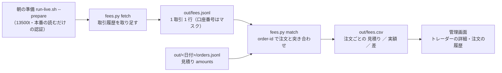

# 約定後の実際の手数料を読む（口座の取引履歴 → 見積りとの突き合わせ）

2026-10-19（月）titan の Claude。利用者の指示「手数料を進めて」（TODO「約定後の実際の手数料を読む」。2026-09-25 の推す案 ＝ 「10/20 の判定の後に `/accounts/{n}/transactions` を sandbox で確かめてから入れる」。依存していた 20 営業日の判定は 10/7 に閉じた）。

## 1. 目的・背景

- 執行器は注文ごとに金額の内訳 `amounts` を残すが、手数料は **発注前の dry-run が返す見積り**（`fee_source: "dry_run_estimate"`）。その見積りがその人の売買履歴（`fees_usd`・`history[].fee`・`ledger.jsonl`）と物差し B・差 2 に入っている
- 実際に口座から引かれた手数料（手数料 ・ 清算費 ・ 規制費）は、口座の取引履歴 `GET /accounts/{n}/transactions` にしか無い。公式リファレンス（developer.tastytrade.com `openapi/transactions.json`。2026-10-19 に読んだ【公表値】）: 1 取引 1 行で `order-id`・`commission`・`clearing-fees`・`regulatory-fees`・`proprietary-index-option-fees`・`other-charge`（それぞれ `*-effect` ＝ Credit ／ Debit ／ None）・`is-estimated-fee`・`executed-at`・`transaction-date`・`transaction-type`・`transaction-sub-type`・`price`・`quantity`・`net-value`。頁は `page-offset` ／ `per-page`（既定 250・最大 2000）・`pagination.total-pages`。日ごとの合計 `GET /accounts/{n}/transactions/total-fees?date=`
- 金額は 1 注文 $0.001〜$0.01 級【実測 live-trading.md §0-3・§1】＝ 判定には効かないが、「保存した内訳が見積りのまま」を閉じる

## 2. 対応方針（推す案。⚠ 執行器は変えない）

| # | 決めごと（推す案） | 理由 |
| ---: | --- | --- |
| 1 | **読むだけの後処理 `fees.py`**（`yardstick.py`・`launchlog.py` と同じ型）。執行器（`run_day.py`・`execute.py`）・売買履歴（`state/`）は触らない ＝ 売買履歴の `fees_usd` は見積りのまま。実額の正本は `out/fees.jsonl`（取引履歴の写し）と `out/fees.csv`（注文ごとの突き合わせ） | 執行器の変更は 11/4 の後（K6）。読むだけの段なら本番に効く道を増やさずに「デプロイ」できる。cron の読む仕事が売買履歴を書き換えるのは危ない |
| 2 | 突き合わせの鍵は **`order-id`**（執行器の `submitted.order_id` ＝ 1 注文 1 トレーダー）。鍵の無い取引（口座で人が売買したもの・配当）は「売買履歴の外」として `fees.csv` に別に数える | 推測で誰かに割り振らない（§0-8 と同じ） |
| 3 | 実額 ＝ `commission` ＋ `clearing-fees` ＋ `regulatory-fees` ＋ `proprietary-index-option-fees` ＋ `other-charge` ＋ `currency-conversion-fees`。`*-effect` が Debit なら正・Credit なら負・None は 0。`is-estimated-fee = true` の行は「仮」の印（確定したら次の取得で上書き） | 執行器の `fee_total_usd` と同じ向き（払う額が正） |
| 4 | 取りに行く範囲: 前回の最後の `transaction-date` の **前日**から今日まで（初回は `out/` の最初の注文の日 ＝ 2026-09-23）。`transaction-type = Trade` だけ。頁は 250 ずつ全部。同じ `id` は上書き（仮 → 確定） | 入金・利息などは手数料の話ではない（記録しない）。取り直しは同じ行に収束する |
| 5 | 朝の準備（`--prepare`）の最後（`yardstick.py` の後）に `fees.py fetch` → `match`。失敗しても rc は変えない（起動の記録の段 `fees` に残す） | 市場の時間の外・本番の読むだけの認証（`TT_PROD_*`。発注の許可は要らない）。売買の回には足さない |
| 6 | 管理画面: トレーダーの詳細の「手数料（差 2）」に **見積り ／ 実額**（実額が揃った注文の数も）・注文の履歴に実額の列・月の小計に実額。`fees.csv` が無ければ今までどおり | 数字の正本は `fees.csv`（管理画面は写すだけ） |
| 7 | 確かめ方: ① sandbox（cert）で取引履歴の形を見る（9/21・9/22 の `test_a` の往復が残っているはず）② 本番の読むだけの照会で 9/23〜 の実額を 1 度取り、見積りとの差を記録に書く（titan。⚠ `out/` には書かず `--print`） | 9/25 の決めごと「sandbox で確かめてから」 |

⚠ 先に指摘するもの: 本番の取引履歴の照会は**読むだけ**（発注の許可は不要・`allow_prod_orders=False`）。応答の口座番号・ID は `Masker` を通す。titan の `live.sqlite` は 9/25 で止まった写しなので、titan では `out/` に書かない（`--print` だけ）。

## 3. Phase と Step

| Phase | Step | 中身 | 確かめ |
| --- | --- | --- | --- |
| 1 API の確認 ✅ | 1-1 | `ttclient.Client.list_transactions`（頁を全部めくる）・`get_total_fees` | モックで頁 2 枚・`per-page` と `page-offset` の渡し方のテスト |
| | 1-2 | sandbox（cert）で 9/21・9/22 の往復の取引を読む → 形（`order-id` が入るか・`is-estimated-fee`・内訳）を記録 §0-16 へ | 【実測】 |
| | 1-3 | 本番の読むだけの照会で 9/23〜10/19 の `Trade` を読み、注文の `order_id` と突き合わせて見積りとの差を出す（`--print`。書かない） | 【実測】を記録 §1 の注記へ |
| 2 fees.py ✅ | 2-1 | `fetch`（範囲・頁・マスク・`out/fees.jsonl` へ上書き追記）／ `match`（`orders.jsonl` × `fees.jsonl` → `out/fees.csv`）／ `--print` | テスト: 偽のクライアント・突き合わせ・符号・仮の印・鍵の無い取引・何度流しても同じ |
| | 2-2 | `run-live.sh --prepare` の最後に足す（段 `fees`・失敗しても rc は変えない） | `./run-tests.sh` |
| 3 管理画面 ✅ | 3-1 | トレーダーの詳細のタイル・注文の履歴の列・月の小計（`fees.csv` を読むだけ。無ければ今までどおり） | `dashboard/tests` に 2 本 |
| 4 記録 ✅ | 4-1 | `live-trading.md` §0-15 の行を ✅ に・§0-16「手数料の実額」（取引履歴の形・差の【実測】）・`dashboard.md`・`glossary.toml` の「手数料」・CLAUDE.md・TODO → push | — |
| 5 デプロイ | 5-1 | ⚠ 利用者の「デプロイ」（Sx360）→ 翌朝の `--prepare` で `fees.jsonl` ／ `fees.csv` ができる → 管理画面で見える | 13500t |

## 4. 影響範囲・手間・危ないところ

- 触るもの: `experiments/tastytrade-api-sample/ttclient.py`（読むだけの 2 本）・`experiments/live-trading/fees.py`（新）・`run-live.sh`（朝の準備に 1 段）・`dashboard/app/live.py` ＋ テンプレート・テスト・文書。⚠ 執行器・売買履歴・mock_server・黄金の集計値は触らない
- 手間【推測】: Phase 1 30 分・Phase 2 2〜3 時間・Phase 3 1 時間・Phase 4 30 分
- 危ないところ: 本番の照会の失敗を繰り返すと IP が約 8 時間ブロックされる（`authenticate` の注記）＝ 朝の準備で 1 度だけ・401 は再試行しない ／ 取引履歴が約定の当日に確定しないことがある（`is-estimated-fee`）＝ 仮の印を出し、次の朝に上書き

## 5. 結果（✅ 2026-10-19 18:40〜19:50 PDT・titan。⚠ ここから下は結果を見て書いた）

- sandbox（cert）は取引履歴を**全期間で 0 件**返した（9/21・9/22 の往復も無い）＝ 「sandbox で確かめる」は形の確認にならず、本番の読むだけの照会（発注の許可なし）で確かめた。
- 本番 9/20〜10/19 ＝ 63 件（Trade 58・規制費の精算 4・入金 1）。**注文 1 本 ＝ 取引 1 行**（`order-id` が一意）。1 行の手数料は dry-run の見積りを $0.001 に丸めた値（T1 の 6 本 ＝ 見積り $0.0182 → 実額 $0.0180）。`is-estimated-fee` は 58 行とも true のまま。規制費の精算は週 1 回の Balance Adjustment（9/26 ＋0.017・10/3 ＋0.019・10/10 −0.067・10/17 −0.015）で注文に紐づかない ＝ `kind = adjustment`。日ごとの `total-fees` は行の合計と一致。
- 入れたもの: `ttclient.list_transactions` ／ `get_total_fees`・`fees.py`（fetch ／ match ／ print）・`run-live.sh --prepare` の段 `fees`・管理画面（タイルの脚注・注文の履歴の列「手数料 $」・月の小計・概要の凡例）・テスト（執行器 5 本・管理画面 2 本）・記録 `live-trading.md` §0-16・`dashboard.md` §13-2・用語「差 2」・CLAUDE.md。
- 残り: Phase 5 ＝ ⚠ 利用者の「デプロイ」（Sx360）→ 翌朝 06:00 PDT の `--prepare` で `fees.jsonl` ／ `fees.csv` ができ、10/8 以降の注文（T1・T4・T6）と 10/7 の手じまい（outside）が初めて当たる。
