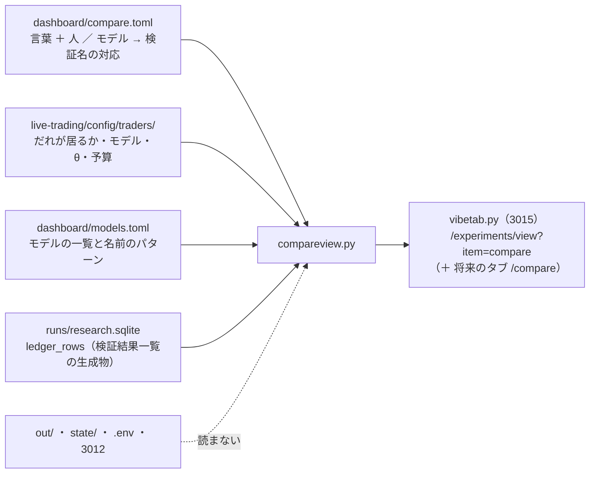

# 既存のモデルとトレーダーの検証結果を比較できるように表示する（外部のタブ「実行」の 1 ページ）

作成 2026-10-22（titan の Claude）。✅ **同日に完了して archive へ**（結果は §4）。利用者の指示（2026-10-22）: **「既存のモデルとトレーダーの検証結果を比較できるように表示して」**。

## 0. 目的・背景

- 机上の検証結果（検証結果一覧 ＝ 研究の DB `ledger_rows`）は 954 行あり、モデルやトレーダーごとに読むには記録（`threshold-trading.md`・`trader-shaped-validation.md`・`horizon-roles-trader.md` …）を行き来するしかない
- 外部のタブ「予測モデル」「トレーダー」は**やさしい言葉の解説**で、利用者の指示（2026-09-20）により **見くらべる表・順位・ほかの人とくらべる文を置かない**（テストの `COMPARING`）。この決まりは変えない
- そこで、**研究の側のタブ「実行」に、比較のための 1 ページ**を足す。数字は全部 DB から引き、1 つも手で写さない

## 1. 対応方針

> この図の主張: 比較のページは **読むだけ**。モデルとトレーダーがどの行かを書いた TOML 1 本と、研究の DB だけを開く。

| 決めごと | 中身 |
| --- | --- |
| 置き場 | 外部のタブ「実行」の目次の 2 番目「モデルとトレーダーの比較」（`/experiments/view?item=compare`）。同じ中身をタブの接頭辞 `compare`（`/compare/view?item=all`）でも出す ＝ project-manager の `projects.yaml`（このリポジトリに無い）に新しいタブを足せばそのまま使える |
| 数字の出どころ | **全部 `ledger_rows`**（`leak = 0`・`is_trial = 1`）。上乗せ bp/fold・fold の符号・判定・閉じる注記・実行日。⚠ 手で写す欄は 1 つも無い |
| 対応の正本 | `dashboard/compare.toml`: トレーダーごとに **素の形の検証名**（`base`。予測モデル名 ＋ `@θ`）と **トレーダーの形の綴り**（`shape` ＝ `names.toml` の `[trader]` ＝ `tr5` ／ `tr5-600`）。5 本 ／ 全銘柄の行の名前は `shape` を 2 つ目の部品に差し込んで機械で作る（`own.all.ridge.shared@50` → `own.all-tr5.ridge.shared@50` ／ `own.all-trall.ridge.shared@50`）。モデルは `[[model]]` の `base`（θ を除いた予測モデル名の一覧）だけ任意で書く。書かないモデルも `models.toml` の経緯のパターンから試した数と上乗せが最大の形を出す |
| 3 つの表 | ① トレーダー（本番の人 ＋ 候補の人。識別名の数の順）＝ 使うモデル ／ θ ／ 素の形（対 B&H）／ 5 本・予算（対 持ち続ける）／ 全銘柄（対 持ち続ける） ② 予測モデル（`models.toml` の全部）＝ 使う人 ／ 試した数（採る ／ 保留 ／ 落とす）／ 素の形 θ 50 ／ 55 ／ 60 ／ 上乗せが最大の形 ③ 人のいないトレーダーの形（DB にある `〔トレーダー・…〕` の行のうち、①で使わなかったもの） |
| 並べ替え | 列の見出しを押すとその列で並べ替える（ページの中の小さな JS。外部リソースなし）。既定の並びは識別名の数の順 ／ `models.toml` の順 |
| 守ること | ⚠ **成績で人を選ばない**（CLAUDE.md）＝ ページの頭に注意を出す ／ ⚠ 売買結果（損益・注文）は出さない（3012 の管理画面の仕事）／ ⚠ `out/`・`state/`・`.env` を読まない ／ 「予測モデル」「トレーダー」のタブの決まり（くらべない）は変えない ＝ そちらからこのページへのリンクも置かない |

## 2. 影響範囲

- 新規: `dashboard/compare.toml`・`dashboard/compareview.py`・`dashboard/tests/test_compare_tab.py`
- 変更: `dashboard/traderview.py`（`TraderPaths` に `compare`・`names` の道）・`dashboard/vibetab.py`（実行タブの目次と view・タブ `compare`・見張り）・`dashboard/tests/test_vibetab.py`（目次の検査 1 本）・`dashboard/README.md`・`docs/specs/dashboard.md` §19・`CLAUDE.md`
- 触らないもの: 研究の側（`cli.report`・`ledger_rows` の形・`catalog.py`）・管理画面（3012）・実売買の設定・`models.toml`・`traders.toml`

## 3. テスト方針

- 小さな DB（`ledger_rows` と同じ列・`doc` に JSON）と最小の置き場で: 人の 3 つの条件が出る ／ 行の無い条件は「—」／ 閉じる注記の印 ／ 設定に居ない人・対応の無い人の扱い ／ モデルの θ の列と試した数 ／ 人のいない形の表 ／ 経路（`/experiments/view?item=compare`・`/compare/…`）／ 指紋が `compare.toml` の変更で動く
- 本物の DB がある機械で: `compare.toml` の人の集合 ＝ 実売買の設定の人の集合（候補を含む）／ 宣言した素の形と機械で作った 5 本 ／ 全銘柄の名前が DB に 1 行ずつある ／ モデルの `base` が DB にある
- 既存の `./run-tests.sh --fast`

## 4. 結果（2026-10-22 16:30 PDT・titan）

| 項目 | 結果 |
| --- | --- |
| 置き場 | 外部のタブ「実行」の目次の 2 番目「モデルとトレーダーの比較」（`/experiments/view?item=compare`）。接頭辞 `compare` でも同じ中身（`/compare/view?item=all`）。3015 を入れ直して 200【実測】 |
| 対応（`compare.toml`） | 人 19（T1〜T6・T7〜T10・T12〜T19。T2・T3 は外した注記つき・T6 は 1995 ／ 2018 の 2 形）・モデル 21（うち `base` あり 19・`none` 1 ＝ cGAN・残りは経緯のパターンだけ ＝ GAN 増強・門 2 種） |
| DB との突き合わせ | 宣言した素の形と機械で作った 5 本 ／ 全銘柄 ＝ 20 形 × 3 ＝ 60 行、モデルの `base` 29 本の θ 50 ＝ 全部 DB にある（`test_real_mapping_rows_exist_in_the_db`）。人のいない形の表 ＝ 7（D2 us74・F1-7・R1b〜R4b・R5） |
| テスト | `tests/test_compare_tab.py` 9 本 ＋ `test_vibetab.py` の目次の検査 1 本を直した。`./run-tests.sh --fast` ✅（執行器 ／ 管理画面 290） |
| 触っていないもの | 判定・数字・検証結果一覧・`catalog.py`・研究側のコード・実売買の設定・`models.toml`・`traders.toml`・「予測モデル」「トレーダー」のタブ |
| 見送ったもの | project-manager の `projects.yaml` へのタブの追加（このリポジトリに無い・Sx360 側の設定 ＝ 利用者）。足すなら baseUrl を `…:3015/compare` に |
