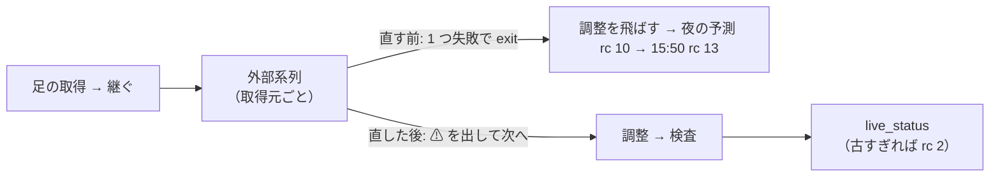

# 外部系列（ECB）の取得が失敗しても日足の調整まで進め、夜の予測を止めない

利用者の指示（2026-11-03）: 「直して」（Sx360 が見つけた件 ＝ TODO の子「外部系列（ECB）の取得が失敗しても…」）

## 目的・背景

`experiments/feature-discovery/live_update.sh` は `set -euo pipefail` で、外部系列の取得（`cli.fetch --exog exog_live`）が 1 つでも例外で落ちると、
後の取得元（treasury ／ noaa ／ usgs）も、調整（`adjusted`）・検査・「どこまで入ったか」も飛ばして rc ≠ 0 で終わる。

夜の予測（`run-live.sh --predict-only`）は更新の rc が 0 ／ 2 以外だと予測しない（rc 10・印を書かない）→ 朝の回し直しでも ECB が落ちていれば同じ → 15:50 ET は rc 13 ＝ 全員がその日は発注しない【推測】。
ECB は 500 ／ 503 ／ 504 を返す日がある【実測 朝の準備 約 27 回中 6 回・2026-11-03 Sx360】。

外部系列はもともと「ずらし 1 ＋ 引き継ぎ 7 日」まで古くても使える作りで、古すぎるかは `cli.live_status` が見る（rc 2）。止まるのは `live_update.sh` の作りだけ。

今の流れ（ECB が落ちた日）と、直した後の流れ:

## 対応方針

1. `live_update.sh`: 外部系列を **取得元ごとに 1 回ずつ**（`--source <取得元>`・取得元の並びは `config/dataset/exog_live.toml` の `source =`）取り、失敗は ⚠ の 1 行を出して次の取得元 → 調整へ進む。最後に「取得に失敗した外部系列: …」の 1 行。rc は今までどおり `live_status` が決める
2. 緩めるのは外部系列の取得だけ。足の取得・継ぎ・調整の失敗は今までどおり止まる
3. `run-live.sh --prepare`: rc 0 でも外部系列の失敗があれば、その 1 行を起動の記録の note に残す
4. テスト `experiments/feature-discovery/tests/test_live_update.py`（python を偽物に差し替える口 `AIL_LIVE_UPDATE_PY`。ネットワークなし）

## 影響範囲

- 本番の経路（13500t の朝の準備・夜の予測・`--same-day`）＝「デプロイ」が要る。今夜 17:30 PST に効かせるなら 13:15〜17:00 PST のデプロイ
- 予測・執行器・研究の `data/` は触らない。外部系列が古いときの扱い（`ex_max_stale_days`）も変えない
- `check.sh` から見ると、ECB だけ落ちた朝の準備は rc 1 → rc 0 になる（外部系列が古すぎれば rc 2）

## テスト方針

- 新しいテスト 5 本（ECB 失敗でも残りの取得元・調整・検査・live_status まで進む ／ rc は live_status の rc ／ 失敗なしなら ⚠ なし ／ `--no-exog` ／ 調整の失敗は止まる）
- `./run-tests.sh`

## Step

- [x] Step 1: `live_update.sh`・`run-live.sh` ・テスト
- [~] Step 2: 「デプロイ」（✅ 2026-11-03 08:03 PST `prod` 21554e1）→ 次に ECB が落ちた日に、夜の予測が印を書くこと・朝の準備の note に ⚠ が出ることを見る（Sx360）
