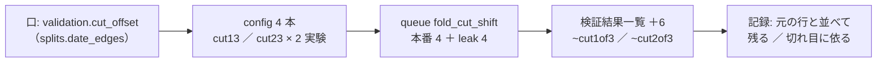

# 評価期間の切れ目をずらして保留の行を測り直す

2026-11-11 Sx360（利用者「今日のアイデアメールにあった…が気になる」→「推す案で進めて」）。⚠ 実装と実行は titan の Claude（研究の DB と計算）。Sx360 では事前固定とプランまで。

## 1. 目的・背景

開発ループの段 1（2026-11-11 01:03 PST・参考なし・$0.585【実測】）が出した案。登録簿は [`20261111-fold-cut-shift`](../../../experiments/feature-discovery/config/ideas/20261111-fold-cut-shift.toml)・状態「人の手」（共有の経路を触るので運転手は自動で作らない）。

問い: 保留の行の「平均だけ正」は、5 つの評価期間の切れ目がたまたまどこに置かれたかで決まっているのか。

切れ目は `splits.date_edges` が「表の日付を 6 等分」で 1 通りに決めていて、置き方への依り方は 1 度も測っていない。

## 2. 対応方針

決めごとの正本は [rules.md 33 章](../../specs/experiments/feature-discovery/rules.md)（⚠ 結果を見る前に書いた）。登録簿が決めていなかった 3 つを、利用者「推す案で」で固定した。

| 決めたこと | 中身 |
| --- | --- |
| 当てる行 | 2026-11-11 の選ぶ段の上位 3（F1-7 ／ F2-2 の 1995 年からの表・M1 3 本の平均。どれも θ 50）。入れ替えない |
| ずらす向き | 後ろへ 1/3 ／ 2/3。fold は 5 つのまま・最後の評価期間が縮む・訓練は減らない |
| 読み方 | 行ごとに「残る ／ 切れ目に依る」。⚠ 新しい証拠ではなく頑健さの確かめ ＝ 残っても採る根拠にしない |

> この図の主張: 口を 1 つ足し、元の config の写し 4 本を queue で回し、元の行と並べて読む。既存の行は動かない。

数: n_trials ＋6（1,166 → 1,172。先にほかの実行が入ればその数から）。手間: 実装とテストで半日弱・回すのは数分〜十数分【推測】。

## 3. 影響範囲

- `experiments/feature-discovery/ail/validation/splits.py`（`date_edges` に任意引数・`cut_offset(v)` の読み手）
- 切れ目の呼び手: `cli/run.py`（本体と `_mix_prepare` ＝ メンバーは持ち主のずらしで切る）・`ail/validation/gate.py`・`cli/calibdiag.py`・`cli/null_shuffle.py`・`cli/planted_power.py`
- `ail/catalog.py`（`threshold_style` に変種）・`ail/names.py` ＋ `config/names.toml`（`~cut1of3` ／ `~cut2of3`）
- config 4 本 ＋ `config/queue/fold_cut_shift.toml`
- ⚠ `splits` ・ `cli/run.py` は 13500t の毎日の予測（`cli/predict.py`）も通る経路 ＝ 項目の無い config は 1 ビットも変わらないこと。本番に出るのは次の「デプロイ」のとき（急がない）
- 検証結果一覧の既存の行・判定・閉じる注記は 1 行も変わらない

## 4. テスト方針

- 口が無ければ `date_edges` の戻り値が今までと同じ（既存の表で 1 ビット）
- `"1/3"` ／ `"2/3"`: fold 1〜5 の初日が L_g × 分子 ÷ 分母（切り捨て）個ぶん後ろ・最初と最後の端は不変・fold は 5 つ・評価期間は重ならず隙間も無い
- `"1/2"`・数・空は拒む
- 門と本体が同じ切れ目を使う
- 合わせる口: 持ち主にずらしがあればメンバーも同じ切れ目・違えば止まる
- 検証方式の変種と名前（項目の無い config は「閾値売買」のまま・`~cut` が付かない）
- 既定経路の指紋 `tests/test_trading_run.py`・`tests/test_predict.py`・`./run-tests.sh`
- 回す前に検証結果一覧を吐き直して差 0 行

## 5. Phase

- [x] Phase 0: 事前固定（rules.md 33 章）・プラン・TODO（Sx360）
- [x] Phase 1: 口 ＋ 変種 ＋ 名前 ＋ テスト（2026-11-11 titan。`tests/test_cut_offset.py` 27 本・研究側 pytest 850 本 ✅）
- [x] Phase 2: config 4 本 ＋ queue・`register --promote`・検証結果一覧の差 0 行を確かめてから `cli.queue --config fold_cut_shift`（titan）
- [x] Phase 3: 記録（`docs/specs/experiments/fold-cut-shift.md` ＝ 元の行と並べた fold の表・残る ／ 切れ目に依る・予想の当たり外れ）・rules.md 33 章に適用例・dev-loop.md に 1 行
- [x] Phase 4: CLAUDE.md に 1 節・DONE へ・プランを archive へ。⏳ 利用者: 選ぶ段の物差しに「切れ目ずらしで残ること」を足すか（結果が「切れ目に依る」だったとき）

## 6. 結果（2026-11-11 08:43〜08:46 PST・titan）

- 採る 0 ／ 保留 2 ／ 落とす 6（n_trials 1,166 → 1,174）。当てた 3 行は 3 行とも「切れ目に依る」。記録は [fold-cut-shift.md](../../specs/experiments/fold-cut-shift.md)
- ⚠ 数は ＋6 ではなく ＋8（合成のメンバーとして回る持ち主の「全部使う」が、変種の検証方式で新しい識別項目になる。回す前に rules.md 33-2 に追記した）
- ⚠ 着手時に見つけた別件: `tests/test_catalog.py` の閉じる注記の数の釘付けが 149 のまま（11/7 の棚卸しで 167）で落ちていた → 167 に直した（判定・注記は触っていない）
- ⏳ 利用者: 選ぶ段に「切れ目ずらしで残ること」を併記するか（TODO に残した）

