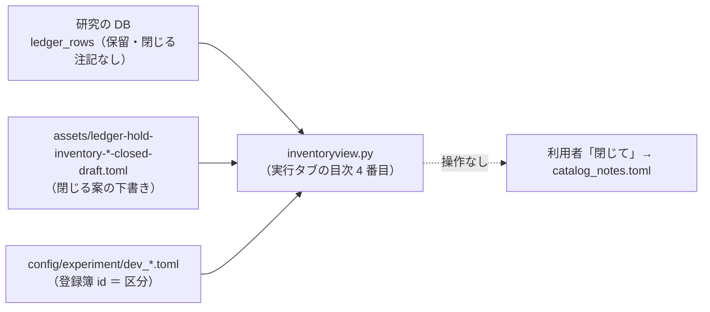

# 外部のタブ「実行」に「棚卸し」のページを足す

利用者（2026-11-07）: 11 月の棚卸しの案に対して「どこかで結果を確認できる方法が欲しい。メール送信以外で何かよい案を出して」→ 案 A（外部のタブ「実行」に 1 ページ）に「A で進めて」。

## 1. 目的・背景

- 月 1 回の棚卸し（rules.md 31 章・[daily-dev-loop.md](../daily-dev-loop.md) 4-4）は「区分・行数・案」を見て利用者が「閉じて」と決める。いまは案が markdown（`docs/specs/experiments/ledger-hold-inventory-*.md`）にしか無く、いつもの画面で見られない
- 画面は研究の DB から **いつ開いても最新** を出す（文書は書いた時点の固定）

## 2. 方針

> この図の主張: 画面は DB と下書きを読むだけ。閉じるのは今までどおり利用者の「閉じて」→ Claude が `catalog_notes.toml` に貼る。

| 項目 | 中身 |
| --- | --- |
| 置き場 | `dashboard/inventoryview.py`（標準ライブラリだけ・読むだけ）。実行タブの目次「まとめ」の 4 番目 `item=inventory`・接頭辞 `/inventory` でも同じ中身（compare ／ devloop と同じ作り） |
| 出すもの | 頭: 保留の総数・閉じる注記つき・注記なし・下書きで「閉じる」案の行数・検証結果一覧を DB に入れ直した時刻 ／ 区分の表（区分・行・上乗せの幅・fold の正の数・案〔閉じる n ／ 残す n〕・最初の実行）／ 行の表（区分・検証名・手法・θ・上乗せ・fold・並べ替え分位・並べ替えp・案〔下書きの注記の種別〕・最初の実行）／ 文書と下書きの一覧（道） |
| 区分 | `cli.select_candidates.group_of` の写し（開発ループの行 ＝ 実験 config の頭の「登録簿 `<id>`」・`dev_tr_*` ＝ 机上の持ち越し・それ以外 ＝ 実験名の末尾 `_t14` などを落とした族）。⚠ 研究側と同じ結果になることをテストで見る |
| 案 | 下書き（`docs/specs/experiments/assets/ledger-hold-inventory-*closed-draft.toml`）の `[[closed]]` の照合キー（`catalog._CLOSED_FIELDS` の写し）が、注記なしの保留の行に当たれば「閉じる（種別）」・当たらなければ「残す ／ 案なし」 |
| 変えないもの | 判定・`n_trials`・研究の DB（読み取り専用）。操作の経路は足さない（閉じるのは利用者 → Claude） |

## 3. 影響範囲

- `dashboard/inventoryview.py`（新）・`dashboard/traderview.py`（`TraderPaths` に `experiment_dir`・`inventory_dir` を足す。既定は今の置き場・環境変数で差し替え）・`dashboard/vibetab.py`（目次・経路・見張り）・`docs/specs/dashboard.md` §21・テスト `dashboard/tests/test_inventory_tab.py`
- 3015（`vibetab.py`）の起こし直し（tmux `pm-ai-income-lab-app` に C-c → Enter）

## 4. テスト方針

- 注記なしの保留だけが出る（閉じた・落とす・採る・leak・基準線は出ない）
- 区分の写しが研究側の `group_of` と同じ（開発ループの config の頭・`_t14` を落とす）
- 下書きの `[[closed]]` が当たる行は「閉じる（種別）」・当たらない行は「残す」・既に閉じた行に当たる古い下書きは数えない
- 目次に出る・`/experiments/view?item=inventory` と `/inventory/view?item=all` が同じ中身・見張りの指紋が DB と下書きの時刻で動く

## 5. Phase

- [x] Step 1: `inventoryview.py` ＋ `TraderPaths` ＋ vibetab の配線 ＋ テスト
- [x] Step 2: dashboard.md §21・3015 の起こし直しと本物の DB で表示の確認
