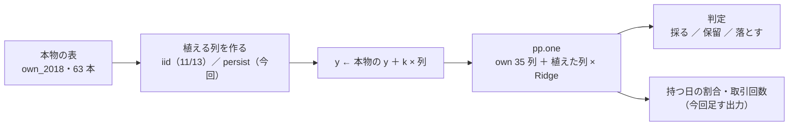

# 開発ループ: 何十日も続く信号を植えて検出力を測る（`20261114-persist-signal-power`）

2026-11-14 14:4x PST titan（利用者「1 と 2 を進めて」の 2）。

## 1. 目的・背景

- レジストリの案 `20261114-persist-signal-power`（11/14 の晩のステージ 1・参考あり・枠の外・`p_hold` 0.6）。
- 11/13 の植え込み（`cli/inject_power.py`）は **日ごとに独立な信号** だけを測った。結果は検出限界の 10 倍（8.3 bp/日）でも「採る 0% ／ 保留 0%」（[dev-loop.md §13](../../specs/experiments/dev-loop.md)）。契約 §2 には「何十日も続く信号（相場の局面）の検出力は測っていない」と書いてある。この案はその空白を埋める。
- ステージ 2 でもサンドボックスでも作れない（数える検証 0 本の診断で実験 config が無い ＝ `sandbox_skip`）。11/6 の `cli.planted_power`・11/13 の `cli.inject_power` と同じく手動で作る。

## 2. 対応方針

`cli/inject_power.py` に信号の種類 `persist` を足す。既定は今の `iid`（日ごとに独立）のまま ＝ 既存の結果は 1 ビットも変わらない。

この図は「変えるのは植える列の時間の並びだけで、読み手・シミュレーター・判定は 11/13 と同じ」を示す。

### 2-1 レジストリの `structure` の読み（⚠ 回す前に固定。結果を見て動かさない）

| 項目 | 読み |
| --- | --- |
| 2 状態マルコフ連鎖 | 対称。状態は ±1。1 日ごとに確率 1 ／ L で反対の状態へ移る（＝ 期待滞在 L 営業日）。最初の状態は ±1 を半々で引く |
| 期待滞在 L | 20 ／ 60 営業日 |
| 列の単位「全銘柄に共通」 | 表の日付（昇順・重複なし）の上に連鎖を 1 本作り、その日の全銘柄の行に同じ状態を置く |
| 列の単位「銘柄ごとに独立」 | 銘柄（名前の昇順）ごとに、その銘柄の行（日付の昇順）の上に別の連鎖を作る。行の無い日は飛ばさず詰めて数える |
| 植え方 | 列 `own_planted` ＝ 状態（±1）。`y` ← 本物の `y` ＋ k bp × 状態（訓練と評価の両方。11/13 は k × 列の符号 ＝ 同じ大きさ） |
| 強さ k | 11/13 と同じ検出限界 L₀ ＝ 300 bp/fold ÷ 評価期間の営業日数の平均。k ＝ L₀ の 0 ／ 0.1 ／ 1 ／ 10 倍（0 ＝ 列は足すが `y` は本物のまま） |
| 乱数 | `default_rng([種, 20261114, L, 単位の番号])`。種が同じなら k をまたいで列は同じ（対の曲線） |
| 読み手・判定 | `cli.planted_power.one` をそのまま（素の own × Ridge ＝ `全部使う（基準）`・θ 50 ／ 55 ／ 60・種 5・費用 5bp・対 B&H・採る ＝ 平均 > 0 で fold 全部が正） |
| 対の相手 | 同じ k の日ごとに独立な植え込み。同じ実行の中で `iid` を回し直して並べる（k 0.1 ／ 1 ／ 10 倍。既存の項目は 11/13 の保存した出力と一致することを確かめる） |
| 出すもの | 採る ／ 保留 ／ 落とすの割合・上乗せ bp/fold・買い% と列の相関・**持つ日の割合**（評価の行のうち持っていた行の割合）・**取引回数**（建てた回数の全銘柄の合計 ／ fold）・評価の行のうち状態 ＋1 の割合 |

- 回数: persist ＝ 単位 2 × L 2 × k 4 × θ 3 × 種 5 ＝ 240 回。対の相手の iid ＝ k 3 × θ 3 × 種 5 ＝ 45 回。合計 285 回・約 4 分【推測（11/13 は 45 回 34 秒【実測】）】。
- ⚠ 検証結果一覧に行を作らない・`n_trials` に数えない・`runs/` を作らない（偽の信号の行 ＝ leak 対照・基準線と同じ扱い）。`--save` で DB の `outputs` の `diag/<時刻>_inject_power_persist/` に JSON を入れる。

### 2-2 予想（レジストリの `prediction` の写し）

全銘柄に共通・10 倍の段で保留以上が半分を超える。1 倍の段は 1 割以下、0.1 倍は k = 0 と区別できない。銘柄ごとの局面は共通より低い。L 20 と L 60 の差は小さい。θ 60 は幅が足りず持つ日がほぼ 0 の行が出る。

当たり方の読み: 「保留以上が出た」＝ persist の 36 組（k > 0）のどれかで、保留 ＋ 採るの割合が 50% 以上（`p_hold` 0.6 に対して）。⚠ 数える検証が無いので `register.md` の当たり方の集計には入らない（記録の文にだけ書く）。

## 3. 影響範囲

- `experiments/feature-discovery/cli/inject_power.py`（種類 `persist`・`--kind`）
- `experiments/feature-discovery/cli/planted_power.py` の `one` に任意の引数 `detail`（既定 False ＝ 戻り値は今までと同じ項目）
- 共有コード（`ail/`・`cli/run.py`・`cli/build.py`）は触らない。研究の DB の検証結果一覧・`n_trials`・判定は変わらない。13500t の毎日の売買の経路には触れない

## 4. テスト方針

- 連鎖: ±1 だけ・種で決まる・長い連鎖の平均滞在がおよそ L
- 共通: 同じ日は全銘柄が同じ状態 ／ 銘柄ごと: 銘柄で違う。`y` の差 ＝ k × 状態・k 0 は本物の `y` のまま・種が同じなら k をまたいで列は同じ
- `pp.one` の `detail`: 既定では項目が増えない・`detail=True` で持つ日の割合と取引回数が出て、上乗せと判定は同じ
- 回帰: `--kind iid`（既定）の出力が 11/13 の保存した出力と一致（`seconds` を除く）
- `tests/test_ideas_20261113.py`・devloop のテストが通る

## 5. Step

- [x] Step 1: 実装 ＋ テスト（`tests/test_inject_persist.py` 7 本・既存と合わせて 21 本 ✅）
- [x] Step 2: 回帰（iid が 11/13 の保存した出力と一致）→ `--kind persist --save`（285 回・219 秒【実測】・14:40〜14:44 PST）
- [x] Step 3: 記録（[dev-loop.md §15](../../specs/experiments/dev-loop.md)・レジストリを「回した」・`register.md` の再生成）→ DONE・archive

## 6. 結果（2026-11-14 14:47 PST）

- k > 0 の 36 組のうち保留以上が出たのは 1 組（共通・L 60・10 倍・θ 55 ＝ 保留 20%）・採る 0 ＝ 予想（共通・10 倍で保留以上が半分超）は外れ。
- ⚠ 事後に足した読み（§2-1 の外）: 学習器を通さず局面そのものを買い% にする `--kind oracle`。10 倍は 4 種類とも保留以上 100%・1 倍以下は上乗せの平均が負（落とす 80〜100%）・損益分岐 k ≈ 3.4〜5.1 bp/日 ＝ 拾えなかったのは読み手で、シミュレーターと判定ではない。
- ⚠ `register --promote` が `registered_at` を 14:47（回した後）に打ち直したので、晩の登録の時刻 01:02 PST に手で戻した。
- ✅ 2026-11-14 15:1x PST 利用者「推しで進めて」＝ ステージ 1 の契約を版 4 にした（§2 の「続く信号の検出力は測っていない」の行を実測に替えた・項目は増やさない・rules.md 31-6 の 6・11/15 の晩の案から）。
