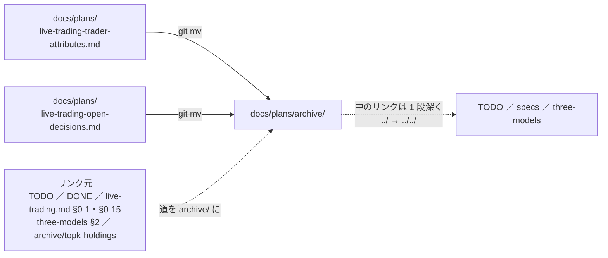

# 済んだプラン 2 本を archive へ・11/4 の判定の雛形

2026-10-20（火）21:30 PDT・titan の Claude。利用者「4」（「やるべき作業を見繕って」への答えの 4 ＝ 決定なしでできる片付け）。✅ 同日に済ませた（文書だけ ＝ デプロイは要らない）。

## 1. 目的・背景

- `docs/plans/` に、中身が全部済んだプランが 2 本残っていた
  - `live-trading-trader-attributes.md`（B6 ＝ 実際に動かす 3 人の属性。TODO の子 Step 1〜5 は全部 ✅・2026-09-21 に確定）
  - `live-trading-open-decisions.md`（2026-09-25 の「残りの決めごとを推す案で決める」。全部決まり、残っていた「手数料は 10/20 の後」も別の TODO〔約定後の実際の手数料〕の Phase 5 に移っている）
- 新しい 3 人（`T1` $600・`T4`・`T6`。1 日目 10/8）の 20 営業日の判定は 11/4（水）だが、`live-trading.md` §2 には 2-1（前の 3 人の 8 営業日）しか無く、書く場所と線の出どころが決まっていなかった。⚠ **結果を見る前に**線・出どころ・数え方を書いておく（2-1 と同じ形）

## 2. 対応方針

この図の主張: 動かすのはプラン 2 本だけで、リンクは「外から中へ」と「中から外へ」の両方を直す。

| # | すること | 置き場 |
| ---: | --- | --- |
| 1 | 2 本を `docs/plans/archive/` へ `git mv`。外からのリンク 9 か所と、中のリンク 5 か所（`trader-attributes` だけ。`open-decisions` にリンクは無い）を直す | 上の図 |
| 2 | `live-trading.md` §2-2 ＝ 雛形: 日付の数え方（1 日目 10/8・20 日目 11/4・起動した営業日で数える・11/1 から PST）／ 流れの図（11/4 の回 → 11/5 朝の `yardstick.py` → 写す → 利用者が決める）／ A〜E の線と `yardstick.csv` の列・`--print` の項目・空の結果 ／ 判定の後に利用者が決めること | `docs/specs/experiments/live-trading.md` |
| 3 | TODO の Phase 5 2 か所（trader-loop「分析を回す」・新しいトレーダー「11/4 の後」）に雛形への案内を 1 行ずつ | `TODO.md` |

## 3. 影響範囲

文書だけ。コード・設定・本番の経路は触らない（「デプロイ」は要らない）。`dashboard/models.toml` の `trader-attributes` は文中の名前（`where` ではない）なので触らない。

## 4. テスト方針

- 動かしたリンクを機械で確かめる（Markdown のリンク先の実在。触ったファイルだけ）
- `./run-tests.sh --fast`（外部のタブの `where` がリンク先の実在を見る）
