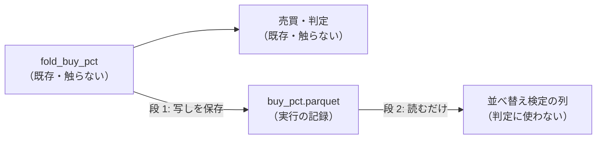
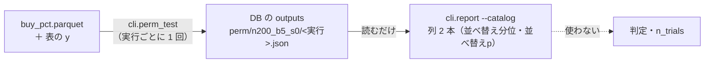

# 実験の行ごとの買い% ／ 出口% を記録に残す（並べ替え検定の物差しの材料）

利用者（2026-11-01）: 登録簿 `20261025-permutation-yardstick`（fold の内側の並べ替え検定）は、実行が買い% を保存していないので既存の行を埋められない、と報告 →「これからでも埋めた方がいいと思うが、なぜ記録を取らない？」→ 2 段で進める案に「進めて」。

## 1. 目的・背景

- いまの実行の記録は判定に要るもの（日次の損益・銘柄別・保有の記録）だけで、売買を回す途中の **買い% ／ 出口% は捨てている**（「取らない」と決めた記録は無い。途中の値の扱いだった）
- 残しておけば、後から別の物差し（並べ替え検定など）で **回し直さずに** 測り直せる。早く取り始めるほど埋められる行が増える

## 2. 方針（2 段）

> この図の主張: 段 1 は保存するだけで判定に触れない。段 2 は保存したものを読むだけ。

| 段 | 中身 |
| --- | --- |
| 1 | `cli/run.py` の fold の後で、その fold の評価分割の (fold, ts, 銘柄) と手法ごとの買い% ／ 出口% を集め、実行の終わりに `buy_pct.parquet` として `runs.Run` に入れる（float64 のまま ＝ 売買を 1 ビットも違わず回し直せる）。leak 対照の実行も同じ |
| 2 | 保存した買い% から、日付の塊（5 営業日）で並べ替えた売買 200 本の上乗せの分布 → fold ごとのパーセント点と合成の p を検証結果一覧の列 2 本に（登録簿の `structure` のまま・判定と n_trials は変えない）。⚠ 段 2 は段 1 の後に別に進める |

## 3. 影響範囲

- 段 1: `cli/run.py`（保存の 1 か所）・`ail/runs.py`（`Run.buy_pct`）。⚠ `fold_buy_pct`・売買・判定・`cli.predict` の経路は触らない ＝ 指紋 `tests/test_trading_run.py`・`test_predict.py`
- 記録の大きさ: 1 実験あたり数 MB 増える【推測 → 段 1 で実測】

## 4. テスト方針

- 保存した買い% から `simulate` を回し直すと、`result.csv` の純利と 1 ビットも同じ（形式 (A) の手法 1 本・θ 1 つで）
- 保存しても既存の出力（result ／ summary ／ daily ／ holds）が 1 バイトも変わらない（指紋テスト）

## 5. 段 1 の結果（✅ 2026-11-01 titan）

- `cli/run.py` の `buy_pct_frame`（fold の後で写しを取るだけ）→ `extra["buy_pct"]` → `ail/runs.py` の `Run.buy_pct`（parquet）・読み手 `runs.read_parquet`。⚠ leak 対照には残さない
- テスト: `tests/test_trading_run.py` に 2 本（保存した買い% から `simulate` を回し直すと `per_symbol.csv` の純利と同じ〔形式 (A) ／ (B)〕・DB への出し入れで表が同じ）。指紋・研究側の関連 94 本 ✅
- 【実測】`dev_roles_entrystop_b10e5`（手法 6 列 × 111,359 行）で **4.2MB**（float64 は圧縮が効かない ＝ zstd 4.2 ／ brotli 3.9MB で差は小さい）。開発ループで 1 晩 6 実験なら 約 25MB【推測】
- ⚠ **測るつもりの 1 回が本物の研究の DB に入った**（`2026-11-01T11-44-53_dev_roles_entrystop_b10e5`。`AIL_RUNS_DIR` を `runs.py` が読まないのを確かめずに流した）。閉じた実行は消せない ＝ 同じ識別項目の回し直しとして残る（n_trials は増えない・検証結果一覧は次の吐き直しで実行一覧に 1 本増える）。中身は 11:06 の回と **result ／ summary ／ per_symbol ／ holds ／ trader ／ daily が 1 バイトも同じ** ＝ 実データでの「保存しても結果が変わらない」の検算になった
- 次: 段 2（並べ替え検定の列）。2026-11-01 以降に回した行だけが埋まる

## 6. 段 2 の設計（2026-11-07 titan・利用者「2 を進めて」。⚠ 結果を見る前に書いた）

> この図の主張: 並べ替えは実行ごとに 1 回だけ計算して DB に置き、検証結果一覧はそれを読むだけ（吐き直しは速いまま・判定には入らない）。

| 決めごと | 中身 |
| --- | --- |
| 並べ替え | 各 fold の評価分割の日付を 5 営業日の塊に切り、塊の順を入れ替える（種 0・200 回）。**全銘柄に同じ日付の入れ替えを当てる**（銘柄ごとの買い% の集まり・保有日率は保つ）。買い% と出口% は同じ行の組で動かす。入れ替え先の日にその銘柄の行が無ければ元の値のまま（数を記録） |
| 器 | `cli.perm_split.fold_net`（`evaluate_trading._row` の素の枝の写し）。元の純利を `result.csv` と突き合わせ、合わない手法（役割つきの組・最短保有など）は出さない ＝ 「—」 |
| 列 1「並べ替え分位」 | fold ごとに、元の fold の上乗せ（純利 − 基準 常に上）が並べ替えの分布の何パーセント点か（0〜100 の整数を `/` でつなぐ。例 `62/48/91/55/70`） |
| 列 2「並べ替えp」 | fold ごとの片側の p ＝（並べ替え ≥ 元 の数 ＋ 1）÷（200 ＋ 1）→ Fisher の合成（χ² 自由度 2 × fold 数）の片側の p |
| 埋める行 | 行の代表の実行（列「実行」）が `buy_pct.parquet` を持ち、手法・θ が再現する行だけ（2026-11-01 以降の実行・leak には無い）。ほかは「—」・回し直さない |
| 置き場 | `cli/perm_test.py`（`--run` ／ `--missing`〔まだ計算していない実行を全部〕）が DB の `outputs` に入れる（上書きしない ＝ 実行は閉じていて変わらない）。`cli.report` は読むだけ（計算しない） |
| 変えないもの | 判定・`n_trials`・既存の列。吐き直しの前後の差は新しい列 2 本だけであることを確かめる |

- 登録簿からのずれ: 登録簿は config の `permute = { n = 200, block_days = 5 }`（無い config は何も足さない）だが、同じ登録簿の「既存の行は保存してある買い% から回し直す」と両立しないので、**水準をコードの定数に固定し、買い% のある実行には全部当てる**（config の項目は作らない）
- ⚠ 新しい列は「もう 1 つの採る基準」ではない（登録簿の failure_modes 4）。ledger.md の注記にそう書く
- テスト: 入れ替えが銘柄ごとの値の集まりを保つ ／ fold をまたがない ／ 塊の中の並びを保つ ／ 分位と Fisher の p の計算 ／ キャッシュが無い行は「—」で、列を足しても判定と `n_trials` が変わらない

## 7. 段 2 の結果（✅ 2026-11-07 titan）

- `cli/perm_test.py`（計算して DB の `outputs` に置く）・`cli/ledger.py` の `attach_perm` と列 2 本・注記・rules.md 15-7 の 6。テスト `tests/test_perm_test.py` 4 本・検証結果一覧 ／ queue ／ devloop の関連 181 本・`./run-tests.sh --fast` ✅
- 買い% のある 38 実行を `--missing --jobs 12` で 330 秒【実測】（1 実行 21〜165 秒）。**埋まった行 75**（器が再現しない手法 ＝ 役割つきの組の一部は「—」）
- 吐き直しの前後: 既存の 2,025 行は新しい列 2 本を除いて 1 文字も変わらない・判定と `n_trials`（1,166）も同じ
- 登録簿の予想との突き合わせ: 「保留の行の分位は散り、5 fold 全部で 95 を超える行は無い」＝ 当たり（保留 2 行 ＝ H4 先 40 日 `100/74/72/50/10`・X5 `39/95/33/50/92`）。「門前の行（ほぼ定数・持ち続ける）は 50 にそろう」＝ 当たり（P1 θ 50 ／ 60 は `50/50/50/50/50`・p 1.000 ＝ failure_modes の 3 の退化）。「損切り係の組は分位が低め」は確かめられない（役割つきの組は器が再現しない）
- 合成の p < 0.05 は 75 行のうち 7 行（「全部使う（基準）」の素の Ridge が 5 行・R3 K 2 θ 60・R2 K 4 θ 60）。5% なら偶然でも 3.75 行出る数で、行どうしは同じ素の Ridge の別の実行で強く重なる。⚠ fold 2 の分位が 90 以上にそろう行が多い（日付の並びの情報というより、その fold の 1 つの局面を避けた形が効いている可能性【推測】）＝ **これで採否を変えない**
- 新しい実行を埋めるのは `python3 -m cli.perm_test --missing` → 吐き直し（いまは手で。開発ループの段 3 の後に足すかは別に決める）
