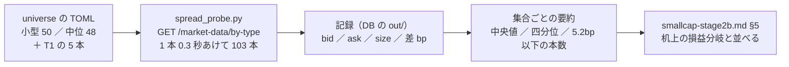

# 小型 50 の気配の差（スプレッド）を本番の読むだけの照会で【実測】する

2026-10-22（木）titan。利用者「次のおすすめの作業は？」→ 推し 1 →「1 を進めて」。
親タスクは TODO「決算データを含めたモデル ＋ 大型株の流れで中小型株を売買する（検討）」（[プラン earnings-smallcap.md §3](earnings-smallcap.md) の壁の 1 行目）。

## 1. 目的・背景

- 段 2b（[smallcap-stage2b.md](../../specs/experiments/smallcap-stage2b.md)）で、小型 50 の「大型株の流れ」θ50 は **費用の損益分岐が往復 5.2bp**【実測・机上】と分かった。机上の費用 5bp は大型株 5 本の差 1（合図時の気配と約定の差）中央値 0.00bp【実測】から置いた仮定で、⚠ **小型株の気配の差は【推測】のまま**（プラン §3「中小型株は開きやすい」）。
- ここでは **気配の差そのもの**（ask − bid。成行の往復で払う幅）を小型 50・中位 48・いまの 5 本で 1 本ずつ読み、机上の費用の水準（5bp ／ 20bp）がどちらの側にあるかを数字にする。
- CLAUDE.md の 2026-09-05 の例外（**API の挙動**の【実測】）の内側。⚠ **発注はしない**（GET だけ・許可は 1 つも渡さない・titan には「本番の機械ではない」印がある）。

## 2. 対応方針

この図の主張: 銘柄は机上の universe をそのまま読み、気配を 1 回ずつ写して、机上の損益分岐と並べるだけ。

- 読み手は `experiments/tastytrade-api-sample/spread_probe.py`（新規・読むだけ。`candle_probe.py` ／ `delisted_probe.py` と同じ作り ＝ `ttclient.Client(env="prod")` に許可を渡さず `TT_PROD_*` で認証・記録は `record.Recorder` ＝ DB）
- 気配の差 ＝ **(ask − bid) ／ mid × 10⁴ bp**（mid ＝ (bid ＋ ask) ／ 2）。⚠ 往復の費用と同じ物差し（買いは ask・売りは bid で、往復で幅 1 つぶん払う）。机上の `cost_bp` も往復なので、**そのまま並べてよい**
- 写しは **1 日 2 回**: A ＝ 準備ができ次第（14:30 ET ごろ）・B ＝ **15:30 ET（12:30 PDT）ごろ** ＝ 執行の時刻（15:45〜15:55 ET）に近く、⚠ 13500t の売買の回（15:40〜16:10 ET）と重ねない（同じ口座への照会を増やさない）
- 一緒に読むもの: `bid-size` ／ `ask-size`（板の厚み・株数）・`last`・`updated-at`（気配の古さ）・市場のセッション（`/market-time/equities/sessions/current`）

## 3. 回す前に固定すること（⚠ 結果を見る前に書いた）

| 項目 | 固定した中身 |
| --- | --- |
| 銘柄 | **小型 50**（`config/universe/small50.toml` の `company`）／ **中位 48**（`midcap48.toml` の `company`）／ **5 本**（`config/traders/T1.toml` の `symbols` ＝ T・PFE・NKE・VZ・BAC）。⚠ 取れなかった銘柄も行に残す・後から外さない |
| 線 | **5.2bp** ＝ 小型 50 θ50 の損益分岐（記録 §2-3）／ **20bp** ＝ 段 2b の費用の変種（rules.md 28-3）／ **$120** ＝ 1 銘柄の枠（$600 ÷ 5 本。プラン §3） |
| 要約 | 集合ごとに 本数・中央値・四分位（25 ／ 75）・最大・5.2bp 以下の本数・20bp 以下の本数・mid > $120 の本数・size の中央値 |
| 読み方 | 小型 50 の**中央値**が 5.2bp を超えれば「θ50 の行は実売買では B&H を割る」が【実測】の裏付けつきになる ／ 5.2bp 以下なら「費用 5bp は小型 50 でも甘くない」。⚠ どちらでも**机上の費用の水準は動かさない**（14-9。20bp は固定済み・別の水準は新しい処置） |
| やらないこと | 発注・dry-run・取消（GET だけ）／ 銘柄の差し替え ／ 結果を見てからの線の移動 ／ 15:40〜16:10 ET の照会 |

見立て【推測】: 5 本の中央値 ≤ 3bp ／ 中位 48 の中央値 2〜8bp ／ **小型 50 の中央値 10〜30bp**（5.2bp 以下は 50 本のうち 10 本以下）／ mid > $120 の小型株は 5 本以下。

## 4. 影響範囲

- 新規 1 本 `spread_probe.py`（既存のコードは触らない）。記録は本物の DB（`experiments/tastytrade-api-sample/out` ＝ 決まった置き場）に `tastytrade-prod-<時刻>.jsonl` の道で 2 本。
- 文書: `smallcap-stage2b.md` に §5（結果）・`earnings-smallcap.md` §3 の表（【推測】→【実測】）・TODO・CLAUDE.md の段 2b の行に 1 文。

## 5. テスト方針

- 読むだけなので自動テストは足さない（発注の経路に触れないことはコードの作りで保証: `Client` に許可の引数を渡さない）。
- 動いたことの確認 ＝ 5 本の差が大型株らしい小さい値で、`updated-at` が数秒以内（市場が開いている間の値）であること。

## 6. 手順

1. プラン（この文書）・TODO の子 → 2. `spread_probe.py` → 3. 写し A → 4. 写し B（15:30 ET ごろ・背景で待つ）→ 5. 記録 §5・プラン §3 の表・CLAUDE.md・TODO → 6. push。

## 7. 限界

- **1 日 2 回の写し**（日々の揺れ・決算日の広がりは測れない）。REST のスナップショットで、`updated-at` の古さは行に残す。
- 成行の約定は気配の内側で付くこともある（差 1 の 0.00bp がそれ）＝ 気配の差は費用の**上限側**の目安。

## 8. 結果（2026-10-22。⚠ 数字の正本は [smallcap-stage2b.md §5](../../specs/experiments/smallcap-stage2b.md)）

- 写し A 15:26 ET・B 15:35 ET（準備が延びて 14:30 ET の写しは取れず、2 回は 9 分差）。103 本とも 2 回取れた・市場 Open・429 なし
- 中央値【実測】: 5 本 2.6bp ／ 中位 48 5.5 ／ 6.5bp ／ **小型 50 15.3 ／ 14.4bp**（5.2bp 以下は 3 本・2 回とも通るのは AMRX 1 本・20bp 以下 30 ／ 38 本）。mid > $120 は小型 50 で 6 本・中位 48 で 30 本
- 読み: 小型 50 の θ50 の行は実売買では B&H を割る（【実測】の裏付け）／ 中位 48 は枠のほうが壁 ／ 机上の費用の水準は動かさない（14-9）
- 見立て（§3）の答え合わせ: 4 つ ✅・mid > $120 の小型株「5 本以下」だけ ❌（6 本）
