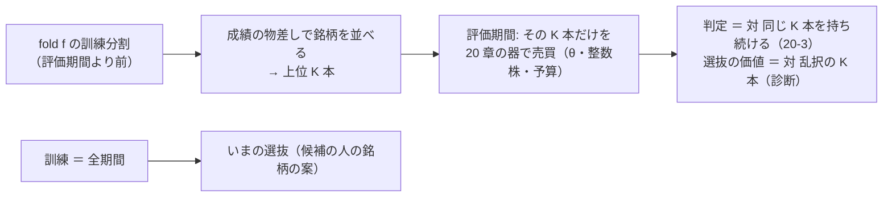

# 小型・中位株から「成績の良い銘柄」を選ぶ処理（訓練期間で選ぶ walk-forward の選抜）

作成 2026-10-22（titan の Claude）。✅ 同日に Phase 0〜3 を終えた（結果は §4）→ 利用者の訂正で Phase 4（§5）→ ✅ **同日 17:31 PDT に完了して archive へ**。利用者の指示（2026-10-22）: **「小型中型から成績を良い銘柄を選ぶ処理を行う」**。
派生元: 決算 ＋ 中小型株のタスク（2026-10-22 に閉じた ＝ [earnings-smallcap.md](earnings-smallcap.md)）。⚠ 段 3 を開け直すのではなく**新しいタスク**として起こす（メモリの決めごと）。
規約の置き場: rules.md 29 章（⚠ **回す前に書く**。14-9・14-10・17 章・20 章の上に足す）。

## 0. 目的・背景

- 小型 50（`small50`）・中位 48（`midcap48`）は「ティッカー順の先頭」で機械的に切った集合で、成績では選んでいない（記録 [smallcap-stage2.md §1](../../specs/experiments/smallcap-stage2.md)）。利用者はここから**成績の良い銘柄を選ぶ処理**を求めている
- ⚠ **評価期間の成績（検証結果一覧の銘柄別 bp・`per_symbol.csv`）で選んで、同じ fold で測り直すのは循環**（選んだ集合は作りによって良く見える ＝ rules.md 13-7「銘柄別 bp は成果物であって採否には使わない」・14-9「結果を見てから動かさない」・上位 K の教訓 17-6 ／ 17-7「上乗せの正体は荒い銘柄への集中 × 生存バイアス」）
- だから処理は **walk-forward の選抜**にする: fold ごとに**訓練分割だけ**を見て K 本を選び、評価期間でその K 本を売買する（14-11「選抜は訓練分割の内側」と同じ置き方）。「いまの選抜」（全期間を訓練にした 1 回）も同じ規則で出す ＝ 候補の人の銘柄の案になる

> この図の主張: 選ぶのは訓練分割の中だけ。評価期間は選んだ K 本を 20 章の器（整数株・予算・持ち続ける）で測るだけ。

## 1. 対応方針（⚠ 回す前に固定する数と構造。決まったら rules.md 29 章に写す）

| 決めごと | 中身（推す案） | ⚠ 理由・代替 |
| --- | --- | --- |
| 口 | `[[trading.trader]]` に `select = { by = "…", k = K }`（`symbols` の代わり）。fold ごとに `tr` から選ぶ。⚠ **`select` の無い config は 1 ビットも変わらない** | 20 章の器（`_trader_fold` ＝ `simulate_topk` を K ＝ 本数・整数株で）をそのまま使う。新しいシミュレータは作らない |
| 成績の物差し ①「株自身」`ret` | 訓練分割の**最後の 252 営業日**の累積対数リターン（`y` の和。行が 126 本未満の銘柄は候補から外す）の大きい順 | モメンタム（12 か月）。窓は 1 水準だけ（振ると物差しを選ぶことになる ＝ 17-7 の 3 と同じ） |
| 成績の物差し ②「モデルの成績」`net` | 訓練分割を頭 ／ 尻に割り（`tail_holdout`。門 14-5 と同じ割り方）、頭で fit したモデルの尻の予測を Platt で買い% にし、**尻で 13 章の閾値売買を銘柄ごとに回した純利 bp** の大きい順（θ ごとに選ぶ。尻の行が 20 本未満の銘柄は外す） | 「この戦略が効いた銘柄」。⚠ 評価期間には触れない。選別 × モデルの config だけ（検知器・合わせる口は今回は受けない） |
| K | **5**（いまの人と同じ本数） | 1 水準だけ。10 を足すなら利用者 |
| 予算（条件） | **2 つ**: `全部を買える予算`（20-2 の 2b の式 ＝ 選抜の価値を株価の壁と分けて測る）／ **$600**（いまの 1 人分 ＝ 1 銘柄の枠 $120。候補の人の形） | 小型 50 は 1 株 $120 超が 6 本・中位 48 は 30 本（気配の【実測】の日）＝ $600 の行は「買えない」が混ざる。両方出して読む |
| 対照（数えない） | `基準 持ち続ける〔トレーダー・選抜…〕`（同じ K 本を持ち続ける ＝ 判定の相手。20-3）／ 診断 `trader.csv` に **乱択の K 本**（種 5 ＝ 同じ θ で売買・持ち続けるの両方）と **全銘柄の持ち続ける** | 判定は「選んだ K 本の上でモデルが効いたか」。⚠ **選抜そのものの価値は「選抜の持ち続ける − 乱択の持ち続ける」「− 全銘柄 B&H」の対の差（診断）で読む** |
| 同じ実行に足す条件 | `全銘柄・全部を買える予算`（選抜なし） | 同じ予測で「選ぶ ／ 選ばない」を並べる（20 章と同じ） |
| 表・モデル・θ | `small_cs`（小型 50・own ＋ cs ＋ ll × Ridge）／ `midcap_cs`（中位 48・同じ）。θ 50 ／ 55 ／ 60（13-3） | 2 集合で「大型株の流れ」の形だけ。own だけ・決算つきは広げない |
| 名前 | `全部使う（基準）〔トレーダー・選抜5・訓練リターン・全部を買える予算〕` など。綴りは `names.toml` の `[trader]` に `sel5-ret-all` ／ `sel5-ret-600` ／ `sel5-net-all` ／ `sel5-net-600` | 20-4 の 2（条件は手法名に入れる・識別項目に列は足さない） |
| 数 | 1 config ＝ 条件 5（選抜 2 物差し × 予算 2 ＋ 全銘柄 1）× θ 3 ＝ 15 ／ 2 config ＝ **＋30（954 → 984）**。leak 対照 2 本は数えない | 物差し 1 つなら ＋18・予算 1 つなら ＋18・両方 1 つなら ＋12 |
| いまの選抜 | 同じ規則を**全期間を訓練にして** 1 回当て、集合 × 物差し（× θ）ごとの K 本を記録に書く（`cli.select_symbols` 1 本。読むだけ） | 候補の人の銘柄の案。⚠ 人を作るかは利用者（本番に入れるのは 11/4 の後） |

### 1-1. ⚠ 先に書く見立て（結果を見る前）

- 採る 0。選抜の行の判定（対 同じ K 本の持ち続ける）は 5 fold で割れる（K ＝ 5 は 1〜2 本の運 ＝ 20-5 の 1）
- 選抜の価値（持ち続ける〔選抜〕 − 持ち続ける〔乱択〕）は `ret` で平均が正でも |t| < 2（12 か月モメンタムは小型株で向きは合うが 5 本では雑音）、`net` は 0 の周り（尻 4〜8 か月の銘柄別純利に順位の情報はほぼ無い ＝ IC 0.01 台）
- $600 の行は `skipped_price` が目立つ（中位 48 で特に）。全部を買える予算の行と差を読む
- 中位 48 と小型 50 で向きが揃わない（揃っても t は届かない）

### 1-2. やらないこと

- 評価期間の銘柄別 bp で選ぶ（循環）／ 選抜の窓・K・θ・予算を結果を見て動かす（14-9）／ この結果で候補の人を本番に入れる（11/4 の後・利用者）／ own だけ・決算つき・LightGBM に広げる（新しい処置）

## 2. 影響範囲

- 研究側: `cli/run.py`（`trader_conditions` の `select`・`_trader_fold` に訓練分割を渡して fold ごとに選ぶ・診断の列）・`ail/validation/select.py`（新規: 2 つの物差し。純粋関数）・`config/names.toml` `[trader]` の綴り 4 つ・`config/experiment/sel_small_cs.toml` ／ `sel_midcap_cs.toml`・`config/queue/symbol_select.toml`・`cli/select_symbols.py`（いまの選抜）・rules.md 29 章・`tests/test_symbol_select.py`（無い config は 1 ビットも変わらない ＝ 既存の指紋・選抜が評価期間を読まないこと・K ＝ 全銘柄なら全銘柄の行と一致）
- 記録: `docs/specs/experiments/symbol-selection-by-training.md`・検証結果一覧の吐き直し・TODO ／ DONE・CLAUDE.md・メモリ
- 触らないもの: 既存の行・判定・`catalog.py` の判定式・実売買の設定・管理画面・外部のタブ（比較のページは `models.toml` に無い形なので出ない）

## 3. Phase

| Phase | 中身 | 出す数 |
| --- | --- | ---: |
| 0 | 利用者の決定（物差し ①②・K・予算の条件）→ rules.md 29 章に固定 | — |
| 1 | 口と物差しの実装 ＋ テスト（評価期間を読んでいないことを機械で） | 0 |
| 2 | 2 config を queue で回す → 検証結果一覧を吐き直す → 記録（結果・見立ての答え合わせ・対の差） | ＋30 |
| 3 | いまの選抜（全期間）を出して記録に書く。候補の人を作るかは利用者 | 0 |

## 4. 結果（済んだら書く）

利用者の決定（2026-10-22）: 物差し ＝ **両方**・予算 ＝ **「一人 600 ドル使えるものとする」**（K は 5 のまま・条件は $600 の 1 つ。「全部を買える予算」の条件は回さない）。

| 項目 | 結果（2026-10-22 17:12 PDT・titan） |
| --- | --- |
| 口 | `[[trading.trader]] select`（rules.md 29 章）・`ail/validation/select.py`・`cli/run.py` の `_select_fold`・`cli/select_symbols.py`・`tests/test_symbol_select.py` 9 本。20 章の行は変更前と 1 ビットも違わない（合成データの写しで確認）・既定経路の指紋 ✅ |
| 数 | ＋12（954 → 966）＝ 2 集合 × 物差し 2 × θ 3（条件は $600 の 1 つ ＝ プランの ＋30 から減った） |
| 判定 | 採る 0 ／ 保留 4 ／ 落とす 8。θ50 の `net` だけ保留（小型 +443・3/5 ／ 中位 +587・4/5） |
| 選抜の価値 | `ret`: 小型 +552（t 0.69・4/5）／ 中位 +1,466（t 1.62・5/5）＝ 向きは合うが届かない。`net`: 0 の周り |
| 退化 | 1 回目の `net` θ55 ／ 60 で「取引なし ＝ 純利 0」の同点が銘柄名の順で選ばれた → 29-3 に「取引の無い銘柄は成績なし」を足して回し直した（1 回目の 4 本は DB に残る） |
| いまの選抜 | 記録 §3（小型 ACMR AAMI ANDE ADEA AMRX ほか）。候補の人は作っていない（利用者） |

## 5. Phase 4: 値段の設定の訂正（2026-10-22 利用者「600/5=120 ドルが最低じゃなくて、600 ドルを 1 銘柄の最低購入額にする。プランの変更」）

| 決めごと | 中身 |
| --- | --- |
| 枠 | **$600 ／ 銘柄**（§1 の「$600 ＝ 1 人の予算 → 枠 $120」は読み違い）。5 本 ＝ 予算 $3,000。候補 ＝ 1 株 $600 以下 |
| 行 | 新しい条件 `〔トレーダー・選抜5・訓練リターン・1本$600〕` ／ `〔…モデル純利・1本$600〕`（rules.md 29-9）。＋12（966 → 978）。⚠ 枠 $120 の 12 行は残して数える |
| 出すもの | 記録 §6（結果・いまの選抜の出し直し）・CLAUDE.md・メモリ。⚠ 人を作るなら 1 人 $3,000（利用者） |

結果（2026-10-22 17:31 PDT）: **採る 1 ／ 保留 5 ／ 落とす 6（966 → 978）**。初めての「採る」（中位 48・ret θ50・+1,003・5/5）は日次 t 1.15・DSR 0.18・乱択選抜と区別がつかず・枠 $120 では落とす ＝ 根拠「中」で扱いは保留と同じ。いまの選抜（1 人 $3,000 の案）は記録 §6-4。候補の人は作っていない（利用者）。
