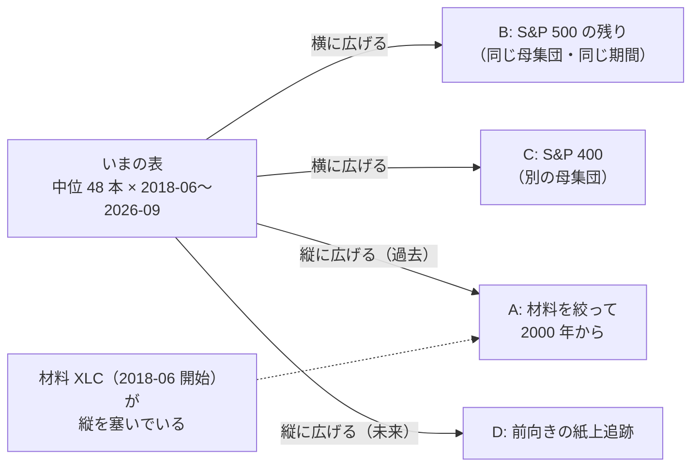
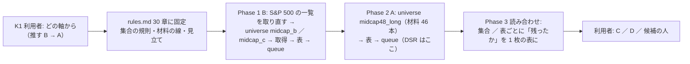

# 「採る」になった選抜の規則を、もっと広いデータで追試する（どう広げるかの検討）

✅ **2026-10-23 に完了して archive へ**: B → A を回し、**3 表とも再現せず**（採る 0 ／ 保留 1 ／ 落とす 26・978 → 1,005）。結果は [記録](../../specs/experiments/symbol-selection-widen.md)・規約は [rules.md 30 章](../../specs/experiments/feature-discovery/rules.md)。

作成 2026-10-23（titan）。利用者の指示（2026-10-23）: **「採るになった手法をもっと広くデータを取る。どのように広げるかも検討する」**。
前のタスク（[記録 symbol-selection-by-training.md](../../specs/experiments/symbol-selection-by-training.md)・[rules.md 29 章](../../specs/experiments/feature-discovery/rules.md)・[プラン（archive）](symbol-selection-by-training.md)）の続き。

## 0. 一言で

- **対象** ＝ 検証結果一覧 978 行で唯一の「採る」: **中位 48・own ＋ cs ＋ ll × Ridge・訓練分割の 12 か月モメンタム（`ret`）で選んだ 5 本・枠 $600 ／ 銘柄・θ50**（rules.md 29-9 の適用例）。対 同じ 5 本を持ち続ける **+1,003bp/fold・5 fold とも正**（+1,556 ／ +2,487 ／ +325 ／ +145 ／ +502・fold の t 2.26）【実測】
- **根拠は「中」止まり**: 日次の t 1.15・DSR **0.18**（SR 0.057/日・SR0 0.079・評価 1,695 日・n_trials 978）・選抜の価値 +336（t 0.23）・乱択選抜との差 +1,106（t 0.88）・同じ規則が枠 $120 では落とす【実測】
- **やること** ＝ 規則を 1 ビットも変えず（14-9）、**まだ見ていないデータ**に同じ規則を当てて、残るか消えるかを見る（追試）。良い行を探す作業ではない。消えたら「集合に依る」と記録する
- **広げ方は 4 軸**（§2）。**推しは B（S&P 500 の残りを 50 本ずつ）→ A（材料を絞って期間を 2000 年から）**（§3）。⚠ **DSR 0.95 に届く可能性があるのは A だけ**で、それも同じ大きさの効果なら 0.83〜0.92 止まり【計算 §2-1】

## 1. いまのデータの縁（広げる前の整理）【実測】

| 項目 | いまの表 `midcap_cs`（`sel600_midcap_cs` が借りる） |
| --- | --- |
| 期間 | **2018-06-27〜2026-09-09**（2,053 営業日・48 銘柄・96,912 行・特徴量 313 本） |
| fold の切れ目（`date_edges`・5 fold） | 2019-11-05 ／ 2021-03-17 ／ 2022-07-27 ／ 2023-12-14 ／ 2025-04-29（評価 ≈ 1.4 年 × 5 ＝ 1,695 日。fold 1 の訓練 ≈ 1.4 年 ＝ 窓 252 日より少し長いだけ） |
| 対象 48 本 | S&P 500（Wikipedia 2026-09-12）のうち `us63` に無いティッカー順の先頭 50 → 2018-06 以前から日足のある 48（[midcap-targets.md](midcap-targets.md)） |
| 材料 63 本 | `us63` の全部（`ll_leaders = "etf"`・断面 `cs_` は同じ時刻の全銘柄） |
| ⚠ **2018 始まりの理由** | **中位の株ではなく材料**。48 本のうち **24 本は 1994 年から・31 本は 2000 年より前から**日足がある。表が 2018-06 から始まるのは材料の **XLC（2018-06-19）** が無い時刻の `ll_` が欠損 → `dropna` で落ちるため（XLRE 2015-10・ABBV 2013-01・META 2012-05 も同じ向き） |
| 取得元 | tastytrade（DXLink）日足・1 購読 8,000 本 ＝ 最大 32 年。70 本で 55 秒【実測 2026-10-19】 |
| 研究用の日足の終わり | 材料 63 本は 2026-09-08 ／ 09-11 で止めている（`cli.fetch --dataset daily` を研究用に流さない ＝ CLAUDE.md）。新しく取る銘柄は今日まで取れるので **`end_date` で揃える**（rules.md 27-3 の口） |

> この図の主張: 「採る」の 1 行は、48 本 × 8 年の 1 枚の表の上にしか立っていない。広げられる向きは 横（銘柄）と 縦（期間）の 2 つで、縦を塞いでいるのは材料の XLC である。

## 2. 広げ方の 4 軸（比べる表）

| 軸 | 何を足すか | 何が分かるか | 要るもの・手間【推測】 | n_trials | DSR に効くか | ⚠ 落とし穴 |
| --- | --- | --- | --- | ---: | --- | --- |
| **A 期間を過去へ** | 材料を **2000-01-01 より前から日足のある 46 本**（`us63` から IWM・VZ・JPM・ACN・CVX・NFLX・CRM・GOOGL・T・MA・V・AVGO・TSLA・META・ABBV・XLRE・XLC の 17 本を外す）に絞った universe `midcap48_long`。対象は同じ 48 本（居る期間だけ）。表 ≈ **2000-03〜2026-09（≈ 6,650 日・評価 ≈ 5,540 日）** | 同じ規則が **別の時代**（IT バブル崩壊・2008・2020）でも残るか。**DSR をまともに測れる唯一の軸** | 取得 0（日足はある）・表 2 枚（本番 ＋ leak）≈ 2 分・queue 2 本 ≈ 2 分・記録 | +6 | **同じ SR 0.057 なら 0.83**・0.95 には SR ≥ 0.066（年率 1.05）が要る【計算 §2-1】 | 材料が減る ＝ **別の表・別のモデル**（13-8 ＝ 2018 表の数字と直接比べない）／ 生存バイアスが深くなる（2026 年の構成銘柄を 2000 年に当てる・12-1）／ fold ≈ 4.4 年で「fold ごとに選ぶ」の回数は 5 のまま ／ 分割調整済みの株価で枠 $600 を当てるので 2000 年代は候補がほぼ全部（枠の意味は「株数」だけになる）／ 2000 年代の断面は銘柄が少ない時刻がある（`cs_n`） |
| **B 銘柄を横へ（同じ母集団）** | S&P 500 の `us63`・`midcap48` に無い残り ≈ 400 本【推測】を、**midcap48 と同じ規則**（ティッカー順・2018-06-27 以前から日足・`end_date = 2026-09-09`）で **50 本ずつ**切る（`midcap_b`・`midcap_c`・…）。材料・期間・fold・θ・枠は全部いまの表と同じ | **同じ時代に別の銘柄で残るか**。48 本の偶然（5 fold の符号だけなら 1/32）なら、2〜3 集合でほぼ消える。集合ごとに独立した追試 | 1 集合 ＝ 取得 50 本 ≈ 40 秒・`cli.adjust`・表 2 枚 ≈ 30 秒・queue 2 本 ≈ 32 秒・記録 ＝ **Claude の作業込み 30 分**。S&P 500 の一覧は取り直す（2026-09-12 版は残していない） | +6 ／ 集合 | **効かない**（評価日数 1,695 のまま ＝ 0.95 には SR 0.119・年率 1.89 が要る【計算】）。読むのは「独立した集合で 5/5 が何回出るか」と「集合をまたいだ fold 対の t」 | 集合を増やすほど 1 つは 5/5 が出る（14-10 ＝ 全部数える・良い集合を選ばない）／ 断面の層は表の全銘柄で作るので **48 本の表と 50 本の表は別の表**（同じ材料でも `cs_` の相手が違う）／ ティッカー順の後ろほど 2018 以前の上場が多い・少ないの偏りは無いはず【推測】 |
| **C 母集団を変える** | **S&P 400（MidCap）** の構成銘柄（Wikipedia）をティッカー順 50 本（small50 と同じ切り方・終値 ≥ $5） | 本当の中型株で残るか（一般化）。S&P 600 は 29 章で保留 ／ 落とす（小型 50 ＝ `ret` θ50 +177・3/5） | B と同じ ＋ 一覧の取得 | +6 | 効かない（B と同じ） | 気配の差は S&P 500 より広い（小型 50 ≈ 15bp・中位 48 ≈ 6bp【実測】・S&P 400 はその間【推測】）＝ 机上の費用 5bp は甘い側 ／ 生存バイアス深い |
| **D 前向き（紙上の追跡）** | 規則を今日で固定し、いまの選抜（AMAT APA ALB BIIB BG・θ50・枠 $600）を **紙上で毎日** 売買と持ち続けるで記録（人は作らない） | **本当の out-of-sample**。ただし 1 年で 252 日 ＝ 検出力は無く、2 年で「向き」だけ | 中位 48 の日足を今日まで継ぐ経路（研究用 `data/` は取り直さない規則 → `data-live/` と同じ「種から後ろだけ継ぐ」別の置き場 `data-track/`）＋ 週 1 回の予測と集計 ＝ **半日〜1 日** | 0（数えない。検証ではなく追跡） | 何年も先 | 「毎日選び直す」にすると別の処置（29 章に登録してから）／ 13500t の経路に混ぜない（titan の読むだけの後処理） |

### 2-1. DSR に届くか【計算・`ail/validation/stats.deflated_sharpe` の式そのまま・歪度 0・尖度 3・n_trials 1,000】

| 評価日数 n_obs | 同じ SR 0.057/日 のときの DSR | DSR 0.95 に要る SR/日（年率） | どの軸か |
| ---: | ---: | ---: | --- |
| 1,695（いまの表） | 0.18 | 0.119（1.89） | B・C ＝ 何集合足しても変わらない |
| 3,000 | 0.45 | 0.090（1.42） | — |
| 5,540（A ＝ 2000 年から） | ≈ 0.83 | 0.066（1.05） | A |
| 6,619（1995 年から ＝ `own_1995` の検証日数） | 0.92 | 0.060（0.96） | A の材料をさらに 1996 年より前の 29 本に絞った場合（⚠ セクター ETF と QQQ が全部外れる ＝ 「大型株の流れ」が薄くなる。推さない） |
| 7,400 | 0.95 | 0.057（0.90） | 持っているデータの外 |

⚠ **読み**: 広げて DSR を通すには「同じ大きさの効果が 22 年続いていた」ことが要る。B・C は DSR を動かさず、**再現の回数**で読む軸。A は DSR を測れるが、通るとは限らない（通らなくても 0.18 → 0.8 台なら「中」の中で上がる）。

## 3. 推し（順番）と理由

1. **B を先に（2 集合 ＝ 次の 100 本）**: 一番安く（1 集合 30 分）・いまの表と**同じ期間・同じ材料・同じ fold** なので「規則が 48 本の偶然だったか」に最短で答える。ここで 2 集合とも消えたら A に進む意味は薄い（記録して閉じる）
2. **A を次に（材料 46 本・2000 年から）**: DSR を測れる唯一の軸。B で残っていれば「別の時代でも残るか」の答えになる
3. **C は B で残ったら**（別の母集団は一般化の検査。費用の壁が先に立つ）。**D は候補の人を作るかの判断とセット**（利用者）。作るなら D の経路（日足を継ぐ・予測）はそのまま人の配線になる

⚠ **推さないこと**: fold の切れ目や fold 数を変えて同じ表を測り直す（データは増えない・14-9 の匂い）／ K・窓・枠・θ を振る ／ 集合の結果を見てから「良い集合」を選ぶ ／ この追試の結果で人を本番に入れる（人を作るかは利用者・本番は 11/4 の後）。

> この図の主張: 進むのは B → A の順で、どちらも「回す前に固定 → 回す → 記録」の 1 本の流れ。結果で次の軸を選ばない（B が消えても A は回してよいが、その判断は利用者）。

## 4. 回す前に固定すること（Phase 1 の頭で rules.md 30 章に写す）

| # | 固定 | 値 |
| ---: | --- | --- |
| 1 | 規則 | 29-9 のまま: `select = { by, k = 5 }`・窓 252 営業日・最低行数 126 ／ 20・枠 $600 ／ 銘柄・予算 $3,000・候補 ＝ 訓練分割の最後の終値 ≤ $600・器 `simulate_topk`・判定 ＝ 対 同じ 5 本を持ち続ける・対照 乱択選抜（種 5） |
| 2 | 回す形 | **29-9 と同じ config の形**（`ret` ／ `net` × θ 50 ／ 55 ／ 60 ＝ 1 集合 +6）。⚠ **主の仮説は `ret` θ50 の 1 行**で、ほかの 5 行は並べて数えるだけ（比較ページ・検証結果一覧に 29 章の行と同じ形で並ぶ） |
| 3 | B の集合の規則 | S&P 500（Wikipedia「List of S&P 500 companies」・取得日を書く）のうち `us63`・`midcap48`（落ちた ABNB・AMCR も含めて 50）に無いティッカーを**アルファベット順**に 50 本ずつ → 2018-06-27 以前から日足のあるものを残す（足りないぶんは次のティッカーで埋めない ＝ 48 本と同じ「落ちたら落ちたまま」）。材料 ＝ `us63` の 63 本・`targets = "company"`・`end_date = "2026-09-09"`・`sector_of` 無し |
| 4 | A の材料の線 | `us63` のうち **2000-01-01 より前から日足のある 46 本**（成績で選ばない・日付だけ）。対象 48 本は同じ。`start_date` は書かない（`dropna` が決める）・fold 5・`walk_forward_dates`（器・切り方は同じ。⚠ fold の長さは ≈ 4.4 年になる） |
| 5 | 読み方（事前） | 各集合 ／ 表で主の行が「上乗せ > 0 かつ 5/5」なら**再現**・符号が割れれば**再現せず**。全体は 集合をまたいだ fold 対の平均と t（診断）。A の θ50 の DSR を 11 章 規約 3 の線（0.95）で見る。選抜の価値（持ち続ける〔選抜〕 − 乱択持ち続ける）と 乱択選抜との差も並べる。⚠ **1 つでも消えたら「集合に依る」と記録し、消えた集合を外さない** |
| 6a | **識別項目に「集合」を足す**（着手時に見つけた穴）: `catalog.KEY` は銘柄集合を**本数**でしか持たない（`_symbols_of`）ので、S&P 500 の次の 50 本が 48 本に減ると中位 48 本と、50 本のままだと小型 50 本と同じ鍵にまとまり、既存の行が「2 実行・不一致」に化ける。実行が記録している `config.json` の `dataset` を「集合」として KEY に足し（`catalog._set_of`・名前は `daily` 以外に `~<綴り>`・rules.md 30-2）、既存の行が 1 行も割れないことを検証結果一覧の前後で検算してから回す |
| 6b | **日足の欠陥（着手時に見つけた。rules.md 30-9）**: 分割の日の終値 1 本だけが旧目盛り（raw 306 本のうち 76 本。`cli.adjust` が分割と読んで前の歴史を二重に割っていた）→ 口 `--fix-split-close`（既定 off）で新しい 100 本だけ直す・A は 9 本を直した写し `data-widen/` で回す ／ ティッカーの使い回し（BR・COIN・CRWD・APP）→ 30 日超の空白・1 日の \|log r\| > 2 で落とす。集合は B 44・C 45・A 47 |
| 6 | 見立て【推測】（回す前に書く） | B: 2 集合で 5/5 は 0〜1・上乗せの平均は正だが集合をまたいだ t < 2・選抜の価値は 0 の周り ／ A: θ50 の上乗せは正で fold が割れる（4.4 年の fold に 2000〜02・2008 が入る）・DSR < 0.95・`net` は尻の取引が増えるぶん退化は消える |
| 7 | 数 | ⚠ **1 表 ＋9**（素の行 全部使う × θ 3 ＋ 選抜 6。29 章では既存の表を借りたので素の行は増えなかったが、ここは新しい表 ＝ 新しい検証）。B 2 集合 ＋ A ＝ **＋27（978 → 1,005）**。leak 対照は数えない。⚠ §2 の表の「+6」は 2026-10-23 の着手時に訂正した |

## 5. 影響範囲とテスト

- **コードは増えない見込み**（口は全部ある: universe TOML・dataset TOML・experiment config の `features_from` ／ `end_date`・`[[trading.trader]] select`・queue）。足すのは TOML と記録だけ
- 取得は **新しい銘柄だけ** `cli.fetch --dataset <新しい dataset> --symbols …`（27 章と同じ手）→ `cli.adjust --period d` の後に **既存の銘柄の `adjusted/` が 1 バイトも変わらない**ことを sha256 で確かめる（研究用の `data/` を取り直さない規則）
- テスト: 既存の `tests/test_symbol_select.py`・`test_catalog`・`test_names` が通ること。新しい universe TOML が `config.symbols_of` で読めること（1 本足す）。比較ページ（`dashboard/tests/test_compare_tab.py`）は「人のいない形」の表に DB から自動で並ぶ ＝ `compare.toml` の変更なし
- デプロイ不要（13500t の経路は触らない）。GPU 不要

## 6. 利用者に聞くこと

| # | 問い | 推す |
| ---: | --- | --- |
| K1 | どの軸から | **B（2 集合 ＝ 次の 100 本）→ A（材料 46 本・2000 年から）**。C ／ D はその後 |
| K2 | B の集合の数 | **2**（1 集合 +6・30 分。消えるなら 2 で分かる。残るなら A へ） |
| K3 | A の材料の線 | **2000-01-01 より前 ＝ 46 本**（1996 年の線はセクター ETF と QQQ を失う） |
| K4 | D（紙上の追跡）を始めるか | **候補の人を作るかの判断と一緒に**（作るなら配線は同じ） |

## 7. Phase

| Phase | 内容 | 状態 |
| --- | --- | --- |
| 0 | どう広げるかの検討（本プラン §1〜§4）| ✅ 2026-10-23 |
| K1〜K3 | 利用者の決定 | ✅ 2026-10-23「推す案で進めて」＝ B → A・2 集合・46 本 |
| 1 | B: rules.md 30 章に固定 → S&P 500 の一覧 → universe `midcap_b` ／ `midcap_c` → 取得 → 表 → queue → 記録 → 比較ページで確認 | ✅ 2026-10-23 13:10 PDT（B 44・C 45 本。`ret` θ50 −591 ／ −700 ＝ 再現せず） |
| 2 | A: 30 章に固定 → universe `midcap48_long` → 表 → queue → 記録（DSR） | ✅ 2026-10-23 13:12 PDT（47 × 46・1999-12〜2026-09。`ret` θ50 −1,108・DSR 0.05 ＝ 再現せず） |
| 3 | 読み合わせ（集合 ／ 表ごとに「残ったか」の 1 枚の表）→ 利用者（C ／ D ／ 候補の人） | ✅ 記録 §3（「採る」は中位 48 × 2018 年からの表に固有・選抜の価値は 4 表とも 0 の周り）。C ／ D に進む材料は無い ＝ 利用者 |
