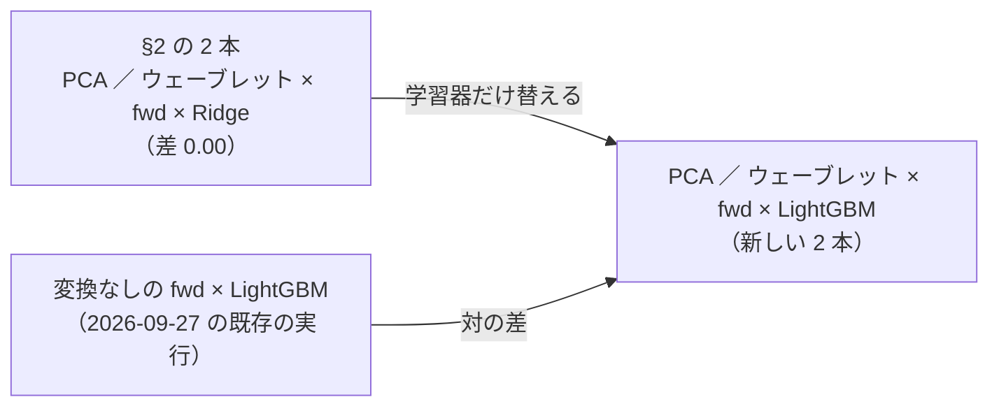
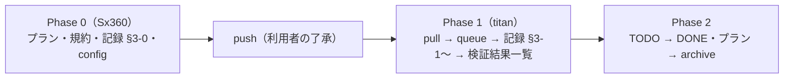

# 線形の変換（PCA・ウェーブレット）× 先 10 日の門 × LightGBM（机上。2026-10-18 利用者「1 で進めて」）

派生元: [transform-into-detectors.md §2-3](../../specs/experiments/transform-into-detectors.md)「線形の変換 × 線形の学習器の組は、この口では何も試していないのと同じ。試すなら非線形の学習器か『置き換える』口を新しい処置として先に登録する」。
2026-10-18 に、まだ回していない机上の検証を手間の小さい順に並べた中の 1 番（利用者「1 で進めて」）。

## 0. 目的・背景

- 2026-10-09 の Phase 3 で、PCA（F5-1）とウェーブレット（F5-4）を `H1 先10日ゲート（全列・学習）`（`fwd`）× Ridge に足したら、買い% が **1 ビットも変わらなかった**（足した列が元の列の線形結合 ＝ 説明変数の張る空間が同じ・Ridge `alpha = 1.0` は OLS と同じ）。n_trials には数えたが、中身は「試していない」のと同じ
- 問い: **学習器を非線形（LightGBM）にすれば、線形の変換の列は検知器の答えを変えるか。変えたら採るに届くか**
- ⚠ **この処置は結果を見た後に登録する**（14-10）。そのことを規約（rules.md 24-2・24-3）と記録（§3-0）に書いてから回す
- ⚠ 回す理由は「効くはず」ではない（14-10 規約 4。予想は 採る 0 ／ 6）。空白を埋める（CLAUDE.md 2026-09-12）
- ⚠ **示せないもの**: 「変換が効いた」。LightGBM は列の抽出 0.8 の乱数が列の数で変わるので、対の差の中で「変換の列の情報」と「乱数の引き直し」を分けられない（記録 §3-0）

## 1. 対応方針

この図の主張: 変えるのは学習器だけで、ほかは §2 の 2 本と同じ。比べる相手は変換なしの `fwd` × LightGBM（既存の実行）。

| # | 決めごと | 中身 |
| ---: | --- | --- |
| 1 | 回すもの | `trade_own_fwd10_pca_lgbm_a`・`trade_ownseq_fwd10_wave_lgbm_a`（queue `transform_detector_lgbm`）。⚠ 2 本全部か回さないか |
| 2 | config | 対の相手（`trade_own_fwd10_lgbm_a`・`trade_ownseq_fwd10_lgbm_a`）と `name` ／ `transform` ／ `k` 以外は 1 文字も違わない（✅ diff で確かめた 2026-10-18） |
| 3 | 水準 | 変換は元の実行のまま（PCA 16 成分・db4 レベル 3）・LightGBM は既定のまま（水準を足さない） |
| 4 | 数 | 2 × θ 3 ＝ **＋6（834 → 840）**・leak 対照 2 本（数えない） |
| 5 | 物差し・予想 | 記録 §3-0（回す前に書いた） |
| 6 | コード | **直さない**（config 2 本 ＋ queue 1 本だけ）。⚠ 13500t の毎日の予測の経路は動かない ＝ 「デプロイ」は要らない |

## 2. 影響範囲

- 足すもの: `experiments/feature-discovery/config/experiment/trade_own_fwd10_pca_lgbm_a.toml`・`trade_ownseq_fwd10_wave_lgbm_a.toml`・`config/queue/transform_detector_lgbm.toml`
- 書くもの: `docs/specs/experiments/feature-discovery/rules.md` 24-2（数え方）・24-3（適用例 3 の予想）・`docs/specs/experiments/transform-into-detectors.md` §3
- 生成物: `runs/research.sqlite`（実行 4 本）・`ledger.md`（`cli.report --catalog` で吐き直す）
- 触らない: `cli/run.py`・`prep.py`・`ail/models/`（予測の経路の指紋は動かない）

## 3. テスト方針

- コードを直さないので新しいテストは足さない。⚠ queue を流す前に `.venv/bin/python -m pytest -q tests/test_transform_detector.py` を流す（口が今の `main` で通ることだけ確かめる）
- 回した後の検算（記録 §3 に書く）: ① n_trials 834 → 840 ／ ② leak 2 本が跳ねる ／ ③ B&H ＋1,666bp/fold が §2 と同じ値 ／ ④ 対の相手の値が forward10-target.md と同じ（同じ実行を読む）

## 4. Phase と Step

この図の主張: 書くのは Sx360、回すのは titan（研究の DB と計算は titan）。

| Phase | 誰 | 中身 | 済み |
| --- | --- | --- | --- |
| 0 | Sx360 の Claude | プラン・TODO・rules.md 24-2 ／ 24-3・記録 §3-0（⚠ 結果を見る前）・config 2 本 ＋ queue | ✅ 2026-10-18 |
| 1 | titan の Claude | `git pull` → `tests/test_transform_detector.py` → `cli.queue --config transform_detector_lgbm`（本番 2 ＋ leak 2。1〜2 分【推測】）→ 記録 §3-1 結果・§3-2 対の差・§3-3 検算・§3-4 かかった時間 → `cli.report --catalog` → push | ✅ 2026-10-18（6 行とも落とす・840） |
| 2 | Claude | TODO の項目を DONE へ・プランを archive へ（リンクを付け替える）。⚠ デプロイは要らない（コードを直していない） | ✅ 2026-10-18 |
