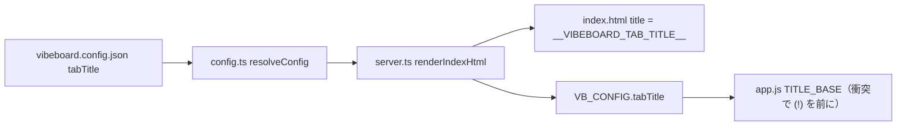

# vibeboard のブラウザのタブの題を「TODO」にする

利用者の指示（2026-10-13）: **TODO のページのタイトル変更をやる** → 確認の答え ＝ 対象は **ブラウザのタブの題（`<title>`）**・新しい題は **「TODO」**
→ 1 度目は「Tasks タブを開いている間だけ」と読み違えて作った。利用者の訂正 **「ブラウザのタブです。Tasks ではありません」** ＝ どのタブを開いていても、vibeboard のブラウザのタブの題を「TODO」にする

## 0. 目的・背景

vibeboard のブラウザのタブの題は root の名前（`ai-income-lab`）で、ブラウザのタブの並びの中で「TODO を見る画面」と分かりにくい。
左上のブランド名（`ai-income-lab`）は変えずに、ブラウザのタブの題だけを「TODO」にする。

## 1. 対応方針

| 項目 | 決め |
| --- | --- |
| どう指定するか | `vibeboard.config.json` に **`tabTitle`** を足す（新しい設定項目。無ければ `title` と同じ ＝ 書かないプロジェクトは 1 ビットも変わらない） |
| 左上のブランド名 | 変えない（`title` のまま。`<h1 class="topbar-brand">`） |
| 衝突の印 `(!)` | いままでどおり前に付く（`(!) TODO`） |
| CLI ／ 環境変数 | 足さない（設定ファイルだけ）。`--title` で `title` を上書きしても `tabTitle` が無ければそれに追随する |
| このプロジェクトの値 | `vibeboard.config.json` の `"tabTitle": "TODO"` |

流れ（1 図 1 主張: 題は設定 → サーバ → `<title>` と `VB_CONFIG` の 2 経路で届く）:

## 2. 影響範囲

- vibeboard（vendor `./vibeboard/` と upstream の clone `/home/ubuntu/vibeboard` に同じ差分）: `src/config.ts`・`src/server.ts`・`src/web/index.html`・`src/web/app.js`・`README.md`（スキーマに 1 項目）・`test/config.test.js`（1 本）
- このプロジェクト: `vibeboard.config.json` に `tabTitle`
- ⚠ 設定と `index.html` は起動時に読むので、**3010 は起こし直しが要る**（利用者が端末で `./run-vibeboard.sh`。src が dist より新しければ build も走る）
- upstream への commit ／ push は利用者の依頼で（反映するまで `vibeboard update` を流すと vendor の差分が消える）

## 3. テスト方針

- `cd vibeboard && npm test`（build ＋ 既存 104 ＋ `tabTitle` 1）
- 別ポート（3017）に仮の root で起こし、`/` の `<title>` が `TODO`・ブランド名が `ai-income-lab` のままであることを curl で確かめる（⚠ 3010 と同じ root では起こさない ＝ ポートガードはポート単位だが念のため）
- 目で見る（利用者）: 起こし直したあと、ブラウザのタブの題が `TODO`・左上は `ai-income-lab` のまま
