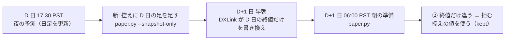

# 終値の控えを夜の予測の後にも取る（権利落ち日の前日の書き換えを拒めるようにする）

2026-11-09 Sx360。利用者「推す案で進めて」（TODO「控えの終値を夜の予測の時点でも取る…を直すか決める」の推す案）。

## 1. 目的・背景

- 紙上の対照（`paper.py`）は、日足の終値を控え（`out/closes.json`）に残します。DXLink が**権利落ち日の前日の終値だけ**を配当ぶん下げて書き換えるので、それを拒むためです（[daily-record-auto Phase 4](archive/daily-record-auto.md)・`paper.py` の頭の ①〜③）。
- 控えを作るのは朝の準備（09:00 ET）だけです。そのため、D 日の足を最初に見るのは D+1 の朝になります。D+1 が権利落ち日だと、その朝にはもう書き換えが済んでいることがあり、② が働きません。
  - 【実測】11/5 の PFE: 控えは 29.45（安値 29.85 より下）だった。11/5 17:30 PST の夜の予測が見た終値は 29.88。差の 0.43 は配当と同じ額【推測】（`live-trading.md` §1 の 11/5）。
- 10/8 の T・VZ は、書き換えが 10/9 の 09:00 ET より後でした。つまり書き換えの時刻は毎回同じではありません。

この図の主張: 夜の予測の直後（公式の終値を取ったばかり）に控えれば、権利落ち日の朝の書き換えは ② で拒める。

## 2. 対応方針

| # | 変更 | 場所 |
| --- | --- | --- |
| 1 | `paper.py --snapshot-only` ＝ 控えだけ更新し、`daily.csv` は書かない（朝の `daily.csv` ・ `yardstick.csv` と食い違わないように） | `experiments/live-trading/paper.py` |
| 2 | ② の判定で、出来高の小さな差（±1% 以内）は「同じ」とみなす（`VOLUME_TOL`） | 同上 `settle_closes` |
| 3 | 夜の予測の後に `paper.py --snapshot-only` を流す。⚠ 失敗しても rc は変えない（予測と印が本体）。起動の記録の段に `closes=<rc>` | `run-live.sh` の `--predict-only` |

- 2 が要る理由【実測 2026-11-03】: 夜の足と朝の足は、始値〜終値は 63 銘柄とも一致したが、出来高は 16 銘柄で違った（最大 +0.37%）。今の ② は出来高も含めて一致を求めるので、朝に出来高が動くと ③（確定した足として受け入れる）に落ち、書き換えを受け入れてしまう。
  - 15:50 ごろの途中の足 → 確定した足の入れ替え（③）は、引けのオークションで出来高が大きく増える（既存のテストは +11%）ので、±1% の線では ② にならない【推測】。
- 更新を流した回だけ控える（`--skip-update` や過去の日付の回し直しでは流さない）。

## 3. 影響範囲

- 本番の経路（`run-live.sh`）。⚠ 発注の経路（15:50 ET の回・`run_day.py`）には触らない。
- 朝の `paper.py` の ② の判定が少し広がる（出来高 ±1%）。既存の控え（10/8 の kept など）は変わらない。
- 本番に効くのは「デプロイ」の後（利用者が頼んだとき）。

## 4. テスト方針

- `tests/test_paper.py`: 出来高が ±1% 以内で終値だけ違う → 拒む ／ 出来高 +11% → 受け入れる（既存）／ `--snapshot-only` は `closes.json` を書き `daily.csv` を書かない。
- `tests/test_nightly.py`（または同等）: `--predict-only` の回が予測の後に控えの段を流し、失敗しても rc を変えない。
- `./run-tests.sh --fast`。

## 5. Step

- [x] Step 1: `paper.py`（`--snapshot-only`・`VOLUME_TOL`）＋ テスト
- [x] Step 2: `run-live.sh` の夜の段 ＋ テスト
- [x] Step 3: 文書（`paper.py` の頭・`live-trading.md` §0-17）・TODO
- [ ] Step 4: 「デプロイ」（⚠ 利用者が頼んだとき）→ 次の権利落ち日に kept が出るのを見届ける

✅ 2026-11-09 Sx360: Step 1〜3 済み。`./run-tests.sh` ✅（執行器 ・ 管理画面 ・ selftest ・ mockrun）。新しい ② の判定を本番の控え（`closes.json`）と日足（`data-live/adjusted/d`）に当て、既存の 36 日 × 5 銘柄の終値が古い判定と 1 つも違わないことを確かめた（13500t・読むだけ・一時ファイルは消した）。
