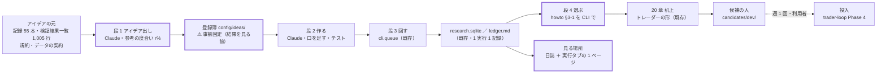
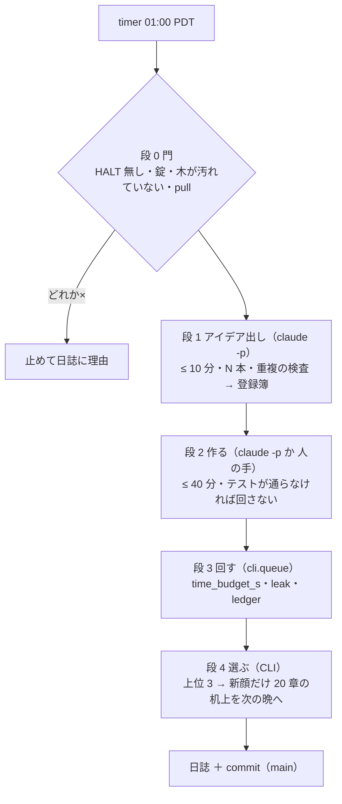

# 「採る」モデルやトレーダーを開発する手法を作る（毎日回る開発ループ）

作成 2026-10-24（土）titan。TODO「「採る」モデルやトレーダーを開発する手法を作る（既存の改善プロセスと被るので上手く統合する）」のプラン。

利用者の指示（2026-10-24）:

- **「TODOに追加。「採る」モデルやトレーダーを開発する手法を作る。既存の改善プロセスと被るので上手く統合する」**
- 流れ: **まず改善のアイデアを出す**（既存の仕組み〔トレーダーに複数のモデルを持つなど〕に囚われないで、仕組みすら改善するアイデアを出す ／ アイデアを出すときに「調査で意味がない」などの判定は行わない）→ **アイデアから実際に動くものを作り検証する** → **この処理を毎日実行し、その中から最良のものを見つける**
- **アイデアを出すときに既存のアイデアと検証を参考にするかどうか・参考の度合いは ％ などの数で決める**（度合いを設定の項目として持つ）
- 追記: **「毎日回す仕組みも考える」**（1 周を毎日回す仕組みそのものが成果物。検証のキューを毎日流すだけではない）

⚠ **このプランは設計と段取りである。Phase 0 の決めごと（§4-0）が決まるまでコードは触らない。**

⚠ **例外（2026-10-25 利用者「できる作業を選んで」）**: Phase 2 の 2-2（`cli.select_candidates`・`cli.trader_shape`）は K1〜K8 に依存しない「写すだけ」の道具なので先に入れた（§4 Phase 2 の表の ✅）。物差し・20 章は 1 行も変えていない。

## 0. 一言で

- **作るもの** ＝ 「アイデア出し → 作る → 机上で検証 → 選ぶ」の 1 周を **titan で毎晩 1 回**回す運転手 **開発ループ（`devloop`）**。既存の器（`cli.queue`・検証結果一覧・rules.md 14 ／ 20 章・howto §3・比較ページ・棚卸し）は**そのまま部品**にし、足すのは 4 つだけ: ① アイデアの**登録簿**（事前固定の置き場）② **運転手**（timer → 段を順に・錠・停止・予算）③ **選ぶ段の CLI 化**（howto §3-1 の物差しを機械で当てる・20 章の config を機械で作る）④ **見る場所**（外部のタブ「実行」に 1 ページ）
- **守るもの**（1 つも緩めない）: 回すと決めるのは結果を見る前 ／ 回したものは全部 `n_trials` に数える ／ leak 対照 ／ 1 実行 1 記録（[rules.md 14-10](../specs/experiments/feature-discovery/rules.md) 規約 6）／ **成績で人を本番に入れない**（入れるのは利用者。CLAUDE.md の 2 つ目の例外）／ 13500t の経路（`cli.predict`・執行器）に混ぜない ／ `prod` を進めない
- **「最良のものを見つける」の意味** ＝ 採用ではなく **並べること**。固定した物差し（howto §3-1 の 6 つ。2026-09-30 固定）で上位を出し → 20 章の机上（トレーダーの形）→ 候補の人（`candidates/dev/`・配線だけ）→ **本番に入れるかは利用者**（[trader-loop.md](trader-loop.md) Phase 4。検証は 3 人まで ＝ 2026-10-04 の決定）
- **「参考の度合い」** ＝ 1 日に出すアイデアのうち、既存の記録・検証を読んで出す本数の割合 r%（§3-1）。残りは記録を読まずに出す。⚠ どちらも、出した後に**重複の検査**（識別項目で検証結果一覧と突き合わせ）だけは通す ＝ これは参考ではなく数え方
- **手間【推測】**: Phase 1 半日 ／ Phase 2 1 日 ／ Phase 3 2〜3 日 ／ Phase 4 半日 ＋ 試運転 10 日。1 周の費用は §3-4

## 1. 全体像

> この図の主張: 新しく作るのは太枠の 4 つだけで、回す・数える・判定する・見る の中身は既存の器がそのまま担う。人が見るのは「朝の日誌」と「週 1 回の候補の棚」の 2 か所。

> この図の主張: 1 晩の流れは直列で、どの段も「止める条件」を持つ。Claude を呼ぶのは段 1・段 2 だけで、段 3・4 は決定的なコードが回す。

## 2. 統合の相手 — 器にする ／ 置き換える ／ 残す

TODO の「被る既存のプロセス」6 つに、関連タスク 3 本を足した 9 つ。⚠ **置き換えるのは「手で写す」作業だけ**で、規約・判定・数え方は 1 つも置き換えない。

| 既存 | いまの役割 | このタスクでの扱い | 足すもの ／ 置き換えるもの |
| --- | --- | --- | --- |
| [rules.md 14 章](../specs/experiments/feature-discovery/rules.md)（事前登録・数え方・14-11 内側の選抜） | 規約 | **器**（1 行も変えない） | 足す: **31 章「開発ループ」1 章だけ**（登録簿の形・数え方・選ぶ段・打ち切り）。⚠ **アイデアごとに章を足さない**（いま 30 章 2,100 行。アイデア 1 本の事前固定は登録簿へ） |
| `cli.queue`（2026-09-16。再開・leak 自動・検証結果一覧の吐き直し・時間の上限） | 回す器 | **器**（変えない） | 足す: その晩の queue config を登録簿から機械で作る（`config/queue/dev_<日付>.toml`）。打ち切りは既存の 3 つ（`time_budget_s`・`max_failures`・済んだものは 2 度回さない） |
| [rules.md 20 章](../specs/experiments/feature-discovery/rules.md) ＋ [howto §3-2](../specs/howto-model-trader.md)（トレーダーの形で机上に） | 器 ＋ 手順 | **器** | 置き換え: 元の config を手で写して `[[trading.trader]]` を足す作業 → **`cli.trader_shape --from <検証名>`** が同じ config を機械で書く（条件 2 つ・θ は行の θ・予算は 20-2 の「いまの人の条件」＝ $600。⚠ 中身は 20 章の写し ＝ 新しい規約ではない） |
| [howto §3-1](../specs/howto-model-trader.md)（選ぶ物差し 6 つ。2026-09-30 固定） | 手順（手で表に当てる） | **器**（物差しは変えない） | 置き換え: 吐き直して表に当てて候補の表をプランに書く → **`cli.select_candidates`**（読むだけ・`ledger_rows` から・DSR と「最大の fold を外した平均」を併記）。⚠ 併記は診断で、順位は 3-1 の 3 のまま |
| [howto §3-4](../specs/howto-model-trader.md)（候補の人にするか ＝ 利用者） | 決定 | **残す** | 変えない。ループは `candidates/dev/` に**配線だけの人**を作るところまで（sim は Sx360・成績は測らない） |
| 比較ページ [dashboard.md §19](../specs/dashboard.md)（`ledger_rows` から数字を全部引く） | 見る | **器** | 足す: 実行タブの目次に **「開発ループ」1 ページ**（登録簿 × 結果 × 日誌。読むだけ・同じ `compareview.py` の作法） |
| 棚卸し [ledger-hold-inventory.md](../specs/experiments/ledger-hold-inventory.md)（保留は区分で処遇） | 手順 | **器** | 足す: 区分 ＝ **アイデア id**（記録 1 本 ＝ 族 の規則のまま。ループの行は id を注記に持つ）。月 1 回の棚卸しの材料を `cli.select_candidates --inventory` が吐く |
| [trader-loop.md](trader-loop.md)（作成 → 投入 → 分析） | タスク | **残す** | 作成の段の出口がこのループ。投入（Phase 4）・分析（Phase 5）はそのまま。⚠ 検証は 3 人まで ＝ 入れ替えは利用者 |
| 「新しいトレーダーを作成する」[trader-model-roles.md](trader-model-roles.md)（手で候補を作る形） | タスク | **残す** | 手の形はそのまま使える（共有の経路を触るアイデアは手の形へ回す ＝ §3-3）。`T7`〜`T19` は触らない |
| 「進化的探索の継続実行」（器は 2026-09-16 に完了） | 器 ＋ アイデア | **アイデアの 1 つ** | 探索の選抜は 14-11（訓練分割の内側・数えるのは champion）。登録簿に載せれば回る |

## 3. 設計の要点

### 3-1. 参考の度合い（%）— 設定の項目

| 項目 | 中身 |
| --- | --- |
| 定義 | 1 晩に出すアイデア N 本のうち、**既存の記録・検証結果一覧・規約を読んで出す本数の割合 r%**。参考 ＝ 「落とした行の失敗の型を避ける」「保留の行を別のデータに当てる」「2 つの口を組み合わせる」など。残り (100 − r)% は**記録を読まずに**出す（渡すのは 問題の記述・データの契約〔表の列・ラベル・fold〕・守る規約だけ ＝ 既存の仕組みに囚われない側） |
| 置き場 | `experiments/feature-discovery/config/devloop.toml` の `[ideation] reference_pct = <0〜100>`・`ideas_per_day = N` |
| 既定（推し） | **r ＝ 30・N ＝ 5**（参考あり 2 本 ／ 参考なし 3 本）。理由: 利用者の強調は「囚われない」側 ／ 記録 55 本・1,005 行は「モデルの軸」をほぼ埋めており、参考ありは**組み合わせ・別データ**に寄る ／ 0% にすると重複が増え、100% にすると仕組みの改善が出ない。⚠ **既定の値は利用者（K1）**。r は日ごとに変えられる（晩ごとに記録） |
| 判定しない | 段 1 は良し悪し・意味の有無を付けない。付ける印は 3 つだけ: **手間**（小 ／ 中 ／ 大）・**測れるか**（14-2 の検出限界に対して。⚠ 「測れない」は回さない唯一の理由 ＝ 14-10 規約 1。印を付けるだけで、回す順は手間の小さい順）・**触る場所**（新しいモジュールだけ ／ 共有の経路 ＝ §3-3） |
| 仕組みの改善 | 「新しい口・新しいデータの層・新しい検証方式・新しい物差し・ループ自身の改善」もアイデアとして同じ登録簿に載せる。⚠ 検証方式・物差しを変えるものは **14 章の変更規約**（なぜ変えるか・前の結果をどう扱うか）を登録簿に書く ＝ 人の手で（§3-3） |
| 重複の検査 | 出した後、識別項目（`catalog.KEY` ＋ 予測モデル名）で検証結果一覧と突き合わせ、既にある行と同じ形は「既出」の印で登録簿に残す（回さない・数えない）。⚠ 参考の有無に関係なく通す |

### 3-2. 登録簿 — 事前固定の置き場

| 項目 | 中身 |
| --- | --- |
| 1 アイデア 1 ファイル | `experiments/feature-discovery/config/ideas/<YYYYMMDD>-<slug>.toml` |
| 項目 | `id`・`date`・`title`・`origin`（`reference` ／ `independent`・参考元の記録名）・`question`（問い）・`structure`（口・水準。⚠ 数値の組み合わせは事前固定しない ＝ 14-9）・`n_trials_planned`（数える検証数 ＝ 手法 × θ）・`key_shape`（識別項目の形・予測モデル名）・`failure_modes`・`prediction`（先に書く予想）・`effort`（小 ／ 中 ／ 大）・`measurable`・`touches`（新しいモジュールだけ ／ 共有の経路）・`status`（登録 ／ 作成中 ／ 回した ／ 人の手 ／ 既出 ／ 失敗） |
| 生成物 | `docs/specs/experiments/dev-loop/register.md`（登録簿を並べた表。`cli.devloop register` が吐き直す。⚠ 手で書かない） |
| 規約 | rules.md **31 章**に一般形を 1 度だけ書く: 登録簿の項目がそろって `status = 登録` になった時刻 ＝ 「回すと決めた時刻」／ 結果を見た後に `structure`・`prediction` を直さない（直すなら新しい id）／ 数えるのは `n_trials_planned`（leak は数えない）／ 回し直しは同じ id で 2 度しない（`cli.queue` の状態が守る） |
| 記録 | 1 アイデア ＝ 1 記録ではなく、**1 晩 ＝ 1 日誌**（`docs/specs/experiments/dev-loop/log/<YYYY-MM-DD>.md`）。中身は機械で書く: 出したアイデア（r・N）・作った ／ 人の手・回した（実行名・秒）・`n_trials` の前後・選ぶ段の上位 3・落ちたテスト。⚠ 区分（棚卸し）はアイデア id |

### 3-3. Claude の呼び方（段 1・段 2）と触ってよい場所

titan には `claude` 2.1.310 と資格情報がある【実測 2026-10-24】。project-manager は Sx360 側（titan に無い）。

| 案 | 中身 | 向き | 不向き |
| --- | --- | --- | --- |
| **(a) `claude -p`（headless）** | timer の中から `claude -p --output-format json --allowedTools … --max-turns … --max-budget-usd …` で段 1・段 2 を呼ぶ。プロンプトの正本は `experiments/feature-discovery/devloop/prompts/*.md` | 人の手なしで毎晩回る・出力を機械で検査できる・費用の上限を数で持てる | 権限の制御が要る（書ける場所の allowlist）・落ちたときの再試行 |
| (b) tmux の `ail` で `/loop` | 利用者のセッションに任せる | 作るものが無い | セッションが閉じると止まる・利用者の作業と混ざる |
| (c) クラウドの routine | `schedule` で毎日 | 機械が落ちても動く | **titan の計算（queue・GPU）が要る**ので段 3 を回せない ＝ 不向き |
| (d) 半自動 | 段 1・段 2 は利用者のセッション（手）・段 3・4 だけ timer | いまの手順そのまま・安全 | 「毎日回す」にならない（人が居ない日は止まる） |

**推し（K3）**: **段 1 ＝ (a)**（最初から）／ **段 2 ＝ 試運転は (d)、7 日通ったら (a)**。理由: 段 1 は書くものが登録簿だけで害が小さい。段 2 はコードを足すので、まず人の手で雛形（Phase 2）を作り、自動で足せる形（新しいモジュールだけ）を限ってから (a) へ。

**触ってよい場所（段 2 を (a) で回すときの allowlist。`run-devloop.sh` が書き込みの前後で差分を検査し、外に出たら捨てて「失敗」）**

| 書いてよい | 書いてはいけない（共有の経路 ＝ 「人の手」の印で止める） |
| --- | --- |
| `config/ideas/`・`config/experiment/dev_*.toml`・`config/queue/dev_*.toml`・`ail/ideas/<id>.py`（新しい口はここに。registry に登録するだけで既存の経路は 1 ビットも変わらない形）・`tests/test_ideas_*.py`・`docs/specs/experiments/dev-loop/`・`config/names.toml`（綴りの追記だけ）・`config/catalog_notes.toml`（注記の追記だけ） | `cli/run.py`・`cli/predict.py`・`cli/build.py`・`ail/validation/*`・`ail/models/*`・`ail/features/*`・`ail/catalog.py`・`ail/names.py`（⚠ 13500t の毎日の予測が通る経路。指紋 `tests/test_trading_run.py`・`test_predict.py`）／ `experiments/live-trading/`・`dashboard/`・`docs/specs/experiments/feature-discovery/rules.md`・`ledger.md`（生成物）・`TODO.md`・`CLAUDE.md` |

- 段 2 が通る条件（全部）: 研究側 pytest（指紋 2 本を含む）✅ ／ 新しい口の「無い config は 1 ビットも変わらない」テスト ✅（`tests/test_ideas_<id>.py` に必ず 1 本）／ `cli.queue --dry-run` が並びを出す ✅。1 つでも落ちたら**回さない**・`status = 失敗`・日誌に理由。⚠ 直して回し直すのは翌晩の段 2（同じ id・回数の上限 2）
- ⚠ **共有の経路を触るアイデア（新しい検証方式・物差し・層の作り方の変更）は自動で作らない** ＝ `status = 人の手`。利用者のセッションで「新しいトレーダーを作成する」の手の形（プラン → rules.md の章 → 回す）で進める。ループは毎朝の日誌にその一覧を出す
- 費用の上限: `--max-budget-usd` を段ごとに（推し: 段 1 $2・段 2 $5 ＝ 1 晩 ≤ $7【推測。利用者 K4】）。超えたら途中で止まり `status` はそのまま（翌晩は続きから）

- ⚠ **2026-10-25 の注意（Phase 1 で分かった）**: いまの作りでは新しい層・検知器・ラベル・器はどれも共有の経路（`ail/features`・`ail/detectors`・`cli/run.py`）に登録するので、K7 をそのまま当てると段 2 は何も作れない（最初の 5 本は 5 本とも「共有の経路」）。**Phase 2-1 の最初に一時の人の手で「新しい口の置き場」を 1 度作る**: `ail/ideas/<id>.py` を `ail.bootstrap` が読む（registry に登録するだけ ＝ 既存の経路は 1 ビットも変わらない・指紋テスト）＋ `cli/build.py` の `ORDER` に無い層は registry の順で後ろに足す。その後は新しい検知器・層は「新しいモジュールだけ」。`cli/run.py` の器（ラベル・合わせる口の項目）を触るものは人の手のまま

### 3-4. 1 晩の予算と打ち切り

| 何 | 推し【推測】 | 根拠 |
| --- | --- | --- |
| 時間帯 | **01:00〜04:00 PDT**（timer 01:00 PDT・`Persistent=false`） | 利用者が titan を触らない時間 ／ 研究用の日足は 2026-09-09 で止めているので市場時間に関係ない ／ 13500t の売買の時間帯（15:40〜16:10 ET）から遠い |
| 全体 | ≤ 3 時間（超えたら段 3 の `time_budget_s` が止める・段 4 は必ず回す） | `transform_detector3` 90 分・`hp_inner` 26 分【実測】級が 1 本入っても収まる |
| 段 1 ／ 段 2 | ≤ 10 分 ／ ≤ 40 分（`--max-turns`・`--max-budget-usd`） | 段 2 は雛形の写しなので長くならないはず |
| 段 3 | `time_budget_s = 5400`・`max_failures = 1`・`leak = true`・`ledger = true` | 既存の既定（leak・ledger）を切らない |
| GPU | 3090 Ti 24GB は全部使ってよい（メモリ `gpu-3090ti-usage`）。1 本が 30 分を超えると見積もる形（tsfresh・PatchTST・TimeXer）は **1 晩 1 本まで** | 全体 3 時間の内 |
| `n_trials` | **1 晩 ≤ 12**（例 アイデア 4 本 × θ 3）。1 年で ＋3,000【計算】→ DSR の土台 SR0 は √ln N で 1,005 → 4,000 で **約 9.5% 上がるだけ**【計算】 | 14-10「検証を増やしても採否は厳しくならない」（判定式に DSR は入らない） |
| 打ち切り（14-11 規約 5 と同型・3 つ） | ① 時間（上） ② 連続失敗: 段 2 が **3 晩連続で 1 本も通らない** → 止めて報告 ③ 改善停止: **14 晩連続で登録 0（全部「既出」）** → 止めて報告 | 放っておくと `n_trials` を無限に増やす |
| 止める手 | `experiments/feature-discovery/DEVLOOP_HALT`（ファイル。段 0 が見る）／ `systemctl --user disable --now ail-devloop.timer` ／ 錠 `devloop.lock`（同時に 2 つ走らない） | 実売買の `HALT`・`run.lock` と同じ形。⚠ 実売買の `HALT` とは別のファイル |

- ⚠ **段 1 の費用【実測 2026-10-25・claude-fable-5-1】**: 参考なし 3 本 **$1.42**（1 ターン・1 分 54 秒・出力 5,901 トークン）／ 参考あり 2 本 **$3.82**（14 ターン・3 分 4 秒・Read 150 行以内の制限つき）＝ **$5.24/晩** ＝ 「段 1 $2」では足りない（失敗した 1 回目 $5.06 を足すと $10.30）。⚠ `--max-budget-usd` に当たると結果は 1 文字も返らない（費用だけ払う）＝ 上限は余裕を持たせる。✅ **2026-10-25 利用者「推しで」＝ (a) 段 1 $6・1 晩 ≈ $11**（`config/devloop.toml`・rules.md 31-4 に反映）。代案だった (b) `--model` を軽くする ／ (c) N 3 は採らない

### 3-5. 記録の置き場（⚠ 既存の置き場を変えない）

| 何 | どこ | 備考 |
| --- | --- | --- |
| 実行 | `runs/research.sqlite`（`ail/runs.Run`） | 変えない。1 実行 1 記録 |
| 検証結果一覧 | `ledger.md`・`ledger_rows` | `cli.queue` が吐き直す（既存） |
| 登録簿 | `config/ideas/*.toml` → `docs/specs/experiments/dev-loop/register.md` | 事前固定の正本 ＝ TOML（git 管理） |
| 日誌 | `docs/specs/experiments/dev-loop/log/<YYYY-MM-DD>.md` | 1 晩 1 枚・機械で書く |
| 状態 | `research.sqlite` の `queue_state` と同じ置き場に 1 行（`devloop`。連続失敗の数・最後に回した晩・費用の累計） | ファイルを増やさない |
| アイデア出しの原文 | 日誌に全文（参考あり ／ なし を分けて） | 「意味の有無の判定はしない」の証拠 |
| 候補の人 | `experiments/live-trading/config/traders/candidates/dev/<id>.toml` | 配線だけ。呼び名は利用者 |

### 3-6. 選ぶ段 — 「最良のものを見つける」の物差し（⚠ 結果を見る前に 31 章に書く）

| # | 決まり | 理由 |
| ---: | --- | --- |
| 1 | 物差しは **howto §3-1 の 6 つをそのまま**（対象 ＝ 閾値売買・保留以上 ／ 除く行 ／ 第 1 キー fold の符号の正の数・第 2 キー 上乗せの平均 ／ θ 違いは 1 行 ／ 上位 3 ／ 印）。⚠ 1 つも変えない | 2026-09-30 に固定・2026-10-08 に利用者が決まり 2 を補った。変えると「結果を見て選んだ」になる |
| 2 | 併記（診断。順位に使わない）: DSR（`n_trials` ＝ その時点）・日次 t・**最大の fold を外した平均**（棚卸し §3 の列）・取引/fold・保有日率 | 良い数字は根拠「中」が上限（11 章 規約 2・3）。読む人が「1 fold が作った上乗せ」に気づける |
| 3 | 毎晩: 上位 3 本を日誌と実行タブに。**新しく上位 3 に入った行だけ**、20 章の机上（条件 2a 5 本・$600 ／ 2b 全銘柄）を**次の晩の queue に自動で足す**（＋2 ／ 本 数える。事前固定は 31 章の一般形 ＝ 「上位に入った行は机上にかける」を先に書く） | howto §3-2 と同じ。手で写す作業だけが機械になる |
| 4 | 週 1 回（金曜の晩）: 机上の判定が **採る**（20-3 の 2 ＝ 対「持ち続ける」上乗せ > 0 かつ fold 5/5）の形だけ、`candidates/dev/` に配線だけの人を作る。保留は棚に残す（候補にしない） | howto §3-3 の表のまま。⚠ 「保留の 1 本を候補にする」(b) は利用者の決定（§3-4）なので自動ではやらない |
| 5 | ⚠ **本番に入れるかは利用者**（trader-loop Phase 4・検証は 3 人まで・11/4 の判定の後）。ループは「候補の棚」を見せるところまで | 成績で人を採らない（CLAUDE.md） |
| 6 | 14-11 との関係: 選ぶのは**検証結果一覧に全部数えた行**の中から ＝ 数え落としは無い（(B) の問題は「数えない候補の中から選ぶ」こと）。採否の判定（13-7・20-3）は変えないので**規約の書き換えは要らない**。⚠ ただし「上位 3 本が毎晩動く」は多重検定のいちばん甘い見方であり、DSR を横に出す（2） | 比較ページ §19-3 の注意と同じ |

### 3-7. git と 2 台の機械

- ループがコミットするのは **`main` だけ**（登録簿・日誌・`register.md`・`ledger.md`・`ledger_rows`・足した口とテスト・`names.toml` の綴り）。⚠ `prod` は進めない（「デプロイ」は利用者の依頼のみ）
- ⚠ CLAUDE.md「コミット・push はユーザーから依頼されたときだけ」に当たるので、**ループの毎晩の commit ＋ push には利用者の常設の許可（K5）が要る**。無ければ: コミットせず作業ツリーに置き、朝の日誌に「未コミット」と書く（利用者が push する）
- 段 0: `git pull --ff-only`（失敗 ＝ 止める）／ 作業ツリーが汚れていたら（利用者の未コミット）**止めて報告**（コードの混線を避ける。推し。代案 ＝ 段 3・4 だけ回す）
- Sx360 は読むだけ。Sx360 の作業ツリーは朝に pull

## 4. Phase と Step

TODO の Step 1〜4 を Phase 1〜4 に置き直す（Step の番号は Phase の括弧に残す）。⚠ **Phase 1・2 は最初の 1 周を手で通し（＝ 自動化の雛形）、Phase 3 でそれを毎晩回る形にする。** 利用者の流れ「まずアイデア → 作って検証 → 毎日 → 最良」の順そのまま。

### Phase 0: 決めごと（⚠ 利用者）

✅ **2026-10-25 利用者「推す案で」＝ K1〜K8 とも下の表の「推す」で確定**（K6 は「基準線」に 全部使う（基準） を含める 9/30 の当て方のまま）。

| # | 決めること | 推す | 代案 |
| ---: | --- | --- | --- |
| **K1** | 参考の度合い r% と 1 晩の本数 N（§3-1） | **r ＝ 30・N ＝ 5** | r ＝ 0（全部独立）／ 50 ／ 100（全部参考）。N ＝ 3 ／ 10 |
| **K2** | どこまで人の手なしで回すか | **段 1〜4 を自動・候補の人の作成まで自動・本番は利用者**（§3-6 の 5） | 段 4 の机上を手で（毎晩の `n_trials` を増やさない）／ 候補の人も手で |
| **K3** | Claude の呼び方（§3-3） | **段 1 ＝ `claude -p`・段 2 ＝ 試運転は人の手 → 7 日通ったら `claude -p`** | 段 2 を最初から `claude -p` ／ 全部半自動 (d) |
| **K4** | 1 晩の予算（§3-4） | **3 時間・`n_trials` ≤ 12・Claude の費用 ≤ $7【推測】・GPU 重いもの 1 本** | 2 時間 ／ ≤ 6 ／ ≤ $3 |
| **K5** | ループの commit ＋ push（`main` だけ）の常設の許可 | **出す**（毎晩 1 コミット・メッセージの頭に `devloop:`） | 出さない（未コミットで置き、利用者が push） |
| **K6** | 「最良」の物差し（§3-6） | **howto §3-1 のまま ＋ DSR ほか併記・上位 3・机上は新顔だけ・候補は「採る」だけ** | 保留の上位も候補に（＝ §3-4 (b) を自動に。推さない） |
| **K7** | 共有の経路を触るアイデアの扱い | **自動で作らず「人の手」の印 → 利用者のセッションで手の形** | ループに任せる（推さない。13500t の予測の経路） |
| **K8** | 時間帯・曜日 | **毎日 01:00 PDT（土日も。データは止まっているので市場に無関係）** | 平日だけ ／ 週末だけ重いものを |

### Phase 1（Step 1）: 改善のアイデアを出す — 最初の 1 周を手で（titan・Claude のセッション）

✅ **2026-10-25 12:31 PDT 済み（titan）**: 1-1 `config/devloop.toml`・rules.md 31 章（下書き）・`cli/devloop.py register`（検査・`--promote`・`--set`・既出の疑い・`register.md`）／ 1-2 段 1 を `claude -p` で 1 度回した（参考なし 3 本 $1.42・参考あり 2 本 $3.82【実測】。原文 `docs/specs/experiments/dev-loop/ideas-2026-10-25.md`）／ 1-3 登録簿 `config/ideas/20261025-*.toml` 5 本（登録 4・人の手 1・既出 0）→ `register.md` ／ 1-4 プロンプトの正本 `devloop/prompts/{contract,ideate_ref,ideate_free}.md`。記録は [dev-loop.md](../specs/experiments/dev-loop.md) §1。⚠ 見つかったこと 2 つ: ① 段 1 の費用 $5.24/晩 ＞ K4 の $2（§3-4）② 5 本とも共有の経路に触れる（§3-3 の注意 ＝ Phase 2-1 の最初に `ail/ideas` の口）

| Step | 中身 | 成果物 |
| --- | --- | --- |
| 1-1 | `config/devloop.toml`（r・N・予算・時間帯・allowlist）・登録簿の項目（§3-2）・rules.md **31 章**の下書き（登録簿 ＝ 事前固定・数え方・選ぶ段 §3-6・打ち切り §3-4。⚠ 結果を見る前に書く） | `config/devloop.toml`・rules.md 31 章 |
| 1-2 | アイデア出し **2 束**: 参考あり（記録 55 本・検証結果一覧・規約を読んで r% 分）／ 参考なし（問題の記述・データの契約・規約だけを渡して (100 − r)% 分）。⚠ **良し悪し・意味の有無を書かない**。印は 手間・測れるか・触る場所 の 3 つだけ。仕組みの改善（新しい口・新しいデータ・新しい検証方式・ループ自身）も同じ束に入れる | `docs/specs/experiments/dev-loop/ideas-2026-10-xx.md`（原文全部） |
| 1-3 | 重複の検査（識別項目で突き合わせ）→ 登録簿へ（`config/ideas/*.toml`）→ `register.md` を吐く | 登録簿・`register.md` |
| 1-4 | 段 1 のプロンプトの正本（参考あり ／ なし の 2 本）を、1-2 でやったことから起こす | `devloop/prompts/ideate_ref.md`・`ideate_free.md` |

### Phase 2（Step 2）: アイデアから動くものを作り、机上で検証する — 最初の 1 周を手で（titan）

✅ **2026-10-25 12:51 PDT 済み（titan）**: 2-1 一時の口（`ail/ideas` を bootstrap が読む・`build.layer_order`・`prep.train_label`）→ 手間の小さい順に 2 本（`h5-pick-centered` ＝ `ail/ideas/` に登録だけ ／ `xs-excess-label` ＝ `cli/run.py`・`catalog`・`names` に 1 行ずつ ＝ 人の手）→ queue `dev_20261025`（6 実行 67 秒【実測】）＝ **採る 0 ／ 保留 1 ／ 落とす 8・n_trials 1,005 → 1,014（予定 ＋9 と一致）**・leak 6 本とも跳ねた ／ 2-2 ✅（前倒し）／ 2-3 `devloop/prompts/build.md` ／ 2-4 記録 [dev-loop.md](../specs/experiments/dev-loop.md) §2（予想との突き合わせ・選んだ期間の分布・上位 3 は動かず）。rules.md 31-5 に実装の場所。残る登録 2 本（`mkt-layer`・`roles-entry-stop`）は次の晩（31-2 の 3）

| Step | 中身 | ⚠ |
| --- | --- | --- |
| 2-1 | 登録簿から **手間の小さい順に 2〜3 本**（14-10 規約 4）。口を足す（`ail/ideas/<id>.py`・`config/experiment/dev_*`・`tests/test_ideas_<id>.py` ＝ 「無い config は 1 ビットも変わらない」）→ 指紋テスト → `config/queue/dev_<日付>.toml`（`leak = true`・`ledger = true`）→ 回す → 記録 | ⚠ 回すと決めるのは結果を見る前（登録簿の `status = 登録` の時刻）。回したものは全部数える |
| 2-2 | 段 4 の CLI: **`cli.select_candidates`**（howto §3-1 を `ledger_rows` に当てる・併記の列・`--inventory` で棚卸しの材料・読むだけ）／ **`cli.trader_shape --from <検証名>`**（20 章の config を機械で書く。既存の `trader_*.toml` と同じ中身になることをテスト） | ⚠ 物差し・20 章は 1 行も変えない（写すだけ）。✅ **2026-10-25 titan（前倒し）**: 2 本とも入れた（`cli/select_candidates.py`・`cli/trader_shape.py`・テスト 17 本）。`select_candidates` は 9/30 の実測を `--asof` で再現（745 → 17 → F1-7・F2-2・D2）・併記 5 列 ＝ 診断・いまの上位 3 ＝ F1-7 ／ F2-2 ／ `M1 3本の平均`（1.3 秒【実測】）／ `trader_shape` は既存 5 本と意味が同じ（tomllib で等しい）・2a は $600・合成は `methods`。⚠ `--inventory` は Phase 4-4 で。⚠ 決まり 2 の「基準線」に 全部使う（基準） を含める読み（9/30 の当て方）を howto §3-1 に明文化した ＝ K6 で確かめる 1 点 |
| 2-3 | 段 2 のプロンプトの正本（口の足し方の雛形 ＝ 2-1 でやったこと）・段 2 の通る条件（§3-3）を機械の検査に | `devloop/prompts/build.md` |
| 2-4 | 記録 `docs/specs/experiments/dev-loop.md` §1（手で通した 1 周: 出した本数・作った・回した・`n_trials` の前後・選ぶ段の出力・予想との突き合わせ） | 判定は 13-7 ／ 20-3 のまま |

### Phase 3（Step 3）: 毎日回す仕組み（titan）

✅ **2026-10-25 17:50 PDT 3-1〜3-6 済み（titan）**: 3-1 `run-devloop.sh` ＋ `cli.devloop night`（段 0 門〔HALT・錠・汚れた木・pull --ff-only・打ち切り ② ③〕→ 段 1〜4 → 日誌 → commit〔K5〕。状態は `queue_state` の `devloop`）／ 3-2 `claude -p` の呼び方（`--tools`・`--allowedTools`・`--max-turns`・`--max-budget-usd`・1 回だけ再試行・出力の検査 ＝ 登録簿の項目・allowlist の外は捨てる）。⚠ timer の環境（systemd --user）は PATH に `~/.local/bin` が無い ＝ 絶対パスなら動いた【実測 $0.21】→ `run-devloop.sh` が PATH を足す ／ 3-3 `systemd/ail-devloop.{service,timer}` ＋ README（⚠ 入れるのは利用者）／ 3-4 実行タブの「開発ループ」（`dashboard/devloopview.py`・[dashboard.md §20](../specs/dashboard.md)）／ 3-5 止め方（`DEVLOOP_HALT`・timer disable・`cli.devloop state --reset`）・連続失敗の数は状態に ／ 3-6 テスト（運転手 16 本・画面 4 本）。dry-run（段 0・4）は実リポジトリと systemd-run の両方で通り、初回の上位 3 は `state --seed-top` で写した（初回の晩に机上を足さない）。⏳ **3-7 試運転は利用者が timer を入れてから**（3 晩 ＝ 段 1 だけ自動 → 7 晩 ＝ 全段）

| Step | 中身 | ⚠ |
| --- | --- | --- |
| 3-1 | 運転手 **`run-devloop.sh`**（プロジェクト直下。段 0 門〔`DEVLOOP_HALT`・錠・汚れた木・`git pull --ff-only`〕→ 段 1 → 段 2 → 段 3 → 段 4 → 日誌 → commit〔K5〕）＋ `cli.devloop`（段の中身・状態・日誌・`register.md`） | ⚠ 段ごとに時間の上限・どの段で止まっても日誌は書く |
| 3-2 | Claude の段: `claude -p` の呼び方（`--output-format json`・`--allowedTools`・`--max-turns`・`--max-budget-usd`・`--permission-mode`）・出力の検査（登録簿の項目がそろっているか・書いた場所が allowlist の内か ＝ 外なら `git checkout` で捨てる）・1 回だけ再試行 | ⚠ まず `claude -p` が titan の timer の環境（ログインしていない user セッション）で動くかを 1 度確かめる（`loginctl enable-linger`） |
| 3-3 | timer **`ail-devloop.timer`**（`experiments/feature-discovery/systemd/`。01:00 PDT・`Persistent=false`・雛形は `live-trading/systemd/` と同じ形）＋ README | ⚠ 入れるのは利用者（実売買の timer と同じ決まり） |
| 3-4 | 見る場所: 外部のタブ「実行」の目次に **「開発ループ」**（登録簿 × 結果〔`ledger_rows`〕× 日誌。読むだけ・`compareview.py` の作法・見張りは `register.md` と日誌の mtime） | ⚠ 「予測モデル」「トレーダー」のタブには出さない（くらべない決まり） |
| 3-5 | 止め方と打ち切り（§3-4 の 3 つ・`DEVLOOP_HALT`・timer disable）・連続失敗の数の記録 | — |
| 3-6 | テスト（§6） | — |
| 3-7 | **試運転**: 3 晩 ＝ 段 1 だけ自動（段 2 は朝に手で）→ 7 晩 ＝ 全段 → 記録 §2（費用【実測】・落ちた段・直したこと） | ⚠ 試運転の結果で物差し・水準を動かさない。直すのは運転手の不具合だけ |

### Phase 4（Step 4）: 毎日の結果から最良のものを見つける

| Step | 中身 | ⚠ |
| --- | --- | --- |
| 4-1 | 選ぶ段の固定（§3-6）を rules.md 31 章に書く（⚠ Phase 1 の 1-1 で下書き・ここで確定 ＝ ループを回す前） | 結果を見る前。✅ **2026-11-01 titan**: 31 章の頭の「下書き」を「確定」に・31-3 に 3a（「新しく上位 3 に入った」＝ 前の晩の `last_top` に無い検証名・足さない行・config の名前 ＝ `select_stage` の写し）／ 3b（机上の持ち越しは次の晩の先頭・1 晩 ≤ 12 に数える）／ 4 に「金曜の晩 ＝ 土曜 01:00 の回」と「`--weekly` は未実装（4-2）」を足した。運転手の毎晩の回はまだ動いていない ＝ 結果を見る前 |
| 4-2 | 週 1 回の **候補の棚**: `cli.select_candidates --weekly` → 机上の判定が「採る」の形だけ `candidates/dev/` に配線だけの人（howto 2 章 2-1〜2-6 の写し・`traders.toml`・`models.toml`・`compare.toml` の追記）。呼び名は利用者 | 成績で本番に入れない。✅ **2026-11-01 titan**: `--weekly` と運転手の土曜の段 `weekly_stage`（下書きは `docs/specs/experiments/dev-loop/drafts/`・1 本の手法の行だけ・合成は人の手）・テスト 2 本。⚠ `candidates/dev/` に機械で置かない（呼び名と `models.toml` の説明が無いと外部のタブのテストが落ちる ＝ 写すのは人）。いま載る行は 0 |
| 4-3 | 利用者の投入 ＝ [trader-loop.md](trader-loop.md) Phase 4 の手順（howto 2-7 ＋ 2-8。検証は 3 人まで・11/4 の判定の後）。sim は Sx360 | 利用者 |
| 4-4 | 棚卸し（月 1 回）: 保留の行を**アイデア id の区分**で処遇の案 → 利用者「閉じて」→ `[[closed]]`（2026-10-22 と同じ規則） | 判定・`n_trials` は変えない。✅ **2026-11-01 titan**: 材料の CLI `cli.select_candidates --inventory`（保留で閉じる注記の無い行を区分ごとに・区分 ＝ 開発ループの行はアイデア id〔config の頭の「登録簿 `<id>`」〕／ `dev_tr_*` は机上の持ち越し ／ それ以外は実験の族〔末尾の `_t14` などを落とす〕・テスト 1 本）。いま 25 行 ／ 8 区分（役割つきの組 12・選抜 11・登録簿 2）。処遇の案と「閉じて」は今までどおり人 ＝ 運転手には入れていない |

### Phase 5: 片付け

- CLAUDE.md に「開発ループ」の節（起こし方・止め方・守るもの）／ howto §3 に「毎晩はループが 3-1〜3-2 を機械でやる」の 1 行 ／ TODO → DONE ／ プランを archive へ

## 5. 影響範囲・手間【推測】・危ないところ

| 項目 | 中身 |
| --- | --- |
| 触る場所（新規） | `run-devloop.sh`・`cli/devloop.py`・`cli/select_candidates.py`・`cli/trader_shape.py`・`config/devloop.toml`・`config/ideas/`・`ail/ideas/`・`devloop/prompts/`・`experiments/feature-discovery/systemd/`・`docs/specs/experiments/dev-loop/`・rules.md 31 章・`dashboard/devloopview.py`（実行タブの 1 ページ） |
| 触らない | `cli/run.py`・`cli/predict.py`・`ail/validation/*`・`ail/models/*`・執行器・管理画面 `app/`・研究用 `data/`（日足は 2026-09-09 で止めたまま。新しいデータのアイデアは新しい置き場 ＝ `data-widen/` の形） |
| 手間 | Phase 1 半日 ／ Phase 2 1 日 ／ Phase 3 2〜3 日 ／ Phase 4 半日 ／ 試運転 10 晩 |
| 1 晩の費用 | 計算 ≤ 3 時間（GPU 含む）・Claude ≤ $7【推測】・`n_trials` ≤ 12 |
| ⚠ 危ない 1 | **自動で足した口が 13500t の予測の経路を変える** → allowlist（§3-3）＋ 指紋テストが落ちたら回さない。共有の経路は「人の手」 |
| ⚠ 危ない 2 | **`n_trials` が増え続ける** → 1 晩の上限・打ち切り 3 つ・「既出」の検査。⚠ DSR への効きは √ln N（§3-4）＝ 採否は厳しくならないが、「上位 3 本」は甘い見方なので DSR を併記 |
| ⚠ 危ない 3 | **「最良」を本番に入れる判断が機械に寄る** → ループは候補の棚まで。入れるのは利用者（trader-loop Phase 4） |
| ⚠ 危ない 4 | **利用者の作業ツリーと混ざる** → 段 0 で汚れていたら止める・01:00〜04:00 PDT・`main` だけ・1 晩 1 コミット |
| ⚠ 危ない 5 | **保留が溜まる**（fold は固定の 5 つ・データは止まっている ＝ 自然に決着しない） → 月 1 回の棚卸し（区分 ＝ アイデア id） |
| ⚠ 危ない 6 | **アイデア出しが同じものを繰り返す** → 重複の検査・14 晩連続「既出」で止めて報告・r を変えるのは利用者 |

## 6. テスト方針

| 何 | テスト |
| --- | --- |
| 登録簿 | 項目がそろわない TOML は `status = 登録` にできない ／ 結果を見た後の `structure`・`prediction` の変更は `register.md` の差分で落ちる（登録時刻より新しい mtime で中身が違う） |
| 段 0 | `DEVLOOP_HALT` で止まる ／ 錠が取れないと止まる ／ 汚れた木で止まる ／ pull が ff できないと止まる |
| 段 2 | allowlist の外に書いたら捨てる ／ 指紋テスト（`test_trading_run`・`test_predict`）が落ちたら回さない ／ 「口の無い config は 1 ビットも変わらない」が無い id は回さない |
| 段 3 | `cli.queue` の既存のテスト（再開・leak・時間の上限）そのまま |
| 段 4 | `cli.select_candidates` が howto §3-1 の実測（2026-09-30: 1,245 行 → 17 行 → 上位 3 ＝ F1-7・F2-2・D2）を再現する ／ `cli.trader_shape` が既存の `trader_*.toml` と同じ config を書く |
| 予算 | 1 晩の `n_trials` の上限・時間の上限・費用の上限で止まる ／ 連続失敗 3・既出 14 で止まる |
| 見る場所 | 実行タブのテスト（`test_compare_tab.py` の作法）＝ 読むだけ・`out/`・`state/`・`.env` を読まない |

## 7. やらないこと

- 13500t・`prod`・執行器・管理画面 `app/` を触らない（デプロイは利用者の依頼のみ）
- 成績で人を本番に入れない・止めない・替えない（候補の棚まで）
- 結果を見て 物差し（howto §3-1）・θ・費用・fold・判定式を動かさない（変えるなら 14 章の変更規約 ＝ 人の手）
- アイデアごとに rules.md の章を足さない（31 章の一般形 ＋ 登録簿）
- 「意味がない」でアイデアを落とさない（回さないのは「測れない」か規約に反するときだけ ＝ 14-10 規約 1）
- 研究用の `data/` を取り直さない（新しいデータは新しい置き場で・`end_date` でそろえる）
- 「予測モデル」「トレーダー」のタブに比べる文・順位を出さない（§16・§17 の決まり）

## 8. 関連

- TODO 親タスク ／ 関連 3 本: [trader-loop.md](trader-loop.md)（投入・分析）・[trader-model-roles.md](trader-model-roles.md)（手で候補を作る形）・進化的探索の継続実行（[evolutionary-search.md](../specs/experiments/evolutionary-search.md)・[runner プラン](archive/evolutionary-search-runner.md)）
- 器: [rules.md 14 章 ／ 20 章](../specs/experiments/feature-discovery/rules.md)・[howto §3](../specs/howto-model-trader.md)・`cli.queue`・[dashboard.md §19](../specs/dashboard.md)・[ledger-hold-inventory.md](../specs/experiments/ledger-hold-inventory.md)
- 数字の出どころ【実測 2026-10-24】: 検証結果一覧 1,005 行（採る 1 ／ 保留 172〔注記つき 149〕／ 落とす 832）・記録 55 本・実験 config 177 本・実行 436 本（`research.sqlite`）
