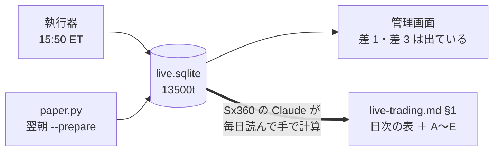
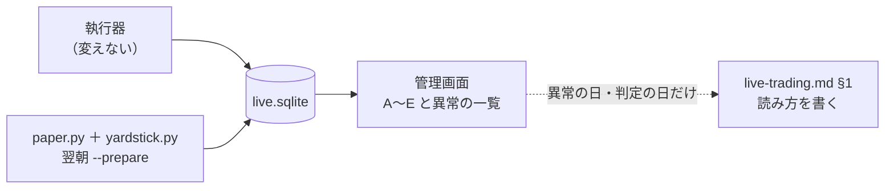
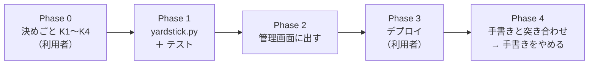
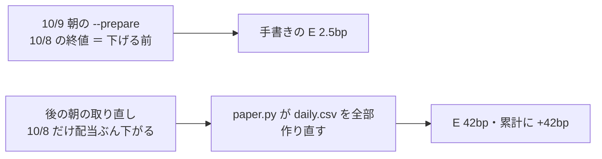

# 実売買の日次の記録を自動で出す

利用者の質問（2026-10-13）: **「記録はなんで毎回手動で行わないといけない？」** → 「プランを書いて」

## 1. 目的・背景

いまは営業日ごとに Sx360 の Claude が 13500t の DB（`live.sqlite`）を読み、[live-trading.md §1](../specs/experiments/live-trading.md) の日次の表と「新しい 3 人の物差し」（A〜E）の表へ手で写している。
手で写しているのは**決まりではなく、仕組みを作っていないだけ**。経緯は 3 つ:

1. 最初の頃は毎日のように事故があり（9/22 の起動遅れ・10/5 の上限超え・10/6 の `live.env` の引用符）、数字より「何が起きたか」を書く必要があった
2. 【実測】の数字の正本は仕様書と決めてある（CLAUDE.md「説明の正本の分け方」）
3. 13500t の DB を読めるのは Sx360 からだけ（titan から届かない）

ところが、記録の中身のほとんどは DB から機械的に出せる。人（Claude）の判断が要るのは「事故の原因」「1 日の運」といった読み方だけ。

| 記録の中身 | いま | 自動にできるか |
| --- | --- | --- |
| 注文・約定の本数・差 1 | 管理画面が計算済み（`dashboard/app/live.py` の `_diff1_bp`・`history`） | ✅ 出ている。写しているだけ |
| A 差 1（中央値 ／ 最大） | 同上 | ✅ 同上 |
| B 持ち続けるとの差 | Claude が毎回手で計算（気配・売買履歴・初日の約定） | ✅ 定義が決まっている（[trader-loop.md Phase 2](trader-loop.md)）。⚠ 基準の株数の決め方だけ文にする（K3） |
| C 机上との一致 | Claude が合図と注文を読んで手で判定 | ✅ 合図の行に `position_before`（合図の前の持ち高）があるので、規則（rules.md 13-4）で出る判断と実物の判断（注文の向き ／ `hold` ／ `skip`）を直接突き合わせられる（⚠ 実装で変えた: 最初の案は `paper.py` に口を足す形だった ＝ `paper.py` は触らない） |
| D 無人運転 | Claude が `trade.log`・`reconcile` を読む | ✅ ほぼ（起動・終了・食い違いは `events` の `start` ／ `end` ／ `positions_outside_ledger` ／ `position_short` ／ `journal_unresolved`）。⚠ 「人手の回数」は記録から分かるもの（`HALT`・指示・`reconcile.py` の操作の履歴）だけ数える |
| E 差 3（そろえた紙上） | `paper.py` が `out/daily.csv` に書く（朝の `--prepare`）・管理画面も読む | ✅ 出ている。写しているだけ |
| cron の `end rc=` | `check.sh` が 16:20 ET に判定（`checks.log`） | ✅ 判定済み。⚠ 管理画面はホストのログを読めない（`events` から同じことを出す） |
| 事故の原因・読み方 | Claude | ❌ 人の判断。ここだけ手で書く |

いまの流れ（手で写している箇所が太線）:

## 2. 対応方針

**`paper.py` と同じ形の「読むだけの後処理」を 1 本足し、管理画面に出す。仕様書には異常の日と判定の写しだけを書く。**

直した後の流れ（1 図 1 主張: 人の手が「読み方」だけに減る）:

- 新しい部品 `experiments/live-trading/yardstick.py`（物差し）: 入力は執行器の記録（`signals` ／ `orders` ／ `ledger` ／ `events` ／ `quotes`）と `out/daily.csv`。出力は `out/yardstick.csv`（1 日 1 行 × トレーダー）。⚠ **読むだけ**（ネットワークを使わない・発注しない・売買履歴を書かない）。毎回ぜんぶ作り直す（何度流しても同じ）＝ `paper.py` と同じ約束
- 起こす場所は朝の `run-live.sh --prepare`（`paper.py` の直後）。E は公式終値が要るので、どのみち翌朝にならないとそろわない ＝ 同じ時刻にまとめる。A・D の当日分は、管理画面がいまも記録から直接出している
- 管理画面は `yardstick.csv` を読むだけ（`daily_rows` と同じ形）。トレーダーの詳細に A〜E の表、全体の詳細に「異常の一覧」（`end` が 0 以外・`journal_unresolved`・`positions_outside_ledger`・`position_short`・`order_unknown`・`blocked_symbol`・C が合わない日・A が線 5bp を越えた日）
- ⚠ **執行器（`run_day.py`・`execute.py`・`plan.py`）は変えない**（新しい 3 人の記録の途中。いまの方針「記録の間は執行器を変えない」を守る）
- ⚠ **損益で人を採らない**（B は見るだけ。表に注記を固定で置く）

### 利用者に決めてほしいこと（⚠ 実装の前に）

✅ **2026-10-13 利用者決定「全部おススメで進めて」＝ K1〜K4 とも推す案**（K1 は CLAUDE.md「説明の正本の分け方」の例外に、K2 は `live-trading.md` §1 の頭に書いた）

| # | 論点 | 推す案 | 理由 |
| --- | --- | --- | --- |
| K1 | 日次の数字の正本 | **DB と管理画面**（`yardstick.csv`）。仕様書は「異常の日の読み方」と「判定の日の写し」だけ | 同じ数字を 2 か所に書かない（CLAUDE.md の「同じしくみの説明を 2 度書かない」と同じ考え）。⚠ CLAUDE.md の「数字は仕様書」の例外として書き足す |
| K2 | 普段の日の §1 の行 | **書かない**。週に 1 度（金曜の引け後）、Claude が A〜E の表を写して 1 行の所見を付ける | 毎日の手作業をなくす。週 1 回でも 20 営業日の判定には足りる |
| K3 | B の基準（持ち続ける）の株数 | **その人の 1 日目の 15:50 ET の中値で `plan.size_intents` と同じ丸め**（予算 ÷ 5 本 → 整数株）。何も買わなかった人（T4 の 1 日目）も同じ計算 | 10/8・10/9 の手計算は「T1・T6 の 1 日目と同じ株数」で、T4 も同じ株数を使った。式にすると同じ値になる見込み【推測】。違えば 10/9 の手計算と並べて報告する |
| K4 | 「人手」の数え方 | **記録から分かるものだけ**（`HALT` の置き外し・名簿 ／ 指示の操作・`reconcile.py` の書き込み・`liquidate.py`）。投入の手順（名簿の開始）は数えない | 記録に残らない人手（ssh で何かした）は機械では数えられない。数えられないものは「数えていない」と表に書く |

## 3. Phase と Step

### Phase 0: 決めごと（⚠ 利用者）✅ 2026-10-13

- K1〜K4（§2 の表）。決まるまで実装しない
- 決まったら CLAUDE.md の「説明の正本の分け方」に 1 行足す（日次の数字は `yardstick.csv`）

### Phase 1: `yardstick.py`（titan ／ Sx360。⚠ 本番は触らない）✅ 2026-10-13 Sx360

✅ `experiments/live-trading/yardstick.py` ＋ `tests/test_yardstick.py` 10 本（10/7〜10/9 を記録の値から合成で作り直し、手書きの A・C・D と B の「その人の損益」〔T1 −$17.92 ／ T4 +$0.01 ／ T6 −$17.84〕を再現）・`run-live.sh --prepare` の `paper.py` の後。⚠ 13500t の記録を Sx360 へまとめて写すのは自動の安全判定に止められた（本番の記録の持ち出し）＝ 本物との突き合わせは Phase 4（デプロイの後に 13500t の上で）

⚠ 見つかったこと: **B は手書きと少しずれる**（T1 −$0.14 ／ 手書き −$0.10・T4 +$17.79 ／ +$17.83・T6 −$0.06 ／ −$0.02）。基準の取得単価が K3 ＝ 1 日目の中値で、手書きは T1 の約定だった ＝ 1 日目の差 1（T +2bp・BAC +2bp ≈ $0.04）のぶん。K3 どおりなので式を変えない

| Step | 中身 |
| --- | --- |
| 1-1 | A: `orders` から差 1（中央値 ／ 最大・本数）。管理画面の `_diff1_bp` と同じ式（共有できるなら共有する。⚠ 管理画面から執行器側へ import の向きを作らない ＝ 式を執行器側に置いて管理画面が import する形） |
| 1-2 | B: 売買履歴の実現 ＋ 含み（15:51 ET の中値）− 手数料（1 日目の買いを含む）と、基準（K3）の時価の差。USD と bp of 予算 |
| 1-3 | C: 合図（買い% ／ 出口%）・θ・`position_before` から規則で出る判断と、実物の判断（`orders` ＋ `hold` ／ `skip`）を突き合わせ、合わない銘柄を列に残す。見送り（`too_small` 等）は不一致に数えない・手じまいと一時停止の日は見ない |
| 1-4 | D: 営業日（NYSE の暦）ごとに `start` ／ `end` の有無と結果・食い違いの事象・人手（K4） |
| 1-5 | E: `daily.csv` の `diff3a_bp` ／ `diff3a_cum_bp` を写す（計算しない） |
| 1-6 | `run-live.sh --prepare` の `paper.py` の直後に起こす（失敗しても準備は失敗にしない ＝ `paper.py` と同じ扱い。⚠ `--prepare` の外の経路〔発注の回〕は触らない） |

### Phase 2: 管理画面に出す ✅ 2026-10-13 Sx360

✅ `dashboard/app/live.py`（`yardstick_rows`・`_ys_view`・`anomalies`。まとめは `yardstick.summarize` を道で読んで呼ぶだけ）・`trader.html`・`overall.html`・`glossary.toml` 2 語・`dashboard.md` §13-13・`tests/test_live.py` 2 本。`./run-tests.sh` ✅（管理画面 268 本）

| Step | 中身 |
| --- | --- |
| 2-1 | `live.py` に `yardstick_rows`（`daily_rows` と同じ形で読むだけ。無ければ空・仮データは出さない） |
| 2-2 | トレーダーの詳細に A〜E の表（全期間 ＝ その面の決まり）。B の横に「⚠ 損益で人を採らない」を固定で置く。言葉は `glossary.toml` に（i マーク） |
| 2-3 | 全体の詳細に「異常の一覧」（直近 20 営業日 ＝ その面の決まり）。異常 0 の日は出さない |
| 2-4 | ⏭ やめた: シミュレーション・デモには `daily.csv` も無い（`paper.py` を流していない・デモの記録は `quotes.jsonl` を除いてある ＝ B が出ない）。紙上の対照と同じ扱いにそろえ、`yardstick.csv` が無ければ節を出さない。シミュレーションで見たいときは `python3 yardstick.py --out-dir sim/<名前>/out` を手で流す |

### Phase 3: デプロイ（⚠ 利用者の「デプロイ」）

- `run-live.sh`・`dashboard/` は本番の経路 ＝ `prod` を進めると 13500t が 15 分以内に取り込む。⚠ 15:00〜16:15 ET（12:00〜13:15 PDT）は `run-deploy.sh` が拒む
- 次の朝 06:00 PDT（09:00 ET）の `--prepare` で初めて `yardstick.csv` ができる

### Phase 4: 手書きと突き合わせて、手書きをやめる（Sx360 の Claude）

- 最初の 1 回は、手で書いた 10/8・10/9（と、それまでに書いた日）の A〜E と `yardstick.csv` を並べる。違えば**どちらが正しいかを確かめてから**直す（手計算の誤りもありうる）
- 一致したら（K2 の推す案なら）普段の日の §1 の行をやめ、週 1 回の写しと異常の日の読み方だけにする
- 後片付け: TODO の親を DONE へ・このプランを `archive/` へ

✅ 2026-10-15 07:50 PDT（10:50 ET）Sx360: 13500t の最初の `yardstick.csv`（10/15 06:05 PDT の `--prepare`・50 行・9/18〜10/14）を手書き（10/8・10/9）と並べた【実測】

| 物差し | 手書き | `yardstick.csv` | 判定 |
| --- | --- | --- | --- |
| A | T1 0.00 ／ +3.61bp・8 本 ／ T4 0.00 ／ 0.00・3 本 ／ T6 0.00 ／ +2.01・5 本 | 2 日を合わせると同じ | ✅ |
| B | T1 −$0.10 ／ T4 +$17.83 ／ T6 −$0.02（損益 −$17.92 ／ +$0.01 ／ −$17.84） | −$0.144 ／ +$17.792 ／ −$0.055（損益 −$17.924 ／ +$0.012 ／ −$17.835） | ✅ 損益は一致・差は Phase 1 に書いた基準のずれ $0.04（K3） |
| C | 0 日 × 3 | 0 × 3 | ✅ |
| D | 2 ／ 2・0 回・0 | 毎日 ran 1 ・ ok 1 ・人手 0 ・差 0 | ✅ |
| E（10/8） | T1 2.52bp ／ T4 0.00 ／ T6 2.44 | **T1 42.2 ／ T4 0.0 ／ T6 42.12** | ❌ |

⚠ **E が合わない原因 ＝ 配当の権利落ち日の前日の終値**（`yardstick.py` の誤りではない。E は `daily.csv` の写し）:

- 10/9 が T・VZ の権利落ち日。DXLink の日足は **権利落ち日の前日の終値だけを配当ぶん下げて返す**（始値・高値・安値はそのまま）: 10/8 の T 24.5925（≈ 24.87 − 0.2775）・VZ 45.6425（**安値 45.715 より下** ＝ ついていない値）【実測】
- 10/9 06:00 PDT の `--prepare` の時点では 10/8 の足はまだ下げる前だった（手書きの E はこの `daily.csv`）。`live_merge` は種の最終日より後の足を毎朝取り直して置き換えるので、後の取り直しで 10/8 が書き換わり、`paper.py` が `daily.csv` を丸ごと作り直した
- 実物（`real_usd` ＝ 売買履歴を終値で値洗い）は 15:51 に約 24.88 で買った T を 24.5925 で値洗い → 10/8 の実物が配当ぶん（T 4 株 × $0.2775 ＋ VZ 2 株 × 約 $0.69 ≈ $2.49 ≈ 41bp of $600）低く出る。そろえた紙上は同じ終値で買うので影響しない → `diff3a_bp` が +40bp。10/9 の終値は下げていないので、実物の累計は 10/9 から元に戻るが、紙上の累計は配当ぶん（売買履歴が配当を知らない）高いまま ＝ `diff3a_cum_bp` に +42bp が残り続ける
- ⚠ **研究用の `data/` にも同じ癖が入っている**（T・VZ とも 2024 年以降の権利落ち日の前日 11 回ずつ。4 桁の終値・安値を割る終値）＝ モデルの入力は研究と本番でそろっている ＝ **予測の経路は直さない**。影響は値洗い（`paper.py` の実物・紙上 → E）だけ
- ⏳ 直し方は利用者の判断待ち（下の案）。決まるまで E は手書きの方を正とする

#### 直し方の案（2026-10-18 Sx360 の Claude。⏳ 利用者の判断待ち）

ずれの正体は「そろえた紙上が、付いていない値（権利落ち日の前日の下げた終値）で買ったことになる」こと。配当そのものは実物とそろえた紙上が同じ株を持つので E の上では打ち消し合う ＝ E を直すのに配当の計上は要らない。

| 案 | やること | 良いところ | 弱いところ | 作業量【推測】 |
| --- | --- | --- | --- | --- |
| **1. 最初に見た終値を固定する（推す）** | `paper.py` が日ごとの終値の控え（`out/` の中 ＝ DB）を持ち、一度書いた日の終値は後の取り直しで変えない。10/8 の T・VZ は「下げた値 ＋ 配当額」で手で埋め戻す。終値が安値〜高値の外の日は異常の一覧に出す | 外の情報が要らない。直すのは `paper.py` だけ（執行器・予測の経路・`data-live/` は変えない） | 朝の `--prepare` が起きなかった翌日に、既に下げた後の値を初めて見たら防げない。安値〜高値の見張りは VZ は拾うが T は拾わない | 半日 |
| 2. 配当の一覧で前日の終値を足し戻す | 権利落ち日と配当額を API から取り、前日の終値に足し戻して値洗いする | いちばん正確・取り直しても直る | 新しい取得の経路。取れる口（market-metrics 等）は【記憶・未確認】＝ sandbox で確かめてから | 1〜2 日 |
| 3. その日を E の判定から外す | `yardstick.py` が権利落ちの前日に印を付け、平均 \|日次\| から外す | いちばん軽い | 数字は直らない（`daily.csv` の累計に +42bp が残る）。権利落ちの日の一覧が別に要る | 2〜3 時間 |
| 4. 何もしない（手書きを正） | 権利落ちのたびに手で直す | 何も変えない | Phase 4 を閉じられない ＝ 普段の日の手書きがやめられない | 0（毎回手間） |

- ⚠ 予測の経路は直さない（研究用の `data/` も同じ癖 ＝ 研究と本番でそろっている。2026-10-15 の判断のまま）
- 配当を損益に入れる（実物の配当の入金を売買履歴へ）は E とは別の話。「約定後の実際の手数料を読む」と同じ `/accounts/{n}/transactions`【記憶・未確認】で取れる見込みなので、やるならそちらとまとめる
- 5 銘柄（T・PFE・NKE・VZ・BAC）はどれも年に数回の権利落ちがあり、持っている日に当たるたびに同じことが起きる【推測】

## 4. 影響範囲

| 場所 | 変わるもの | 本番への影響 |
| --- | --- | --- |
| `experiments/live-trading/yardstick.py` | 新規 | 朝の準備の後に動く。読むだけ |
| `run-live.sh` | `--prepare` の最後に 1 行 | 発注の回は変えない |
| `dashboard/app/live.py`・templates・`glossary.toml` | 表示を足す（POST は増やさない） | 管理画面のコンテナの起こし直し |
| `docs/specs/experiments/live-trading.md` §1 | 書き方を変える（K2） | なし |
| `CLAUDE.md` | 正本の分け方に 1 行（K1） | なし |
| ⚠ 変えないもの | `run_day.py`・`execute.py`・`plan.py`・`ledger.py`・g3plus-ops（`run.sh`・`check.sh`） | — |

## 5. テスト方針

- `experiments/live-trading/tests/test_yardstick.py`: 合成の記録で A〜E を 1 つずつ（買い ／ 売り ／ hold ／ skip ／ 手じまい ／ 一時停止 ／ 起動しなかった日 ／ `end` が 1 の日 ／ C が合わない日）
- **10/8・10/9 の手計算の値を写したもの**を固定する（T1 の B −$0.10 ／ T4 +$17.83 ／ T6 −$0.02・C 0 日・D 2 ／ 2）。⚠ 13500t の記録はテストに入れない（口座の数字をリポジトリに入れない）＝ 必要な行だけを合成で作り直す
- `paper.py` は触らない（C は合図の `position_before` から判定する）
- 黄金の集計値（`--full`）が変わらないこと（執行器は触らないので変わらないはず。変わったら止まって原因を確かめる）
- 管理画面: `yardstick.csv` が無いときに落ちない・仮データを `/api/live` に出さない・秘密が応答に出ない（既存のテストに足す）
- 関門はいつもどおり `./run-tests.sh`

## 6. 作業量と期間【推測】

- Phase 1: 半日〜1 日（B と C の突き合わせがいちばん重い）
- Phase 2: 半日
- Phase 3〜4: デプロイの翌朝に 1 回の突き合わせ（30 分ほど）
- 合計 1〜2 日。費用は 0（計算だけ・新しいサービスを使わない）

## 7. やらないこと

- 外への通知を増やす（いまの `check.sh` の healthchecks.io の口のまま）
- 「読み方」を自動で書く（事故の原因は人が書く）
- 執行器を変える（新しい 3 人の記録の途中）
