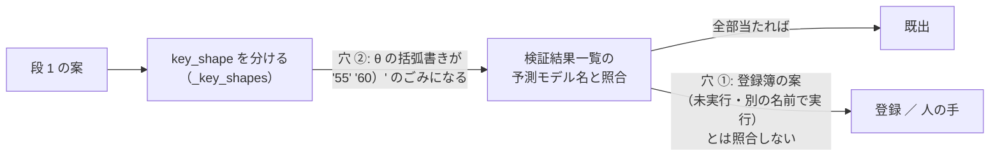

# 開発ループ: 段 1 の重複の検査を直す

2026-11-10 Sx360（利用者「まずは手を付けられる作業からやって」）。⚠ 実装は titan の Claude（研究の DB と開発ループの置き場）。

## 1. 目的・背景

11/8 ・ 11/9 の段 1（各 5 本）は、どちらも日誌で「既出 0」と出た。ところが中身は、すでに回したか登録済みの案の焼き直しが多い。

| 11/8 ・ 11/9 の案 | 似ている過去の案 | 由来 |
| --- | --- | --- |
| `20261108-cluster-laggard-revert` | `20261106-cluster-laggard-revert`（回した。題名も同じ） | 参考なし |
| `20261108-signal-inject-power` ・ `20261109-planted-signal-mde` | `20261106-planted-signal-power`（回した ＝ `cli/planted_power.py`） | 参考なし |
| `20261109-null-shuffle-top-rows` | `20261107-date-shuffle-null`（回した ＝ `cli/null_shuffle.py`） | **参考あり** |
| `20261108-vol-abstain-days` | `20261104-calm-day-hold`（V2）・`20261106-skip-high-disp-days` | 参考なし |
| `20261109-regime-cluster-hold` ・ `20261108-hmm-sticky-regime-hold` | `20261104-regime-cluster-ridge`（R1）・`20261106-regime-ex-cluster-ridge`（R2）・`20261107-regime-col-lgbm`（R3） | 参考なし ／ あり |

検査がこれを拾えない理由は 2 つある。

- **穴 ①（作り）**: 照合の相手は検証結果一覧の予測モデル名だけ（`cli/devloop.py` の `register_ideas` → `duplicates`）。登録簿の案は照合しない。しかも段 1 は毎晩新しい名前で `key_shape` を書くので、同じ問いでも名前では当たらない。
- **穴 ②（不具合）**: `_key_shapes` は `／` で先に割ってから括弧を消す。そのため `own.x.ridge.shared@θ（θ ＝ 50 ／ 55 ／ 60）` が `['own.x.ridge.shared', '55', '60）']` になる。`既出` は「全部のパターンが当たる」が条件なので、`55` が当たらない限り **この書き方の案は決して既出にならない**。11/6〜11/9 の 20 本のうち 9 本がこの形だった【実測】。

参考なしの束（道具なし ＝ r 30% の残り 70%）が同じ案を出し直すのは、設計上ありうること（プラン [daily-dev-loop.md](daily-dev-loop.md) の「危ない 6」）。その受け皿が「重複の検査」だが、上の 2 つの穴で働いていない。⚠ 人の手で作る量が増え、11/6〜11/7 は焼き直しにも検証を数えている（`n_trials` を減らすことはしない ＝ 回したものは全部数える）。

## 2. 対応方針

### 2-1 穴 ② を直す（決めごとは要らない）

- `_key_shapes`: 括弧書き（全角 ・ 半角）と `@` 以降を **割る前に** 消す。数字だけ ・ 括弧の残る断片は捨てる
- 既にある登録簿の `key_shape` は書き換えない（status が登録より先なら直さない ＝ rules.md 31-1）。直すのはこれから写す案だけ

### 2-2 穴 ①: 登録簿の案とも照合する（⚠ 利用者が選ぶ）

文字の近さだけでは線を引けない。題名 ＋ 問いの文字 3-gram の Jaccard を 11/6〜11/9 の 20 本で測ると【実測】:

- 近い案は正しく引ける（`cluster-laggard` 0.22 ・ `signal-inject` 0.10 ・ `vol-abstain` 0.11、`null-shuffle` → `date-shuffle-null`）
- ただし別物も同じくらいの値になる（`regime-cluster-hold` ← `path-cluster-baserate` 0.15。`skip-high-disp` ← `calm-day-hold` 0.15 は本当に近い）

この結果から、しきい値で自動的に「既出」へ回すのは危ない。案は 3 つ。

| 案 | 中身 | 費用 | 決めごと |
| --- | --- | --- | --- |
| **A（推す）** | 段 1 の後に、登録簿の全部と題名 ＋ 問いの近さを測る。いちばん近い過去の案 3 本を `register.md` ・ 日誌 ・ 報告メールに「似た過去の案」として出す。**status は変えない**（「既出」の印を付けるのは人。段 2 を作る前に見る） | $0 ・ 決定的 | なし（表示だけ。rules.md は変わらない） |
| B | A に加えて、`claude -p` で 1 回だけ「同じ問いか」を判定させ、同じなら status を `既出` にする（理由も残す） | 1 晩 $0.1〜0.3【推測】 | rules.md 31-1 の 2 の「既出」の定義に「登録簿に同じ問いがある」を足す ／ 判定の文の固定 |
| C | 参考なしの束に、過去の題名の一覧を渡す | $0 | ⚠ 「参考なし」でなくなる（r を実質変える ＝ K1 の変更）。推さない |

⚠ どの案も「意味がない」の判定はしない（利用者の指示 2026-10-24）。見るのは「同じ問いを前に出したか」だけ。

## 3. 影響範囲

- `experiments/feature-discovery/cli/devloop.py`（`_key_shapes` ・ `register_ideas` ・ `register.md` の列）、`cli/devloop_mail.py`（A ／ B の表示）
- 研究の DB ・ 検証結果一覧 ・ `n_trials` ・ 判定は 1 ビットも変わらない（段 1 の登録だけ）
- 13500t の毎日の売買の経路には触れない

## 4. テスト方針

- `_key_shapes` の表（`@θ（θ ＝ 50 ／ 55 ／ 60）`・半角括弧・一覧で渡す形・空）
- 穴 ② の回帰: 検証結果一覧に既にある名前 ＋ θ の括弧書きの案が `既出` になる
- A: 登録簿の偽物 3 本で、近い順に並ぶ ・ 自分自身を含まない ・ status が変わらない
- devloop の既存のテスト（45 本）が通る

## 5. Phase

- [ ] Phase 1: 穴 ② を直す ＋ テスト（titan）
- [ ] Phase 2: 穴 ① の案を利用者が選ぶ（A ／ B ／ C）
- [ ] Phase 3: 選んだ案を作る ＋ テスト → 1 晩回して日誌 ・ メールで見る
- [ ] Phase 4: dev-loop.md §3 に 1 行 → DONE へ ・ プランを archive へ
