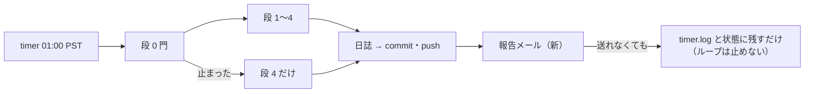
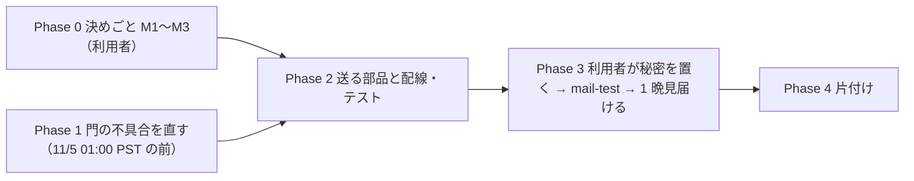

# 開発ループの報告メール

利用者の指示（2026-11-03 15:2x PST・Sx360）: **「開発ループは報告メールを送るようにする。TODOとプラン作成」**

## 1. 目的・背景

開発ループ（titan の timer `ail-devloop.timer`・毎晩 01:00 PST。2026-11-03 に入れた）は、1 晩の結果を日誌 `docs/specs/experiments/dev-loop/log/<日付>.md`・`main` へのコミット・外部のタブ「実行」の「開発ループ」に残す。
どれも **見に行かないと分からない**。特に次の 3 つは朝に知りたい:

- その晩が **止まった**（段 0 の門・打ち切り ② ③・段が落ちた・費用の上限に当たった）
- 試運転の 3 晩（プラン [daily-dev-loop.md](daily-dev-loop.md) 3-7）は **朝に段 2 を手で作る** ＝ 何本・どの id を作るか
- 段 4 の上位 3 に **新顔** が入った（次の晩に机上へ回る）

そこで、毎晩の最後に 1 通、結果をメールで送る。

1 晩の流れのどこで送るか（日誌とコミットの後・止まった晩も送る）:

## 2. 先に直す不具合（2026-11-03 Sx360 が見つけた）

`cli/devloop.py` の門（`gate`）は、`git status --porcelain` に **自分の錠 `devloop.lock` 以外** が 1 行でもあれば「作業ツリーが汚れている」でその晩を止める。
ところが `night()` は **コミットの後に日誌を書き直す**（コミットの結果を書き足す。コメントは「日誌自身は次の晩のコミットに入る」）。

- コミットまで通った晩 → 日誌が「変更あり」で残る → **次の晩は門で止まる**【推測。コードを読んだ結論・まだ起きていない】
- 止まった晩の日誌はコミットされず「未追跡」で残る → **その次の晩以降もずっと止まる**
- ⚠ テスト（`tests/test_devloop_night.py`）は偽の git を使っているので拾えなかった
- 11/4 01:00 PST の 1 晩目は作業ツリーが clean なので通る見込み → **11/5 01:00 PST から止まる**。費用はかからない（段 1〜3 を回さない）が、試運転が進まない

直し方（推す）: 門が **自分の日誌の置き場 `docs/specs/experiments/dev-loop/log/` の変更も数えない**（錠と同じ扱い）。日誌は今までの意図どおり次の晩のコミットに入る（`commit()` の対象に `docs/specs/experiments/dev-loop` が入っている）。
テスト: 「日誌だけが汚れている」は通る ／ 「日誌 ＋ ほかのファイル」は止まる ／ 本物の git の一時リポジトリで 2 晩続けて回すと 2 晩目も門を通る。

⚠ メールより先に入れる（メールがあれば止まったことに気づけるが、止まらないほうがよい）。**11/5 01:00 PST より前**に入れたい。

## 3. 対応方針

### 3-1. 送るもの

| 項目 | 中身 |
| --- | --- |
| 件名 | `[ail devloop] 2026-11-04 ✅ 登録 3・n_trials 1120→1132・新顔 0・$5.24` ／ 止まった晩は `⚠ 止まった: 段 0 …` ／ 段が落ちた晩は `⚠ 段 3 が落ちた` |
| 本文の頭（3〜6 行） | 結果の 1 行・**朝にやること**（試運転の間 ＝ 段 2 を手で作る id の一覧。止まった晩 ＝ 解き方〔`DEVLOOP_HALT` を消す ／ `state --reset` ／ 未コミットのファイル名〕）・費用（その晩 ／ 累計）・コミットの sha と push の成否 |
| 本文の残り | 日誌の全文（Markdown をそのまま平文で）|
| 入れないもの | 資格情報・`.env`・口座に関わるもの（開発ループは研究だけ ＝ もともと入っていない。送る前に `.env` の項目名の文字列が無いことを検査する）|

### 3-2. 送る時機

- `night()` の最後、日誌とコミットの **後**（sha を入れるため）。`finally` で、段 0 で止まった晩・段が落ちた晩・錠が取れない晩も送る
- Python ごと落ちた晩（`.venv` が無い・import が落ちる）は、`run-devloop.sh` が rc を見て **標準ライブラリだけの小さな送り手** を呼ぶ（中身は `timer.log` の最後の 40 行）。送ったかは `devloop/logs/<日付>.mail` の印で見る（2 通送らない）
- ⚠ **送れなくてもループは止めない**。失敗は `timer.log` と状態（`queue_state` の `nights` の最後の行に `mail`）に残す。⚠ 日誌は書き換えない（コミットの後に日誌を触ると §2 と同じことが起きる）
- 機械が落ちた晩・timer が動かなかった晩は、中からは送れない ＝ **毎晩送る形にして「来ない」を合図にする**（M2）。外の見張り（13500t の `check.sh` と同じ healthchecks.io）は今回は入れない

### 3-3. 送り方（M1）

| 案 | 中身 | 費用 | 手間 |
| --- | --- | --- | --- |
| **(a) Gmail の SMTP ＋ アプリ パスワード（推す）** | Python 標準の `smtplib`（`smtp.gmail.com`・587・STARTTLS）。送り主 ＝ 宛先 ＝ 利用者の Gmail | 無料の範囲【推測】 | 利用者がアプリ パスワードを作る（Google アカウントの 2 段階認証が前提【推測・作るときに Google のヘルプで確かめる】）|
| (b) 送信 API のサービス（Resend・SendGrid など） | HTTPS で送る | 無料枠あり【推測】 | ⚠ アカウントの登録 ＝ 契約が発生する行動（利用者だけ）・送り主のドメインの設定 |
| (c) Gmail API（OAuth） | トークンで送る | 無料【推測】 | トークンの更新・同意画面の設定が重い |
| (d) Claude の Gmail のつなぎ（MCP） | — | — | timer（`claude -p` の外）からは使えない ＝ 採らない |

- 秘密の置き場: titan の **`~/.config/ai-income-lab/devloop-mail.env`**（リポジトリの外・`chmod 600`）。項目 `AIL_MAIL_HOST`・`AIL_MAIL_PORT`・`AIL_MAIL_USER`・`AIL_MAIL_PASSWORD`・`AIL_MAIL_TO`
- ⚠ **宛先のアドレスとアプリ パスワードはリポジトリ・日誌・メモリ・プランに書かない**（EDGAR の連絡先 E2 と同じ扱い）。ファイルを作って書くのは利用者。無ければ送らず `timer.log` に「not-sent（設定ファイルが無い）」の 1 行だけ

### 3-4. 設定（`config/devloop.toml` の `[mail]`）

| 項目 | 既定 | 意味 |
| --- | --- | --- |
| `enabled` | `true` | false で送らない（設定ファイルが無いときも送らない）|
| `send` | `"always"` | `"always"` 毎晩 ／ `"problems"` 止まった ・落ちた晩だけ（M2）|
| `secrets` | `"~/.config/ai-income-lab/devloop-mail.env"` | 秘密の置き場（リポジトリの外）|
| `subject_prefix` | `"[ail devloop]"` | Gmail のフィルタ用 |
| `max_body_chars` | `20000` | 日誌が長い晩は切り、「続きは日誌」と書く |

### 3-5. CLI

- `cli.devloop mail-test` ＝ 試しの 1 通（利用者が設定ファイルを置いた後に 1 回）
- `night --dry-run` は送らない（`--mail` を付けたときだけ送る ＝ 試験用）
- `night --no-mail` ＝ その晩だけ送らない

## 4. 影響範囲

| 触る | 中身 |
| --- | --- |
| `experiments/feature-discovery/cli/devloop.py` | §2 の門の直し・`night()` の最後に送る・`mail-test`・`--mail` ／ `--no-mail` |
| `experiments/feature-discovery/cli/devloop_mail.py`（新） | 件名と本文を組む・送る（標準ライブラリだけ ＝ Python ごと落ちた晩の送り手にも使う）|
| `run-devloop.sh` | rc ≠ 0 ／ 2 で印が無ければ送り手を呼ぶ |
| `config/devloop.toml` | `[mail]` |
| `systemd/README.md` | 設定ファイルの作り方・`mail-test` |
| `tests/test_devloop_mail.py`（新）・`tests/test_devloop_night.py` | §5 |
| `docs/specs/experiments/dev-loop.md` §3 | 送るもの・置き場の記録 |

- ⚠ **触らない**: 13500t・`prod`・執行器・予測の経路（指紋）・管理画面 `dashboard/app/` ＝ 「デプロイ」は要らない
- ⚠ **titan の運転手は毎晩 `git pull` した `main` で動く** ＝ `main` に push した変更はその晩から効く。テストを通してから push する（01:00 PST の前に）
- 作業する機械は titan（コードと研究の DB）。秘密のファイルを置くのは利用者（titan）

## 5. テスト方針

- 件名と本文: 通った晩 ／ 段 0 で止まった晩 ／ 段が落ちた晩 ／ 錠が取れない晩 ／ 試運転の「朝にやること」に段 2 の id が並ぶ
- 送り手を差し替えて（`env["mail"]`。今の `env["sh"]` と同じ形）: 設定ファイルが無い → 送らない・例外なし ／ 送信が失敗 → `night()` は同じ rc・状態に `mail` が残る・日誌は書き換えない ／ `send = "problems"` で通った晩は送らない ／ `--dry-run` は送らない
- 本文に `AIL_MAIL_PASSWORD` などの項目名・`.env` の中身が出ない
- §2: 本物の git の一時リポジトリで 2 晩続けて回し、2 晩目も門を通る ／ 日誌 ＋ ほかの未コミットなら止まる
- `run-devloop.sh`: Python ごと落ちた形（`PY` を偽物に）で送り手が 1 回だけ呼ばれる
- 本物: 利用者が設定ファイルを置く → `mail-test` → 次の 1 晩のメールを見届ける

## 6. Phase と Step

順番（門の直しが先・秘密を置くのは利用者）:

### Phase 0: 決めごと（⚠ 利用者）

✅ **2026-11-03 利用者「推す案ですすめて」＝ M1〜M3 とも下の表の「推す」で確定**

| # | 決めること | 推す | 代案 |
| ---: | --- | --- | --- |
| **M1** | 送り方 | **(a) Gmail の SMTP ＋ アプリ パスワード** | (b) 送信 API ／ (c) Gmail API |
| **M2** | いつ送るか | **毎晩**（来ない ＝ 機械か timer が止まった合図）| 止まった ・落ちた晩だけ |
| **M3** | 本文 | **頭の要約 ＋ 日誌の全文** | 要約だけ（日誌は GitHub で見る）|

### Phase 1: 門の不具合を直す（§2。⚠ 急ぎ・11/5 01:00 PST の前）

- [x] 1-1 門が自分の置き場（`dev-loop/log/`・`register.md`・`dev-loop/drafts/`）を数えない ＋ テスト（本物の git で 2 晩 ＋ 止まった晩の次の晩）
  ✅ 2026-11-03 Sx360: `devloop.own_outputs` ／ `_is_own`。⚠ 止まった晩も段 4 の下書きと `register.md` の吐き直しは回るので、日誌だけでなく 3 つとも数えない。直す前の形で本物の git の 2 晩目が「作業ツリーが汚れている（log/2026-10-26.md）」で止まることを確かめた

### Phase 2: 送る部品と配線

- [x] 2-1 `cli/devloop_mail.py`（件名・本文・送る）と `[mail]`
- [x] 2-2 `night()` の最後に送る（`devloop.report`）・`mail-test`・`--mail` ／ `--no-mail`・`run-devloop.sh` の送り手（印 `AIL_DEVLOOP_MAIL_MARK`）
- [x] 2-3 テスト（§5）`tests/test_devloop_mail.py` 16 本 ＋ 既存の devloop 21 本 ＋ 外部のタブ 4 本 ✅（2026-11-03 Sx360）→ `main` に push

### Phase 3: 動かす（⚠ 秘密を置くのは利用者）

- [ ] 3-1 利用者: アプリ パスワードを作り、titan に `~/.config/ai-income-lab/devloop-mail.env`（600）を置く
- [ ] 3-2 `cli.devloop mail-test` で 1 通届く
- [ ] 3-3 次の 1 晩のメールを見届ける（件名・朝にやること・sha）

### Phase 4: 片付け

- [ ] 4-1 `dev-loop.md` §3・`systemd/README.md`・CLAUDE.md の開発ループの行に 1 行 → TODO から DONE へ・このプランを archive へ
