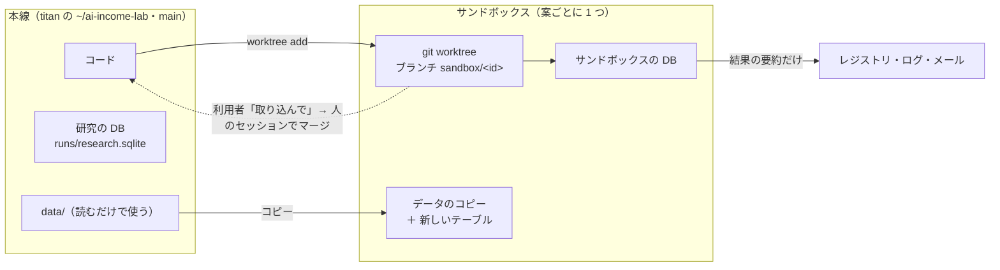
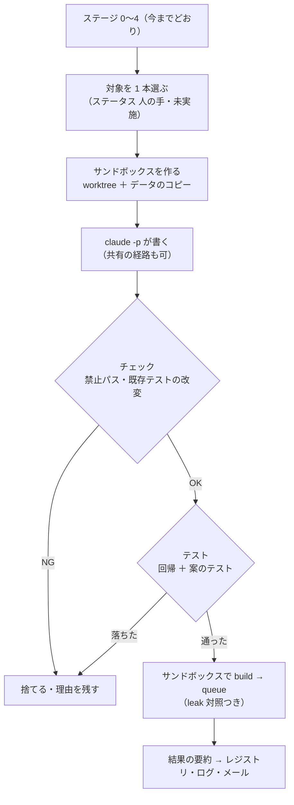

# 開発ループのサンドボックス（共有の経路に触れる案を、本線に入れずに夜に作って回す）

利用者の指示（2026-11-13 titan）: **「土台に触れやすいものを実験的に試す方法はないだろうか？たとえば仮想環境を用意してそこで動かすとか」** → 案 A・B・C を示した → **「以下をやる A（推す）上の流れを全部やる。作る・テスト・回すまで」**

用語は [CLAUDE.md](../../CLAUDE.md) の「技術用語は、プログラミングで普通に使われる言い方で書く」（2026-11-13）に従う。古い文書の言い方は最初の 1 回だけ併記する: ランナー（旧: 運転手）・ステージ（旧: 段）・ゲート（旧: 門）・レジストリ（旧: 登録簿）・ログ（旧: 日誌）。

## 1. 目的・背景

開発ループ（[daily-dev-loop.md](daily-dev-loop.md)）のステージ 1 が出す案のうち、**共有の経路**（訓練のラベルの作り方・売買のシミュレーター・検証の分割・検証結果一覧の列 ＝ 全部の検証と 13500t の毎日の予測が通るコード）を触る案は、ステータス「人の手」になり、夜には作らない（K7）。

- 2026-11-13 時点で「人の手」は 21 本。うち手を付けていないものが 16 本（作れば数える検証は合計 66）。毎晩 1〜3 本ずつ増える
- 問いそのものを変える案（枠の外）ほど共有の経路に触れやすい ＝ 面白い案ほどここに溜まる
- 人が見ているセッションで 1 本作るのに 30〜60 分かかる【推測】＝ 作る速さが追いつかない

そこで、**本線（`main`）にも本番にも 1 行も入らない場所（サンドボックス）で、夜に AI が共有の経路も含めて作り、テストし、回す**。結果を見てから、取り込むかを利用者が決める。

## 2. 対応方針

### 2-1. 何を何から隔離するか

この図の主張: サンドボックスは「コード・記録・データ」の 3 つを本線と分け、本線へ戻る道は利用者の「取り込んで」だけ。

| 分けるもの | 本線 | サンドボックス | しくみ |
| --- | --- | --- | --- |
| コード | `~/ai-income-lab`（`main`） | `~/.cache/ai-income-lab-sandbox/<id>/`（ブランチ `sandbox/<id>`） | `git worktree add`。`main` には入らない ＝ `prod` にも乗らない |
| 検証の記録 | `runs/research.sqlite` | ワーキングツリーの中の `runs/research.sqlite`（**本線の DB のコピーを種にする** ＝ 837MB【実測】） | DB のパスはコードの場所からの相対（`ail/runs.py`）＝ 何もしなくても分かれる。種が要る理由は §6 の Phase 1 |
| 日足（raw ／ adjusted ／ derived ／ manifests ＝ 256MB【実測】） | `data/` | ワーキングツリーの中の `data/` にコピー | コピー（ハードリンクは使わない ＝ 上書きが本物に届く） |
| テーブル（`data/features/` ＝ 6.7GB・97 個【実測】） | 〃 | 要るテーブルだけコピー ＋ 新しく作るぶん ＋ 検証結果一覧が期間を読む古いテーブル（26 ファイル・1.4GB【実測】） | 実験の config の `features_from` ／ 実験名から引く |
| Python の環境 | `.venv` | 同じ `.venv` を使う（cwd がワーキングツリー ＝ `python -m` はワーキングツリーの `ail` ／ `cli` を読む） | 依存を足す案は対象外（「人の手」のまま） |

⚠ **これは論理的な隔離**（パスを分ける）で、OS レベルの隔離ではない。AI が書いたコードを無人で実行する以上、そのコードは titan のユーザー権限で何でもできる（いまのステージ 2・3 が `ail/ideas/*.py` を実行するのと同じ種類のリスク）。OS レベルの隔離（bubblewrap ＝ 書けるのはサンドボックスのディレクトリだけ・ネットワークなし）は Phase 6 に置く。titan には bubblewrap も docker も入っていない【実測 2026-11-13】。

### 2-2. 1 晩の流れ

この図の主張: サンドボックスのステージは、いまのステージ 1〜4 の後ろに足すだけで、既存のステージの動きは変えない。

### 2-3. 決めること

| # | 決めること | 推す案 | 状態 |
| --- | --- | --- | --- |
| S1 | **数え方** | サンドボックスで回した検証も全部数える。数はレジストリの案ごとに持ち、合計を「サンドボックスの検証数」として `n_trials`（本線）の横に併記する。DSR の併記は合計で引く。取り込んで本線で回し直した案は、本線の行が正本になり、サンドボックスのぶんは合計から外す（同じ検証の再現） | ✅ 2026-11-13 利用者「A（推す）」＝ 示した案のとおり |
| S2 | **判定の扱い** | サンドボックスの行にも同じ式で判定を計算して出すが「参考」。検証結果一覧（`ledger.md`）には載せない・選ぶステージ（`select_candidates`）の対象にしない・サンドボックスの行から「採る」を出さない | ✅ 同上 |
| S3 | **取り込み** | 自動ではマージしない。利用者の「`<id>` を取り込んで」→ Claude のセッションで diff をレビュー → `main` にマージ → テスト → 本線で回す（ここで普通に数える） | ✅ 同上 |
| S4 | ブランチを origin に push するか | push する（`sandbox/*`。GitHub で diff が見られる・Sx360 からも見える）。⚠ K5 の常設の許可（ループの commit ＋ push は `main` だけ）を `sandbox/*` まで広げることになる | ⏳ 利用者 |
| S5 | 1 晩の本数と上限 | 1 本・`claude -p` は $20（定価換算）・80 turns・build ＋ queue は 60 分。順番は手間の小さい順 → id 順（31-1 の 6 と同じ） | ⏳ 利用者 |
| S6 | サンドボックスで書いてよい範囲 | 共有の経路を含む `experiments/feature-discovery/` の中（`cli/`・`ail/`・`config/`・`tests/` の新しいファイル）。**禁止**: 執行器（`experiments/live-trading/`）・`experiments/tastytrade-api-sample/`・`dashboard/`・`docs/`（案のメモ 1 枚を除く）・`TODO.md` ／ `CLAUDE.md` ／ `DONE.md`・`config/devloop.toml`・`cli/devloop*.py` ／ `cli/sandbox.py`（ランナー自身）・**既存のテストの書き換えと削除**（守りのテストを弱められないように） | ⏳ 利用者 |
| S7 | 対象から外す案 | 閉じた案・済んだ案 5 本（並べ替えの列・`perm_split`・合図の植え込み 11/13・Wikipedia 11/13・FINRA）に `skip` を付ける。残り 16 本と、これから増える「人の手」が対象 | ⏳ 利用者 |
| S8 | 保存期間 | ワーキングツリーとサンドボックスの DB・データは 14 日で消す。ブランチと結果の要約（レジストリ）は残す | ⏳ 利用者 |
| S9 | OS レベルの隔離 | Phase 1〜5 は論理的な隔離で始め、試運転の後に bubblewrap を入れる（インストールは利用者 ＝ `sudo apt install bubblewrap`） | ⏳ 利用者 |

### 2-4. 守り（サンドボックスでも消えないリスクへの対応）

サンドボックスは「壊しても本線に響かない」ことを保証するが、**AI が書いた共有の経路のコードが正しいこと**は保証しない（先の日付の情報が混ざる誤りを入れると、偽の良い結果が出る）。

| 守り | 中身 |
| --- | --- |
| 回帰テスト | 既定の経路のフィンガープリント（`tests/test_trading_run.py`・`tests/test_predict.py`）＋ `test_names.py`・`test_catalog.py`。「オプションの無い config は 1 ビットも変わらない」を機械で見る |
| 既存のテストを守る | `main` との diff で、既存の `tests/` のファイルが変更・削除されていたら NG（追加だけ可） |
| leak 対照 | 切らない（`leak = true`）。跳ねない実行は配線の誤りを疑う印としてログに出す |
| 判定は参考 | S2。採用には取り込み（人のレビュー）→ 本線で回し直しが要る |
| 事前固定 | レジストリの `structure`・`prediction`・`n_trials_planned` は今までどおり、回す前のまま（直さない） |

## 3. 影響範囲

| 場所 | 変更 |
| --- | --- |
| `experiments/feature-discovery/cli/sandbox.py`（新規） | サンドボックスの作成・チェック・実行・要約・削除 |
| `experiments/feature-discovery/cli/devloop.py` | サンドボックスのステージ（`sandbox_stage`）・ログの節・レジストリの `[sandbox]` |
| `experiments/feature-discovery/config/devloop.toml` | `[sandbox]`（enabled・dir・per_night・上限・allowlist ／ forbid・保存期間） |
| `experiments/feature-discovery/devloop/prompts/build_sandbox.md`（新規） | サンドボックス用の「作る」プロンプト |
| `experiments/feature-discovery/cli/devloop_mail.py`・`dashboard/devloopview.py` | 「サンドボックスの結果」の別枠 |
| `docs/specs/experiments/feature-discovery/rules.md` | 31 章に 31-7（サンドボックス）・14 章の数え方に 1 行 |
| `docs/specs/experiments/dev-loop.md`・`CLAUDE.md`・`systemd/README.md` | 記録と手順 |

- ⚠ **既存の検証・本番には効かない**: 新しいファイルと、ランナーの後ろに足すステージだけ。`[sandbox] enabled = false`（既定）なら 1 晩の動きは今までと同じ
- 13500t・`prod`・執行器・管理画面（3012）は触らない
- ディスク: 1 本あたり 約 2.5GB【実測】（日足 256MB ＋ DB 837MB ＋ 期間を読むテーブル 1.4GB ＋ 実験のテーブル）＋ 新しいテーブル。14 日ぶんで約 35GB。空きは 807GB【実測】

## 4. テスト方針

- `tests/test_sandbox.py`: 一時のリポジトリ（本物の git）でサンドボックスを作る → ワーキングツリーとブランチができる・データがコピーされる・本線のファイルは変わらない ／ チェックが禁止パスと既存テストの改変を拾う ／ 削除でワーキングツリーが消えブランチは残る
- `tests/test_devloop_sandbox.py`: ランナーのステージ（モックの `claude`）＝ 通った案は要約がレジストリに入る ／ 落ちた案は捨てて理由が残る ／ `enabled = false` なら何も呼ばない ／ 本線のワーキングツリーに 1 ファイルも増えない
- 実物での確認（Phase 1 の出口）: 既存の実験 1 本をサンドボックスで回し、**本線の同じ実験の数字と一致する**ことを見る（隔離しても同じ結果が出る ＝ サンドボックスの結果が信用できる前提）
- `./run-tests.sh --fast`・開発ループのテスト

## 5. Phase

| Phase | 中身 | 出口 |
| --- | --- | --- |
| 0 | 決めること S1〜S9 | 利用者の決定 |
| 1 | サンドボックスの土台 `cli/sandbox.py` ＋ テスト ＋ 実物での一致の確認 | 既存の実験がサンドボックスで本線と同じ数字になる |
| 2 | 規約を先に書く（rules.md 31-7・14 章に 1 行 ＝ 数え方と判定の扱いを、最初の案を回す前に固定） | 利用者の了承 |
| 3 | 手で 1 本（`20261101-deadzone-label` ＝ 手間 小・数える 6）をサンドボックスで作って回す → 記録 | dev-loop.md に結果・サンドボックスの検証数 6 |
| 4 | ランナーに組み込む（`sandbox_stage`・プロンプト・ログ・メール・実行タブ・保存期間の掃除） | テスト ✅・dry-run ✅ |
| 5 | 試運転 3 晩（`[sandbox] enabled = true`・1 晩 1 本） | 費用・落ちた理由・直したことを記録 |
| 6 | OS レベルの隔離（bubblewrap。S9） | 書けるのがサンドボックスだけ・ネットワークなしを実物で確認 |
| 7 | 片付け（CLAUDE.md・README・DONE・archive） | — |

### 手間と費用【推測】

- 実装: Phase 1 半日 ／ Phase 2 1 時間 ／ Phase 3 半日 ／ Phase 4 1 日 ／ Phase 6 半日
- 夜の費用: 1 本あたり定価換算で $10〜20 の上乗せ（titan は定額のプランのログイン ＝ 請求ではなく利用枠）。計算は 1 本あたり数分〜数十分

## 6. 記録

### Phase 1: サンドボックスの土台（2026-11-13 19:50〜20:05 PST・titan）

- 作ったもの: `experiments/feature-discovery/cli/sandbox.py`（`create` ／ `tables` ／ `exec` ／ `check` ／ `report` ／ `remove` ／ `list`）・`tests/test_sandbox.py` 9 本（本物の git の一時リポジトリ）
- **実物での確認**（既存の実験 `trade_own_fwdmulti_a` ＝ queue `horizon_roles1` をサンドボックスで回した）

  | 見たこと | 結果【実測】 |
  | --- | --- |
  | 作成 | 2.6 秒・2.5GB（worktree ＋ 日足 ＋ DB ＋ 期間を読むテーブル 26 ファイル ＋ 実験のテーブル 2 個） |
  | 実行 | queue 本番 ＋ leak で 33 秒（本線では 16 秒【2026-10-18 の実測】）|
  | 数字の一致 | `result.csv`・`summary.csv`・`daily.csv`・`per_symbol.csv`・`holds.csv`・較正 5 個・`config.json` が本線の同じ実験の実行とハッシュで一致 |
  | 一致しないもの | `env.json`（時刻・コミット）・`log.txt`・`inputs.json`（日足の manifest ＝ 本線の日足が 10/18 の後に増えたため。サンドボックスのせいではない）・`checks.json`（DSR の `n_trials` だけ） |
  | 本線への影響 | 本線の DB の実行の数 551 → 551・`ledger.md` のハッシュ不変・`git status` に出るのは作業中のファイルだけ |
  | 要約 | 増えた検証 0 ／ 変わった行 0 ／ 消えた行 0（既存の識別項目の回し直しなので増えないのが正しい）|

- **見つけて直したこと 2 つ**（どちらも「空のサンドボックスでは検証結果一覧を再生成できない」）
  1. 空の DB では `config/catalog_notes.toml` の閉じる注記（167 件）が 1 行にも当たらず、再生成が止まる → **作るときに本線の DB をコピーして種にする**（SQLite のバックアップ API）。副産物: 既出の検査・DSR の `n_trials` が本線と同じ条件になる・「既存の行が 1 行も変わらない」を要約で見られる（`changed` ／ `gone`）
  2. DB をコピーしても止まった: 検証結果一覧は、期間を記録していない古い実行の「期間」を**テーブルの実物**から読む（`ail/catalog.py` の `_period_of` の 3 段目）→ そのファイル（サンドボックスの DB から列挙）もコピーする
- ⚠ サンドボックスの中の `checks.json` の DSR は、サンドボックスの DB の `n_trials` で引かれる（種があるので本線に近い値になるが、同じではない）＝ 要約には DSR を出さない
- ⚠ `cli.sandbox exec` の `--timeout` は id の前に書く（id の後ろは全部サンドボックスの python へ渡る）
