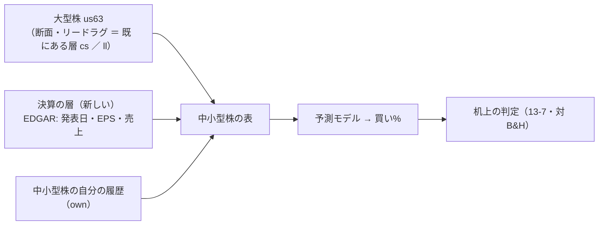
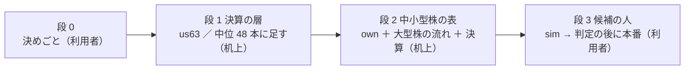

# 決算データを含めたモデル ＋ 大型株の流れで中小型株を売買する（検討。2026-10-18）

利用者の言葉（2026-10-18）: **「決算データを含めたモデルを作れるか検討」**・**「全体の流れを大手の銘柄で調べ、実際の売買は中小型株で行うものを検討」**

⚠ **この文書は検討**。§5 の決めごと（利用者）が済むまで、取得・コードには手を入れない（取得の規則は取得の前に固定する ＝ [midcap-targets.md §2](../specs/experiments/midcap-targets.md) と同じ）。
⚠ **規約に触れる**: 決算データの取得元ごとに利用規約・アクセスの決まりがある（§2）。

## 0. 答え（先に）

| 問い | 答え |
| --- | --- |
| 決算データを含めたモデルは作れるか | ✅ **作れる**。SEC EDGAR の API（無料・キー不要）で、銘柄ごとの **決算発表日（8-K の Item 2.02）** と **財務の数字（XBRL。提出日 `filed` 付き）** が取れる【実測 2026-10-18・AT&T 1 社で確かめた】。いまの表に「決算の層」を 1 つ足す形で、机上の器（feature-discovery）にそのまま載る |
| 大型株の流れで中小型株を売買できるか | ⚠ **半分は試し済み**。2026-09-12 に「大型株（`us63`）の断面とリードラグを材料に、S&P 500 の中位 48 本を当てる」を回した ＝ 良くはなった（θ 50 で −554 → ＋120bp/fold）が届いていない（t 0.46・符号 2/5）（[midcap-targets.md](../specs/experiments/midcap-targets.md)）。⚠ **本当の中小型株（S&P 600 などの S&P 500 の外）はまだ試していない** |
| 2 つを合わせる意味 | 決算は **全銘柄で同じ値にならない**数少ない材料（[daily-data-sources.md §9](../specs/experiments/daily-data-sources.md)「次に試すなら、全銘柄で同じ値にならないもの」・[econ-calendar.md §6](../specs/experiments/econ-calendar.md) の 3）。中小型株はアナリストの数が少なく、決算の後の値動きが遅れて出やすいと言われる【推測。文献は当たっていない】 |

この図の主張: 「流れ」は大型株から、「銘柄の違い」は決算から取り、売買するのは中小型株。

## 1. 決算データの取得元【公表値 ／ 実測】

| 取得元 | 取れるもの | 費用 ／ 制限 | 過去にさかのぼれるか | 出典 |
| --- | --- | --- | --- | --- |
| **SEC EDGAR**（`data.sec.gov`） | 提出の履歴（8-K の Item 2.02 ＝ 決算発表・受付の時刻 `acceptanceDateTime`）／ XBRL の財務の数字（EPS・売上ほか。1 つずつに提出日 `filed`・様式 `form`） | 無料・キー不要【公表値】。⚠ **毎秒 10 回まで・User-Agent に連絡先を書く**【公表値】 | ✅ 8-K は 2001 年ごろから・XBRL は 2009〜2011 年から【記憶・未確認】。AT&T で 8-K Item 2.02 は直近 17 件・EPS（希薄化後）は 317 行【実測 2026-10-18】 | [EDGAR API](https://www.sec.gov/search-filings/edgar-application-programming-interfaces)・[Accessing EDGAR Data](https://www.sec.gov/search-filings/edgar-search-assistance/accessing-edgar-data)（2026-10-18 取得） |
| tastytrade の API（口座がある） | 過去の EPS と発表日（`get_earnings` ＝ `occurred_date`・`eps`）／ 次の発表予定日（`expected_report_date`。いまの値だけ） | 口座の範囲内・追加費用なし【推測】 | EPS と日付は ✅・⚠ **市場予想（consensus）は今の値だけ** ＝ 過去の「予想との差（サプライズ）」は作れない | [tastytrade SDK の metrics](https://tastyworks-api.readthedocs.io/en/latest/api/metrics.html)（2026-10-18 取得。SDK の説明 ＝ REST の道は未確認） |
| Alpha Vantage | 過去の EPS・予想・サプライズ（`EARNINGS`）・発表予定（`EARNINGS_CALENDAR`） | 無料は 1 日 25 回【公表値ではない ＝ 第三者の解説。公式は未確認】 | ✅ 予想込み | [macroption の解説](https://www.macroption.com/alpha-vantage-earnings-calendar/)（2026-10-18 取得）。⚠ 利用規約は未確認 |

⚠ **推す: まず EDGAR だけ**（公的・無料・過去の提出日が残る ＝ 先読みを避けやすい）。サプライズ（予想との差）が要るなら Alpha Vantage を足すかを後で決める（規約を先に読む）。

## 2. 先読み（leak）の落とし穴

| # | 落とし穴 | 対処（案） |
| ---: | --- | --- |
| 1 | 決算の期末日（`end`）で表に入れると、まだ発表されていない数字を使う | ⚠ **提出日 `filed`（8-K は受付の時刻）で入れる**。発表の日の 15:50 ET の判断には使わず、**翌営業日から**使う（`ex` 層の `ex_lag_days = 1` と同じ考え） |
| 2 | 決算の数字はあとで直される（修正の提出） | 同じ期の値が複数あれば **最初に提出された値**を使う（`filed` が一番早いもの） |
| 3 | 8-K（発表）と 10-Q（XBRL の数字）の日がずれる | AT&T: 8-K 2026-04-22 ／ 10-Q（EPS の XBRL）2026-04-27【実測】＝ ⚠ **XBRL の数字は発表の数日後にしか入らない**。発表の日の数字（サプライズ）を使うなら別の取得元が要る |
| 4 | 次の発表予定日は「未来の暦」 | ⚠ 最初は**過去だけから作る列**（前の発表から何日・前の期からの EPS の伸び）に限る。予定日を使うなら別の層として設計する（econ-calendar.md §6 の 4） |
| 5 | 中小型株は上場廃止・指数の入れ替えが多い（生存バイアス） | 銘柄を選ぶ規則を取得の前に固定し、限界として残す（[universe-delisted.md](../specs/experiments/universe-delisted.md)） |

## 3. 中小型株で実際に売買するときの壁（本番）

| 項目 | 中身 |
| --- | --- |
| 気配の差（スプレッド） | 大型株の 5 本は差 1 の中央値 0.00bp【実測】。⚠ **中小型株は開きやすい**【推測】 ＝ 机上の費用 5bp（往復）の仮定が甘くなる。机上では費用を上げた行も見る・売買の回数を減らす案（[trader-model-roles.md §5](trader-model-roles.md) の最短保有）と相性がよい |
| 1 銘柄の枠 | $600 ÷ 5 本 ＝ $120 → 1 株 $120 を超える株は買えない（整数株）。中小型株は株価が低いものが多く、この点は楽【推測】 |
| 流動性の線 | 取得の前に固定する（例: 株価 ≥ $5・1 日の売買代金の下限）。⚠ 結果を見て線を動かさない |
| 銘柄を替える ＝ 新しい人 | いまの 3 人の銘柄は変えない（替えるのは新しい識別名の人） |
| 予測の時間 | 13500t の 15:40〜15:58 ET の中に収まるか（表が大きくなる ＝ 予測 1 本の時間が延びる）【推測】 |

## 4. 進め方（案）

この図の主張: 決算の層を既にある表で先に確かめ、そのあと中小型株の表に広げる。本番は最後。

| 段 | 中身 | 手間【推測】 | n_trials【推測】 |
| --- | --- | --- | --- |
| 1 | EDGAR の取得（`ail/data/sources/` に 1 本・控えは研究の `data/`）・決算の層 `ern_`（前の発表から何日・EPS の前年同期比・売上の前年同期比など数列。提出日の翌営業日から）・leak 対照・テスト → 既にある表（`us63` の own ／ 中位 48 本の `midcap_cs`）に足して回す | 2〜3 日 | 1 表 × 1 モデル × θ 3 ＝ ＋3 ずつ |
| 2 | 中小型株の銘柄の規則を固定（例: S&P 600 の構成銘柄からアルファベット順に 50 本・流動性の線）→ 日足の取得（`cli.fetch`）→ `own` ／ `own ＋ cs ＋ ll`（大型株の流れ）／ `＋ ern` の 3 本を並べる（動かす軸を 1 つずつ） | 2 日 ＋ 取得の時間 | ＋9 前後 |
| 3 | 何かが残ったら候補の人（`candidates/`）・sim・費用を上げた机上の行。⚠ 本番に入れるかは利用者 | — | — |

⚠ 机上の検証は「可能性が低くても回す」（CLAUDE.md 2026-09-12）。⚠ 前の結果からの見立て【推測】: 段 1 は採る 0 の見込み（中位 48 本でも届かなかった）。それでも「全銘柄同値でない材料」が初めて入るので、空白を埋める意味はある。

## 5. 決めごと（⚠ 利用者）

✅ 2026-10-19 利用者「推す案で進めて」＝ E1・E3〜E6 は推す案で確定。⚠ E2 は利用者が決める（環境変数 `AIL_EDGAR_CONTACT="<名前> <メール>"` で渡す。リポジトリに書かない）。段 1 の実装と事前固定は [rules.md 26 章](../specs/experiments/feature-discovery/rules.md)・記録 [earnings-layer.md](../specs/experiments/earnings-layer.md)。

| # | 決めること | 推す案 |
| ---: | --- | --- |
| E1 | 取得元 | EDGAR だけで始める（Alpha Vantage・tastytrade の EPS は後で） |
| E2 | EDGAR の User-Agent に書く連絡先 | 利用者が決める（⚠ SEC の決まりで連絡先が要る。Claude は利用者のメールアドレスを勝手に送らない） |
| E3 | 決算の層の列 | 過去だけから作る列（前の発表からの日数・EPS ／ 売上の前年同期比・発表の後 n 日の印）。予定日は使わない |
| E4 | 中小型株の範囲と銘柄の規則 | S&P 600（小型）の構成銘柄からアルファベット順 50 本・株価 ≥ $5・取得の前に固定 |
| E5 | 順番 | 段 1（決算の層を既にある表で）→ 段 2（中小型株） |
| E6 | 本番 | 段 3 まで机上と sim。⚠ 本番に入れるかは 11/4 の判定の後・利用者 |
