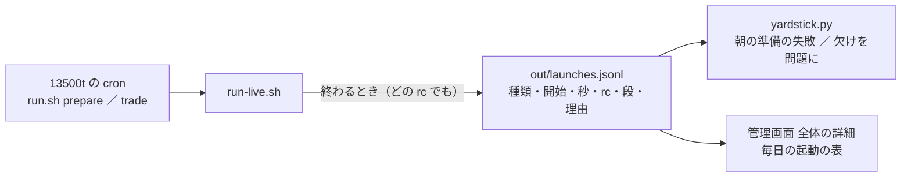

# 毎日の起動の記録を自動で残す（朝の準備・売買の回）

2026-10-18 Sx360 の Claude。利用者の指示「1を自動で行うようにして」（＝ TODO「13500t の host cron が毎日起きているかを見る」で、ログから手で書き写していた毎日の起動の記録）。

## 1. 目的・背景

- いままでは Claude が 13500t の `~/g3plus-ops/trade-runner/logs/{prepare,trade}.log` の `end rc=` を読み、TODO のメモに 1 日 1 行で手で写していた（10/9 で止まっている）
- 外へ知らせる見張りは既にある: `check.sh`（16:20 ET）が rc を healthchecks.io へ送り `checks.log` に 1 行（g3plus-ops）・管理画面の「今日の起動が無い」（16:15 ET を過ぎて記録が無い日）
- 足りないもの: ① 記録がリポジトリの DB と管理画面に無い ② 朝の準備の rc ≠ 0 の**理由**が残らない（9/29・10/5・10/7・10/9・10/12 の rc=1 は外部系列の取得元の HTTP 500 ／ 504【実測・ログ】）③ 所要秒

## 2. 対応方針

起動の入口 `run-live.sh` が、終わるとき（どの rc でも ＝ `trap EXIT`）に 1 行を DB に足す。

- 置き場 ＝ `experiments/live-trading/out/launches.jsonl`（DB の lines）。⚠ **`out/<日付>/` には書かない**（朝の準備で今日のディレクトリができると、管理画面の見張り「今日の起動が無い」が記録ありと読み違える・`yardstick.py` が今日を「起動なし」の行にする）
- 1 行 ＝ `{"date"（ET）, "kind": prepare|trade, "mode", "start", "end", "secs", "rc", "stage"（最後に入った段）, "steps"（朝の準備の 3 段の rc）, "note"（rc ≠ 0 の理由 1 行）, "host"}`
- 理由は `live_update.sh` の出力から `Error` ／ `⚠` を含む最後の行（200 字まで）。⚠ 秘密が載る出力ではない（公開の系列の取得元の例外）が、`eyJ…`（JWT の形）は伏せる
- 書けなくても起動の rc は変えない（`⚠ 起動の記録を書けなかった` を 1 行出すだけ）＝ DB の無い置き場（Sx360 の手元・`LT_OUT_DIR` のテスト）でも売買の経路は今までどおり
- ⚠ 拾えないもの: `run.sh` が容器の前で止めた日（`REFUSE` ／ `SKIP`）・cron が起きなかった日・機械が落ちた日 ＝ 「記録が無い」で見える（`yardstick.py` の `prepare_missing`・管理画面の「今日の起動が無い」・`check.sh` の外の見張り）
- ⚠ 執行器（`run_day.py`）・`g3plus-ops`（`run.sh`・`check.sh`）は変えない

## 3. Phase と Step

| Step | やること | 状態 |
| --- | --- | --- |
| 1 | `launchlog.py`（足す ／ 読む）・`run-live.sh` の `trap EXIT`・テスト | ✅ 2026-10-18 Sx360 |
| 2 | `yardstick.py` に `prepare_failed` ／ `prepare_missing`（D を崩さない）・管理画面の全体の詳細に「毎日の起動」の表・札 | ✅ 2026-10-18 Sx360（`./run-tests.sh` ✅・`dashboard.md` §13-14） |
| 3 | `./run-tests.sh` → 「デプロイ」（⚠ 利用者）→ 次の朝の準備・売買の回で 1 行ずつ入ることを確かめる → TODO の手書きの子を閉じる | |

## 4. 影響範囲

| 場所 | 変わるもの | 本番への影響 |
| --- | --- | --- |
| `run-live.sh` | 終わるときに 1 行書く（`trap EXIT`）・朝の準備の出力を一時ファイルにも写す | 書けなくても rc は変えない |
| `experiments/live-trading/launchlog.py` | 新規 | 読み書きだけ |
| `yardstick.py` | 問題 2 つ | 読むだけの後処理 |
| `dashboard/app/live.py`・`templates/overall.html` | 表を足す（POST は増やさない） | 管理画面のコンテナの起こし直し |

## 5. テスト方針

- `launchlog.py`: 足した行が読める・`eyJ…` が伏せられる・200 字で切れる・DB の無い道では rc ≠ 0 で止まる（`run-live.sh` が警告にする）
- `run-live.sh`: `--traders` が無い（rc=64）でも 1 行入る（`LT_OUT_DIR` を一時置き場の DB に向けて実物の `run-live.sh` を流す）
- `yardstick.py`: 朝の準備の rc ≠ 0 の日に `prepare_failed`・記録が始まった後の営業日で朝の準備の行が無い日に `prepare_missing`・D は崩さない
- 管理画面: `launches.jsonl` が無くても落ちない・秘密が応答に出ない（既存のテスト）
- 関門は `./run-tests.sh`

## 6. 作業量【推測】

半日（Step 1・2）。Step 3 はデプロイの次の営業日。
