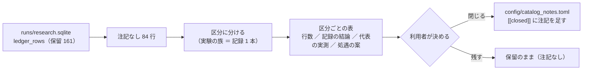

# 検証結果一覧の「保留」の棚卸し（2026-10-22）

2026-10-22（木）titan。利用者「次のおすすめの作業は？」→ 推し 1 →「1 を進めて」。
前の処遇は 2026-09-11（16 行）・2026-09-16（62 行 ＝ [ledger-hold-disposition.md](archive/ledger-hold-disposition.md)・[validation-power.md §6-2](../specs/experiments/feature-discovery/validation-power.md)）。それ以降に増えた保留に、同じ規則で棚卸しをかける。

## 1. 目的・背景

- 検証結果一覧（954 検証）は **採る 0 ／ 保留 161 ／ 落とす 793**【実測 2026-10-22・DB `ledger_rows`】。保留のうち 77 行は「閉じる」の注記つき（2026-09-11 ／ 09-16 の処遇）、**残り 84 行は注記なし**で 2026-09-16 以降に増えた。
- ⚠ **保留は「採るの一歩手前」ではない。多重検定を通していない良い数字である**（rules.md 11 章 規約 2・3）。放っておくと「まだ望みがある行」に見える。
- ここでは **84 行を区分に分け、区分ごとに「別の実測が同じ問いに答えているか（代表済み）／ 軸を閉じたか ／ 残すか」を表にする**。⚠ 閉じる・残すの決定は利用者（前の 2 回と同じ）。この棚卸しは判断の材料で、判定の列・数字・n_trials は 1 つも変えない。

## 2. 対応方針

この図の主張: 読むのは DB だけ。出るのは区分の表と、利用者が決めたときに流し込める `[[closed]]` の下書き。

- **区分 ＝ 実験の族（記録 1 本）**。前回と同じく ⚠ **行ごとの数字を見て決めない**（数字が小さい行だけ閉じると大きい行が残って選別になる）。
- 行ごとの付随情報（上乗せ・fold の符号・1 fold を外した符号・取引回数）は **材料として表に載せるが、処遇の根拠にしない**。根拠にするのは「同じ問いに答えた別の実測があるか」「軸を閉じたか」だけ。
- 「時間で決着するか」: 評価期間が延びれば fold が増えるが、研究用の `data/` は 2026-09-09 で止めている（取り直さない ＝ CLAUDE.md）ので、**いまの表では保留は自然には決着しない**。これも結論として書く。
- 再測はしない（前の 2 回と同じ判断: 同じ検出限界の下で同じ答えを得るだけで DSR の基準だけ上がる）。

## 3. 回す前に固定すること

| 項目 | 中身 |
| --- | --- |
| 対象 | `ledger_rows` の `is_trial = 1`・`leak = 0`・判定「保留」・`closed = 0` の 84 行 |
| 区分の切り方 | 実行名の実験名 → 記録の文書。同じ記録に属する行は同じ区分 |
| 処遇の案の語彙 | 前回と同じ 4 つ: 閉じる（代表済み）／ 閉じる（軸を閉じた）／ 閉じる（中身を確かめた）／ 残す。⚠ 「効かないと確かめた」とは書かない |
| 触らないもの | 判定の列・数字・`n_trials`・`catalog.py` の判定の規則・`[[closed]]`（利用者が決めるまで足さない） |
| 成果物 | 記録 `docs/specs/experiments/ledger-hold-inventory.md`（区分の表・行の一覧・処遇の案・`[[closed]]` の下書きの置き場） |

## 4. 影響範囲

文書だけ（記録 1 本・このプラン・TODO・CLAUDE.md の 1 文）。コードは触らない。

## 5. テスト方針

- 区分の行数の合計 ＝ 84（数え落とし・二重数えなし）
- 付随情報は `result.csv` から機械で引く（手で写さない）。`上乗せbp` は `ledger_rows` の値と一致すること

## 6. 手順

1. プラン・TODO → 2. 84 行を引いて区分に分ける（スクリプトは scratchpad）→ 3. 区分ごとに記録の結論を読んで処遇の案を書く → 4. 記録・CLAUDE.md・TODO → 5. push → 6. 利用者の決定を待つ（閉じると決まったら `[[closed]]` を足して吐き直す ＝ 別の回）
