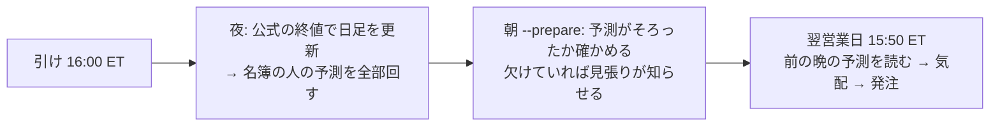

# 予測は前の晩・発注は翌営業日の 15:50 ET（予測を引け前の数分から切り離す）

利用者の指示（2026-11-01）:
- 「６０秒を１０分まで伸ばす」
- → 「予想をそんな１０分くらいの短い時間に縛られるのは間違っていると思う。そもそも短期の予測をするものではない。それを踏まえてどのようなスケジュールにすればいいか考えて」
- → 提案（夜に予測・翌営業日 15:50 ET に発注）に「進める案で」

TODO「予測は前の晩・発注は翌営業日の 15:50 ET に分ける」。

## 1. 目的・背景

- いまの 1 日（`run-live.sh --wait`）は、15:50 ET に日足を更新（約 1 分）→ 予測を並列（4 本で 49〜52.6 秒【実測 13500t】）→ 発注。予測の時間は 60 秒の線に縛られている。発注の刻限は 15:58 ET、引けは 16:00
- 新しい候補の人（`T7`〜`T19`）の係は、先 5〜40 日を見て、最短保有も 5〜40 日。予測を引けの直前の数分に詰める理由がない
- 予測が 1 本でも失敗すると、その日は 3 人とも売買しない。刻限の確認は日足の更新の前に 1 回だけで、予測が延びても止まらない（`run-live.sh:156`）

## 2. 対応方針（新しい日程）

> この図の主張: 予測と発注を別の時間に分け、発注の窓には読むだけの仕事を残す。

| いつ | 何をする | 時間の縛り |
| --- | --- | --- |
| 営業日の夜（引けの後） | 公式の終値で日足を更新し、名簿の人の予測を回す。予測は `asof ＝ その日` | 翌朝までに終わればよい |
| 朝の `--prepare` | 前の晩の予測がそろっているか確かめる | 発注まで 6 時間以上 |
| 翌営業日 15:50 ET | 前の晩の予測を読み、気配を取って発注する（日足の更新・予測はしない） | 発注の窓 15:45〜16:05 ET は変えない |

- 代償: 合図が 1 日遅れる（終値 t の予測で t+1 の 15:50 に売買）。合図の時刻を 15:50 と決めた D13 が変わる ＝ ハルも含めて**新しい検証**
- 切り替えは入れ替えの切れ目に合わせる（11/5 の晩に最初の予測 → 11/6 から入れ替えた 3 人）【案・利用者が最終決定】

## 3. Phase

| Phase | 中身 | 誰 |
| --- | --- | --- |
| 1 | 机上: 検証方式の変種 `閾値売買（翌日終値）`（rules.md 32 章。回す前に固定）を足し、ハル・候補の形で 1 日遅れの効き方を測る | Claude |
| 2 | 執行の設計: `run-live.sh` を夜の予測（`--predict-only`）と 15:50 の発注（前の晩の予測を読む）に分ける・執行器に「前の営業日の asof でない予測は読まない」歯止め・紙上の対照（`paper.py`）を 1 日遅れに・見張り（`check.sh`）に夜の回 | Claude（設計 → 利用者の了承） |
| 3 | コード・テスト（`./run-tests.sh`・予測の経路の指紋）→「デプロイ」 | Claude → 利用者 |
| 4 | 13500t の cron に夜の 1 本（g3plus-ops） | Sx360 の Claude |
| 5 | 切り替えの日に夜の予測 → 翌日の発注を見届ける（`live-trading.md` §1） | 利用者 → Claude |

## 4. Phase 1 の詳しい中身

- 口: config の `[trading] execution = "next_close"`。損益だけ y_exec[t] ＝ log(終値 t+2 ／ 終値 t+1)（足 t の合図で足 t+1 の引けに売買）。終値は調整済み日足（22 章の始値と同じ層）。⚠ `execution` の無い config は 1 ビットも変わらない
- 水準・物差し・予想は rules.md 32 章（回す前に書いた）
- ⚠ この結果で人を選ばない（日程の判断の材料だけ）

## 5. 影響範囲

- Phase 1: `cli/run.py`（`execution_of`・終値の継ぎ）・`ail/catalog.py`（`threshold_style`）・`config/names.toml`・config 14 本・queue 1 本・テスト。既定経路は変えない（指紋 `tests/test_trading_run.py`・`tests/test_predict.py`）
- Phase 2〜4: `run-live.sh`・`experiments/live-trading/`（執行器・`paper.py`）・13500t の cron・文書（`live-trading.md` D13・§0-9・§0-10）

## 6. テスト方針

- `tests/test_next_open.py` の形で: 終値の継ぎ（先読みしない・最後の行は 0）・既定経路は不変・識別項目 `閾値売買（翌日終値）`・名前 `~exec-close`
- 机上は leak 対照つき。⚠ 1 日ラベルの leak は 1 日遅れの損益と重ならない ＝ 跳ねないのが正しい（32-1 の 5）

## 7. Phase 1 の結果（2026-11-01 13:04 PST・titan）

- queue `lag1_close`（14 本 ＋ leak 14 本・6 分【実測】）。採る 0 ／ 保留 13 ／ 落とす 39・`n_trials` 1,032 → 1,084
- 物差しは rules.md 32-4（回す前に書いた）。差 ＝ 1 日遅れの引け − 終値 の「上乗せ（対 同じ執行の基準）」・fold の対

| 形 | 素の行（対 B&H） | 5 本（対 持ち続ける） | 全銘柄（対 持ち続ける） |
| --- | --- | --- | --- |
| ハル（M1 3 本の平均・1 日ラベル） | −1.52bp/日（t −2.85・5/5 負） | −0.74（t −1.03） | −1.39（t −2.86） |
| ミオ（L1） | −0.35（t −2.01） | −0.34（t −0.62） | −0.32（t −2.03） |
| 損切りあり R1〜R4 | −0.23〜+0.42 | −0.43〜−0.03 | −0.21〜+0.41 |
| 損切りなし R6〜R9 | −0.10〜+0.10 | −0.21〜+0.08 | −0.09〜+0.07 |
| 土台差 R10〜R13 | −0.25〜−0.06 | −0.35〜+0.11 | −0.22〜−0.05 |

- 基準自身の差（B&H ・持ち続ける）は −0.12〜+0.07bp/日 ＝ 値段の端がずれるだけ
- **③ 日程の判断の線（5 本の行で −2.5bp/日より負・t ≤ −2）に当たる形は 0 ＝ Phase 2 へ進む**
- ⚠ ハルは 1 日先を当てるモデルなので、1 日遅れで合図の中身がかなり消える（素の行の上乗せ +123 → −425bp/fold）。5 本の形は +425 → +159bp/fold で正のまま。先 5〜40 日の係の人はほとんど変わらない
- leak: 1 日ラベルの表は跳ねない・先 5〜40 日の表は跳ねる（32-1 の 5 の予想どおり ＝ 継ぎ方は正しい）
- ⚠ この結果で人を選ばない（日程の判断の材料だけ）
