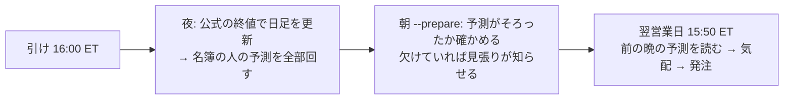
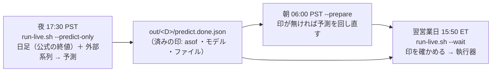

# 予測は前の晩・発注は翌営業日の 15:50 ET（予測を引け前の数分から切り離す）

利用者の指示（2026-11-01）:
- 「６０秒を１０分まで伸ばす」
- → 「予想をそんな１０分くらいの短い時間に縛られるのは間違っていると思う。そもそも短期の予測をするものではない。それを踏まえてどのようなスケジュールにすればいいか考えて」
- → 提案（夜に予測・翌営業日 15:50 ET に発注）に「進める案で」

TODO「予測は前の晩・発注は翌営業日の 15:50 ET に分ける」。

## 1. 目的・背景

- いまの 1 日（`run-live.sh --wait`）は、15:50 ET に日足を更新（約 1 分）→ 予測を並列（4 本で 49〜52.6 秒【実測 13500t】）→ 発注。予測の時間は 60 秒の線に縛られている。発注の刻限は 15:58 ET、引けは 16:00
- 新しい候補の人（`T7`〜`T19`）の係は、先 5〜40 日を見て、最短保有も 5〜40 日。予測を引けの直前の数分に詰める理由がない
- 予測が 1 本でも失敗すると、その日は 3 人とも売買しない。刻限の確認は日足の更新の前に 1 回だけで、予測が延びても止まらない（`run-live.sh:156`）

## 2. 対応方針（新しい日程）

> この図の主張: 予測と発注を別の時間に分け、発注の窓には読むだけの仕事を残す。

| いつ | 何をする | 時間の縛り |
| --- | --- | --- |
| 営業日の夜（引けの後） | 公式の終値で日足を更新し、名簿の人の予測を回す。予測は `asof ＝ その日` | 翌朝までに終わればよい |
| 朝の `--prepare` | 前の晩の予測がそろっているか確かめる | 発注まで 6 時間以上 |
| 翌営業日 15:50 ET | 前の晩の予測を読み、気配を取って発注する（日足の更新・予測はしない） | 発注の窓 15:45〜16:05 ET は変えない |

- 代償: 合図が 1 日遅れる（終値 t の予測で t+1 の 15:50 に売買）。合図の時刻を 15:50 と決めた D13 が変わる ＝ ハルも含めて**新しい検証**
- 切り替えは入れ替えの切れ目に合わせる（11/5 の晩に最初の予測 → 11/6 から入れ替えた 3 人）【案・利用者が最終決定】

## 3. Phase

| Phase | 中身 | 誰 |
| --- | --- | --- |
| 1 | 机上: 検証方式の変種 `閾値売買（翌日終値）`（rules.md 32 章。回す前に固定）を足し、ハル・候補の形で 1 日遅れの効き方を測る | Claude |
| 2 | 執行の設計: `run-live.sh` を夜の予測（`--predict-only`）と 15:50 の発注（前の晩の予測を読む）に分ける・執行器に「前の営業日の asof でない予測は読まない」歯止め・紙上の対照（`paper.py`）を 1 日遅れに・見張り（`check.sh`）に夜の回 | Claude（設計 → 利用者の了承） |
| 3 | コード・テスト（`./run-tests.sh`・予測の経路の指紋）→「デプロイ」 | Claude → 利用者 |
| 4 | 13500t の cron に夜の 1 本（g3plus-ops） | Sx360 の Claude |
| 5 | 切り替えの日に夜の予測 → 翌日の発注を見届ける（`live-trading.md` §1） | 利用者 → Claude |

## 4. Phase 1 の詳しい中身

- 口: config の `[trading] execution = "next_close"`。損益だけ y_exec[t] ＝ log(終値 t+2 ／ 終値 t+1)（足 t の合図で足 t+1 の引けに売買）。終値は調整済み日足（22 章の始値と同じ層）。⚠ `execution` の無い config は 1 ビットも変わらない
- 水準・物差し・予想は rules.md 32 章（回す前に書いた）
- ⚠ この結果で人を選ばない（日程の判断の材料だけ）

## 5. 影響範囲

- Phase 1: `cli/run.py`（`execution_of`・終値の継ぎ）・`ail/catalog.py`（`threshold_style`）・`config/names.toml`・config 14 本・queue 1 本・テスト。既定経路は変えない（指紋 `tests/test_trading_run.py`・`tests/test_predict.py`）
- Phase 2〜4: `run-live.sh`・`experiments/live-trading/`（執行器・`paper.py`）・13500t の cron・文書（`live-trading.md` D13・§0-9・§0-10）

## 6. テスト方針

- `tests/test_next_open.py` の形で: 終値の継ぎ（先読みしない・最後の行は 0）・既定経路は不変・識別項目 `閾値売買（翌日終値）`・名前 `~exec-close`
- 机上は leak 対照つき。⚠ 1 日ラベルの leak は 1 日遅れの損益と重ならない ＝ 跳ねないのが正しい（32-1 の 5）

## 7. Phase 1 の結果（2026-11-01 13:04 PST・titan）

- queue `lag1_close`（14 本 ＋ leak 14 本・6 分【実測】）。採る 0 ／ 保留 13 ／ 落とす 39・`n_trials` 1,032 → 1,084
- 物差しは rules.md 32-4（回す前に書いた）。差 ＝ 1 日遅れの引け − 終値 の「上乗せ（対 同じ執行の基準）」・fold の対

| 形 | 素の行（対 B&H） | 5 本（対 持ち続ける） | 全銘柄（対 持ち続ける） |
| --- | --- | --- | --- |
| ハル（M1 3 本の平均・1 日ラベル） | −1.52bp/日（t −2.85・5/5 負） | −0.74（t −1.03） | −1.39（t −2.86） |
| ミオ（L1） | −0.35（t −2.01） | −0.34（t −0.62） | −0.32（t −2.03） |
| 損切りあり R1〜R4 | −0.23〜+0.42 | −0.43〜−0.03 | −0.21〜+0.41 |
| 損切りなし R6〜R9 | −0.10〜+0.10 | −0.21〜+0.08 | −0.09〜+0.07 |
| 土台差 R10〜R13 | −0.25〜−0.06 | −0.35〜+0.11 | −0.22〜−0.05 |

- 基準自身の差（B&H ・持ち続ける）は −0.12〜+0.07bp/日 ＝ 値段の端がずれるだけ
- **③ 日程の判断の線（5 本の行で −2.5bp/日より負・t ≤ −2）に当たる形は 0 ＝ Phase 2 へ進む**
- ⚠ ハルは 1 日先を当てるモデルなので、1 日遅れで合図の中身がかなり消える（素の行の上乗せ +123 → −425bp/fold）。5 本の形は +425 → +159bp/fold で正のまま。先 5〜40 日の係の人はほとんど変わらない
- leak: 1 日ラベルの表は跳ねない・先 5〜40 日の表は跳ねる（32-1 の 5 の予想どおり ＝ 継ぎ方は正しい）
- ⚠ この結果で人を選ばない（日程の判断の材料だけ）

## 8. Phase 2 の設計（2026-11-01 利用者「全員夜の予測にそろえて、Phase 2 の設計を進めて」）

- 全員（ハルを含む）を夜の予測にそろえる（利用者決定）。2 つの形を並べて持たない

### 8-1. 新しい 1 日

> この図の主張: 夜の回が予測を作って「済み」の印を置き、15:50 の回は印を確かめて読むだけ。印が無ければ発注しない。

| いつ（PST） | 回 | 中身 |
| --- | --- | --- |
| 営業日 17:30（20:30 ET） | 夜（新しい cron） | ① 日足 ＋ 外部系列を更新 ② `config/traders/` 直下の本物の人**全員**のモデルの予測（名簿に関係なく ＝ 夜に ▶ 開始した人も翌日に動ける）③ 全部そろったときだけ `predict-<時刻>.jsonl` と「済み」の印を書く |
| 06:00 | 朝の準備（いまの cron） | いまの中身 ＋ 前の営業日の印が無ければ予測を回し直す（時間はある） |
| 12:40 起動 → 12:50（15:50 ET） | 発注（いまの cron） | 日足の更新・予測はしない。前の営業日の印を確かめ、そのファイルを執行器に渡す。印が無い ／ モデルが欠けていれば**発注しない**（rc 13） |

- 休場日・週末: 金曜の夜の予測を月曜の 15:50 に読む（「前の営業日」は NYSE の暦で数える）
- ⚠ 予測が無い日に、その場で予測して埋めることはしない（合図の時刻が混ざる）

### 8-2. 直すところ

| # | 場所 | 中身 | ⚠ |
| ---: | --- | --- | --- |
| 1 | `run-live.sh --predict-only [--date D]` | 更新（外部系列も）→ 直下の本物の人全員の（実験, 手法）を並列で予測（asof D）→ そろえば `out/D/predict-<時刻>.jsonl` ・`predict.meta.jsonl` ・`predict.done.json`。起動の記録は `kind = predict` | 今日の日付で引けの 15 分前より前なら拒む（途中の足で作らない）。休場日は何もしない |
| 2 | `run-live.sh --traders …`（発注の回） | 更新と予測の段を外す。前の営業日 P の `predict.done.json` を読み、名簿の人の（実験, 手法）が全部あるか見る → `run_day.py --predict <ファイル> --signal-date P` | 刻限の確認は残す（準備の見積り 120 秒 → 15 秒） |
| 3 | `run_day.py --signal-date` | 予測の行を `signal-date` で引く。**本体の歯止め**: submit のとき `signal-date` が `date` の前の営業日でなければ起動を拒む（事象 `refused_stale_predict`）。`start` ・`signals` の行に `signal_date` を残す | 引数が無ければ `signal-date ＝ date`（今までと 1 ビットも同じ ＝ sim ・mockrun ・テスト） |
| 4 | `signals.collect` | 行を引く日付を `signal_date` にする | — |
| 5 | `--prepare` | 最後に、前の営業日の印が無ければ #1 を asof P で流す | 回し直したことは起動の記録に残す |
| 6 | `market_calendar.previous_trading_day(d)` | 前の営業日 | 暦に載っていない年は止まる |
| 7 | `launchlog.py` | `kind` に `predict` を足す | 管理画面の見張りは今までどおり |
| 8 | `paper.py` ・`yardstick.py` | **変えない**。紙上は「その日の合図を、その日の終値で執行」で、その日の合図が前の晩の予測になるだけ ＝ 実物と同じ形のまま | 途中の足（出来高の列が今日の行だけ低い）の差は消える |
| 9 | 文書 | `live-trading.md` の D13 ・§0-9 ・§0-10（1 日の流れの表）・`system.toml` の「実際の売買」・CLAUDE.md | — |
| 10 | 13500t（g3plus-ops） | cron に夜の 1 本（`run.sh predict`）・`check.sh` に夜の回を見る行 | Sx360 の Claude |

- 変えないもの: 発注できる時間帯（15:45〜16:05 ET）・気配を取る時刻（発注のとき）・成行・予算 ・上限・許可の 3 段・`HALT`・名簿・一時停止 ／ 手じまい

### 8-3. 失敗したとき

| 起きたこと | どうなる |
| --- | --- |
| 夜の予測が失敗 | 印を書かない → 朝の準備が回し直す → それも失敗なら 15:50 は発注しない（rc 13）・`check.sh` が知らせる |
| 夜に ▶ 開始した人 | 夜は直下の全員を予測しているので翌日に動ける |
| 印より後に設定が変わった（デプロイ） | 名簿の人の（実験, 手法）が印に無ければ発注しない（その日は止まる）→ デプロイは夜の回より前に済ませる |
| 夜の日足が確定していない | Phase 3 で確かめる（下の 8-5） |

### 8-4. テスト

- `run_day.py`: `--signal-date` の無い経路は不変（黄金の集計値 `--full`）・submit で前の営業日でない日付を拒む・`signal_date` の行が記録に残る
- `run-live.sh`: 印が無い ／ モデルが欠けた ／ 古い印 で rc 13・印があれば執行器に渡す道（`LT_OUT_DIR` を tmp に）
- `previous_trading_day`: 週末・祝日・年の境目
- 予測の経路（`cli.predict`）は触らない ＝ 指紋テストはそのまま通ること

### 8-5. 切り替えの日（案）

| いつ（PST） | |
| --- | --- |
| 11/4（水）12:50 | 今の形での最後の回（ハル 20 営業日目） |
| 11/4 13:15 以降 | 「デプロイ」→ Sx360 の Claude が cron に夜の 1 本を足す。⚠ 新しい 2 人の設定もこのデプロイに入れる（夜は直下の全員を予測するため）＝ 2 人はこの前に決める |
| 11/4 13:10 以降 | 名簿でアキ・ソラに 🧹 手じまい（利用者） |
| 11/4 17:30 | 最初の夜の予測（asof 11/4） |
| 11/5（木）12:50 | 新しい形の最初の回（ハル ＋ アキ・ソラの手じまい） |
| 11/5 の回の後 | 新しい 2 人に ▶ 開始 → 11/6（金）から |

- 夜の日足の確定は、デプロイの前に titan で確かめる: 11/2（月）・11/3（火）の 17:30 PST に作業用の写しへ `live_update.sh` を流し、翌朝の足と突き合わせる（発注しない・本物の `data-live/` は触らない）

## 9. 日程の変更と Phase 3（2026-11-01 利用者「手じまいを月曜にして、火曜からの開始にする」）

§8-5 の案（11/5 切り替え）を、次に置き換えた（PST）:

| いつ | 何をする | 誰 |
| --- | --- | --- |
| 〜11/2（月）12:40 | 名簿でアキ（T1）・ソラ（T6）に 🧹 手じまい（15:40〜16:10 ET は名簿を書けない） | 利用者 |
| 11/2 12:50 | 今の形での最後の回: ハルが売買・アキ ・ソラの持ち株を売る | 自動 |
| 11/2 13:15 以降 | 「デプロイ」（夜の予測 ＋ `T18` ・`T19`）→ Sx360 の Claude が cron に夜の 1 本・`check.sh` に夜の行 → `reconcile.py show` で差 0 → `T18` ・`T19` に ▶ 開始 | 利用者 → Sx360 の Claude → 利用者 |
| 11/2 17:30 | 最初の夜の予測（asof 11/2） | 自動 |
| 11/3（火）06:00 | 朝の準備（印がそろっているか。11/2 の夜の足と朝の足を突き合わせる） | 自動 → Claude |
| 11/3 12:50 | 新しい形の最初の回（ハル ＋ `T18` ＋ `T19`） | 自動 |

- ⚠ デプロイを 11/2 の回より**前**にすると、11/2 の回が 10/30 の夜の予測を探して見つからず rc 13（手じまいの売りも止まる）
- ⚠ アキ ・ソラの記録は 20 営業日目（11/4）の前で切れる・ハルは 11/3 から新しい形（20 日のうち最後の 2 日）
- ⚠ 夜の足の確定は前もって確かめられない ＝ 11/2 の夜の分を 11/3 の朝に突き合わせる

### 9-1. Phase 3 でやったこと（2026-11-01 titan）

| 場所 | 中身 |
| --- | --- |
| `run-live.sh` | `--predict-only`（夜）・発注の回は前の営業日の印を読む（rc 13）・`--prepare` の回し直し・`--same-day`（今までの形。plan ／ dry-run だけ）・刻限の準備の見積り 120 → 15 秒 |
| `experiments/live-trading/nightly.py`（新規） | `models`（`--all-real` ＝ 直下の本物の人全員）・`done`（済みの印）・`find`（前の営業日の印 ＋ 名簿の人のモデル）・`prev` ・`is-trading-day` ・`after-close` ・`real-traders` |
| `run_day.py` | `--signal-date`・submit の歯止め（rc 13・`refused_stale_predict`）・`start` ／ `signals` に `signal_date` |
| `market_calendar.py` | `previous_trading_day`（暦の外は止める） |
| `paper.py` ・`launchlog.py` | 拒否の種類に `refused_stale_predict`・起動の記録に `kind = predict` |
| テスト | `tests/test_nightly.py` 12 本（前の営業日・印を探す・歯止め・run-live.sh の rc 13 と受け渡し・signal_date で行を引く）。`./run-tests.sh --full` ✅ |
| 実地 | titan の作業用の置き場で `--predict-only --date 2026-09-24 --skip-update` ＝ 8 本 49 秒【実測】・印 → `find --date 2026-09-25` が見つける ／ 9-28 は rc 13 |
| 文書 | `live-trading.md` §0-17（正本）・D13 の注・`system.toml` ・CLAUDE.md |

### 9-2. Sx360 の Claude に頼むこと（g3plus-ops。デプロイの後）

- `trade-runner/run.sh` に `predict` を足す: コンテナで `./run-live.sh --predict-only`（今の `prepare` と同じ起こし方・同じ環境）
- host cron: 平日 17:30 PST（`30 17 * * 1-5`。休場日は `run-live.sh` が何もしないで rc 0）
- `check.sh`: 夜の回の rc を見る行（`launches.jsonl` の `kind = predict`）。rc 13（15:50 で印が無い）も失敗として知らせる
- ⚠ 夜の回が 15:40〜16:10 ET の売買の回と重ならないこと（17:30 PST ＝ 20:30 ET なので重ならない）
