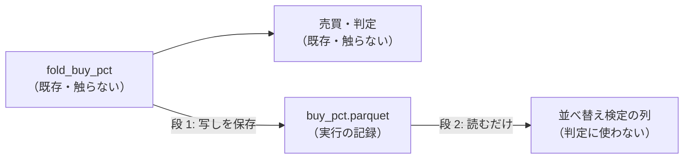

# 実験の行ごとの買い% ／ 出口% を記録に残す（並べ替え検定の物差しの材料）

利用者（2026-11-01）: 登録簿 `20261025-permutation-yardstick`（fold の内側の並べ替え検定）は、実行が買い% を保存していないので既存の行を埋められない、と報告 →「これからでも埋めた方がいいと思うが、なぜ記録を取らない？」→ 2 段で進める案に「進めて」。

## 1. 目的・背景

- いまの実行の記録は判定に要るもの（日次の損益・銘柄別・保有の記録）だけで、売買を回す途中の **買い% ／ 出口% は捨てている**（「取らない」と決めた記録は無い。途中の値の扱いだった）
- 残しておけば、後から別の物差し（並べ替え検定など）で **回し直さずに** 測り直せる。早く取り始めるほど埋められる行が増える

## 2. 方針（2 段）

> この図の主張: 段 1 は保存するだけで判定に触れない。段 2 は保存したものを読むだけ。

| 段 | 中身 |
| --- | --- |
| 1 | `cli/run.py` の fold の後で、その fold の評価分割の (fold, ts, 銘柄) と手法ごとの買い% ／ 出口% を集め、実行の終わりに `buy_pct.parquet` として `runs.Run` に入れる（float64 のまま ＝ 売買を 1 ビットも違わず回し直せる）。leak 対照の実行も同じ |
| 2 | 保存した買い% から、日付の塊（5 営業日）で並べ替えた売買 200 本の上乗せの分布 → fold ごとのパーセント点と合成の p を検証結果一覧の列 2 本に（登録簿の `structure` のまま・判定と n_trials は変えない）。⚠ 段 2 は段 1 の後に別に進める |

## 3. 影響範囲

- 段 1: `cli/run.py`（保存の 1 か所）・`ail/runs.py`（`Run.buy_pct`）。⚠ `fold_buy_pct`・売買・判定・`cli.predict` の経路は触らない ＝ 指紋 `tests/test_trading_run.py`・`test_predict.py`
- 記録の大きさ: 1 実験あたり数 MB 増える【推測 → 段 1 で実測】

## 4. テスト方針

- 保存した買い% から `simulate` を回し直すと、`result.csv` の純利と 1 ビットも同じ（形式 (A) の手法 1 本・θ 1 つで）
- 保存しても既存の出力（result ／ summary ／ daily ／ holds）が 1 バイトも変わらない（指紋テスト）

## 5. 段 1 の結果（✅ 2026-11-01 titan）

- `cli/run.py` の `buy_pct_frame`（fold の後で写しを取るだけ）→ `extra["buy_pct"]` → `ail/runs.py` の `Run.buy_pct`（parquet）・読み手 `runs.read_parquet`。⚠ leak 対照には残さない
- テスト: `tests/test_trading_run.py` に 2 本（保存した買い% から `simulate` を回し直すと `per_symbol.csv` の純利と同じ〔形式 (A) ／ (B)〕・DB への出し入れで表が同じ）。指紋・研究側の関連 94 本 ✅
- 【実測】`dev_roles_entrystop_b10e5`（手法 6 列 × 111,359 行）で **4.2MB**（float64 は圧縮が効かない ＝ zstd 4.2 ／ brotli 3.9MB で差は小さい）。開発ループで 1 晩 6 実験なら 約 25MB【推測】
- ⚠ **測るつもりの 1 回が本物の研究の DB に入った**（`2026-11-01T11-44-53_dev_roles_entrystop_b10e5`。`AIL_RUNS_DIR` を `runs.py` が読まないのを確かめずに流した）。閉じた実行は消せない ＝ 同じ識別項目の回し直しとして残る（n_trials は増えない・検証結果一覧は次の吐き直しで実行一覧に 1 本増える）。中身は 11:06 の回と **result ／ summary ／ per_symbol ／ holds ／ trader ／ daily が 1 バイトも同じ** ＝ 実データでの「保存しても結果が変わらない」の検算になった
- 次: 段 2（並べ替え検定の列）。2026-11-01 以降に回した行だけが埋まる
