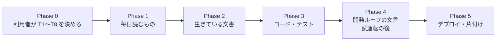
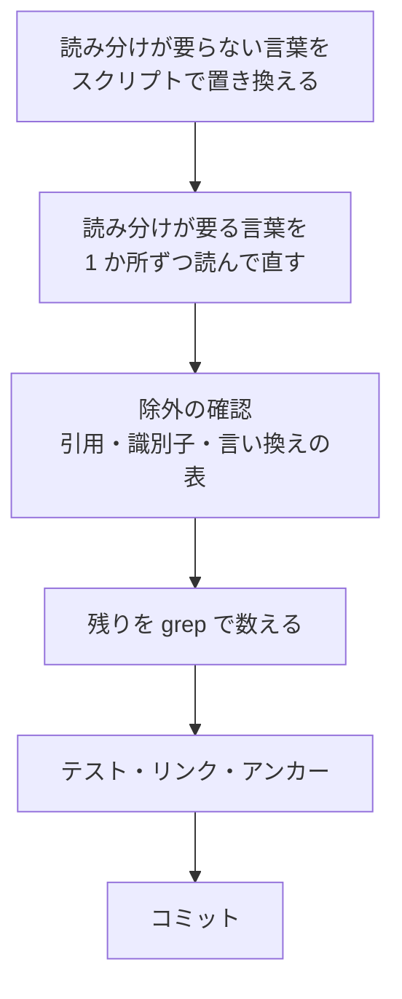

# 既存の文書・画面の文言の技術用語を一般的な言い方へ置き換える

- 作成: 2026-11-14（土）15:16 PST・titan
- 利用者の指示（2026-11-13）: 「このプロジェクトの説明では漢字が多く使われてそれがとても分かりにくい。…一般的なプログラムの環境では使われない漢字表現が多すぎる」→「一括で変更するというのをTODOに入れて」
- ルールと言い換えの表の正本: [CLAUDE.md](../../CLAUDE.md) の「ドキュメントの書き方」（2026-11-13。新しく書く文はもうこのルール）
- このプランの対象: それより前に書いた文

## 1. 目的と背景

独自の漢字語・たとえ話の言葉（砂場・門・錠・札・器・口・運転手 など）を、エンジニアが検索して出てくる言い方（カタカナ語か英語）に替える。新しい文は 11/13 から替わっているが、古い文が残っているので、読むたびに 2 つの言い方が混ざる。Claude も既存の文から言い回しを写すので、古い文が残るほど新しい文にも古い言葉が戻る。

## 2. 調べたこと（2026-11-14【実測】）

数え方: `git ls-files` の全ファイルを正規表現で数えた。スクリプトは使い捨て（リポジトリには入れていない）。⚠ 一文字の言葉（門・段・口・器・印・道・木）は、ほかの語の一部（入口・口座・学習器・値段 など）を正規表現で粗く除いただけなので、数は多めに出ている。

### 2-1. スコープごとのファイル数

| 記号 | スコープ | ファイル数 |
| --- | --- | ---: |
| A | 直下の文書（`CLAUDE.md`・`TODO.md`・`README.md`。`AGENTS.md` は `CLAUDE.md` への symlink） | 4 |
| B | 進行中のプラン（`docs/plans/*.md`。このプランを除く 6 本） | 6 |
| C1 | `docs/specs/experiments/feature-discovery/`（`rules.md` 2,451 行・`ledger.md` 4,723 行〔生成物〕ほか） | 8 |
| C2 | 仕様書（`docs/specs/` 直下。`dashboard.md` 1,495 行ほか） | 17 |
| D1 | 実験の記録（`docs/specs/experiments/*.md`。`live-trading.md` 1,503 行・`dev-loop.md` 632 行を含む） | 71 |
| D2 | 開発ループの生成物（`dev-loop/log/`・`register.md`・`sandbox/`・`ideas-*.md`） | 18 |
| E1 | 外部のタブの TOML（`dashboard/*.toml` 5 本・計 3,830 行） | 5 |
| E2 | 管理画面のテンプレート（html・js） | 17 |
| F | 開発ループのプロンプト（`devloop/prompts/` 5 本・計 203 行） | 5 |
| G1 | 設定の TOML（実験・トレーダー・queue など） | 393 |
| G2 | レジストリ（`config/ideas/*.toml`） | 62 |
| H | テスト（約 25,500 行） | 151 |
| I | Python（テスト以外・約 43,800 行。コメント・docstring・メッセージ） | 216 |
| J | シェル・systemd | 21 |
| K | その他の md（各ディレクトリの README など） | 9 |
| Z | 履歴（`DONE.md`・`docs/plans/archive/`）＝ 替えない | 197 |

### 2-2. CLAUDE.md の表の言葉の出現数（Z を除く）

| 言葉 | 合計 | 多いスコープ（上位 3） | 読み分け |
| --- | ---: | --- | --- |
| 砂場 | 11 | A 11（全部 CLAUDE.md の説明と引用） | 不要 |
| 台帳 | 526 | D1 226・I 111・H 82 | 要（研究 ＝ 検証結果一覧 ／ トレーダー ＝ 売買履歴） |
| 運転手 | 162 | D1 34・I 34・G1 26 | 不要 |
| 関門 | 44 | D1 14・A 10・J 10 | 不要 |
| 門（単独） | 598 | D1 135・C1 99・E1 94 | 要（ゲート ／ チェック） |
| 門前 | 295 | I 66・D1 63・C1 50 | ⚠ コードの項目名でもある（§2-4） |
| 錠 | 36 | A 11・I 7・B 6 | 不要 |
| 段 N（段 0〜5 など） | 912 | D2 184・D1 174・I 97 | 要（ステージ ／ ステップ ／ 段階） |
| 「選ぶ段」など | 366 | D2 65・D1 58・A 35 | 要 |
| 口（機能） | 813 | D2 210・G1 120・D1 91 | 要（オプション ／ フラグ ／ 差し込み口はそのまま） |
| 器（単独） | 866 | D2 253・D1 147・G2 117 | 要（シミュレーター ／ エンジン。学習器・分類器の残りも混ざる） |
| 札 | 138 | C2 47・H 16・I 16 | 要（ステータス ／ ラベル） |
| 印（単独） | 880 | I 152・D2 140・D1 130 | 要（フラグ ／ ラベル ／ マーク。「本番の機械ではない」印は 9/21 の「変えないもの」） |
| 登録簿 | 576 | G1 142・I 137・G2 67 | 不要 |
| 日誌 | 156 | I 41・D1 22・B 20 | 不要（ログ。⚠ `predict.log` などの「ログ」と並ぶ文は読み分け） |
| 置き場 | 337 | I 111・D1 45・A 35 | 要（ディレクトリ ／ パス ／ 保存先。「記録の置き場は DB」はディレクトリではない） |
| 道（パス） | 394 | I 98・D1 72・C2 48 | 要 |
| 控え | 242 | I 77・D1 65・A 30 | 要（バックアップ ／ スナップショット ／ ジャーナル〔`journal.jsonl`〕） |
| 写し | 467 | I 94・D1 89・G1 75 | 要（コピー ／ スナップショット） |
| 吐き直す | 73 | D1 32・I 9・A 7 | 不要 |
| 指紋 | 240 | D1 65・I 56・C1 30 | 要（回帰テスト ／ フィンガープリント ／ ハッシュの比較） |
| 黄金（の集計値） | 43 | A 10・D1 10・B 6 | 不要 |
| 雛形 | 20 | A 7・B 5・D1 5 | 不要 |
| 偽の | 193 | D2 84・G2 35・D1 25 | 要（モック ／ ダミー。「偽の分布」「偽の実行」は統計の話でモックではない） |
| 見張り | 80 | I 26・C2 20・A 10 | 不要 |
| 機械（titan など） | 309 | D1 74・I 61・A 31 | 要（「機械で検査」＝ 自動で、は別） |
| 作業ツリー | 35 | D1 7・I 6・H 5 | 不要 |
| 木（単独） | 205 | I 45・D1 42・C1 33 | 要（ワーキングツリー ／ シミュレーションのディレクトリ ／ 決定木） |
| 物差し | 514 | D1 117・D2 92・C1 74 | 要（指標 ／ メトリクス。⚠ レジストリの値でもある ＝ §2-4） |
| 突き合わせる | 199 | D1 72・I 54・C1 19 | 不要 |
| 人の手 | 262 | D2 76・D1 47・A 33 | 要（共有コード変更 ／ 手動） |

合計 ≈ 1 万か所。そのうち読み分けが要らない言葉は ≈ 2,300、文脈で読み分ける言葉が ≈ 7,700（一文字の言葉の数え過ぎを含む）。

### 2-3. 表に無いが同じ種類の言葉（追加の候補）

| 言葉 | 合計（Z を除く） | 案 | 推す扱い |
| --- | ---: | --- | --- |
| 執行器 | 701 | 執行エンジン | 替える（CLAUDE.md の表の「器 → エンジン」と同じ考え方） |
| 尻（訓練分割の尻） | 314 | 末尾 | 替える |
| 種（乱数の） | 240 | シード | 替える |
| 切れ目（評価期間の） | 677 | 分割点 | 替える。⚠ 検証方式の名前「切れ目ずらし1/3」は DB の値なので替えない |
| 帯（画面の） | 420 | バナー | 替える |
| 束（アイデア出しの・モデルの一覧の） | 141 | バッチ ／ グループ | 替える |
| 枝（コードの分岐の） | 67 | 分岐 ／ コードパス | 替える |
| 筋書き（sim の） | 62 | シナリオ | 替える |
| 作り置き（予測の） | 105 | キャッシュ ／ 事前計算 | 替える |
| 帳尻を合わせる | 26 | 照合（reconcile） | 替える |
| 番人 | 12 | ガード | 替える |
| 通し運転 | 18 | 通し実行（E2E） | 替える |
| 棚（候補の棚） | 33 | 候補リスト | 替える |
| 土台（確率の） | 746 | ベースレート | 替える。⚠ 登録名「…土台差）」は識別子なので替えない |
| 綴り（名前の） | 263 | 表記 | 替える |
| 名簿 | 178 | ロスター | ⚠ 利用者（管理画面の `/roster` の画面の言葉。10/7・10/9 の決定で使っている） |
| 検知器 | 1,176 | — | 替えない（普通の技術の日本語） |
| 較正 | 761 | — | 替えない（キャリブレーションの正しい訳語。外部のタブの禁止語にも入っている） |
| 棚卸し・打ち切り・試運転・注記・系統・手じまい | — | — | 替えない（普通の日本語 ／ 取引の用語） |

### 2-4. 文字が識別子・値として使われている箇所（替えると動きが変わる）

| 場所 | 中身 | 扱い |
| --- | --- | --- |
| `cli/ledger.py`・`ail/validation/gate.py` | 行の項目名 `"門前"`（`r.get("門前")`） | 項目名は替えない。表示の文だけ替える |
| `cli/devloop.py` の `KINDS` | レジストリの `kind` の値 `"物差し"`（62 本の TOML に入っている） | 替えない（替えるなら `OLD_STATUS` と同じ読み替えを置く ＝ 別の作業） |
| `ail/catalog.py` の `KEY` | 検証結果一覧の列名「鍵」「検証方式」など | 替えない（9/21 の「変えないもの」） |
| 検証方式・登録名 | 「閾値売買（切れ目ずらし1/3）」「…（全列・学習・土台差）」など | 替えない（DB の値） |
| `cli/devloop.py` → `dashboard/devloopview.py` | ログの見出し `## 段 1 の原文` を画面が文字で探す | 生成側を替えるなら、読む側は新旧の両方を探す（過去のログは替えないので） |
| `dashboard/glossary.toml` | 語の名前（`tests/test_help.py` が見る）・`where` 144 か所（仕様書の見出しの文字のコピー） | 見出しを替えたら grep で拾って一緒に直す |
| テスト | assert の行に対象の言葉が出るのは 25 ファイル・54 行（メッセージの文字を見ているのはその一部。`test_devloop_mail.py` の「錠」「運転手が落ちた」「続きは日誌」など） | メッセージを替えるときにテストも同じコミットで直す |
| 仕様書の見出しへのアンカー（`.md#…`） | 23 か所（archive を除く） | 見出しを替えたら一緒に直す |

## 3. 先に決めること（⚠ 利用者）

| # | 決めること | 選択肢 | 推す案 |
| --- | --- | --- | --- |
| T1 | 範囲 | (a) 毎日読むものだけ ＝ A・E1・E2・F・開発ループのログとメールの生成の文言 ／ (b) ＋ 生きている文書 ＝ B・C1・C2・D1 のうち `live-trading.md`・`dev-loop.md`・手順書・K ／ (c) ＋ コード ＝ I・J・H（コメント・docstring・メッセージ） ／ (d) ＋ 閉じた実験の記録 D1 の残り 69 本 | **(c) まで。Phase を (a) → (b) → (c) の順に分ける**。(d) はやらない（済んだ記録 ＝ 9/21 の「変えないもの」と同じ扱い） |
| T2 | 9/21 に利用者が決めた言葉（検証結果一覧・識別項目・識別名・許可・資格情報・売買履歴・売買基準値・評価期間・観測期間 など）も替えるか | 替える ／ 替えない | **替えない**（普通の日本語として通じる・外部のタブの本文で使っている〔売買基準値 253 か所〕） |
| T3 | 言い換えの表 | §2-2 の 31 語 ＋ §2-3 の追加の候補 | §2-2 は CLAUDE.md のとおり。§2-3 は「推す扱い」のとおり（名簿は利用者が決める） |
| T4 | 設定の TOML のコメント（G1 393 本）とレジストリ（G2 62 本） | 替える ／ 替えない | **替えない**（事前固定の記録 ＝ 回すと決めたときの文をそのまま残す。レジストリの本文は `claude -p` の出力そのもの） |
| T5 | 生成物 | `ledger.md`・`register.md` は生成のコードの文言を替えて再生成する ／ 過去の `dev-loop/log/*.md`・`sandbox/*.md`・`ideas-*.md` は替えない | 推す ＝ このとおり |
| T6 | 外部のタブの本文（やさしい言葉の決まり）の「門」94 か所・「道」47 か所・「印」45 か所・「土台」100 か所 | カタカナ語（ゲート・チェック・パス・ラベル）に替える ／ 本文はそのまま・「詳しく」の中だけ替える | **本文も替える**（決まりの禁止語にカタカナ語は入っていない。⚠ 替えた後にやさしい言葉のテストを流す） |
| T7 | 開発ループのプロンプト（F）と、ランナーのログ・メールの文言 | すぐ替える ／ 全ステージの試運転（11/14〜11/20 の 7 晩）が済んでから替える | **試運転の後**（文言を替えると夜のアイデア出しの出力が変わる ＝ 試運転の途中で条件を動かさない）。替えるときに契約の版を 5 に上げる（rules.md 31-6 に 1 行） |
| T8 | 本番に効くファイル（執行器のメッセージ・管理画面のテンプレート・`glossary.toml`） | Phase ごとにデプロイ ／ 最後にまとめて 1 回 | **まとめて 1 回**（Phase 3 の最後。`event` の名前・記録の項目名は替えないので、過去の記録の読み手は変わらない） |

### 3-1. 決定（2026-11-14 15:20 PST 頃 利用者「推す案で」）

T1〜T8 は全部「推す案」のとおり。§2-3 の追加の候補も「推す扱い」のとおり。⚠ **名簿 → ロスター はまだ決めていない**（利用者が決めるまで「名簿」のまま）。

## 4. 進め方

主張: 置き換えは「機械的に替えられる言葉」と「1 か所ずつ読む言葉」に分け、スコープごとにテストで確かめてからコミットする。

### 4-1. 1 ファイルの手順

主張: 一括の sed は使わない（一文字の言葉が別の語に当たる・引用と識別子を壊す）。

- 替えない箇所（どのスコープでも）
  - 利用者の言葉の引用（「…」の中。例: 利用者「人の手という言葉の意味が不明すぎる」）
  - CLAUDE.md の言い換えの表そのもの・「変えないもの」の列挙
  - バッククォートの中（コード・ファイル名・コマンド・値）
  - §2-4 の識別子・値
  - `DONE.md`・`docs/plans/archive/`・過去のログ
- 古い言い方の文書（archive・閉じた記録）を指す文では、最初の 1 回だけ「サンドボックス（旧: 砂場）」のように併記する（CLAUDE.md のルール）

### 4-2. Phase

| Phase | 対象 | 中身 | 作業量【推測】 |
| --- | --- | --- | --- |
| 0 | — | 利用者が T1〜T8 を決める | — |
| 1 | A・E1・E2 | `CLAUDE.md`（517 行）・`TODO.md`・`README.md`・外部のタブの TOML 5 本・管理画面のテンプレート 17 本 | 3〜4 時間 |
| 2 | B・C1・C2・D1 の 2 本・K | `rules.md`・`dashboard.md`・`live-trading.md`・`dev-loop.md`・手順書・進行中のプラン 6 本・README 9 本。`ledger.md` と `register.md` は Phase 3 の生成のコードの後に再生成 | 5〜7 時間 |
| 3 | I・J・H | Python 216 本のコメント・docstring・メッセージ、シェル 21 本、テスト 151 本。⚠ メッセージを替えたらテストも同じコミットで | 8〜12 時間 |
| 4 | F・ランナーの生成の文言 | プロンプト 5 本・ログの見出し・メール・`devloopview.py` の読む側（新旧の両方）・契約の版 5 | 1〜2 時間。11/21（土）以降 |
| 5 | — | `./run-tests.sh --full` → 「デプロイ」（利用者の依頼で）→ CLAUDE.md のルールの段落から「既存の文書は一括では書き換えない」を「2026-11 に書き換えた」に直す → TODO → DONE・プランを archive へ | 1 時間 |

合計 18〜26 時間【推測】（Claude のセッションの時間。複数日に分ける）。費用は定額のプランの利用枠の中で、初期コスト・金銭の支出は無い。

## 5. 影響範囲

- **研究の結果は変わらない**: 替えるのは文・コメント・メッセージだけ。識別子・項目名・DB の値・設定の TOML は替えない
- **本番に効くもの**: 執行器のメッセージ（`run_day.py`・`reconcile.py`・`recovery.py` など）・管理画面のテンプレート・`glossary.toml`。`event` の名前と記録の項目名は替えない。デプロイは Phase 5 にまとめて 1 回
- **開発ループ**: 試運転の間（〜11/20）は `cli/devloop.py`・`cli/devloop_mail.py`・`devloop/prompts/` に触らない（Phase 4 へ回す）。夜 01:00 PST にランナーが `main` へ commit ＋ push するので、作業の途中でワーキングツリーを汚したまま夜を越さない（ステージ 0 のゲートが止まる）
- **外部のタブ**: TOML は 5 秒ごとに読み直されるので、替えたらその場で画面に出る。Python（`*view.py`）を替えたら 3015 の再起動が要る
- **リンク**: 仕様書の見出しを替えると、アンカー 23 か所と `glossary.toml` の `where` 144 か所が切れうる

## 6. テスト方針

- スコープごとに: `./run-tests.sh --fast`（Phase 1・2）／ `./run-tests.sh`（Phase 3 の各コミット）／ `./run-tests.sh --full`（Phase 5）
- 予測の経路の回帰テスト（`tests/test_trading_run.py`・`tests/test_predict.py`）は Phase 3 で必ず流す（コメントだけの変更でも、同じファイルを触るので）
- `ledger.md` の再生成の前後で、行数・判定の内訳（採る ／ 保留 ／ 落とす）・`n_trials` が同じことを照合する
- 置き換えの後に、対象の言葉の残りを同じ正規表現で数え直し、残った箇所が §4-1 の「替えない箇所」だけであることを確かめる
- リンクとアンカー: 替えた見出しを `git diff` から拾い、古い見出しの文字を grep して 0 件にする
- 外部のタブ: `dashboard/tests/`（やさしい言葉の禁止語・`test_help.py`・`test_system_tab.py`）

## 7. やらないこと

- コードの識別子・ファイル名・DB の列名と値・`event` の名前の改名
- `DONE.md`・`docs/plans/archive/`・閉じた実験の記録・過去のログの書き換え
- 設定の TOML とレジストリの書き換え（T4）
- 9/21 の言葉の変更（T2。利用者が言ったときだけ）

## 8. 記録

### 8-1. Phase 1（2026-11-14 15:43 PST・titan）

- 対象と件数【実測】: `CLAUDE.md` 約 370 か所 ／ `TODO.md` 76 か所 ／ `README.md` 0 ／ 外部のタブの TOML 5 本 413 か所（`models.toml` 306・`system.toml` 63・`glossary.toml` 30・`compare.toml` 8・`traders.toml` 6）／ 管理画面のテンプレート 10 本と `app.js` 36 か所
- テスト: `./run-tests.sh --fast` ✅（執行エンジン 77 秒・管理画面 52 秒 ＝ 300 本）。TOML 5 本は `tomllib` で読めることも確かめた
- 一緒に直したテスト（画面の文字を見ている 3 か所・`dashboard/tests/test_live.py`）: 「今日は見張らない（…）」→「今日は監視しない（…）」／「dry-run の写し」→「dry-run のコピー」／「物差し A〜E」→「指標 A〜E」
- 用語集の語の改名は 1 つだけ: 「物差し A〜E」→「指標 A〜E」（テンプレートの見出しと `info()` を一緒に替えた）
- 道具: `docs/plans/assets/terminology-rename/`（`trlib.py` ＝ 保護と置き換え ／ `rules_common.py` ＝ 共通の規則 ／ `apply.py <ファイル> [--spec <個別の規則>] [--write]` ／ `ctx.py` ＝ 文脈の表示 ／ `count_terms.py` ＝ スコープごとの件数 ／ `spec_*.py` ＝ ファイルごとの個別の規則）。⚠ `--write` の前に必ず `--write` なしで全部の置き換えを目で見る

### 8-2. Phase 1 で踏んだこと（Phase 2・3 でも効く）

| 踏んだこと | 対処 |
| --- | --- |
| 一文字の言葉が別の語に当たる: 値段の「道すじ」・「分かれ道」・「片道」／ 決定木の「木」／ 被覆率と閾値の「帯」・「時間帯」／「業種」「6 種」／「生成器」「予測器」／「機械では」「状態機械」 | 共通の規則に除外を足した。`models.toml` は「木」「帯」の規則を外した |
| 同じ言葉でも文書で意味が違う: 「印」は CLAUDE.md ではフラグが多く、外部のタブではラベル ／「控え」はジャーナル（発注の前の記録）・バックアップ・スナップショット（終値）・コピー ／「束」はバッチ（アイデア出し・取得）とグループ（モデルの一覧） ／「器」は仕組み（`cli.queue`）とシミュレーター ／「土台」はベースレート（確率）と基盤（サンドボックス） | ファイルごとの個別の規則（`spec_*.py`）を先に当てる |
| ログの出力の引用（「終値の控え → closes.json」など）は利用者の言葉ではないので、引用の保護に掛からない | 個別に保護する（`EXTRA`） |
| `glossary.toml` の `name`（`info()` とテストが見る）・`where`（仕様書の見出しのコピー）・`doc` | 行ごと保護した。`where` は Phase 2 で見出しと一緒に替える |
| 用語集の `short` は 90 文字まで（`test_vibetab.py`）。カタカナ語は長くなる | 「フィンガープリント」→「ハッシュ」で縮めた |
| 置き換えた後の併記が、後ろの規則でもう 1 度置き換わる（「旧: 土台」→「旧: ベースレート」） | 併記は全部の規則を当てた後に手で入れる |

### 8-3. Phase 1 で残したもの

- **「本番の機械ではない」**（画面のバナー・用語集の語・執行エンジンのメッセージ・テストが同じ文字を使う）→ Phase 3 でコードと一緒に決める。`CLAUDE.md` では「本番の機械ではない」フラグ と書いた
- **用語集の語の名前**: 「門前」「前置きの門」「状態機械」「控え」「3 段の許可」→ Phase 2（`where` と一緒に）。「門前」は検証結果一覧の表示が替わる Phase 3 で
- **検証結果一覧の表示「門前」**: `CLAUDE.md` では「ゲート未通過（検証結果一覧の表示は「門前」）」と併記した
- **外部のタブの TOML の「〜の段」**（ページの中のセクションの意味・約 20 か所）: 替えていない
- **「偽の」**: `CLAUDE.md` の 4 か所は統計の話（偽の分布・偽の実行）と「誤った」の意味で、モックではないので替えていない
- **「写す」「手で」**（動詞・普通の日本語）: 替えていない
- **`CLAUDE.md` のルールの段落**（「既存の文書は一括では書き換えない」）: Phase 5 で直す

### 8-4. Phase 2（2026-11-14 15:53 PST・titan）

- 対象と件数【実測】: 約 2,650 か所 ／ 26 ファイル

  | ファイル | 件数 | 個別の規則 |
  | --- | ---: | --- |
  | `docs/specs/experiments/live-trading.md` | 600 | `spec_live.py`（「控え」を行ごとに ジャーナル ／ 終値のスナップショット ／ バックアップ に分けた） |
  | `docs/specs/experiments/feature-discovery/rules.md` | 567 | `spec_rules.py` |
  | `docs/specs/dashboard.md` | 365 | `spec_dashboard.py`（「帯」は全ページに出るものだけバナーに。左の帯・閾値の帯・ものさしの帯は図の部品なので替えていない） |
  | `docs/specs/experiments/dev-loop.md` | 361 | `spec_devloop.py` |
  | `docs/plans/daily-dev-loop.md` ／ `trader-model-roles.md` | 270 ／ 103 | `spec_plan.py` |
  | `docs/specs/howto-model-trader.md` ／ `validation-power.md` | 115 ／ 73 | `spec_howto.py` ／ `spec_vpower.py` |
  | 進行中のプランの残り 4 本 | 91 | `spec_closes.py`・`spec_nightly.py`・`spec_tloop.py`・`spec_generic.py` |
  | README 7 本・`feature-discovery/` の小さい文書 5 本 | 89 | `spec_generic.py`・`spec_ltreadme.py` |
  | `dashboard/glossary.toml` の `where` 12 行・語の名前 3 つ | 15 | `fix_where.py`（仕様書と同じ規則を `where` に当て、見出しにあるかを前後で見る ＝ 新しく外れた `where` 0） |

- 確かめたこと: 替えた md 25 本とも、行数が同じ ・ ASCII（コマンド・パス・識別子・数字）が 1 文字も変わっていない（`check.py`）。コードブロックは mermaid と bash だけ替え、ほかの言語のブロック（出力の引用・TOML の例）は保護した
- 用語集の語の改名: 「状態機械」→「ステートマシン（旧: 状態機械）」／「控え」→「ジャーナル（旧: 控え）」／「3 段の許可」→「3 段階の許可」（`ops.html` の `info()` も）
- テスト: `./run-tests.sh --fast`（結果は TODO の Phase 2 の行）
- 足した道具: `check.py`（HEAD と比べて行数 ・ ASCII ・ 替わった見出し）／ `fix_where.py` ／ `trlib.py` に「（旧: …）の併記を保護」「コードブロックの言語で保護を分ける」

### 8-5. Phase 2 で替えなかったもの

- **調査の仕様書 7 本**（`online-tradable-assets.md`・`market-data-availability.md`・`trading-api-availability.md`・`trading-fee-comparison.md`・`trading-tax.md`・`service-trust-assessment.md`・`overview.md`）と `income-taxonomy/`・`experiments/i7-dataset/` の 2 本: このプロジェクトの独自の言葉がほとんど無く、当たるのは「入札」「落札」「印税」「1 口」「同種」「車種」などの普通の言葉だった ＝ 触らない（ほかの文書からのアンカー 23 か所もここを指している）
- **`ledger.md`・`register.md`**: 生成物 ＝ Phase 3 で生成のコードの文言を替えてから再生成
- **閉じた実験の記録 69 本・`dev-loop/log/` などの生成物**: T1・T5 のとおり
- **`dev-loop.md` のステータスの「人の手」**（22 か所）: 同じ文書の §14 に「この節より前の「人の手」は改名の前の記録」と書いてあるので、ステータスの意味の箇所は残した。「手で作った」の意味の見出し（「作った口（人の手）」など）だけ「手動」にした
- **用語集の語「門前」「前置きの門」**: 外部のタブ「実行」の見出し（`vibetab.py`）と検証結果一覧の表示が同じ文字を使う ＝ Phase 3 でコードと一緒に

### 8-6. Phase 2 で踏んだこと（Phase 3 でも効く）

| 踏んだこと | 対処 |
| --- | --- |
| 置き換えの文字列に後方参照を書くとき、`r"\\1"` と書くと「\1」という文字がそのまま入る（数字が消える） | `r"\g<1>"` と書く。`check.py` の「ASCII が変わった行」で気づける ＝ 当てた後に必ず流す |
| 「収束」「入り口」「小口」「印字」「時刻帯」「1 本道」「置き場所」に当たる | 共通の規則に除外を足した |
| 「器」が「コンテナ」「構成」の意味の箇所（`live-trading.md` §0-13） | 手で直した。Phase 3 でも「器 → シミュレーター」は 1 か所ずつ見る |
| 「控えた」（動詞） | 共通の規則から外した |
| 見出しを替えると `glossary.toml` の `where` が古くなる | `fix_where.py` |
| 開発ループのステージ 1（参考あり）は仕様書を読む ＝ 仕様書の言葉が替わると夜の案の言葉も少し変わりうる | 避けられない（プロンプトと契約は Phase 4 まで触っていない） |

### 8-7. Phase 3a（コメントと docstring だけ。2026-11-14 16:08 PST・titan）

Phase 3 は 2 つに分けた。**3a ＝ 動きが変わらない範囲**（Python のコメントと docstring）／ **3b ＝ 動きに出る範囲**（文字列リテラル ＝ メッセージ・画面の文字・生成物の文言、シェル、1 か所ずつ読む一文字の言葉）。

- 3a の対象と件数【実測】: Python 261 ファイル・1,409 か所（テストのコメントも含む）
- 道具: `apply_code.py`（`tokenize` でコメントを、`ast` で docstring を拾い、そこだけに `rules_code.py` を当てる。⚠ 文字列リテラルは触らない）
- 当てた規則: 読み分けが要らない言葉だけ（運転手・関門・錠・登録簿・日誌・吐き直す・黄金の集計値・雛形・見張り・作業ツリー・突き合わせ・物差し・指紋・執行器・通し運転・筋書き・作り置き・番人・綴り・切れ目・尻・状態機械・機械・置き場・道・写し・合わせる口・選ぶ段）。「台帳」はファイルの場所で読み分けた（研究 ＝ 検証結果一覧 ／ 実売買 ＝ 売買履歴）
- 確かめたこと: 替えた 261 ファイル全部で、**docstring を除いた AST が HEAD と同じ**・行数が同じ（道具の中と、独立のスクリプトの 2 回）＝ 実行されるコードは 1 文字も変わっていない
- テスト: `./run-tests.sh` と研究側の pytest（結果は TODO の Phase 3 の行）

### 8-8. Phase 3b に残したもの

- **コメントと docstring の一文字の言葉**: 門・門前・印・札・器・口・段 N・控え・土台・帯・束・種・木（ディレクトリごとに意味が違う ＝ 1 か所ずつ読む）
- **文字列リテラル**: 執行エンジンのメッセージ・管理画面と外部のタブの Python が出す文字（`vibetab.py` の「前置きの門」「門前」など）・`cli/ledger.py` が生成する `ledger.md` の文言・`run-tests.sh` の表示（「段」「執行器」）・「本番の機械ではない」。⚠ テストが文字を見ている箇所と一緒に替える
- **シェル・systemd**（21 本）
- **開発ループのログの見出し・メール・プロンプト**は Phase 4（11/21 以降）

### 8-9. Phase 3b-1（文字列リテラル。2026-11-14 16:24 PST・titan）

- 対象と件数【実測】: Python の文字列リテラル（docstring 以外）172 か所 ／ 約 70 ファイル。道具 `apply_strings.py`（全部の置き換えを表示してから `--write`）・除外 `strings_skip.py`
- 当てた規則は 3a と同じ（読み分けが要らない言葉だけ）。メッセージとそれを見るテストに同じ規則が当たるので、両方が同時に替わる
- **替えなかった文字列（`strings_skip.py`）**: 実行の記録の項目名（「尻の行数」「尻の行」「尻の日数」＝ DB の記録は書き換えできないので、名前を替えると古い記録と割れる）／ 検証結果一覧の行の項目名「指紋」／ 閉じる注記の「登録簿 `id`」を読む正規表現とその表示（`config/catalog_notes.toml` は替えない）／ SQL のスキーマの中のコメント ／ 用語集の語の名前「…旧: 台帳」とテストの中の作り物の TOML
- **「本番の機械ではない」→「本番のマシンではない」**: 画面のバナー・用語集の語・`run_day.py` ／ `liquidate.py` ／ `sample.py` ／ `notprod.py` のメッセージ・テスト・`CLAUDE.md` ・`dashboard.md` ・`live-trading.md` ・README を同じコミットで替えた（`event` の名前 `refused_not_production` とファイル名 `NOT_PRODUCTION` は替えていない）
- **`ledger.md` を再生成した**: 違いは 10 行だけ（文言 9 行〔物差し → 指標・指紋 → フィンガープリント・突き合わせ → 照合・登録簿 → レジストリ〕＋ 生成日）＝ 行数 4,723 のまま・表の行と判定は 1 文字も変わっていない
- テスト: 執行エンジン 271 passed ／ 管理画面 300 passed ／ 研究側 968 passed・1 skipped ／ selftest ・ mockrun ✅
- **シェルは替えていない**: `run-live.sh` の表示（「執行器（--mode plan）」「拒否: この機械は本番の機械ではない」）を見るテストがあり、13500t の g3plus-ops（`check.sh` など。titan からは見えない）が同じログの文字を読んでいないかを確かめられないため

### 8-10. Phase 3b-1 で踏んだこと

| 踏んだこと | 対処 |
| --- | --- |
| ⚠ **`grep -rl … $(…) \| xargs sed -i` の `$(…)` が正規表現の誤りで空になり、grep がリポジトリ全体を再帰で探した** ＝ `DONE.md` とアーカイブのプラン 5 本・`TODO.md`・このプランまで sed が書き換えた | すぐ `git checkout` で戻した。git 管理外のファイル（`live.sqlite`・`research.sqlite`・`NOT_PRODUCTION`）は更新時刻で触られていないことを確かめた。⚠ **以後、ファイルの一覧を変数に入れて中身を表示してから sed に渡す**（一覧が空なら止める） |
| 「この機械で本番の発注が…」が「この自動で…」になる | 規則に「この機械 → このマシン」を先に置いた |
| 否定の assert（`"執行器（" not in r.stdout`）は、出す側（シェル）が古い言葉のまま、テストだけ新しい言葉にすると**何も確かめないテストになる** | テストとシェルを元に戻した。⚠ テストの文字を替えるときは、出す側が同じコミットで替わっているかを必ず見る |
| `cli.report --catalog` は標準出力に出すだけ（ファイルは `> ledger.md` で書く） | 一時ファイルに出して今のものと行ごとに比べてから置いた |

### 8-11. Phase 3b-3 の前半（コメントと docstring の一文字の言葉。2026-11-14 16:33 PST・titan）

- 対象と件数【実測】: 665 か所（実売買 190 ／ 研究側 318 ／ 管理画面と外部のタブ 157。テストのコメントを含む）。道具は 3a と同じ `apply_code.py`（`--rules rules_code2`）＝ **docstring を除いた AST が全ファイルで HEAD と同じ**
- ディレクトリごとの読み分け（`rules_code2.py`。当てる前に全部の箇所を表示して読んだ）

  | 言葉 | 実売買 | 研究側 | 管理画面・外部のタブ |
  | --- | --- | --- | --- |
  | 控え | ジャーナル（`paper.py` ・ `yardstick.py` は終値のスナップショット ／ API のサンプルはバックアップ） | バックアップ | コピー（「控えの未完」はジャーナル） |
  | 印 | フラグ（「仮」の印はラベル） | フラグ（「時刻の印」はタイムスタンプ ／ 手法名の印はラベル） | ラベル（「本番のマシンではない」印などはフラグ） |
  | 木 | ツリー（シミュレーションのディレクトリ） | 替えない（決定木） | ツリー |
  | 口 | オプション（「操作の口」は手段） | オプション（「記録の口」はフック ／「薄い口」はラッパー ／「学習器の口」はインターフェース） | オプション |
  | 段 N | ステップ（API のサンプルはステージ） | ステージ | — |
  | 門 | — | ゲート | ゲート |
  | 器 | — | シミュレーター（「回し続ける器」は仕組み ／「推定器」は替えない） | — |
  | 土台 | — | ベースレート（確率の話）／ ベース（基準の話） | — |
  | 種 ・ 束 | — | シード ・ バッチ | 束はグループ |
  | 帯 ・ 札 | — | 替えない（ヒステリシスの帯） | 全ページに出るものだけバナー ／ 札はラベル（モデルの 1 枚はカード） |

- 替えていない: 「門前」（項目名と同じ文字）・開発ループのランナーとサンドボックスのファイル（Phase 4）
- テスト: `./run-tests.sh --fast` と研究側の pytest（結果は TODO）

### 8-12. 残り（2026-11-14 の終わりの時点）

- **3b-2 シェル 21 本**: 先に Sx360 で g3plus-ops がログの文字を読んでいないかを確かめる
- **3b-3 の後半**: 文字列リテラルの一文字の言葉（画面とメッセージ）・「門前」「前置きの門」（外部のタブ「実行」の見出し ＋ 用語集の語 2 つ ＋ 検証結果一覧の表示）・`register.md` の再生成
- **Phase 4**（11/21 以降）: 開発ループのプロンプト・ログの見出し・メール・`devloop.py` ／ `sandbox.py` の一文字の言葉・契約の版 5
- **Phase 5**: `./run-tests.sh --full` → 「デプロイ」→ `CLAUDE.md` のルールの段落を直す → 片付け
