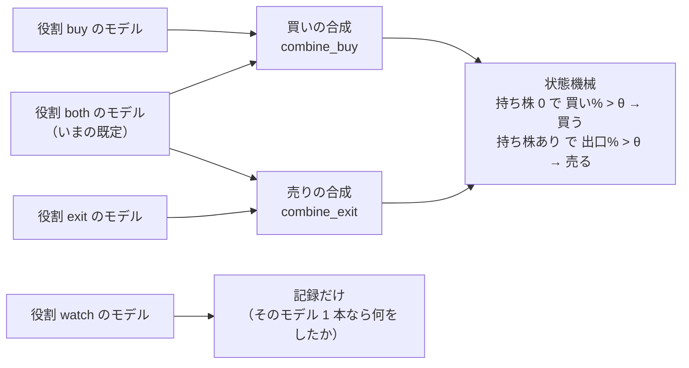
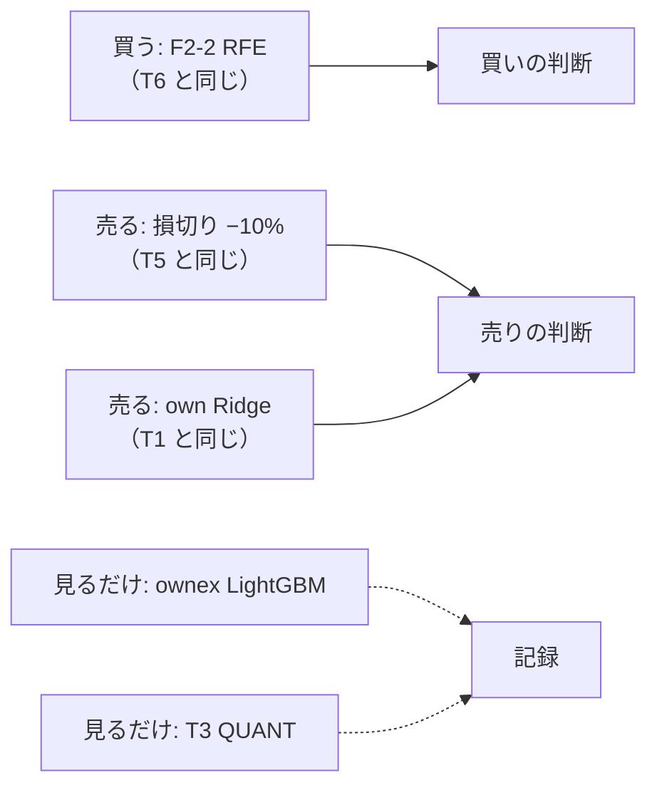
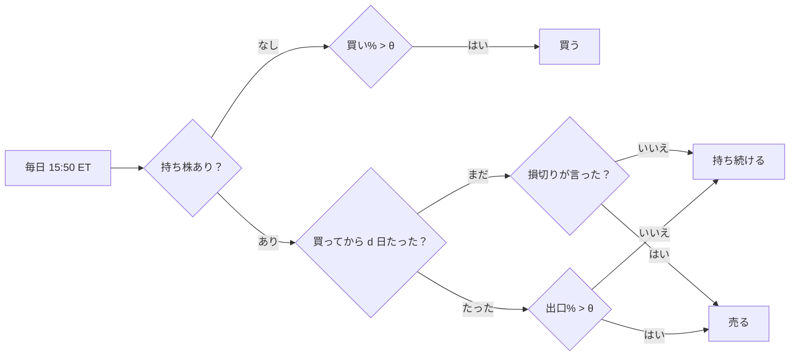

# 新しいトレーダー: モデルに役割（買う ／ 売る ／ 見るだけ）を持たせ、売買の頻度を減らす（案。2026-10-18）

派生元: TODO「新しいトレーダーを作成する」。利用者の言葉（2026-10-18）: **「新しいトレーダーの大まかな設定を作成します。現在のトレーダーには複数のモデルを使い売買ができます。購入と売却、またはどちらにも使わずに違うモデルで評価だけを残すようなものを考えています」**

⚠ **この文書は案**。§4 の決めごと（利用者）が済むまで、コードに手を入れない。

## 0. 目的・背景

- いまのトレーダーは、持っているモデル**全部**の 買い% ／ 出口% を 1 つの合成規則（`asis` ／ `mean` ／ `majority` ／ `unanimous`。`trader.py` の `combine`）でまとめ、同じ値を**買いにも売りにも**使う
- 「売りだけを言うモデル」は今でも作れるが、**回り道**になっている: `T5`（ミオ）は損切りモデルに「買い% を常に 100」を返させ、`unanimous`（買い ＝ 最小・出口 ＝ 最大）で買いの判断から外している。`mean` に入れると買い% が半分に割れて使えない
- 「売買には使わず、評価だけを残すモデル」は**作れない**（持たせたモデルは必ず合成に入る）
- 問い: **モデルごとに役割（買う ／ 売る ／ 両方 ／ 見るだけ）を書けるようにし、その形の新しいトレーダーを 1 人作る**

## 1. 役割の案

この図の主張: 役割で合成の入口を分ける。「見るだけ」は記録に残るが、売買の判断には入らない。

| 役割 `role` | 買いの判断 | 売りの判断 | 記録 | いまとの関係 |
| --- | --- | --- | --- | --- |
| `both`（既定） | 入る | 入る | 入る | ⚠ **いまの全員がこれ**。`role` を書かない設定は 1 ビットも変わらない（黄金の集計値で固定） |
| `buy` | 入る | 入らない | 入る | 新しい |
| `exit` | 入らない | 入る | 入る | `T5` の「買い% 100 の回り道」が要らなくなる |
| `watch` | 入らない | 入らない | 入る | 新しい。⚠ 注文・予算・売買履歴には一切効かない |

| # | 決めごと（案） | 中身 |
| ---: | --- | --- |
| 1 | 合成規則を側ごとに | `combine_buy`・`combine_exit`（書かなければ `combine` と同じ）。買いの側・売りの側それぞれに 1 本以上のモデルが要る（無ければ設定の読み込みで止める） |
| 2 | θ | 1 つのまま（買い% > θ で買う・出口% > θ で売る。いまの状態機械を変えない）。側ごとの θ は §4 の K3 |
| 3 | 「見るだけ」の記録 | 毎日の合図の記録（`signals` の `inputs`。もうモデルごとの 買い% ／ 出口% を残している）に役割を付ける ＋ 「そのモデル 1 本で売買していたら、今日は 買う ／ 売る ／ 持ち続ける ／ 見送る」を 1 行。⚠ 注文は出さない |
| 4 | 「見るだけ」の評価 | 紙上の対照（`paper.py`）と同じ作りで、見るだけのモデル 1 本ずつの紙上の損益を `out/daily.csv` の隣に出す（読むだけの後処理）。⚠ **損益で採らない**（CLAUDE.md。数週間では判定できない）。見るのは 机上との一致・売買の回数・トレーダーの判断との食い違い |
| 5 | 予測の時間 | `run-live.sh` は実験ごとに `cli.predict` を 1 本回す。⚠ **すでに誰かが使っている実験なら追加 0 秒**、新しい実験なら 1 本ぶん増える（いまは 4 本並列で 49〜53 秒【実測 2026-10-08】・刻限 15:58 ET） |
| 6 | 同じ実験を 2 役で | ⚠ いまは「同じ実験名の違う手法を 1 人の中で 2 本持てない」（`signals.py` は (実験名, 銘柄) で引く）。同じモデルを買いにも売りにも使うなら `both` 1 本で書く |

## 2. 新しい人の大まかな設定（叩き台）

この図の主張: 買いを決めるモデルと売りを決めるモデルを分け、ほかのモデルは横で見ているだけ。

| 項目 | 叩き台 | 理由 |
| --- | --- | --- |
| 識別名 ／ 呼び名 | `T7` ／ （利用者が決める） | `T5` は候補のミオが使っている。呼び名は `dashboard/traders.toml` の `[nicks]`（使い回さない） |
| 予算 | $600 | いまの 3 人と同じ |
| 銘柄 ／ `sizing` | T・PFE・NKE・VZ・BAC ／ 整数株 | いまの 3 人と同じ（株を変えると、役割の違いと株の違いが混ざる） |
| 買う（`buy`） | `sel_small4_1995` F2-2 RFE | 検証結果一覧の上位から選んだ本（`T6`）。⚠ 今の時期は毎日「全部買う」に近い（`trader-shaped-validation.md`） |
| 売る（`exit`） | `trade_own_stopexit_a` 損切り −10% ＋ `trade_own_ridge_a` | 損切りと、売りの合図（T1 のモデル）のどちらかが言ったら降りる（`combine_exit = "unanimous"` ＝ 最大） |
| 見るだけ（`watch`） | `trade_ownex_lgbm_a`（もと T2）・`trade_ownseq_ridge_a` T3 QUANT（もと T3） | ⚠ 外した 2 人のモデルを横で見続ける。⚠ 実験はどれも既存（`trade_ownex_lgbm_a`・`trade_ownseq_ridge_a` は `T4` が使う）＝ `T4` が名簿に居る間は**予測の時間は増えない**（`run-live.sh` は名簿の全員の (実験名, 手法) を 1 本ずつにまとめて予測する）。⚠ 名簿全体では、新しく増える実験は損切りの `trade_own_stopexit_a` 1 本（いまの 4 本 → 5 本並列）。`T4` と入れ替えても 5 本のまま（`T7` が見るだけで持つので） |
| θ | 50 | いまの 3 人と同じ |

⚠ 叩き台のモデルの組み合わせは「役割の配線を確かめやすい」で選んだ。**良し悪しで選んでいない**（机上で採ったモデルは 0 本）。

## 3. 影響範囲と進め方

この図の主張: 執行器を直すのは 20 営業日の判定（11/4）の後に本番へ出す。それまでは机上・テスト・シミュレーションで固める。

| Phase | 誰 | 中身 | 手間【推測】 |
| --- | --- | --- | --- |
| 0 | 利用者 | §4 の決めごと | — |
| 1 | Claude | `trader.py`（`role`・`combine_buy` ／ `combine_exit`・読み込みの検査）・`signals.py`（役割で入口を分ける・記録に役割）・テスト。⚠ `role` の無い設定は 1 ビットも変わらない（黄金の集計値・既存のテスト） | 半日 |
| 2 | Claude | 見るだけのモデルの「1 本ならどうしたか」の記録・`paper.py` に見るだけのモデルの紙上の損益・管理画面のトレーダーの詳細に 1 表 | 1 日 |
| 3 | Claude | `candidates/roles/T7.toml` ＋ `sim_T7`・sim で 64 営業日・手順書 `howto-model-trader.md` に役割の節・外部のタブの TOML（`traders.toml`・`system.toml` の「トレーダーのしくみ」に役割の 1 段） | 半日 |
| 4 | 利用者 → Claude | 11/4 の判定の後: 誰と入れ替えるか（検証は 3 人まで ＝ 2026-10-04 の決定）・予算の上限・「デプロイ」→ 名簿の ▶ 開始 | — |

⚠ 影響: `trader.py`・`signals.py`・`plan.py`（読むだけ）・`paper.py`・`yardstick.py`・管理画面。⚠ **執行器は 13500t の毎日の売買の経路** ＝ 本番に出すのは 11/4 の判定の後（「20 営業日のあいだは執行器を変えない」と同じ考え。§4 の K6）。

テスト方針: 役割ごとの合成の表（`buy` だけ ／ `exit` だけ ／ `watch` は判断を変えない）・設定の誤り（買いの側が 0 本 など）で起動を拒む・`role` の無い全員の設定で計画が 1 ビットも同じ・黄金の集計値（`--full`）・`T5` を役割で書き直した形と今の `T5` が同じ判断を出すこと。

## 4. 決めごと（⚠ 利用者）

| # | 決めること | 推す案 |
| ---: | --- | --- |
| K1 | 役割を 4 つ（`both` ／ `buy` ／ `exit` ／ `watch`）にするか | 4 つ |
| K2 | 合成規則を側ごとに分けるか | 分ける（書かなければ今の `combine`） |
| K3 | θ を側ごとに分けるか | 分けない（1 つのまま。分けるのは後で別の人として） |
| K4 | 叩き台のモデルの組み合わせ（§2） | §2 のまま（配線を確かめやすい） |
| K5 | 「見るだけ」の評価に紙上の損益まで出すか | 出す（⚠ 損益で採らない・物差しは机上との一致と売買の回数） |
| K6 | 本番に出す時期 | 11/4 の判定の後（それまでテストとシミュレーションまで） |
| K7 | 売買の頻度を減らす口（§5-2） | ① 最短保有（買ってから d 日は売りの合図を読まない・損切りだけは例外） |
| K8 | 保有期間 d の候補（§5-3。⚠ 回す前に固定） | 1（いまと同じ）・3・5・10・20・40 営業日 |
| K9 | 最適な d の選び方（§5-3） | B 訓練分割の尻で選ぶ（14-12 と同じ置き場。数えるのは champion × θ） |
| K10 | 机上にかけるモデル | `T7` の買うモデル（F2-2 RFE `sel_small4_1995`）と `T1` のモデル（own Ridge）の 2 本 ＝ ＋6 |

## 5. 売買の頻度を減らす・保有期間の最適な長さを計算する（2026-10-18 追加）

利用者の言葉（2026-10-18）: **「売買頻度を極力減らして手数料の影響を小さくします。保持期間の最適な長さも計算して出します」**

### 5-1. 手数料の大きさ（先に確かめたこと）

| 項目 | 値 | 種類 |
| --- | --- | --- |
| 本番の手数料（整数株の成行 1 注文） | $0.001 | 【実測】`live-trading.md` §0-3（`dryrun2` の `market_1`） |
| 1 銘柄の枠 $120（$600 ÷ 5）に対して | 約 0.08bp ／ 1 注文 | 【計算】$0.001 ÷ $120 |
| 合図時の気配と約定の差（差 1）の中央値 | 0.00bp | 【実測】`live-trading.md` §2-1（前の 3 人の 8 営業日・17 本） |
| 机上の売買の費用の仮定 | 往復 5bp（建てた日と手仕舞った日に 2.5bp ずつ） | 【推測】rules.md 13-4 の 3 |

⚠ **本番では手数料の影響はもともと小さい**（1 往復で約 0.16bp【計算】）。売買の回数を減らして効くのは主に ① 机上の 5bp の仮定（売買が多い形ほど机上で負ける）② 気配の差が開いた日の取りこぼし。⚠ 「手数料が減ったから成績が良くなった」は本番の数字では見えない大きさ。

### 5-2. 回数を減らす口

この図の主張: いまの状態機械は毎日、持ち株があれば売りの合図を読む。最短保有は「買ってから d 日はその合図を読まない」を足すだけ。

| 口 | 中身 | 既にあるもの ／ 結果 | 推す |
| --- | --- | --- | --- |
| ① 最短保有 d 日 | 買ってから d 営業日は売りの合図を読まない（役割 `exit` の損切りだけは読む） | 無い。⚠ 机上の `simulate` には逆向きの「d 日たったら降りる」（`max_hold_days`。基準線）だけがある。売買履歴は建てた日 `opened` を持っている（`state.py`）＝ 執行器に足せる | ✅ |
| ② 判断する日を減らす | 週 1 回（決まった曜日）だけ売買を判断する | 無い | — |
| ③ 売る線を下げる | 売りの合図の基準を買いより低くする（帯を広げる） | ⚠ rules.md 13-3 規約 2 で帯は 20 点まで。(55, 50) などは試した ＝ 採る 0（`forward10-target.md` §7-4） | — |
| ④ 先の長い日数を当てる | 先 10 日の値動きを学ぶ | 試した ＝ 取引は半分以下になったが、⚠ **保有の中央値は 2 日のまま**（`forward10-target.md`） | — |

### 5-3. 最適な保有期間の計算（机上）

⚠ **評価期間の結果を見て d を選ぶと、選んだぶんだけ良く見える**（rules.md 14-10・14-11）。選び方は 2 案:

| 案 | 中身 | 数え方 | 推す |
| --- | --- | --- | --- |
| A 格子を全部回す | d の候補 6 つ × θ 3 を全部評価期間で測る | 候補 × θ ＝ 1 モデルにつき ＋18 | — |
| **B 訓練分割の尻で選ぶ** | fold ごとに、訓練分割の尻 10% で d の候補を測り（物差し ＝ 尻での B&H に対する上乗せ）、決まった d（champion）を評価期間に 1 回だけ当てる。⚠ 14-12（ハイパーパラメータの内側選抜）と同じ置き場 | champion × θ ＝ 1 モデルにつき ＋3 | ✅ |

- **出すもの**: fold ごとの champion の d（＝ 計算した「最適な保有の長さ」）・その d で評価期間に当てた結果（13-7 の判定）・d ＝ 1（いまの形）との対の差・取引の回数と保有の中央値
- ⚠ **先に書く見立て【推測】**: 上げ相場の時期（2018 年から）では、長く持つほど B&H（ずっと持つ）に近づく。尻の物差しを「純利」にすると一番長い d に張り付くので、物差しは **B&H に対する上乗せ**にする。それでも champion が一番長い d（40）に張り付いたら、答えは「持ち続けるのに近いほど良い ＝ モデルの売りの合図に情報が無い」（`trader-shaped-validation.md` の「持ち続けるとの差」と同じ形）
- ⚠ 既にある関係の結果: 「d 日たったら降りる」基準線（5 ／ 10 日）は、損切りなしの入口だけより悪かった（`stoploss-as-model.md`）。最短保有はそれとは逆向き（早く降りない）
- 実装【推測】: `ail/validation/simulate.py` に `min_hold_days`（既定 None ＝ 1 ビットも変わらない）・内側で d を選ぶ段（`tuned.py` と同じ形）・config 2 本 ＋ queue。手間 1 日・実行は数分（Ridge）〜数十分（RFE）
- ⚠ **`T7` の d の決め方**: 机上の結果を見て決める（＝ 検証結果から選ぶ ＝ `howto-model-trader.md` §3 と同じ扱い。記録に「結果を見て決めた」と書く）。執行器には `min_hold_days` を足す（`plan.py`。書かない人は 1 ビットも変わらない）

### 5-4. 進め方への足し

| Phase | 中身 |
| --- | --- |
| 1b（titan） | §5-3 の机上の検証（事前の登録 → 回す → 記録）。⚠ 執行器の Phase 1 とは別に先に回せる（本番の経路に触らない） |
| 1c | 執行器に `min_hold_days`（`trader.py` の設定・`plan.py` の状態機械）・テスト（買ってから d 日は売らない・損切りは例外・書かない人は 1 ビットも同じ） |
