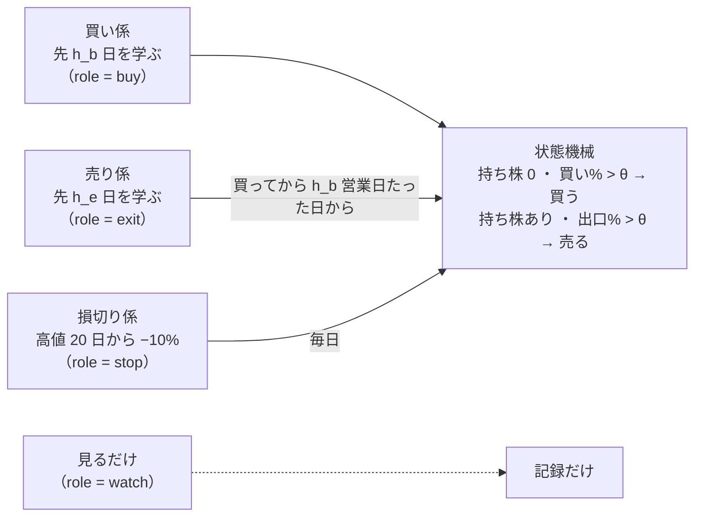
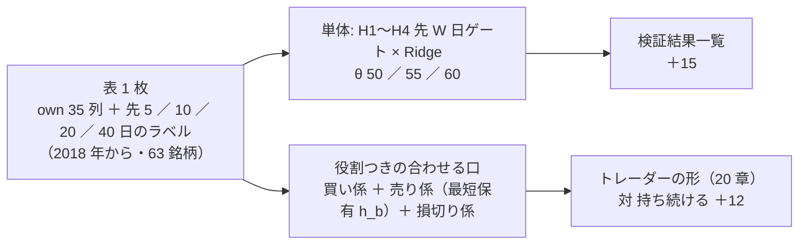
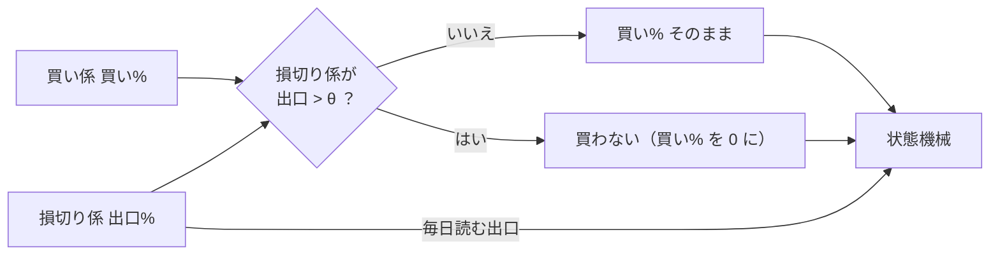
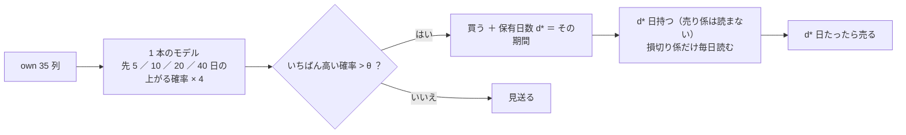
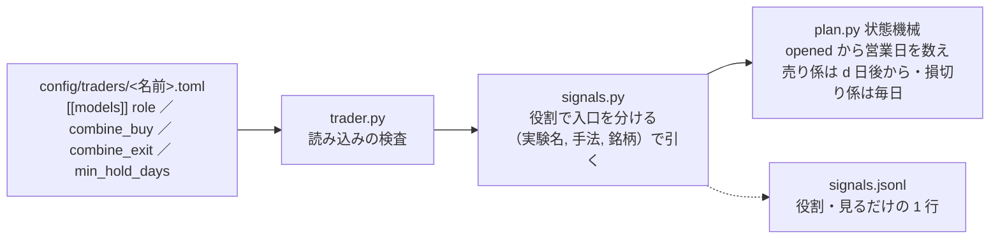

# 新しいトレーダー: 先の期間が違う「買い係 ／ 売り係 ／ 損切り係」を持つ人を複数作る（2026-10-18）

派生元: TODO「新しいトレーダーを作成する」。作成 2026-10-18（土）PDT・titan の Claude。

利用者の言葉（2026-10-18）:
- **「新しいトレーダーの大まかな設定を作成します。現在のトレーダーには複数のモデルを使い売買ができます。購入と売却、またはどちらにも使わずに違うモデルで評価だけを残すようなものを考えています」**
- **「売買頻度を極力減らして手数料の影響を小さくします。保持期間の最適な長さも計算して出します」**
- **「新しいトレーダーが一人でなくてよい」**
- **「モデルは特定の期間を保有した場合に買いと判断するモデルと、それとは別の期間で売りと判断するモデルと、損切りモデル。期間を別々にすることが大切です」**
- **「複数パターンを作ってシミュレートする。何日にするかは任せる」**
- 3 つの決めごと（最短保有 ／ 入力データ ／ 机上）に **「A」**（＝ 全部 推す案）

⚠ **§7 の残りの決めごとが済むまでコードに手を入れない。** ⚠ 決算の層・中小型株（E ／ F）は[別のプラン](earnings-smallcap.md)で後に進める（2026-10-18 利用者決定）。

## 0. 目的・背景

| 項目 | 中身 |
| --- | --- |
| いまの人 | 持っているモデル全部の 買い% ／ 出口% を 1 つの合成規則でまとめ、**同じ値を買いにも売りにも**使う。モデルはどれも「明日の符号」（先 1 日）を学ぶ（`T6` の F2-2 RFE も先 1 日） |
| 足りないもの | ① モデルに**役割**（買う ／ 売る ／ 損切り ／ 見るだけ）を書けない ② 買う判断と売る判断で**見る先の期間**を分けられない ③ 買ってから**最短でどれだけ持つか**を書けない |
| 問い | 「h_b 日先まで上がりそう」で買い、買ってから h_b 日は持ち、その後「h_e 日先が弱そう」で降りる（損切りだけは毎日見る）人は、持ち続けるより良いか。期間の組を複数作って並べる |
| 判定するもの | 机上 ＝ 対「持ち続ける」の上乗せ（rules.md 20 章の判定そのまま）／ 本番 ＝ 執行の差と無人運転（損益で採らない ＝ CLAUDE.md） |

## 1. 新しい人の形

この図の主張: 1 人の中に係が 3 人いて、係ごとに見る先の期間が違う。見るだけの係は記録にだけ残る。

| 係 | `role` | 中身 | 出どころ |
| --- | --- | --- | --- |
| 買い係 | `buy` | own 35 列 × Ridge で **先 h_b 営業日の累積リターンが正の確率** → 買い%。持ち株 0 の日に 買い% > θ で買う | 検知器 `H* 先{h_b}日ゲート（全列・学習）`（`ail/detectors/fwd.py`。先 10 日は既にある） |
| 売り係 | `exit` | 同じ 35 列 × Ridge で **先 h_e 営業日**を学ぶ。出口% ＝ 100 − 買い%。⚠ **買ってから h_b 営業日は読まない**（最短保有 ＝ 買い係が見た期間は持つ）。その後 出口% > θ で売る | 同じ検知器の別の期間 |
| 損切り係 | `stop` | 高値 20 日から −10% で出口% 100（買い% は常に 100 ＝ 買いに効かない）。⚠ **最短保有の中でも毎日読む** | `trade_own_stopexit_a` の `X1 出口だけ 高値20日から−10%で降りる`（`T5` と同じ） |
| 見るだけ | `watch` | 買い% ／ 出口% を記録し「この係 1 本なら今日 買う ／ 売る ／ 持つ ／ 見送る」を 1 行残す。⚠ 注文・予算・売買履歴に効かない | 新しい人では使わない（しくみだけ作る。§7 K5） |
| いまの形 | `both`（既定） | 買いにも売りにも入る。`role` を書かない設定は 1 ビットも変わらない | いまの全員 |

| 決めごと（済） | 中身 |
| --- | --- |
| 合成規則 | 側ごと: `combine_buy`（買い係が 1 本なら `asis`）／ `combine_exit = "unanimous"`（売り係と損切り係のどちらかが言ったら降りる ＝ 最大）。書かなければ今の `combine` |
| 売買基準値 θ | 1 つ（50。いまの 3 人と同じ）。側ごとに分けない |
| 最短保有 | d ＝ h_b で固定（d を別に選ぶ机上の検証はしない ＝ 2026-10-18 利用者「A」）。営業日で数える（NYSE の暦。売買履歴の `opened` から） |
| 入力データ・学習器 | 買い係・売り係とも **T1 と同じ own 35 列 × Ridge**。違いは先の期間だけ |
| 銘柄 ／ `sizing` ／ 予算 | T・PFE・NKE・VZ・BAC ／ 整数株 ／ $600（いまの 3 人と同じ。違いを期間だけにする） |

## 2. 期間の組（⚠ 回す前に固定。2026-10-18 Claude が決めた ＝ 利用者「何日にするかは任せる」）

候補の日数は **5・10・20・40 営業日**（1 週 ／ 2 週 ／ 1 か月 ／ 2 か月。先 1 日はいまの 3 人・先 10 日は forward10-target.md で済み）。組は「買いが長く・売りが短い」を 3 つと、向きを逆にした対照 1 つ。

| 識別名 | 買い係 h_b | 売り係 h_e | 最短保有 | ねらい |
| --- | ---: | ---: | ---: | --- |
| `T7`（リン） | 10 | 5 | 10 | 既にある先 10 日を買いに使う最短の組 |
| `T8`（ユウ） | 20 | 5 | 20 | 1 か月先で買い・1 週先の弱さで降りる（本命） |
| `T9`（ナギ） | 40 | 10 | 40 | 2 か月持つ形。売買はいちばん少ない |
| `T10`（レン） | 5 | 20 | 5 | ⚠ **対照**: 短い先で買い・長い先が弱いときだけ降りる。「向きが大切か」を見る |

✅ 呼び名は 2026-10-18 利用者「トレーダー名は適切に付けて」で Claude が付けた（リン ／ ユウ ／ ナギ ／ レン ＝ 意味の無い名前・使い回さない。`dashboard/traders.toml` の `[nicks]` は Phase 4 で書く）。⚠ **結果を見て組を足さない・動かさない**（rules.md 14-9）。

## 3. 机上の検証（Phase 1・2。titan）

この図の主張: 単体のモデル（新しい先の期間）を先に検証結果一覧に載せ、そのうえで 3 人組の形を同じ表で合わせて判定する。

| Phase | 中身 | 場所 | 検証の数 |
| --- | --- | --- | ---: |
| 1 ✅ 2026-10-18 | 先 5 ／ 20 ／ 40 日の検知器を**新しい登録名**で足す（`H2 先5日ゲート`・`H3 先20日ゲート`・`H4 先40日ゲート`。既存の `H1 先10日ゲート`・`WINDOW` は 1 文字も変えない）。表の持ち主 `trade_own_fwdmulti_a`（own 35 ＋ `trend` 窓 20 ＋ `label_scales = [5, 10, 20, 40]`）。⚠ 損切り係 X1 が高値 20 日の列を読むので `trend` 層が要る ＝ 買い係・売り係の検知器には **層の絞り `fwd_feature_layers = ["own"]`** を足して 35 列だけ見せる（無い config は 1 ビットも変わらない ＝ 指紋テスト）。⚠ H1 の行は層が own ＋ trend なので既存の own 表の行とは別の識別項目 ＝ 数える | `ail/detectors/fwd.py`・`config/experiment/trade_own_fwdmulti_a.toml`・queue `horizon_roles1` | H1〜H4 × θ 3 ＝ **＋12**。X1 単体（持ち続ける ＋ 損切り）× θ 3 ＝ **＋3** |
| 2 ✅ 2026-10-18 | **役割つきの合わせる口**（rules.md 20-6 の 4 を拡張 ＝ 25 章として事前固定）: `[[trading.mix]]` のメンバーに `role`（`buy` ／ `exit` ／ `stop`）・`min_hold_days`。買い% ＝ 買い係・出口% ＝ 売り係（100 − 買い%）・損切り% ＝ 損切り係。`simulate` に `min_hold_days`（建ててから d 本は `exit_pct` を読まない）と `stop_exit_pct`（毎日読む出口%。既定 None ＝ 1 ビットも変わらない）。config 4 本（`trader_roles_t7`〜`t10`。表は `features_from`・メンバーは同じ実行の検知器 ＝ 切れ目が同じ）・条件 2 つ（2a 5 本・**$600**〔いまの人の予算〕／ 2b 全銘柄を買える予算） | `ail/validation/simulate.py`・`cli/run.py` の `_mix_fold`・rules.md 25 章・`config/names.toml` の `[mix]` | 組 4 × （素の行 1 ＋ 条件 2）＝ **＋12** |
| 記録 ✅ | `docs/specs/experiments/horizon-roles-trader.md`（§0 事前固定 → 回す → §1 以降）。検証結果一覧を吐き直す（`n_trials` 840 → **867** ✅ 2026-10-18） | — | 合計 **＋27** |

⚠ **先に書く見立て【推測】**（回す前。記録 §0 に写す）:
1. 単体 H2〜H4 は 9 行とも採る 0（先 10 日と同じ向き ＝ 門前が多い・AUC 0.49〜0.51）
2. 役割つき 4 組は採る 0。2a の上乗せは正が多いが、`trader-shaped-validation.md` §5 と同じく **1 つの fold（全員がほぼ現金だった下げの時期）から来る**
3. 取引の回数は h_b が長いほど減る（`T9` が最少）。保有の中央値は最短保有の d に張り付く（d ＝ h_b より少し上）
4. 対照 `T10`（5 ／ 20）は `T7`〜`T9` より取引が多く、上乗せは下回る
5. leak 対照は全部跳ねる

⚠ **机上で再現しないもの**（記録に書く）: 毎日の学び直し・15:50 ET の途中の足・気配と約定の差・`data-live/`・損切り係の「売った翌日に買い戻す」動き（`X1` の買い% 100。買い係が別に居るので起きにくいが、買い係が買いと言えば翌日買う）。

### 3-1. 結果（✅ 2026-10-18 20:55〜21:03 PDT・titan。記録 §1〜§4）

採る 0 ／ 保留 5 ／ 落とす 22（n_trials 840 → 867）。見立て 6 つのうち 4 つ当たり・2 つ半分。

| 見つかったこと | 中身 | 次 |
| --- | --- | --- |
| ⚠ **損切り係の翌日買い戻し** | 損切り係 X1（高値 20 日から −10%）が出口を言う日に買い係が買い、翌日売り、翌日また買う。保有 1 日の取引が 4 組とも約 6 割・保有の中央値 1〜2 日（最短保有 d に届かない）。⚠ 本番の `unanimous`（`T5` ミオ・この形の人）でも同じ動きになる | §7 K8（利用者）。直すなら新しい処置として先に登録 |
| 買い% の幅が潰れる fold | fold 2・4・5 では買い係 4 本とも毎日「買い」（幅 4〜10 点・門前）＝ 期間の違いが 1 ビットも効かず、4 組の数字が同じ | 期間の良し悪しはこの表では測れない（検出限界） |
| 2a の保留 2 行 | R1 ＋69・R3 ＋117bp/fold（fold 3/5・t ≤ 0.42）。正の fold は 4 組とも同じ向き（損切り係が下げを削ったぶん） | 成績で採らない。候補の人は配線の確認のため |

### 3-2. K8 (b) の中身（✅ 2026-10-18 利用者決定。⚠ まだ登録していない ＝ 利用者の追加の質問の後に rules.md 25-4 として事前固定してから回す）

この図の主張: 損切り係の「売れ」を買いの側にも流し、言っている日は買わない。売りの側はいままでどおり。

| 項目 | 中身 |
| --- | --- |
| 処置の名前（案） | 役割つきの合わせる口に `stop_blocks_buy = true`（既定 false ＝ いまの 4 組と 1 ビットも同じ）。手法名は `R1b 買い先10日・売り先5日・損切り（買いも止める）` のように別の名前（別の識別項目） |
| 机上 | 同じ表・同じ 4 組・同じ条件 2 で ＋12（n_trials 867 → 879）。比べる相手は同じ組の R1〜R4（対の差を添える。採否は 20-3 のまま） |
| 執行器（Phase 3） | `role = "stop"` のモデルの出口% > θ の日は、その銘柄の買いの合図を出さない。⚠ `T5`（ミオ）は `unanimous` のままなので変わらない（`role` を書いていない人は 1 ビットも変わらない） |
| 先に書く見立て【推測】 | 保有 1 日の取引が大きく減り、保有の中央値は最短保有 d に近づく。費用が減るぶん 2a の上乗せは R1〜R4 より上がるが、買い% の幅が潰れている fold（2・4・5）では「下げの時期に買わない ＝ 戻りを取り損ねる」側に寄る。採る 0 の見込み |
| ⚠ 守るもの | 結果を見てから足した処置なので、記録にその旨を書く（14-10）。4 組全部を回すか回さないか（1 組だけ選ばない） |

### 3-3. 別のモデル: 1 本で「買い」と「何日持つか」の 2 つを出す（✅ 2026-10-18 利用者「別のモデルとしてプランに入れて」。⚠ まだ登録していない）

利用者の問い（2026-10-18）: **「１つの予測モデルで買いと何日後に売るという２つの数値を出せるか？」** → 出せる。3 係に分ける形（§1）とは別のモデルとして扱い、並べて比べる。

この図の主張: 同じ 35 列から先 5 ／ 10 ／ 20 ／ 40 日の「上がる確率」を 4 本まとめて出し、いちばん高い期間を保有日数にする。保有中は損切り係だけ読み、日数がたったら売る。

| 項目 | 中身 |
| --- | --- |
| 名前（案） | 検知器 `H5 先5〜40日から期間を選ぶゲート（全列・学習）`（綴り `h5-gate-pick`）。出力は **買い%（選んだ期間の確率）と 保有日数 d***。候補の人は `T11`（呼び名は後で） |
| 作り | 先 W 日の検知器 4 本（H2 ／ H1 ／ H3 ／ H4）と同じ学び方・同じ較正を 4 本まとめて持つ 1 つの検知器。買い% ＝ max の確率・d* ＝ その期間。⚠ 期間を選ぶのに使うのは予測値だけ（答えは見ない） |
| 出力の契約 | ⚠ **3 本目の出力「保有日数」** ＝ 14-1 ／ 16-1 の契約を広げる（rules.md に新しい節）。`simulate` ／ `simulate_topk` に行ごとの `hold_days_pct`（建ててから d* 本たったら売る。既にある `max_hold_days` の行ごと版）。損切り係は K8 (b) と同じ扱い（毎日読む・言っている日は買わない） |
| 机上の数 | 1 本 × θ 3（素の行）＋ トレーダーの形 × 条件 2（θ 50）＝ **＋5**。比べる相手は「持ち続ける」と、同じ表の R1〜R4（期間を固定した 3 係の形） |
| 執行器（Phase 3） | 合図の記録に `hold_days`・売買履歴に「売る予定の日」・状態機械が「d* 営業日たったら売る」（NYSE の暦）。`hold_days` の無いモデルは 1 ビットも変わらない |
| 別の案 B（劣る） | 「過去に何日持ったら一番儲かったか」を答えにして日数を直接当てる分類。答えがノイズだらけになる見込み【推測】＝ 回さない（A で十分） |
| 先に書く見立て【推測】 | 採る 0。確率の幅が潰れる fold（2・4・5）では 4 本が 52〜55% に並び、期間の選択が雑音で決まる。売買の回数は 3 係の形より確実に減る（期間中は損切り係しか売らない）。「決まった日数で売る」の基準線（損切りの机上）は降りない形より悪かったので、上乗せは負に寄る |
| 手間【推測】 | 研究側（検知器・契約・状態機械・テスト）1 日・実行は数分。執行器は Phase 3 に含めて半日 |

⚠ 守るもの: 登録してから回す（14-10）・期間の候補は 5 ／ 10 ／ 20 ／ 40 のまま（足さない）・結果で人を採らない。

## 4. 執行器（Phase 3。⚠ 本番に出すのは 11/4 の判定の後）

この図の主張: 設定の読み込みで役割と最短保有を受け、合図の合成を側ごとに分け、状態機械は売りの合図を「最短保有の後だけ」読む。

| # | 変更 | ⚠ |
| ---: | --- | --- |
| 1 | `trader.py`: `[[models]] role = "both" \| "buy" \| "exit" \| "stop" \| "watch"`（既定 `both`）・`combine_buy` ／ `combine_exit`（無ければ `combine`）・`min_hold_days`（既定 None）。検査: 買いの側・売りの側それぞれに 1 本以上（`stop` は売りの側に数える）／ `watch` だけの人は拒む ／ `min_hold_days` は 1 以上の整数 | `role` の無い設定は 1 ビットも変わらない（黄金の集計値） |
| 2 | `signals.py`: 行を **(実験名, 手法, 銘柄)** で引く（いまは (実験名, 銘柄)。買い係と売り係が同じ実験の別の手法なので要る）。役割で `buys` ／ `exits` ／ `stops` に分けて合成。記録の `inputs` に `role` | 既存の人は手法が 1 本なので値は同じ（テスト） |
| 3 | `plan.py`: 持ち株あり ＆ 建ててから `min_hold_days` 営業日未満 → 売り係の出口% を読まず、損切り係の出口% だけ見る。営業日は `nyse_calendar`（`opened` は売買履歴にある） | `min_hold_days` の無い人は 1 ビットも変わらない |
| 4 | `run-live.sh`: 名簿の (実験名, 手法) を 1 本ずつ予測するのは今のまま。買い係・売り係は同じ実験の別の手法 ＝ 予測 2 本・損切り係 1 本 | ⚠ 予測の時間（§8） |
| 5 | 見るだけ: `signals.jsonl` に「この係 1 本なら」の 1 行・`paper.py` の紙上の損益は **出さない**（§7 K5。後で足せる） | — |
| 6 | 管理画面: トレーダーの詳細の合図の表に役割の列（読むだけ）。`glossary.toml` に「役割」「最短保有」 | 「デプロイ」が要る ＝ 11/4 の後 |

テスト方針: 役割ごとの合成（`buy` は売りに入らない・`exit` ／ `stop` は買いに入らない・`watch` は判断を変えない）／ 最短保有（d 日未満は売り係の 100 でも売らない・損切り係の 100 なら売る・d 日目から売り係を読む・休場日をまたいで営業日で数える）／ 設定の誤りで起動を拒む ／ `role` の無い全員の設定で計画が 1 ビットも同じ ／ `T5` を役割（`both` ＋ `stop`）で書いた形と今の `T5` が同じ判断 ／ 黄金の集計値（`--full`）／ (実験名, 手法, 銘柄) で引いても既存の合図が同じ。

## 5. 候補の人とシミュレーション（Phase 4）

| # | 中身 | 場所 |
| ---: | --- | --- |
| 1 | `candidates/horizon/T7〜T10.toml`（§1・§2 の値。`note` に 3 係の期間）＋ `sim_T7〜T10`（$300・`sim_` 始まり）。§3-3 のモデルの人 `T11` は机上の後に | `experiments/live-trading/config/traders/` |
| 2 | 作り置き `simpredict.py make sim7`（買い係・売り係 ＝ `trade_own_fwdmulti_a` の H1〜H4・損切り係 ＝ `trade_own_stopexit_a` X1。titan・研究用の `data/`）。⚠ 作り置きの買い% が銘柄・日で動いているか（幅が潰れていないか）を sim の前に見る（howto §3-4） | `sim-predict/` |
| 3 | sim7 を 64 営業日（4 人同時）。見るもの: 最短保有の中で売り係が 100 を出した日に売っていないこと・損切り係で売った日・取引の回数が h_b の順 | `./run-sim.sh`（Sx360）／ titan は `LT_MODE_DIR` を scratch へ |
| 4 | 外部のタブ: `models.toml` に `[[model]]`（先 5 ／ 20 ／ 40 日の買い係・売り係。`history.names` は `own.h*-gate*.ridge.shared`）・`traders.toml` に 4 人の文と呼び名（利用者）・`system.toml`「トレーダーのしくみ」に役割と最短保有の 1 段 | `dashboard/*.toml` |
| 5 | 手順書 `howto-model-trader.md` に「2-8 役割と最短保有を持つ人」を足す | `docs/specs/howto-model-trader.md` |

## 6. 本番（Phase 5。⚠ 利用者・11/4（水）の判定の後）

| 手順 | 誰 |
| --- | --- |
| 4 人のうち誰を、誰と入れ替えるか（検証は 3 人まで ＝ 2026-10-04 の決定）。予算の上限は `live.env` | 利用者 |
| 13500t の予測の時間を測る（`bench_predict.py`。線 60 秒。§8） | Claude（デプロイの後） |
| 「デプロイ」→ 名簿の ▶ 開始（howto 2-7） | 利用者 → Claude |

## 7. 残りの決めごと（⚠ 利用者。推す案で進めてよければ「推す案で」）

| # | 決めること | 推す |
| ---: | --- | --- |
| K1 ✅ 推す案（2026-10-18「推す案でいく」。呼び名は §2） | 役割に `stop`（最短保有の中でも読む出口）を `exit` と分けて置くか | 置く（損切り係だけを例外にする最も単純な書き方） |
| K2 | 期間の組（§2 の 4 組） | §2 のまま（対照 `T10` を含む） |
| K3 | 2a の予算 | $600（いまの人の予算。rules.md 20-2 の「いまの人の条件」を更新して事前固定） |
| K4 | 買い係・売り係の見る列 | own 35 列だけ（検知器に層の絞りを足す）。⚠ 絞らないと高値 20 日の 6 列が混ざる |
| K5 | `watch` のしくみを今回作るか・紙上の損益まで出すか | しくみは作る（記録の 1 行まで）・紙上の損益は出さない・新しい 4 人は使わない |
| K6 | 執行器の変更を本番に出す時期 | 11/4 の判定の後（それまで机上・テスト・sim） |
| K7 ✅ | 4 人の呼び名 | リン ／ ユウ ／ ナギ ／ レン（2026-10-18 利用者「トレーダー名は適切に付けて」） |
| **K8** ✅ | ⚠ **損切り係の翌日買い戻し（§3-1）をどうするか**。(a) そのまま ／ (b) **「損切り係が出口を言っている日は買い係が買わない」** ／ (c) 損切り係を建値基準にする | ✅ **2026-10-18 利用者決定 (b)**（「プランに入れるだけにして追加の質問をしたい」＝ 登録・机上・コードはまだ触らない。中身は §3-2） |

## 8. 影響範囲・手間・危ないところ

| 項目 | 中身 |
| --- | --- |
| 研究側 | `ail/detectors/fwd.py`（登録名 3 つ・層の絞り）・`ail/validation/simulate.py`（`min_hold_days`・`stop_exit_pct`）・`cli/run.py`（`_mix_fold` の役割）・rules.md 25 章・`config/names.toml`・config 5 本 ＋ queue 2 本・記録 1 本。⚠ `cli.predict` の既定経路の指紋（`test_trading_run`・`test_predict`）を流す |
| 執行器 | `trader.py`・`signals.py`・`plan.py`・テスト・黄金の集計値。⚠ 13500t の毎日の経路 ＝ 本番に出すのは 11/4 の後 |
| 画面・文書 | `dashboard/*.toml`・トレーダーの詳細（役割の列）・`howto-model-trader.md`・`live-trading.md` §0-1（候補の人） |
| 手間【推測】 | Phase 1 半日 ＋ 回す 10 分 ／ Phase 2 1 日 ＋ 回す 30 分 ／ Phase 3 1 日 ／ Phase 4 1 日（作り置き 64 本 × 5 実験 約 30 分） |
| ⚠ 予測の時間 | 1 人で予測 3 本（買い・売り・損切り）。いまの名簿 4 本に足すと 7 本並列 ＝ 線 60 秒を越える見込み【推測。4 本で 52.6 秒 ＝ trader-loop.md 1-3】。入れ替えで `T4`（3 本）を外せば 4 本。⚠ 名簿に入れる前に 13500t で測る |
| ⚠ 切れ目 | 合わせる口のメンバーは fold の切れ目（表の日付の範囲）が同じでないと止まる ＝ 3 係とも `trade_own_fwdmulti_a` の表に載せる（損切り係の X1 もこの実行の検知器として）。別の実験から読まない |
| ⚠ 守るもの | 損益で採らない ／ 結果を見て組・θ・列・d を動かさない ／ 回したものは全部 `n_trials` ／ いまの 3 人は編集しない ／ 発注の経路を増やさない |

## 9. 経緯（2026-10-18 の前の案）

朝の案は「`T7` 1 人（買う F2-2 RFE ／ 売る 損切り ＋ own Ridge ／ 見るだけ 2 本）＋ 最短保有 d を訓練分割の尻で選ぶ」だった。昼に利用者が **「期間を別々にすることが大切」** と方向を決めたので、買い係・売り係を「先の期間が違う同じ形のモデル」にし、d は h_b で固定、人は 4 人に広げた。朝の案の K1〜K10 はこの文書の §1・§7 に吸収した（F2-2 RFE を買う役にする案は取り下げ）。
