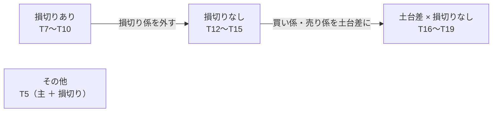

# ハルだけ残して 2 人を入れ替える（本番の 3 人の入れ替え）

利用者の指示（2026-11-01）: **「現在動いているトレーダーのうちハルだけ残して、２トレーダーを入れ替えます」**。
TODO「本番の 3 人のうちハル（T4）だけ残し、アキ（T1）とソラ（T6）を新しい 2 人に入れ替える」（「新しいトレーダーを作成する」Phase 5 の子）。

## 1. 目的・背景

- いまの本番の 3 人 ＝ アキ（T1）・ハル（T4）・ソラ（T6）。10/8 に 1 日目・20 営業日の判定は 11/4（水）（[live-trading.md §2-2](../specs/experiments/live-trading.md)）
- ハルを残し、アキとソラの 2 人を候補の棚から入れ替える。⚠ **選ぶのは利用者**。この文書は選ぶための材料（事実だけ）と手順
- ⚠ **成績で人を選ばない**（CLAUDE.md の 2 つ目の例外。判定するのは執行の差と無人運転の成立）。下の表に順位・机上の損益は書かない

## 2. 候補の棚（2026-11-01 時点・設定から写した事実）

> この図の主張: 候補は 4 つの組に分かれ、組の中の 4 人は「買い係の期間 × 売り係の期間」だけが違う。

| 識別名（呼び名） | 組 | 係（予測モデル） | 最短保有 | 予測の本数（ハルと重ならない分） | 試し運転で見えた動き |
| --- | --- | --- | --- | --- | --- |
| `T7`（リン） | 損切りあり | 買い 先 10 日 ／ 売り 先 5 日 ／ 損切り X1（高値 20 日から −10%） | 10 | 3 | sim7: 4 人の売買がほぼ同じ。売り 73 本のうち 71 本が損切り係・70 本は翌日買い戻し |
| `T8`（ユウ） | 〃 | 買い 先 20 日 ／ 売り 先 5 日 ／ 損切り X1 | 20 | 3 | 〃 |
| `T9`（ナギ） | 〃 | 買い 先 40 日 ／ 売り 先 10 日 ／ 損切り X1 | 40 | 3 | 〃 |
| `T10`（レン） | 〃（対照） | 買い 先 5 日 ／ 売り 先 20 日 ／ 損切り X1 | 5 | 3 | 〃 |
| `T12`（ハナ） | 損切りなし | 買い 先 10 日 ／ 売り 先 5 日 | 10 | 2 | sim8: 3 人は「買って持ち続ける」・売り係が鳴るのは先 5 日の係だけ・4 人の注文は互いに違わない |
| `T13`（ユキ） | 〃 | 買い 先 20 日 ／ 売り 先 5 日 | 20 | 2 | 〃 |
| `T14`（ミナ） | 〃 | 買い 先 40 日 ／ 売り 先 10 日 | 40 | 2 | 〃 |
| `T15`（サク） | 〃（対照） | 買い 先 5 日 ／ 売り 先 20 日 | 5 | 2 | 〃 |
| `T16`（コウ） | 土台差 × 損切りなし | 買い 先 10 日 ／ 売り 先 5 日（土台差） | 10 | 2 | sim9: 注文は 4 人で 4 本だけ（3 人は 1 本も買わない ＝ この時期の買い% が 50 を超えない） |
| `T17`（リク） | 〃 | 買い 先 20 日 ／ 売り 先 5 日（土台差） | 20 | 2 | 〃 |
| `T18`（アオ） | 〃 | 買い 先 40 日 ／ 売り 先 10 日（土台差） | 40 | 2 | 〃 |
| `T19`（シン） | 〃（対照） | 買い 先 5 日 ／ 売り 先 20 日（土台差） | 5 | 2 | 〃 |
| `T5`（ミオ） | その他 | 主モデル（`trade_own_ridge_a` ＝ ハルの 1 本と同じ）＋ 損切り X1・`unanimous` | — | 1（主モデルはハルと共有） | sim5 ＝ `live-trading.md` §0-7 (k) |

- 共通: 銘柄 T ・ PFE ・ NKE ・ VZ ・ BAC の 5 本・整数株・θ 50・`combine = "asis"`（T5 は `unanimous`）。候補の設定の予算は $300 ＝ 本番に入れるときに **$600** へ（いまの 3 人と同じ。C11「予算だけは編集してよい」）
- 係・最短保有・損切り係の意味は外部のタブ「システム説明」の「トレーダーのしくみ」・1 人ずつの説明は「トレーダー」のタブ
- ⚠ 外した人（`T2` アリス・`T3` カエデ）は予測の本数が 0（ハルと共有）だが、10/4 に外した人。戻すかは利用者
- ⚠ `T11`（H5）は作らない（K10 (a)）

## 3. 予算と予測の時間（数えるだけ）

| 項目 | 中身 |
| --- | --- |
| 予算 | 3 人 × $600 ＝ $1,800 ＋ 予備 $100 ＝ 上限 $1,900 のまま（13500t の `live.env` は変えない）。追加の入金は要らない【計算】。⚠ ただしアキ・ソラの持ち株を売り切る前に新しい人を入れると、予算の合計が上限に当たり後から入った人が休む |
| 予測の本数 | 執行器は（実験名, 手法）が同じ予測を 1 回だけ回す（`run-live.sh`）。ハル ＝ 3 本。いま（ハル ＋ アキ ＋ ソラ）＝ **4 本**（`trade_own_ridge_a` は共有） |
| 入れ替え後の本数 | ハル 3 ＋ 新しい 2 人の重ならない分。例: 損切りなし 2 人（同じ組）＝ 3 ＋ 2〜4（係が重なれば減る。`T12` と `T13` は売り係 先 5 日が共通 ＝ 3 本）／ 損切りあり 2 人 ＝ 3 ＋ 4〜6 ／ T5 を含めると ＋1 |
| 予測の時間 | 4 本並列で 49〜52.6 秒【実測 13500t・2026-10-04 ／ 10-08】・線 60 秒。1 本 33〜44 秒【実測 titan・`trade_own_fwdmulti_a`】。⚠ **6 本以上は線を越える見込み【推測】** ＝ 名簿に入れる前に 13500t で `bench_predict.py` を流す（プラン [trader-model-roles.md §8](trader-model-roles.md)） |

## 4. 手順（Phase）

| Phase | 中身 | 誰 |
| --- | --- | --- |
| 0 | 11/4（水）の 20 営業日の判定（11/5 の朝に Sx360 の Claude が `yardstick.csv` を写す） | 利用者 ＋ Sx360 の Claude |
| 1 | 入れる 2 人を決める（上の表から） | **利用者** |
| 2 | 2 人の設定を `candidates/horizon/` から `config/traders/` 直下へ写し、予算を $600 に・テスト（`./run-tests.sh`）・`dashboard/compare.toml` の `[[trader]]`・push | Claude |
| 3 | 「デプロイ」（Sx360・15:00〜16:15 ET は不可）→ 13500t で予測の時間を測る（ハル ＋ 新しい 2 人の本数・線 60 秒） | 利用者 → Claude |
| 4 | 名簿でアキ・ソラに 🧹 手じまい（翌営業日の回で執行器が売る）→ 持ち株 0・`reconcile.py show` で差 0 を確かめる | 利用者（名簿）・確かめは Sx360 の Claude |
| 5 | 新しい 2 人に ▶ 開始 → 1 日目の記録（`live-trading.md` §1）・物差し A〜E は新しい 2 人も 1 日目から | 利用者 → Claude |

## 5. 影響範囲・テスト方針

- 執行器・研究のコードは触らない（役割と最短保有の口は 2026-10-20 に本番へ出ている ＝ K6）。触るのは設定（`config/traders/` 直下に 2 人）・`compare.toml`・記録だけ
- テスト: `./run-tests.sh`（設定の検査・名簿・役割 `test_roles.py`・黄金の集計値は `--full`）。外部のタブ「トレーダー」の一覧に「（候補）」が外れて出ること
- ⚠ 予測の本数が増えると、15:50 ET から刻限 15:58 ET までの窓に収まるかが一番の危険（§3）
