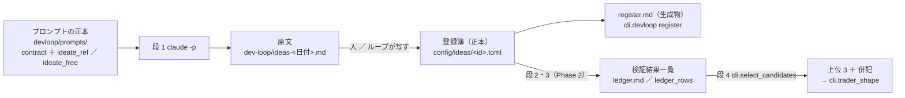
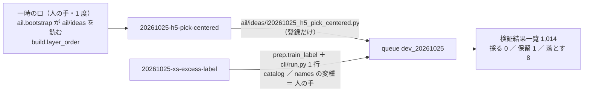

# 開発ループ（devloop）— 毎晩「アイデア出し → 作る → 机上で検証 → 選ぶ」を回す仕組みの記録

作成 2026-10-25（土）titan。TODO「「採る」モデルやトレーダーを開発する手法を作る」・プラン [daily-dev-loop.md](../../plans/daily-dev-loop.md)・規約 [rules.md 31 章](feature-discovery/rules.md)・数と置き場 `experiments/feature-discovery/config/devloop.toml`。
利用者決定 2026-10-25「推す案で」＝ K1〜K8（プラン §4-0）。

> ⚠ これは投資助言ではなく調査資料である。ループが出すのは「並べたもの」であって採用ではない。候補の人にするか・本番に入れるかは利用者（成績で人を選ばない）。

## 0. 置き場（1 周で何がどこに残るか）

> この図の主張: 人が読むのは 日誌・`register.md`・検証結果一覧 の 3 つで、事前固定の正本は登録簿（TOML）だけ。

## 1. 最初の 1 周（Phase 1。2026-10-25・手で）

### 1-1. 段 1 の実測（`claude -p`・モデル claude-fable-5-1・titan）

| 束 | 本数 | 道具 | 費用【実測】 | ターン | 時間 | 落とし穴 |
| --- | ---: | --- | ---: | ---: | ---: | --- |
| 参考なし（記録を読まずに出す） | 3 | なし | **$1.42** | 1 | 1 分 54 秒 | 1 回目は上限 $1.5 で止まり、⚠ **上限に当たると結果は 1 文字も返らない**（費用だけ払う） |
| 参考あり（記録・検証結果一覧・規約を読む） | 2 | Read ／ Grep ／ Glob | **$3.82** | 14 | 3 分 4 秒 | 1 回目は rules.md（2,126 行）／ ledger.md をまるごと読み（キャッシュ書き込み 60k トークン）$3 で止まった → プロンプトに「Read は 150 行以内・15 回まで」を足した |

- 合計 **$5.24**（失敗した 1 回目 $5.06 を足すと $10.30）。⚠ **K4 の推し「段 1 ≤ $2」は足りない**（段 1 だけで 1 晩の上限 $7 の 7 割）。✅ 同日 利用者「推しで」＝ 上限を上げる（段 1 $6・1 晩 ≈ $11。`config/devloop.toml`・rules.md 31-4）
- 入れ子の `claude -p` は `env -u CLAUDECODE` で動く（titan・2.1.310【実測】）。timer の環境（ログインしていない user セッション）で動くかは Phase 3-2 で確かめる
- 原文は [dev-loop/ideas-2026-10-25.md](dev-loop/ideas-2026-10-25.md)（良し悪しの印なし ＝ 利用者の指示 2026-10-24 の証拠）

### 1-2. 登録（`cli.devloop register`）

| id | 題 | 出どころ | 手間 | 数える | 触る場所 | 状態 |
| --- | --- | --- | --- | ---: | --- | --- |
| `20261025-h5-pick-centered` | 期間を選ぶゲート H5 を土台差で選ばせる | 参考あり（組み合わせる） | 小 | 6 | 共有の経路（`ail/detectors/fwd.py` に登録名 1 本） | 登録 |
| `20261025-xs-excess-label` | ラベルを断面の超過リターンに替えて学ぶ | 参考なし | 小 | 3 | 共有の経路（`cli/run.py`・`catalog`） | 登録 |
| `20261025-mkt-layer` | 市場全体の状態の層 `mkt_` を足す | 参考なし | 中 | 6 | 共有の経路（`ail/features`・`build.ORDER`） | 登録 |
| `20261025-roles-entry-stop` | 役割つきの組の損切り係を建値から −10% に替える | 参考あり（避ける） | 中 | 12 | 共有の経路（`cli/run.py`・`simulate.py`） | 登録 |
| `20261025-permutation-yardstick` | fold の内側の並べ替え検定を物差しに足す | 参考なし | 中 | 0 | 共有の経路（`ail/validation`・`catalog`・`report`） | 人の手（物差し ＝ 14 章の変更規約） |

- 既出の疑い（`key_shape` が検証結果一覧の予測モデル名に当たる数）は 5 本とも 0。登録の時刻 2026-10-25 12:31 PDT ＝ 回すと決めた時刻（結果はまだ 1 つも無い）
- ⚠ **見つかったこと: 5 本とも「共有の経路」に触れる**。この研究では新しい層・検知器・ラベル・器はどれも `ail/features` ／ `ail/detectors` ／ `cli/run.py` に登録する作りなので、K7（共有の経路は人の手）をそのまま当てるとループは何も作れない。Phase 2-1 の最初に **一時の人の手で「新しい口の置き場」を 1 度作る**（`ail/ideas/<id>.py` を `ail.bootstrap` が読む ／ `build.ORDER` に無い層は registry から後ろに足す）＝ その後は新しい検知器・層は「新しいモジュールだけ」になる。`cli/run.py` の器（ラベル・合わせる口の項目）を触るものは人の手のまま
- 段 1 の出力の `key_shape` の綴りは 1 本だけ直した（`full` → `all`。names.toml の綴り）。原文は登録簿の `notes` に残した

### 1-3. 次（Phase 2 ＝ 最初の 1 周の段 2〜4 を手で）

手間の小さい順（31-1 の 6）: `h5-pick-centered`（小・6）→ `xs-excess-label`（小・3）→ `mkt-layer`（中・6）→ `roles-entry-stop`（中・12）。1 晩の上限 12 に収まるのは先頭 2 本（9）。⚠ 回すのは 20 章の節に当たる事前固定が登録簿にあることを確かめてから（`structure`・`prediction` は登録済み・直さない）。

## 2. 最初の 1 周の段 2〜4（Phase 2-1。2026-10-25 12:49〜12:51 PDT・手で）

登録簿の手間の小さい順に 2 本（31-1 の 6）。事前固定は登録簿（`registered_at` 2026-10-25 12:31 PDT・`structure`・`prediction` は回す前のまま）。queue `dev_20261025`（leak ＝ true・ledger ＝ true）＝ 6 実行 67 秒【実測】・**n_trials 1,005 → 1,014（＋9 ＝ 登録簿の `n_trials_planned` 6 ＋ 3 と一致）**。

> この図の主張: 2 本のうち 1 本は `ail/ideas/` に登録するだけで作れ、1 本は共有の経路（ラベル・識別項目）に 1 行ずつ要った。この差が K7 の「人の手」の線になる。

### 2-1. 作った口（人の手・1 度だけ）

| 口 | 場所 | ⚠ |
| --- | --- | --- |
| 新しい口の置き場 | `ail/ideas/__init__.py`（`load_all`）＋ `ail/bootstrap.py` の末尾 1 行（`i*.py` を全部 import ＝ registry に登録するだけ） | 既存の経路は 1 ビットも変わらない（指紋 `test_predict`・`test_trading_run`・`test_fwd` ✅・`tests/test_ideas_loader.py`） |
| `ORDER` に無い層 | `cli/build.py` の `layer_order`（登録済みの層は 12 層とも `ORDER` にある ＝ 既存の config の並びは同じ式） | `20261025-mkt-layer` のため。テストが全 config で前の式と一致することを見る |
| 訓練のラベルの口 | `ail/validation/prep.py` の `train_label`（`label` の無い config は `tr["y"].values` そのもの）＋ `cli/run.py` の共通学習の枝 1 行（銘柄別は拒む）＋ `ail/catalog.py` の変種 `閾値売買（断面超過ラベル）`＋ `ail/names.py` ／ `names.toml` の `[label]`（`~xs-label`） | ⚠ 共有の経路 ＝ ループの段 2 では「人の手」。門（14-5）は元のラベルで測ったまま（診断） |

### 2-2. 結果（判定は 13-7 ／ 20-3 のまま。⚠ 採否に併記は使わない）

| id | 行（検証名） | 判定 | 上乗せ bp/fold ／ fold | 対の相手（既存） | 予想との突き合わせ |
| --- | --- | --- | --- | --- | --- |
| h5-pick-centered | `own-trend.h5-gate-pick-centered.ridge.shared@50 ／ 55 ／ 60` | 落とす ×3 | −88（1/5）／ −757（0/5）／ −955（0/5） | H5 土台なし −216（2/5）／ −10（3/5）／ −227（2/5） | 「採る 0」✅。「H5 との対の差は \|t\| < 2」＝ θ 55 ／ 60 は H5 より下（保有日率 0.50 ／ 0.31 ＝ 休んだぶんが負 ＝ 25-7 の単体と同じ型）✅ 失敗モード 2 |
| 〃（組 R14 ＋ X1） | `own-trend.roles-pick-centered-stop.ridge.shared@50`・`-tr5-600`・`-trall` | 落とす ／ **保留** ／ 落とす | −313（1/5）／ **＋329（1/5 −−＋−−）**／ −278（1/5） | R5 −410（0/5）／ −20（2/5）／ −330（0/5） | 「R14 対 R5 の差は fold 3 が決める」✅（3 行とも fold 3 だけ正）。保留は $600 の形 1 本 ＝ 25-7 の組と同じ型 |
| xs-excess-label | `own.all.ridge.shared~xs-label@50 ／ 55 ／ 60` | 落とす ×3 | −821 ／ −1,128 ／ −1,306（3 本とも 0/5） | `own.all.ridge.shared` −271（2/5）／ −540（1/5）／ −944（1/5） | 「θ 60 は売買がほぼ無い」✅（取引 5 回/fold・保有日率 0.04）「θ 50 の保有日率 約 5 割」✅（0.57）「5 fold とも負か 0 の周り」✅。「AUC が 0.01〜0.02 上がる」は測れず（門は元のラベル） |

- **選んだ期間の分布（H5 土台差・fold 別の最頻の期間とその割合）**: fold 1 先 5 日 73% ／ fold 2 先 40 日 81% ／ fold 3 先 5 日 74% ／ fold 4 先 20 日 64% ／ fold 5 先 40 日 71%。土台なしの H5（§6-2: 88〜100%）より散ったが、**「2 つ以上の fold で 7 割を切る」の予想は fold 4 の 1 つだけ** ＝ 土台を引いても期間は fold ごとに 1 つに偏る。土台 π は W が長いほど高い（fold 2: 0.566 → 0.620）
- 門（診断）: H5 土台差 AUC 0.504・買い% 幅 9.7 点（門前） ／ 断面超過ラベルの門は元のラベルの数字のまま（0.498・5.9 点）
- leak 対照: 6 本とも跳ねた（H5 土台差 ＋3,887〜3,895・5/5 ／ R14 ＋2,488〜3,257・5/5 ／ 断面超過ラベルの leak も 5/5）
- 段 4（`cli.select_candidates`）: **上位 3 は F1-7 ／ F2-2 ／ `M1 3本の平均` のまま**（新しく入った行なし ＝ 31-3 の 3 により次の晩の机上は無し）。決まり 1・2 の残り 22 → 決まり 4 で 18

### 2-3. 読み方と、やらないこと

- 判定は 1 行も動かさない・θ・期間・π の取り方・損切り係の水準を結果を見て振らない（25-5 の 8・25-7 の 6）。R14 の $600 の保留は fold 3 の 1 つが作る（25-7 の組と同じ）＝ 候補の人は作らない
- ⚠ **ループの段 2 の線（K7）**: 新しい検知器は `ail/ideas/` だけで書けた。ラベル・器・識別項目の列を変えるものは `cli/run.py`・`catalog`・`names` に要る ＝ 「人の手」。段 2 のプロンプトの正本（`devloop/prompts/build.md`）にこの線を書いた
- 残る登録 2 本（`mkt-layer` 中・6 ／ `roles-entry-stop` 中・12）は次の晩へ（31-2 の 3。`roles-entry-stop` は `cli/run.py`・`simulate.py` を触る ＝ 人の手）。`permutation-yardstick` は人の手（物差し）

## 3. 運転手（Phase 3。2026-10-25 17:50 PDT・titan）

| 何 | 場所 | 実測・注意 |
| --- | --- | --- |
| 運転手 | `run-devloop.sh` → `cli.devloop night`（段 0 門 → 段 1〜4 → 日誌 → commit） | dry-run（段 0・4）: 実リポジトリ 1 秒・systemd-run の環境でも通った |
| timer の環境 | `systemd-run --user` で `claude -p` | ⚠ PATH に `~/.local/bin` が無い（`/usr/bin` ほかだけ）＝ `claude` は見つからない。絶対パスなら動いた（$0.21・HOME は同じ ＝ 資格情報は読める）→ `run-devloop.sh` が PATH を足し、`cli.devloop` は `AIL_CLAUDE_BIN` → `which` → `~/.local/bin/claude` の順で実体を探す |
| 初回の晩 | `cli.devloop state --seed-top` | 上位 3（F1-7 ／ F2-2 ／ M1）を状態に写した ＝ 初回の晩に机上を足さない（31-3 の 3 は「新しく入った行」だけ） |
| 状態 | `research.sqlite` の `queue_state` の 1 行 `devloop` | 連続で段 2 が 0 本・連続で登録 0・費用の累計・机上の持ち越し・直近 30 晩 |
| 止め方 | `DEVLOOP_HALT`（段 0）／ timer disable ／ 打ち切り ② ③ は `state --reset` で解く | 実売買の `HALT` とは別 |
| 見る場所 | 実行タブの「開発ループ」（`dashboard/devloopview.py`） | 登録簿 × 結果 × 日誌。読むだけ |

- ⏳ 3-7 試運転（利用者が timer を入れてから）: 3 晩 ＝ 段 1 だけ自動（`[build] mode = "manual"`。段 2 は朝に `devloop/prompts/build.md` の手順で手で）→ 7 晩 ＝ 全段（`mode = "claude"`）。費用【実測】・落ちた段・直したことをここに足す。⚠ 試運転の結果で物差し・水準を動かさない（直すのは運転手の不具合だけ）
