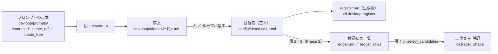
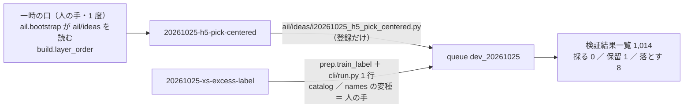

# 開発ループ（devloop）— 毎晩「アイデア出し → 作る → 机上で検証 → 選ぶ」を回す仕組みの記録

作成 2026-10-25（土）titan。TODO「「採る」モデルやトレーダーを開発する手法を作る」・プラン [daily-dev-loop.md](../../plans/daily-dev-loop.md)・規約 [rules.md 31 章](feature-discovery/rules.md)・数と置き場 `experiments/feature-discovery/config/devloop.toml`。
利用者決定 2026-10-25「推す案で」＝ K1〜K8（プラン §4-0）。

> ⚠ これは投資助言ではなく調査資料である。ループが出すのは「並べたもの」であって採用ではない。候補の人にするか・本番に入れるかは利用者（成績で人を選ばない）。

## 0. 置き場（1 周で何がどこに残るか）

> この図の主張: 人が読むのは 日誌・`register.md`・検証結果一覧 の 3 つで、事前固定の正本は登録簿（TOML）だけ。

## 1. 最初の 1 周（Phase 1。2026-10-25・手で）

### 1-1. 段 1 の実測（`claude -p`・モデル claude-fable-5-1・titan）

| 束 | 本数 | 道具 | 費用【実測】 | ターン | 時間 | 落とし穴 |
| --- | ---: | --- | ---: | ---: | ---: | --- |
| 参考なし（記録を読まずに出す） | 3 | なし | **$1.42** | 1 | 1 分 54 秒 | 1 回目は上限 $1.5 で止まり、⚠ **上限に当たると結果は 1 文字も返らない**（費用だけ払う） |
| 参考あり（記録・検証結果一覧・規約を読む） | 2 | Read ／ Grep ／ Glob | **$3.82** | 14 | 3 分 4 秒 | 1 回目は rules.md（2,126 行）／ ledger.md をまるごと読み（キャッシュ書き込み 60k トークン）$3 で止まった → プロンプトに「Read は 150 行以内・15 回まで」を足した |

- 合計 **$5.24**（失敗した 1 回目 $5.06 を足すと $10.30）。⚠ **K4 の推し「段 1 ≤ $2」は足りない**（段 1 だけで 1 晩の上限 $7 の 7 割）。✅ 同日 利用者「推しで」＝ 上限を上げる（段 1 $6・1 晩 ≈ $11。`config/devloop.toml`・rules.md 31-4）
- 入れ子の `claude -p` は `env -u CLAUDECODE` で動く（titan・2.1.310【実測】）。timer の環境（ログインしていない user セッション）で動くかは Phase 3-2 で確かめる
- 原文は [dev-loop/ideas-2026-10-25.md](dev-loop/ideas-2026-10-25.md)（良し悪しの印なし ＝ 利用者の指示 2026-10-24 の証拠）

### 1-2. 登録（`cli.devloop register`）

| id | 題 | 出どころ | 手間 | 数える | 触る場所 | 状態 |
| --- | --- | --- | --- | ---: | --- | --- |
| `20261025-h5-pick-centered` | 期間を選ぶゲート H5 を土台差で選ばせる | 参考あり（組み合わせる） | 小 | 6 | 共有の経路（`ail/detectors/fwd.py` に登録名 1 本） | 登録 |
| `20261025-xs-excess-label` | ラベルを断面の超過リターンに替えて学ぶ | 参考なし | 小 | 3 | 共有の経路（`cli/run.py`・`catalog`） | 登録 |
| `20261025-mkt-layer` | 市場全体の状態の層 `mkt_` を足す | 参考なし | 中 | 6 | 共有の経路（`ail/features`・`build.ORDER`） | 登録 |
| `20261025-roles-entry-stop` | 役割つきの組の損切り係を建値から −10% に替える | 参考あり（避ける） | 中 | 12 | 共有の経路（`cli/run.py`・`simulate.py`） | 登録 |
| `20261025-permutation-yardstick` | fold の内側の並べ替え検定を物差しに足す | 参考なし | 中 | 0 | 共有の経路（`ail/validation`・`catalog`・`report`） | 人の手（物差し ＝ 14 章の変更規約） |

- 既出の疑い（`key_shape` が検証結果一覧の予測モデル名に当たる数）は 5 本とも 0。登録の時刻 2026-10-25 12:31 PDT ＝ 回すと決めた時刻（結果はまだ 1 つも無い）
- ⚠ **見つかったこと: 5 本とも「共有の経路」に触れる**。この研究では新しい層・検知器・ラベル・器はどれも `ail/features` ／ `ail/detectors` ／ `cli/run.py` に登録する作りなので、K7（共有の経路は人の手）をそのまま当てるとループは何も作れない。Phase 2-1 の最初に **一時の人の手で「新しい口の置き場」を 1 度作る**（`ail/ideas/<id>.py` を `ail.bootstrap` が読む ／ `build.ORDER` に無い層は registry から後ろに足す）＝ その後は新しい検知器・層は「新しいモジュールだけ」になる。`cli/run.py` の器（ラベル・合わせる口の項目）を触るものは人の手のまま
- 段 1 の出力の `key_shape` の綴りは 1 本だけ直した（`full` → `all`。names.toml の綴り）。原文は登録簿の `notes` に残した

### 1-3. 次（Phase 2 ＝ 最初の 1 周の段 2〜4 を手で）

手間の小さい順（31-1 の 6）: `h5-pick-centered`（小・6）→ `xs-excess-label`（小・3）→ `mkt-layer`（中・6）→ `roles-entry-stop`（中・12）。1 晩の上限 12 に収まるのは先頭 2 本（9）。⚠ 回すのは 20 章の節に当たる事前固定が登録簿にあることを確かめてから（`structure`・`prediction` は登録済み・直さない）。

## 2. 最初の 1 周の段 2〜4（Phase 2-1。2026-10-25 12:49〜12:51 PDT・手で）

登録簿の手間の小さい順に 2 本（31-1 の 6）。事前固定は登録簿（`registered_at` 2026-10-25 12:31 PDT・`structure`・`prediction` は回す前のまま）。queue `dev_20261025`（leak ＝ true・ledger ＝ true）＝ 6 実行 67 秒【実測】・**n_trials 1,005 → 1,014（＋9 ＝ 登録簿の `n_trials_planned` 6 ＋ 3 と一致）**。

> この図の主張: 2 本のうち 1 本は `ail/ideas/` に登録するだけで作れ、1 本は共有の経路（ラベル・識別項目）に 1 行ずつ要った。この差が K7 の「人の手」の線になる。

### 2-1. 作った口（人の手・1 度だけ）

| 口 | 場所 | ⚠ |
| --- | --- | --- |
| 新しい口の置き場 | `ail/ideas/__init__.py`（`load_all`）＋ `ail/bootstrap.py` の末尾 1 行（`i*.py` を全部 import ＝ registry に登録するだけ） | 既存の経路は 1 ビットも変わらない（指紋 `test_predict`・`test_trading_run`・`test_fwd` ✅・`tests/test_ideas_loader.py`） |
| `ORDER` に無い層 | `cli/build.py` の `layer_order`（登録済みの層は 12 層とも `ORDER` にある ＝ 既存の config の並びは同じ式） | `20261025-mkt-layer` のため。テストが全 config で前の式と一致することを見る |
| 訓練のラベルの口 | `ail/validation/prep.py` の `train_label`（`label` の無い config は `tr["y"].values` そのもの）＋ `cli/run.py` の共通学習の枝 1 行（銘柄別は拒む）＋ `ail/catalog.py` の変種 `閾値売買（断面超過ラベル）`＋ `ail/names.py` ／ `names.toml` の `[label]`（`~xs-label`） | ⚠ 共有の経路 ＝ ループの段 2 では「人の手」。門（14-5）は元のラベルで測ったまま（診断） |

### 2-2. 結果（判定は 13-7 ／ 20-3 のまま。⚠ 採否に併記は使わない）

| id | 行（検証名） | 判定 | 上乗せ bp/fold ／ fold | 対の相手（既存） | 予想との突き合わせ |
| --- | --- | --- | --- | --- | --- |
| h5-pick-centered | `own-trend.h5-gate-pick-centered.ridge.shared@50 ／ 55 ／ 60` | 落とす ×3 | −88（1/5）／ −757（0/5）／ −955（0/5） | H5 土台なし −216（2/5）／ −10（3/5）／ −227（2/5） | 「採る 0」✅。「H5 との対の差は \|t\| < 2」＝ θ 55 ／ 60 は H5 より下（保有日率 0.50 ／ 0.31 ＝ 休んだぶんが負 ＝ 25-7 の単体と同じ型）✅ 失敗モード 2 |
| 〃（組 R14 ＋ X1） | `own-trend.roles-pick-centered-stop.ridge.shared@50`・`-tr5-600`・`-trall` | 落とす ／ **保留** ／ 落とす | −313（1/5）／ **＋329（1/5 −−＋−−）**／ −278（1/5） | R5 −410（0/5）／ −20（2/5）／ −330（0/5） | 「R14 対 R5 の差は fold 3 が決める」✅（3 行とも fold 3 だけ正）。保留は $600 の形 1 本 ＝ 25-7 の組と同じ型 |
| xs-excess-label | `own.all.ridge.shared~xs-label@50 ／ 55 ／ 60` | 落とす ×3 | −821 ／ −1,128 ／ −1,306（3 本とも 0/5） | `own.all.ridge.shared` −271（2/5）／ −540（1/5）／ −944（1/5） | 「θ 60 は売買がほぼ無い」✅（取引 5 回/fold・保有日率 0.04）「θ 50 の保有日率 約 5 割」✅（0.57）「5 fold とも負か 0 の周り」✅。「AUC が 0.01〜0.02 上がる」は測れず（門は元のラベル） |

- **選んだ期間の分布（H5 土台差・fold 別の最頻の期間とその割合）**: fold 1 先 5 日 73% ／ fold 2 先 40 日 81% ／ fold 3 先 5 日 74% ／ fold 4 先 20 日 64% ／ fold 5 先 40 日 71%。土台なしの H5（§6-2: 88〜100%）より散ったが、**「2 つ以上の fold で 7 割を切る」の予想は fold 4 の 1 つだけ** ＝ 土台を引いても期間は fold ごとに 1 つに偏る。土台 π は W が長いほど高い（fold 2: 0.566 → 0.620）
- 門（診断）: H5 土台差 AUC 0.504・買い% 幅 9.7 点（門前） ／ 断面超過ラベルの門は元のラベルの数字のまま（0.498・5.9 点）
- leak 対照: 6 本とも跳ねた（H5 土台差 ＋3,887〜3,895・5/5 ／ R14 ＋2,488〜3,257・5/5 ／ 断面超過ラベルの leak も 5/5）
- 段 4（`cli.select_candidates`）: **上位 3 は F1-7 ／ F2-2 ／ `M1 3本の平均` のまま**（新しく入った行なし ＝ 31-3 の 3 により次の晩の机上は無し）。決まり 1・2 の残り 22 → 決まり 4 で 18

### 2-3. 読み方と、やらないこと

- 判定は 1 行も動かさない・θ・期間・π の取り方・損切り係の水準を結果を見て振らない（25-5 の 8・25-7 の 6）。R14 の $600 の保留は fold 3 の 1 つが作る（25-7 の組と同じ）＝ 候補の人は作らない
- ⚠ **ループの段 2 の線（K7）**: 新しい検知器は `ail/ideas/` だけで書けた。ラベル・器・識別項目の列を変えるものは `cli/run.py`・`catalog`・`names` に要る ＝ 「人の手」。段 2 のプロンプトの正本（`devloop/prompts/build.md`）にこの線を書いた
- 残る登録 2 本（`mkt-layer` 中・6 ／ `roles-entry-stop` 中・12）は次の晩へ（31-2 の 3。`roles-entry-stop` は `cli/run.py`・`simulate.py` を触る ＝ 人の手）。`permutation-yardstick` は人の手（物差し）

## 3. 運転手（Phase 3。2026-10-25 17:50 PDT・titan）

| 何 | 場所 | 実測・注意 |
| --- | --- | --- |
| 運転手 | `run-devloop.sh` → `cli.devloop night`（段 0 門 → 段 1〜4 → 日誌 → commit） | dry-run（段 0・4）: 実リポジトリ 1 秒・systemd-run の環境でも通った |
| timer の環境 | `systemd-run --user` で `claude -p` | ⚠ PATH に `~/.local/bin` が無い（`/usr/bin` ほかだけ）＝ `claude` は見つからない。絶対パスなら動いた（$0.21・HOME は同じ ＝ 資格情報は読める）→ `run-devloop.sh` が PATH を足し、`cli.devloop` は `AIL_CLAUDE_BIN` → `which` → `~/.local/bin/claude` の順で実体を探す |
| 初回の晩 | `cli.devloop state --seed-top` | 上位 3（F1-7 ／ F2-2 ／ M1）を状態に写した ＝ 初回の晩に机上を足さない（31-3 の 3 は「新しく入った行」だけ） |
| 状態 | `research.sqlite` の `queue_state` の 1 行 `devloop` | 連続で段 2 が 0 本・連続で登録 0・費用の累計・机上の持ち越し・直近 30 晩 |
| 止め方 | `DEVLOOP_HALT`（段 0）／ timer disable ／ 打ち切り ② ③ は `state --reset` で解く | 実売買の `HALT` とは別 |
| 見る場所 | 実行タブの「開発ループ」（`dashboard/devloopview.py`） | 登録簿 × 結果 × 日誌。読むだけ |

- ⏳ 3-7 試運転（利用者が timer を入れてから）: 3 晩 ＝ 段 1 だけ自動（`[build] mode = "manual"`。段 2 は朝に `devloop/prompts/build.md` の手順で手で）→ 7 晩 ＝ 全段（`mode = "claude"`）。費用【実測】・落ちた段・直したことをここに足す。⚠ 試運転の結果で物差し・水準を動かさない（直すのは運転手の不具合だけ）

### 3-1. 報告メールと門の直し（2026-11-03 Sx360・利用者「推す案ですすめて」＝ [プラン devloop-mail.md](../../plans/devloop-mail.md)）

- **門の直し**: 門は自分の錠のほかに **自分が書く置き場（日誌 `dev-loop/log/`・`register.md`・下書き `dev-loop/drafts/`）も「汚れた木」に数えない**（`devloop.own_outputs`）。直す前は、コミットの後に書き直した日誌・止まった晩の日誌 ／ 下書きを未コミットと数え、**2 晩目から毎晩止まる作り**だった（timer を入れた 11/3 に見つけた・まだ起きていない。本物の git で 2 晩回すテストで、直す前の形は 2 晩目が「作業ツリーが汚れている（log/2026-10-26.md）」で止まることを確かめた）。置き場の中身は次に通った晩のコミットに入る（今までの意図どおり）
- **報告メール**: 毎晩の最後（日誌とコミットの後）に 1 通（M2 毎晩）。件名で結果・本文の頭に「朝にやること」・続きに日誌の全文（M3）。Gmail の SMTP ＋ アプリ パスワード（M1・`cli/devloop_mail.py`・標準ライブラリだけ）。秘密は titan の `~/.config/ai-income-lab/devloop-mail.env`（リポジトリの外）。Python ごと落ちた晩は `run-devloop.sh` が印を見て 1 通だけ送る。送れなくても止めない・日誌は書き換えない（結果は状態 `nights[-1].mail`）。手順は `experiments/feature-discovery/systemd/README.md`

## 4. 2 周目（登録簿の残り 2 本・2026-11-01 11:05〜11:08 PST・titan・手で）

利用者「行える作業を見繕って」→「推す順で進めて」。2026-10-25 に登録して残っていた `20261025-mkt-layer`・`20261025-roles-entry-stop` を段 2（人の手）で作り、queue `dev_20261101`（12 実行・約 3 分【実測】）で回した。⚠ **回すと決めたのは結果を見る前**（登録 2026-10-25 12:31 PDT）。

- **結果: 採る 0 ／ 保留 1 ／ 落とす 17・n_trials 1,014 → 1,032（登録簿の予定 6 ＋ 12 と一致）**。leak 対照 12 本とも跳ねた（mkt ＋22,000bp/fold 級・組 ＋2,100〜＋6,700）。上位 3（F1-7 ／ F2-2 ／ M1）は動かず
- ⚠ 31-2 の 3「1 晩 ≤ 12」を超えた（18）。運転手の毎晩の上限と読み、登録簿の残りを手で回す 1 回として 1 度に回した（分けても数える件数は同じ）。✅ 2026-11-01 利用者決定「A。手動で回すときはカウントしない」＝ 上限は運転手だけ（rules.md 31-2 の 3a）・`n_trials` には全部数える
- 名前: 登録簿のメモの R14〜R17 は R14 が先に使われていた（`20261025-h5-pick-centered`）ので **R15〜R18**。config は `dev_roles_entrystop_*`（登録簿の `touches` の `trader_roles_t21〜t24` ではなく allowlist の `dev_*`）。予測モデル名（`key_shape`）は登録どおり

### 4-1. 作った口（人の手）

| 何 | 場所 | ⚠ |
| --- | --- | --- |
| 層 `mkt_`（8 列 ＝ 幅 20 ／ 60 日・幅の 5 日差・断面のばらつき・等加重指数の 1 ／ 5 ／ 20 日リターン・その 20 日ボラ） | `ail/ideas/i20261025_mkt_layer.py`（registry に登録するだけ ＝ `build.layer_order` が後ろに足す） | 足 i の値は足 i の終値まで（`own_` と同じ ＝ 予測する日の前日の終値まで）。表 `dev_mkt_ridge`（＋ `_leak`）は `own_2018` と **行が 135,962 で完全に一致**・共通の列の差 ≤ 1e-12【検算】 |
| 建値から −x% で降りる（`simulate` の形 B）を組に | `cli/run.py` の `mix_specs`（`[[trading.mix]] entry_stop_pct`・roles だけ）・`_roles_fold`・器を呼ぶ 3 か所 ＋ `simulate_topk` の `stop_loss_pct`（`simulate` と同じ式） | 省けば 1 ビットも変わらない（指紋 `test_trading_run`・`test_predict`・`test_fwd` ✅）。1 銘柄・K 1 で `simulate` と同じ売買になることをテスト。⚠ 共有の経路 ＝ 人の手 |
| テスト | `tests/test_ideas_20261025_mkt_layer.py`（3 本 ＝ 無い config は不変・全銘柄に同じ値・先読みなし）・`tests/test_ideas_20261025_roles_entry_stop.py`（5 本）・`tests/test_ideas_loader.py`（新しい層を除いて「登録済みの層は ORDER にある」） | — |

### 4-2. 結果（判定は 13-7 ／ 20-3 のまま。対の差 ＝ 同じ切れ目の fold 対・純利 bp/fold）

| 登録簿 | 行 | 判定 | 対の差（相手 ／ t ／ 正の fold） |
| --- | --- | --- | --- |
| mkt-layer | Ridge θ50 ／ 55 ／ 60 | 落とす × 3 | 対 own だけ（`trade_own_ridge_a`）＋16 ／ ＋154 ／ −77（t ＋0.22 ／ ＋0.98 ／ −0.52） |
| 〃 | LightGBM θ50 ／ 55 ／ 60 | 落とす × 3 | 対 own だけ（`trade_own_lgbm_a`）−953 ／ −40 ／ ＋796（t −1.99 ／ −0.05 ／ ＋1.02） |
| roles-entry-stop | R15〜R18 × 素 ／ 5 本・$600 ／ 全銘柄（12 行） | 保留 1（R17 = 買い先 40・売り先 10 の 5 本・$600 ＋49）／ 落とす 11 | **対 損切りなし（R6〜R9）: 12 対とも負**（−77〜−271・t −0.97〜−2.38）／ 対 X1（R1〜R4）: 素と全銘柄は b10 ／ b20 ／ b40 で正（b20 の 2 行は t ＋3.00 ／ ＋3.72・5/5）・5 本・$600 と b5 は 0 の周りか負 |

### 4-3. 予想との突き合わせと読み方

- mkt-layer: 予想「平均は 0 の周りで fold の符号はそろわない・leak は跳ねる・Ridge と LightGBM で向きは同じ」→ 前の 2 つは当たり、向きは θ ごとにばらばら（LightGBM は列の抽出の乱数が列の数で変わるので層の情報と分けられない ＝ 登録簿の失敗の型 4）。⚠ **この 8 列には own だけの表に足して翌日の方向の情報を足す力は見えない**（6 対とも |t| < 2）
- roles-entry-stop: 予想「対 R1〜R4 は 4 組とも正・対 R6〜R9 は 0 の周り（|t| < 1）」→ **外れ**。建値から −10% の損切りは **損切りを持たない形より 12 対とも下**（往復の費用・戻る前に降りる）。X1 よりは上の組がある（b20 の 2 行は 5/5）が、損切りなし ＞ 建値基準 ≳ X1 の並び ＝ 25-6 の「損切り係を外すと上」と同じ向き
- ⚠ 登録簿の `measurable` にあった「形 B の発火回数を `fitted_doc` に残す」は入れていない（発火の数は保有の記録 `holds.csv` から後で数えられる）
- ⚠ **やらないこと**: 水準（5 ／ 20%）を足す・建値基準を高値基準と混ぜる・mkt の列を選び直す（どれも新しい id で先に登録）。候補の人は作らない

## 5. 3 周目（2026-11-01 14:58〜15:21 PST・titan・手で。利用者「開発ループの3周目を進めて」）

- 登録簿の残りは「人の手」の 1 本（並べ替え検定 ＝ 買い% の保存の段 2）だけだったので、段 1 から回した: `./run-devloop.sh --stages 0,1 --no-commit`
- ⚠ **段 0 の門が自分の錠（`devloop.lock`）を「利用者の未コミット」と数えて毎晩止まっていた**（night が門の前に錠を取るため ＝ 運転手は 1 度も段 1 に進めない作りだった）。門が自分の錠を数えないように直した（`728b1a7`・テスト 1 本）。timer の試運転（3-7）の前に見つかった
- 段 1: **$2.13【実測】**（参考あり 2 本 $1.59・7 turns ／ 参考なし 3 本 $0.54・1 turn）・5 本 ＝ 登録 1・人の手 4・既出 0

| 登録簿 | 題 | 段 1 の状態 | 今回 |
| --- | --- | --- | --- |
| `20261101-roles-nostop-midcap-c20` | 損切りなしの組 R6〜R9 を中位 48 本 × 費用 20bp に | 登録 | 回した |
| `20261101-vol-scaled-label` | 訓練のラベルを y ÷ 直近 60 日の σ に | 人の手 | このセッションで作って回した |
| `20261101-gap-intraday-layer` | 夜間（前日終値 → 始値）と日中（始値 → 終値）に分けた層 `gap_` | 人の手 | このセッションで作って回した |
| `20261101-deadzone-label` | 小さな値動きの日を訓練から外す | 人の手 | 残す（学習の行と較正の行を分ける口が要る ＝ `cli/run.py` の共通学習の枝を大きく触る） |
| `20261101-subperiod-sign-count` | 評価期間を四半期に切って符号を数える物差し | 人の手 | 残す（物差しの変更 ＝ 14 章の変更規約。並べ替え検定と同じ棚） |

- `cli.devloop register --promote` は 人の手 も受けるようにした（利用者のセッションで作ると決めたら登録 ＝ `registered_at` を打つ・`built_by` に残す）。2 本とも 15:12 PST に登録してから作った

### 5-1. 作った口（人の手）

| 何 | 場所 | ⚠ |
| --- | --- | --- |
| 訓練のラベル `label = "vol_scaled"` | `ail/validation/prep.py` の `train_label`（y ÷ `own_vol_60`〔標準化の前〕・欠けた ／ 0 以下の σ は訓練の正の σ の中央値）・`catalog.threshold_style` の変種 `閾値売買（ボラ割りラベル）`・`names.toml` `~vol-label` | 無い config は 1 ビットも変わらない（指紋 ✅） |
| 層 `gap_`（8 列） | `ail/ideas/i20261101_gap_layer.py` | 足 i の終値まで・`build.layer_order` が後ろに足す。表 `dev_gap_ridge` は `own_2018` と行が一致（共通の列の差 ≤ 1e-12 ＝ `dev_mkt_ridge` と同じ） |
| own ＋ cs の対の相手 | `dev_owncs_ridge`（素のラベル・新しく回した ＝ ＋3） | 既存に own ＋ cs だけの閾値売買の表が無かった |
| 中位 48 本 × 費用 20bp の組 | `dev_roles_midcap_{b10e5,b20e5,b40e10,b5e20}`（`trader_roles_t12`〜`t15` の写し ＋ dataset ・start ・targets ・cost 20・2a を外す。表は b10e5 が作る） | 規則（係・最短保有・θ）は 1 ビットも動かさない |
| テスト | `tests/test_ideas_20261101.py`（3 本） | — |

### 5-2. 結果（queue `dev_20261101b`・16 本 3 分 30 秒【実測】）

**採る 0 ／ 保留 0 ／ 落とす 24（n_trials 1,084 → 1,108）**・leak 8 本とも跳ねた・上位 3 は動かず（F1-7 ／ F2-2 ／ M1）。

| 登録簿 | 対の差（同じ切れ目の fold 対・上乗せ bp/fold） |
| --- | --- |
| ボラ割りラベル × own（対 `trade_own_ridge_a`） | θ 50 / 55 / 60 ＝ −6 / −71 / −61（t −0.13 / −0.69 / −0.86） |
| ボラ割りラベル × own ＋ cs（対 `dev_owncs_ridge`） | −174 / −85 / +23（t −1.39 / −1.20 / +1.32） |
| 層 `gap_`（対 `trade_own_ridge_a`） | +46 / −99 / +43（t +0.33 / −0.92 / +1.57） |
| 損切りなしの組 × 中位 48 本 × 費用 20bp | 素の行 R6〜R9 ＝ −432〜−621（正の fold は 0〜1）・全銘柄の形も同じ向き。us63 ・費用 5bp では保留だった形 ＝ 集合と費用を替えると 4 組とも B&H ／ 持ち続けるを下回る（予想どおり） |

- 予想（先に書いた）との突き合わせ: ボラ割りラベル ＝ 対の差 6 対とも \|t\| < 2・向きはそろわない ＝ 予想どおり ／ gap ＝ 対の差は小さく符号は割れる ＝ 予想どおり ／ 中位 48 本 ＝ 4 組とも素の行は B&H 未満 ＝ 予想どおり（「e ＝ 5 の組ほど下がる」は R8〔e ＝ 10〕が最も浅く、おおむね当たり）
- ⚠ 結果を見て水準・費用・集合を動かさない。残る 2 本（人の手）は利用者が作るかを決める

## 6. 段 1 の契約 2（未知への挑戦。2026-11-01 15:5x PST・titan。rules.md 31-6）

- 利用者「回す前に書いた予想通りが気になる。…未知なものへのトライが増えたらいいな」→「推す案で進めて」。契約に §3b（枠の内 ／ 外・確率つきの予想 `p_hold` ／ `p_positive`・差なしで分かること `learn_if_null`）を足し、`register.md` に予想の当たり方の節を足した
- 契約 2 で段 1 を 1 回: **$1.85【実測】**（参考あり 2 本 $1.25・10 turns ／ 参考なし 3 本 $0.60）・5 本 ＝ 登録 1・人の手 4・**枠の外 2 本**（下限どおり）・日誌 `log/2026-11-01-2.md`

| id | 枠 | 保留以上の確率 | 問いの要約 | 状態 |
| --- | --- | ---: | --- | --- |
| `20261101-crash-label-exit` | 外 | 0.20 | 当てるものを「先 5 日の急落」に替え、その確率を出口に使う | 人の手（ラベルの口） |
| `20261101-graded-weight-sizing` | 外 | 0.15 | 決めるものを「どれだけ持つか」に替える（買い% に応じて持つ量） | 人の手（器の口） |
| `20261101-c3-as-stop-role` | 内 | 0.35 | 損切り係を SMA200 割れ（C3）にした役割つきの組 | 登録 |
| `20261101-ten-fold-long-table` | 内 | 0.35 | 1995 年からの表を評価期間 10 個に切る（物差しの検出力） | 人の手 |
| `20261101-trough-entry-cond` | 内 | 0.25 | 外にいる日だけで学ぶ再進入の係 | 人の手 |

- 3 周目までの「差なし」の予想と違い、確率は 0.15〜0.35 に散り、`learn_if_null` は次の行動を名指ししている（例: 急落が当たらなければ日中の足などの別のデータで同じラベル）
- ⚠ 同じ日の 2 回目の運転手が日誌 `<日付>.md` を上書きした → 2 回目以降は `<日付>-2.md` … に書くように直した（1 回目の日誌は元に戻した）

## 7. 枠の外の 2 本を作って回した（2026-11-01 16:10〜16:11 PST・titan・手で。利用者「推す案で進めて」）

queue `dev_20261101c`（4 本・1 分【実測】）＝ **採る 0 ／ 保留 1 ／ 落とす 5**（＋素の行の再実行 3 は既存と同じ識別項目 ＝ n_trials 1,108 → 1,114）・leak 2 本とも跳ねた。

| 何 | 場所 |
| --- | --- |
| 急落を当てる出口の検知器 `X5 出口だけ 先5日の急落を当てる（own・学習）`（綴り `x5-exit-crash5`） | `ail/ideas/i20261101_crash_exit.py`（ラベルは検知器の中 ＝ 共有の経路を触らない・先の 4 本が訓練分割に無い ／ 暦で 10 日超の行は落とす・パージ 10 日） |
| 持つ量を買い% に応じて変える器 `simulate_graded`・行 `〔量を段階に〕`（綴り `-graded`） | `ail/validation/simulate.py`・`cli/run.py` の `[trading] graded = true`・`ail/names.py`（無い config は 1 ビットも変わらない ＝ 指紋 ✅） |
| テスト | `tests/test_ideas_20261101.py` に 3 本 |

| 登録簿（先に書いた確率） | 結果 | 予想との突き合わせ |
| --- | --- | --- |
| `20261101-graded-weight-sizing`（保留以上 0.15・対の差が正 0.30） | 対の差（段階 − 素・同じ実行）θ 50 / 55 / 60 ＝ **−1,207 / −1,087 / −710bp/fold（t −3.60 / −2.57 / −1.39）**・5 fold とも負。保有日率 0.72 → **0.11**（θ 50） | ⚠ **外れた**（予想は「小さな負・\|t\| < 1」）。原因: Ridge の買い% は 50 のすぐ上に潰れていて（幅が狭い）、確率の大きさで量を決めると持つ量がほぼ 0 ＝ ほぼ現金になる。⚠ 分かったこと ＝ **この買い% の「大きさ」は量を決める材料にならない**（閾値を超えたかどうかしか使えない）。`learn_if_null` に書いた次の手（断面の順位で量を配る）がそのまま次の候補 |
| `20261101-crash-label-exit`（保留以上 0.20・正 0.35） | 上乗せ θ 50 / 55 / 60 ＝ −27 / −29 / +0.5bp/fold・θ 60 が保留（2/5）。保有日率 **0.999**（出口がほとんど鳴らない） | 向きは予想どおり（小さな負・2020 年を含む fold だけ正）。⚠ 保留は B&H とほぼ同じ形のたまたま。原因: 急落の確率は土台（急落の割合）が低く、較正した確率が売る線（50〜60%）をほとんど超えない ＝ 25-7 の土台の問題と同じ形。次に試すなら土台差 ／ 順位で出口を鳴らす形（新しい処置として先に登録） |

- 予想の当たり方（`register.md`）: 2 本・当たり 50%・Brier 0.331 ＝ 3 周目までの「差なし」と違い、外れが出た
- ⚠ 結果を見て水準を動かさない。次の 2 案（順位で量を配る ／ 急落の出口を土台差に）は段 1 か人の手で新しく登録する

## 8. §7 の次の手 2 本（2026-11-01 16:31 登録 → 16:33〜16:34 PST に回した・titan・手で。利用者「次の候補の2本も進めて」）

- 段 1 を通さず、§7 の `learn_if_null` に書いた次の手を人の手で登録簿に書いた（契約 2 の項目つき・`origin.prompt` ＝ 人の手）→ `--promote` → 作る → queue `dev_20261101d`
- 作った口: `simulate_graded(weight=…)`（行ごとの持つ量）・`cli/run.py` の `[trading] graded_rank = true` と `rank_weight`（同じ日の断面の順位の割合・最下位 0 ／ 最上位 1）・行 `〔量を順位で〕`（綴り `-rankgraded`）／ 検知器 `X6 出口だけ 先5日の急落を当てる（own・学習・土台差）`（X5 と同じ中身から土台を logit で引く）。どれも無い config は 1 ビットも変わらない（指紋 ✅・テスト 2 本）

**採る 0 ／ 保留 0 ／ 落とす 6（n_trials 1,114 → 1,120）**・leak 2 本とも跳ねた。

| 登録簿（先に書いた確率） | 結果 | 分かったこと |
| --- | --- | --- |
| `20261101-rank-graded-sizing`（保留以上 0.10・対の差が正 0.25） | 対の差（順位 − 素・同じ実行）θ 50 / 55 / 60 ＝ −821 / −1,037 / −676bp/fold（t −3.20 / −2.66 / −1.38）・5 fold とも負。保有日率 0.39（素 0.72） | 予想どおり負。差の大半は「持つ量が少ないぶん」で説明できる（保有の差 × B&H ＝ −659 / −794 / −685）＝ **断面の順位にも持つ量を決める情報は見えない**（残りも負）。大きさ（§7）・順位とも量の材料にならない ＝ このモデルの買い% で使えるのは「閾値を超えたか」だけ |
| `20261101-crash-exit-centered`（保留以上 0.15・X5 より良い 0.30） | 上乗せ θ 50 / 55 / 60 ＝ −389 / −291 / −205bp/fold・保有日率 0.83〜0.95・X5 との差 t −0.94〜−1.57。同じ保有日率の乱択ゲートとほぼ同じ純利（θ 50 ＝ 1,263 対 1,248） | 予想どおり（鳴る日は増えたが B&H を下回る・X5 より悪い。保有日率の予想 0.5〜0.8 は外れて 0.83〜0.95）。**急落の確率の並びは、降りる日をでたらめに選ぶのと区別できない** ＝ 日足の own 列からは「いつ降りるか」の情報が見えない。次は別のデータ（日中の足・気配の差）で同じラベル（`learn_if_null` のとおり） |

- 予想の当たり方（`register.md`）: 4 本・当たり 75%・Brier 0.174

## 9. 試運転 1 晩目の段 2（人の手）を回した（2026-11-05 15:01〜15:04 PST・titan・手で。利用者「TODOから次の作業を選んで」）

- 作ったのは 2026-11-04（段 2 の人の手・回す前）: 損切り係 `X7 出口だけ 終値がSMA200を割ったら降りる`（`ail/ideas/i20261101_c3_stop.py`）と組 R19〜R22（`dev_roles_c3stop_*` ＝ R6〜R9 に X7 を足しただけ）／ 検知器 `V2 荒れる日を休む` ＋ 学習器 `ロジスティック回帰`（`ail/ideas/i20261104_calm_day.py`・`dev_calm_day`）／ 検知器 `R1 局面別 Ridge（k-means・2 ／ 4個）`（`ail/ideas/i20261104_regime_ridge.py`・`dev_regime_ridge`）。テスト `tests/test_ideas_20261104*.py`・指紋 ✅。`20261104-perm-split-timing` は検証を作らない読むだけの物差し（`cli/perm_split.py`）で、この queue には入らない
- 手で回した ＝ 1 晩 12 の上限に数えない（31-2 の 3a）。11/5 01:00 PST の晩は、この 4 本が未コミットだったので段 0 で止まった（[log/2026-11-05.md](dev-loop/log/2026-11-05.md)）
- ⚠ queue は本番の行の後にだけ一覧を吐くので、最後の leak（`dev_regime_ridge_leak`）が一覧に入らなかった → 終わった後に 1 回吐き直した（n_trials は 1,142 のまま・leak の 6 行だけ増えた）

queue `dev_20261104`（12 本 3 分【実測】）＝ **採る 0 ／ 保留 2 ／ 落とす 20（n_trials 1,120 → 1,142）**。上位 3 は動かず（F1-7 ／ F2-2 ／ M1）。

| 登録簿（先に書いた確率） | 結果（対の差 ＝ 同じ切れ目の fold 対・純利 bp/fold） | 予想との突き合わせと分かったこと |
| --- | --- | --- |
| `20261101-c3-as-stop-role`（保留以上 0.35・正 0.40） | 対 損切りなし R6〜R9: 素 ／ 全銘柄の 8 対とも負（−147〜−436・t −1.15〜−3.58）・$600 の形は b20 ＋223 ／ b40 ＋250（t 0.64 ／ 0.71）・b10 −334 ／ b5 −106。対 X1（R1〜R4）は 12 対とも \|t\| ≤ 1.22・向きは割れる。保留 2 ＝ R20 ／ R21 の $600 の形（3/5・対 持ち続ける ＋305 ／ ＋478 ＝ R7 ／ R8 の $600 の形が保留だったのと同じ形）。leak は 12 行とも跳ねた・X7 の単体は学ばないので leak でも同じ値 | ⚠ **「往復は X1 より大きく減る」は外れた（逆）**: 取引は素の行の 5 fold 合計で R19 16,096 ／ X1 の R1 6,238 ／ 損切りなしの R6 1,293・保有の中央値 3 日（1 日が 36%）。終値が SMA200 の上下を行き来する銘柄で、損切り係が出口を言い、翌日に買い係が買い直す。**遅い損切りでも「損切り係が出口を言う → 翌日に買い直す」往復は消えない**（SMA200 の近くで値が上下するたびに鳴る）。損切り係を足すと、X1 でも X7 でも損切りなしより下がる |
| `20261104-calm-day-hold`（保留以上 0.30・正 0.35） | 上乗せ θ 50 / 55 / 60 ＝ −701 / −858 / −817・0/5（fold 4 は休む日 0）。同じ保有日数の乱択ゲートとの差 −494（t −1.81）。買い% の幅は fold ごとに 71 ／ 0.01 ／ 49 ／ 15 ／ 3 点（fold で毎日休むか休まないかに振れる）。**leak は跳ねなかった**（−426・2/5） | 上乗せが負は予想どおり。「2020 年を含む fold だけ正」と「leak が跳ねる」は外れた。leak の表は翌日の \|y\| の断面中央値を持つので、荒れる日はほぼ完全に当たる。それでも B&H を下回る ＝ **荒れる日（上位 30%）を完全に当てて休んでも、大きく上がる日も一緒に逃して B&H に負ける**。問いそのもの（荒れる日を休む）が、この表と費用では負ける形 |
| `20261104-regime-cluster-ridge`（保留以上 0.22・正 0.40） | 対 `trade_own_ridge_a`「全部使う（基準）」: K 2 ＝ −121 / ＋277 / ＋356（t −0.42 / ＋0.57 / ＋1.69）・K 4 ＝ ＋6 / −91 / −165（t ＋0.03 / −0.30 / −0.96）。買い% の幅 1.9 ／ 2.0 点（素の Ridge 5.9 点）。leak は跳ねた | 6 対とも \|t\| < 2・K 4 のほうがばらつく・K 2 がわずかに正 ＝ 予想どおり。⚠ **「買い% の幅が広がる」は外れた（狭くなった）**＝ 局面ごとに学ぶと係数が縮み、買い% はもっと 50 に寄る。`learn_if_null` のとおり「局面で分けても own 列の線形の関係は同じ」＝ own 列で局面を決める軸は閉じる。続けるなら外生の列で局面を決める形（新しい id で登録） |

- 予想の当たり方（`register.md`）: 7 本・当たり 71%・Brier 0.179
- ⚠ 結果を見て水準（SMA の長さ・分位 70・K）を動かさない。保留 2 行は $600 の形の既知の型で、候補の人は作らない（成績で人を選ばない）

## 10. 試運転 2 晩目の段 2（人の手）を回した（2026-11-06 12:51〜12:54 PST・titan・手で。利用者「TODOから次の作業を選んで」）

- 2 晩目（11/6 01:00 PST・timer）は段 0〜4 を 118 秒・$2.17【実測】で完走した（段 1 5 本 ＝ 登録 3・人の手 2・commit 217f66d ＋ push。[log/2026-11-06.md](dev-loop/log/2026-11-06.md)）
- 登録 3 本を同じ日に作って回した:
  - 検知器 `R2 局面別 Ridge（外生で k-means・2 ／ 4個）`（`ail/ideas/i20261106_regime_ex_ridge.py`・`dev_regime_ex_ridge`）。R1 の写しで、局面を決める列だけを `ex_UST*` ／ `ex_EURTO*` の 28 列に替えた。表は `exog_h1`（own_2018 と行が同じ）
  - 検知器 `L1 集まりの中で遅れた銘柄を買う（相関の集まり8個・5日）` ＋ 基準線 `集まりを乱数で割り当てた遅れの買い（8個）`（数えない）。`ail/ideas/i20261106_cluster_laggard.py`・`dev_cluster_laggard`
  - 読むだけの物差し `cli/planted_power.py`（検証を作らない・`n_trials` に数えない）
  - テスト `tests/test_ideas_20261106.py` 9 本・指紋 ✅
- 登録簿からのずれ（回す前に決めた）:
  - L1 の買い% は訓練分割の順位そのものにした。Platt を通すと向きを学び直し、規則が逆になりうるため
  - L1 の識別項目の学習器は綴りの都合で ridge のまま（key_shape の none は綴りが無い）。L1 は Ridge を呼ばない
  - L1 の表の接頭辞は own（規則が読むのは `own_ret_1` ／ `own_ret_5` だけ）
  - 乱数の集まりの基準線は買い% が 0 ／ 100 なので、比べられるのは θ 50 の行だけ
  - L1 は LEAK_ 列を読まないので、leak 対照は跳ねない（器の確かめにならない）
- ⚠ 前回と同じく、最後の leak の後に検証結果一覧を 1 回吐き直した

queue `dev_20261106`（4 本 1 分 7 秒【実測】）＝ **採る 0 ／ 保留 0 ／ 落とす 9（n_trials 1,142 → 1,151）**。検出力の曲線は 100 本 79 秒【実測】で、DB の `outputs` の `diag/2026-11-06T12-53-07_planted_power/` に入れた。

| 登録簿（先に書いた確率） | 結果（対の差 ＝ 同じ切れ目の fold 対・純利 bp/fold） | 予想との突き合わせと分かったこと |
| --- | --- | --- |
| `20261106-regime-ex-cluster-ridge`（保留以上 0.22・正 0.45） | 対 `trade_own_ridge_a`「全部使う（基準）」: K 2 ＝ ＋39 / −439 / −200（t ＋0.41 / −1.50 / −0.90）・K 4 ＝ −18 / ＋75 / −25（t −0.13 / ＋0.11 / −0.09）。対 R1: K 2 ＝ ＋160 / −716 / −556（t ＋0.66 / −1.34 / −1.60）・K 4 ＝ −25 / ＋166 / ＋140（\|t\| ≤ 0.77）。上乗せは 6 行とも負（−232〜−1,143）。買い% の幅（門）0.8 ／ 1.7 点（R1 1.9 ／ 2.0・素の Ridge 5.9）。**局面の滞在日数の中央値は 1〜2 日**（どの fold でも、訓練でも評価でも）。leak は跳ねた（＋22,195） | 「6 対とも \|t\| < 2・向きは割れる・幅は素の Ridge より狭い・leak は跳ねる」＝ 当たり。「K 2 は 2022 年の利上げを含む fold だけ差が大きい」は確かめられない（局面が毎日入れ替わる）。⚠ **failure_modes の 1 が起きた**: 1 日遅れの差分と 20 日 z の k-means は、局面というより日ごとの揺れを分けている。外生の列で分けても、局面ごとの Ridge は縮んで 50 に寄る ＝ `learn_if_null` のとおり、**局面別の線形モデルの軸は局面の決め方によらず閉じる**。続けるなら局面を列として 1 本の非線形の学習器に渡す形（新しい id） |
| `20261106-cluster-laggard-revert`（保留以上 0.15・正 0.40） | 上乗せ θ 50 / 55 / 60 ＝ −1,016 / −1,156 / −1,133（t −5.38 / −7.63 / −6.89・0/5）。対 乱数の集まり（θ 50）＋110（t ＋1.38・3/5）。θ 55 ／ 60 の対の差は −31 ／ −8（参考。基準線は θ を持たない）。買い% の幅は 88〜95 点（学習器なしの順位なので広い）・AUC 0.502。取引 10,947 回・保有の中央値 4 日 | 「B&H に負寄り・乱数の集まりとの差は小さい」＝ 当たり。「leak が跳ねる」は外れ（設計上 跳ねない）。⚠ **5 日の断面の逆張りは、毎日の持ち替えの費用と持たない日のぶん B&H に約 1,000bp/fold 負ける**。相関の集まりは乱数の集まりと差が無い（t 1.38）＝ 日足の相関から作った集まりは、翌日の方向に使える構造を持たない（`learn_if_null` のとおり）。次は集まりを出来高の同時の跳ねで作る形（新しい id） |
| `20261106-planted-signal-power`（数えない・p_hold 0） | 既知の列 × s bp/日を合成の y に埋め、素の own × Ridge（θ 50）と判定式に通した（種 20・s をまたいで雑音は同じ・合成の日次 σ の中央値 175bp）。**s 0 ／ 0.1 ／ 1 bp/日 ＝ 採る 0%・保留 5%・落とす 95%**（上乗せの平均 −620bp/fold）。**s 5 ＝ 採る 0%・保留 10%**（買い% と既知の列の相関 ρ 0.07）。**s 20 ＝ 採る 40%・保留 50%・落とす 10%**（ρ 0.79・上乗せ ＋884） | ⚠ **外れた（検出力は予想よりずっと低い）**。予想は「s 0 で保留 3〜5 割、s 5 で採るが半分を超える」。信号の無い器は、B&H の持ち上がり（銘柄の平均を合成にも入れた）を取り逃がして 95% が「落とす」になる。保留は 5%・採るは 0% ＝ **この判定式の偽陽性の率は低い**（failure_modes の 2 は起きない）。一方で、行ごとの IC が約 0.03 にあたる s 5 bp/日では、Ridge が 36 列から既知の列をほとんど拾えず（ρ 0.07）判定も動かない。**この器と 5 fold で「採る」が半分近く出るのは、s 20 bp/日（行ごとの IC 約 0.11）級の信号から**。⚠ 多変量正規なので本物の太い裾は写していない（甘く見積もる側）＝ 実際の検出力はもっと低い。以後の案の measurable はこの数字に対して付ける |

- 予想の当たり方（`register.md`）: 9 本・当たり 78%・Brier 0.147
- ⚠ 結果を見て水準（K・集まりの数 8・5 日・s の水準・種の数）を動かさない。候補の人は作らない

## 11. 試運転 3 晩目の段 2（人の手）を回した（2026-11-07 13:23〜13:30 PST・titan・手で。利用者「1 を進めて」）

- 3 晩目（11/7 01:00 PST・timer）は段 0〜4 を 111 秒・$2.22【実測】で最後まで走った（段 1 5 本 ＝ 登録 4・人の手 1〔`20261107-night-day-split` ＝ ラベルと器の口・共有の経路〕・commit 9090c20 ＋ push。[log/2026-11-07.md](dev-loop/log/2026-11-07.md)）
- 登録 4 本を同じ日に作った（テスト `tests/test_ideas_20261107.py` 5 本・既存 ＋ 指紋 140 本 ✅）:
  - 検知器 `R3 局面の番号を列にした LightGBM（外生で k-means・2 ／ 4個）` ＋ 対照 `R3 局面の列なし（own のみ・LightGBM）`（数える）。`ail/ideas/i20261107_regime_col_lgbm.py`・`dev_regime_col_lgbm`。局面は R2 の `regimes` をそのまま呼び、one-hot を own 35 列に足した。表は `exog_h1`
  - 検知器 `P1 60日の形の塊ごとの上がる割合（k-means・8個）` ＋ 基準線 `形の塊を乱数で割り当てた割合（8個）`（数えない）。`ail/ideas/i20261107_path_cluster.py`・`dev_path_cluster`（表は `trade_ownseq_ridge_a`）
  - 検知器 `L2 出来高が同じ日に跳ねる仲間の遅れを買う（集まり8個・翌日）` ＋ 基準線 `出来高の集まりを乱数で割り当てた遅れの買い（8個）`（数えない）。`ail/ideas/i20261107_volspike_cluster.py`・`dev_volspike_cluster`（表は `own_2018`）
  - 読むだけの物差し `cli/null_shuffle.py`（検証を作らない・`n_trials` に数えない）
- 登録簿からのずれ（回す前に決めた）:
  - R3 の重要度（gain）は、ctx の model とは別に同じ水準の LightGBM を訓練分割で 1 回 fit して取った（診断だけ・予測には使わない）
  - P1 の「z スコアで正規化」は、行ごとに道筋を標準化する形で読んだ（水準と振れ幅を消して形だけを残す）。leak 対照は LEAK_ 列を √60 倍して塊の入力に足した（60 点の形と同じ重み）
  - P1・L2 の識別項目の学習器は、L1 と同じ綴りの都合で ridge のまま（呼ばない）。P1 の名前の頭は `own-seq.`（key_shape の `seq.` ではない ＝ seq 層の列の接頭辞が own_）
  - L2 の出来高は表に無い（`own_vratio_*` は比）ので、表の close と同じ層の調整済み日足の `volume` を (銘柄, 日) で継いだ。z ＝ その日を含まない前の 60 日の平均と標準偏差。点 ＝ 合図の日だけ「仲間のうち跳ね かつ上げの割合」・ほかは 0 → 訓練分割の順位
  - 偽の実行は、各 fold の訓練分割と評価分割それぞれの中で日付を 20 営業日の塊に切って順を入れ替え、同じ日の全銘柄が同じ日から `y` を借りる形にした（断面を保つ・fold をまたがない）。元の行は検証結果一覧の値（−271 ／ −540 ／ −944bp/fold）と一致した
- ⚠ 前回と同じく、最後の leak の後に検証結果一覧を 1 回吐き直した

queue `dev_20261107`（6 本 4 分 9 秒【実測】）＝ **採る 0 ／ 保留 0 ／ 落とす 15（n_trials 1,151 → 1,166）**。偽の実行は 200 回 280 秒【実測】で、DB の `outputs` の `diag/2026-11-07T13-29-50_null_shuffle/` に入れた。

| 登録簿（先に書いた確率） | 結果（対の差 ＝ 同じ切れ目の fold 対・純利 bp/fold） | 予想との突き合わせと分かったこと |
| --- | --- | --- |
| `20261107-regime-col-lgbm`（保留以上 0.20・正 0.45） | 上乗せは 9 行とも負（列なし −110 ／ −606 ／ −1,333・K 2 −307 ／ −654 ／ −983・K 4 −395 ／ −775 ／ −1,210）。対 列なし（θ 50 ／ 55 ／ 60）: K 2 ＝ −197 ／ −48 ／ ＋350（t −0.82 ／ −1.45 ／ ＋0.59）・K 4 ＝ −285 ／ −169 ／ ＋123（t −1.12 ／ −0.75 ／ ＋1.30）。**局面の列の重要度は下位**（gain の割合 K 2 1.4〜2.5%・K 4 3.7〜6.1%・順位は 37 ／ 39 列のうち 16〜37 位）。買い% の幅（評価の 5〜95%）は fold ごとに 0.1〜4.1 点（K 4 の fold 5 だけ 23.1）・列なし 0.0〜3.5 点。局面の滞在日数の中央値は 1〜2 日（R2 と同じ）。leak は跳ねた（＋22,190 前後） | 「6 対とも \|t\| < 2・向きは割れる・重要度は下位・leak は跳ねる」＝ 当たり。「幅は R2（0.8〜1.7）より広い」は外れ寄り（LightGBM 自体の幅が狭い・列なしでも 0〜3.5 点）。⚠ `learn_if_null` の前半のとおり、**日足の外生列の k-means は局面を作れていない**（滞在 1〜2 日 ＝ 日ごとの揺れ）。モデルを分けても（R2）列にしても（R3）同じ。次に局面を試すなら、滞在日数に下限を置く決め方（隠れマルコフで遷移を抑える形）を新しい id で |
| `20261107-path-cluster-baserate`（保留以上 0.10） | 上乗せ θ 50 ／ 55 ／ 60 ＝ 0 ／ −1,106 ／ −1,652（0/5 ／ 1/5 ／ 0/5）。**塊ごとの上がる割合は fold ごとに 51.4〜55.7%**（8 つとも 50% を超える）＝ 買い% の幅 1.2〜3.7 点。θ 50 は毎日全部を持つ（B&H と同じ・保有日率 1.00）・θ 55 は保有日率 0.16・θ 60 は 1 日も持たない。乱数の割り当ての基準線も θ 50 では全部を持つ（差 0）。leak は跳ねた（＋19,887） | 「幅 5 点以下・θ 55 ／ 60 はほぼ持たない・θ 50 は持ち続けると同じ・leak は跳ねる」＝ 当たり（failure_modes の 1）。「塊は fold ごとに偏る」は確かめていない。⚠ **60 日の道筋の形は、翌日に上がる割合を土台（52〜53%）から ±2 点しか動かさない** ＝ `learn_if_null` のとおり、形そのものは翌日の方向の土台をほとんど動かさない |
| `20261107-volspike-cluster-lag`（保留以上 0.12・正 0.50） | 上乗せ θ 50 ／ 55 ／ 60 ＝ −1,750 ／ −1,319 ／ −1,319（0/5）。対 乱数の集まり（θ 50）＋49（t ＋2.07・5/5）。保有日率 θ 50 0.2%・θ 55 ／ 60 15%（売る線 100 − θ が合図の無い行の順位〔約 49〕より下なので、1 度買うと売らない）。**集まりは 8 個のうち 1 つに 53〜55 本が入り、ほかは 1〜2 本**（Jaccard の平均連結）＝ 「仲間の過半数が跳ねる日」は市場全体の日。合図の日は評価期間で 16〜49 日 ／ fold・訓練の合図の翌日の平均 y は 5 fold のうち 4 つで負。leak は跳ねなかった（設計上） | 「B&H に負けるが L1（約 −1,000）より小さな負」は外れ（持たない日が多すぎて B&H の持ち上がりを取り逃がし、L1 より大きな負）。「乱数との差は θ 50 で正寄りだが t < 2」は外れ寄り（t 2.07・5/5。ただし ＋49bp/fold は小さく、合図の日が少ない）。「fold の符号が割れる」は外れ。⚠ **failure_modes の 2 が起きた**: 出来高の同時の跳ねで作った集まりは「全体の日」を拾う 1 つの大きな塊になる。乱数との差の ＋49 は、ほぼ同じ大きな塊どうしの比較なので、集まりの作り方の情報とは言えない。`learn_if_null` のとおり、**日足（値の相関・出来高の跳ね）から集まりを作る軸を閉じる**。次は材料を共有する印（同じ日に 8-K を出した会社など）を新しい id で |
| `20261107-date-shuffle-null`（数えない・p_hold 0） | 素の own × Ridge（`trade_own_ridge_a`）の `y` を 20 営業日の塊で 200 回入れ替えた。偽の上乗せの 5 ／ 50 ／ 95%: θ 50 ＝ −979 ／ −302 ／ ＋16・θ 55 ＝ −1,275 ／ −697 ／ −98・θ 60 ＝ −1,652 ／ −1,298 ／ −859bp/fold。**「5 fold 全部で正」0%（3 水準とも）・採る 0%・保留 6.5% ／ 1.0% ／ 0%**。元の行の分位 0.57 ／ 0.67 ／ 0.91 | 「偽の中央値は負」「元の 3 行は偽の分布の中ほど」＝ 当たり（θ 60 は上寄り）。「全 fold 正は数 % 前後」は外れ（0%）。⚠ **素の own × Ridge は、ラベルとの時間の対応を壊した偽の実行と見分けがつかない**（θ 50 の分位 0.57）＝ 1 日のラベルの情報は無いのと同じ。⚠ **偽の「保留」は 6.5%・「採る」は 0%** ＝ §10 の合成データ（信号なしで保留 5%・採る 0%）と同じ水準で、判定式の偽陽性の率は低い。ただし判定の式には混ぜない（登録簿のとおり並べて見せるだけ） |

- 予想の当たり方（`register.md`）: 12 本・当たり 83%・Brier 0.116
- ⚠ 結果を見て水準（K・塊の数 8・集まりの数 8・z の線 2・塊の長さ 20 日・回数 200）を動かさない。候補の人は作らない

## 12. 「人の手」の 1 本 ＝ 切れ目ずらしを回した（2026-11-11 08:43〜08:46 PST・titan・手で。利用者「推す案で進めて」→「進めて」）

- 7 晩目（11/11 01:00 PST・timer）の段 1 が出した `20261111-fold-cut-shift`（参考なし・枠の内・共有の経路 ＝ 人の手）を、利用者が「気になる」で回すと決めた。事前固定は rules.md 33 章（Sx360）・口とテストと実行は titan
- 口 `[validation] cut_offset = "1/3" ／ "2/3"`（`ail/validation/splits.py`）・検証方式の変種 `閾値売買（切れ目ずらし1/3）`・名前 `~cut1of3` ／ `~cut2of3`。当てた行 ＝ 11/11 の選ぶ段の上位 3
- queue `fold_cut_shift`（8 本 3 分 34 秒【実測】）＝ **採る 0 ／ 保留 2 ／ 落とす 6（n_trials 1,166 → 1,174）**。**上位 3 は 3 行とも「切れ目に依る」**（平均を作っていたのは下げの時期に降りていた fold で、切れ目の位置で符号が入れ替わる）。記録は [fold-cut-shift.md](fold-cut-shift.md)
- 数は登録簿の 6 ではなく 8（合成のメンバーとして回る持ち主の「全部使う」が新しい識別項目になる ＝ 回す前に rules.md 33-2 に追記）
- 予想の当たり方（`register.md`）: 13 本・当たり 85%・Brier 0.126
- ✅ 同日 利用者「推す案で進めて」＝ **選ぶ段の併記に「切れ目ずらし」を足した**（rules.md 33-6。物差し・順位・判定は変えない）: `cli.select_candidates` と日誌の上位の行に「残る ／ 切れ目に依る ／ —」・段 4 は新顔の行にだけ `dev_cut13_*` ／ `dev_cut23_*`（`cli.cut_shift`）を書いて次の晩の queue に 20 章の机上と一緒に足す（`config/devloop.toml` の `[select] cut_new = true`）・持ち越しは config ごとに数え、1 晩 ≤ 12 に入るぶんだけ並べる（31-3 の 3b を実装）。いまの上位 3 は 3 行とも「切れ目に依る」と出る。⚠ 効くのは次に新顔が出た晩から（いまの上位 3 は新顔ではないので何も回らない）

## 13. 溜まった登録 15 本を仕分けて、2 本を回した（2026-11-13 14:47〜14:56 PST・titan・手で。利用者「登録 15 本を仕分けて」→「案通りで進めて」）

- 11/8〜11/13 の晩の登録 15 本は 1 本も作っていなかった（段 2 が `mode = "manual"`・焼き直しが多いと分かり、重複の検査を先に直した ＝ [プラン](../../plans/devloop-dedupe.md)）。同じ日に「似た過去の案」の表示（穴 ①・案 A）を作り、15 本を 1 本ずつ読んで仕分けた。⚠ 見たのは「同じ問いを前に出したか」だけ（意味の有無は判定しない）
- **既出 5 本**（回していない ＝ 数えない。理由は登録簿の `notes`）: `20261112-day-regime-split`（＝ R1）／ `20261109-regime-cluster-hold`・`20261111-unsup-regime-hold`（＝ `20261108-hmm-sticky-regime-hold` と同じ問い・代表 1 本に絞った）／ `20261109-planted-signal-mde`（＝ 11/6 の検出力の曲線）／ `20261112-planted-signal-power`（＝ `20261108-signal-inject-power`）
- **失敗 1 本**（回していない ＝ 数えない）: `20261111-exdiv-event-layer`。構造の前提が成り立たない ＝ 研究用の調整済みの日足は分割だけの調整（`cli.adjust` の `dividend_adjusted = false`）で、生 ／ 調整済みの終値の比に配当の段が無い【実測 306 銘柄・2018 年以降の比の段 98・うち 5% 未満 0】。配当の暦を足すなら配当のデータ（新しい取得元）か終値から落ちを推定する別の構造 ＝ 新しい id
- **作った 2 本**（テスト `tests/test_ideas_20261113.py` 5 本・既存 ＋ 指紋 131 本 ✅）:
  - 検知器 `TR1 自分の直近252日の予測値の中の順位（own・学習）`（`ail/ideas/i20261113_score_trailing_rank.py`・`dev_score_trailing_rank`・表は `own_2018`）
  - 読むだけの物差し `cli/inject_power.py`（検証を作らない・`n_trials` に数えない。器と判定は `cli.planted_power.one` をそのまま呼ぶ）
- 登録簿からの読み（回す前に決めた）:
  - TR1 の順位 ＝（直近 252 個〔その行を含む〕の中の平均順位 − 0.5）÷ 並びの長さ。尻 ＝ 訓練の最後の 252 日（2N 日に満たなければ後ろ半分）を外して学んだ 1 本で尻を当て、評価の予測値は訓練の全部で学ぶ 1 本（素の own × Ridge と同じ）。「同じ保有日率の乱択」は既存の checks の乱択ゲート
  - 植え込みの検出限界 L ＝ 300 bp/fold ÷ 評価期間の営業日数の平均（契約 §2 の「数百」を 300 と読んだ）＝ 0.833 bp/日（評価期間 359〜361 日）。k ＝ L の 0.1 ／ 1 ／ 10 倍 ＝ 0.083 ／ 0.833 ／ 8.329 bp/日・θ 3・種 5。列は行ごとに独立な N(0,1)・`y` ← 本物の `y` ＋ k × 列の符号
- ⚠ 最後の leak の後に検証結果一覧を 1 回吐き直した（判定の内訳は 落とす ＋3 だけ・保留 192 ／ 採る 1 は不変）

queue `dev_20261113`（2 本 32 秒【実測】）＝ **採る 0 ／ 保留 0 ／ 落とす 3（n_trials 1,174 → 1,177）**。植え込みは 45 回 34 秒【実測】で、DB の `outputs` の `diag/2026-11-13T14-55-03_inject_power/` に入れた。

| 登録簿（先に書いた確率） | 結果（純利 bp/fold） | 予想との突き合わせと分かったこと |
| --- | --- | --- |
| `20261113-score-trailing-rank`（保留以上 0.30） | 上乗せ θ 50 ／ 55 ／ 60 ＝ −1,340 ／ −1,257 ／ −1,157（3 行とも 0/5・t −9.4 ／ −10.4 ／ −9.4）。保有日率 0.50 ／ 0.50 ／ 0.50・取引 5,025 ／ 4,426 ／ 3,885 回/fold・保有の中央値 1 ／ 2 ／ 2 日（1 日だけの保有が 51 ／ 45 ／ 40%）。**同じ保有日率の乱択ゲートとの差 −31 ／ −39 ／ ＋19（t −0.14 ／ −0.24 ／ ＋0.15）**。対の相手（素の own × Ridge）は −271 ／ −540 ／ −944。leak は跳ねた（＋22,082） | 「幅は門を通る・保有日率 0.4〜0.6・乱択との差は \|t\| < 2・leak は跳ねる」＝ 当たり。「上げの fold で負・下げを含む fold で正に割れる」は外れ（5 fold とも負 ＝ 半分の日を休むぶんと、毎日のように入れ替える費用）。**買い% の幅を必ず開く形にしても、同じ保有日率の乱択と見分けがつかない** ＝ これまでの「門前」は測れなかった理由ではなく、予測値の時間方向の並びに情報が無い（登録簿の「決着なしなら」のとおり）。保留以上なし ＝ 確率 0.30 に対して当たり |
| `20261108-signal-inject-power`（数えない・p_hold 0） | 本物の `y` に k bp/日 × 列の符号を埋め、素の own × Ridge と判定式に通した（種 5・k をまたいで列は同じ）。**9 つの組（k 3 段 × θ 3）とも 採る 0% ・ 保留 0% ・ 落とす 100%**。上乗せの平均（θ 50 ／ 55 ／ 60）: k 0.083 ＝ −245 ／ −499 ／ −961・k 0.833 ＝ −239 ／ −481 ／ −942・k 8.329 ＝ −254 ／ −98 ／ −1,293。買い% と列の相関 ρ ＝ 0.000 ／ 0.002 ／ 0.047 | 「0.1 倍は採る 0」＝ 当たり。**「1 倍で保留以上が半分前後・10 倍でほぼ全部が採る」は外れ**（10 倍 ＝ 8.3 bp/日でも保留すら出ない）。素の行がもともと B&H に −271 ／ −540 ／ −944 負けているので、埋めた信号はその差と毎日の入れ替えの費用を超えないと判定に届かない。**いまの器と判定は、契約が「測れる」と書いた大きさ（数百 bp/fold を日に直した値）の 10 倍の行ごとの信号でも拾えない** ＝ 11/6 の合成の版（s 20 bp/日 から採る 40%）と同じ向きで、本物のリターンでも甘くはならなかった。⚠ 埋めた列は日ごとに独立 ＝ 毎日入れ替える形の信号の話で、何十日も続く信号（局面）の検出力は測っていない |

- 予想の当たり方（`register.md`）: 14 本・当たり 86%・Brier 0.124
- ⚠ 結果を見て水準（N 252・L の読み 300・倍率・種の数）を動かさない。候補の人は作らない
- 登録簿の「決着なしなら」から: 植え込みは「1 倍の段でも採るが出なければ、以後の『差なし』の案は回す前に必要な k を書くよう登録簿の項目を足す」＝ 契約の変更（段 1 のプロンプト）なので利用者に聞く

### 13-1. 同じ日の 2 束目 ＝ 滞在日数に下限のある局面 R4（15:03〜15:05 PST）

- 検知器 `R4 粘る局面で持つ（HMM・2 ／ 3状態）`（`ail/ideas/i20261108_hmm_sticky.py`・`dev_hmm_sticky`・表は `own_2018`・テスト `tests/test_ideas_20261108.py` 5 本・既存 ＋ 指紋 136 本 ✅）。`hmmlearn` は無いので numpy で EM と前向き算法を書いた
- 登録簿からの読み（回す前に決めた）: 観測 ＝ `own_ret_1` の断面平均とその 20 日の標準偏差（1 日遅れ）／ 遷移の対角の下限 0.95（期待滞在 20 営業日）を M ステップのたびに当てる ／ 状態の確率は前向きだけ（評価の日は訓練の最後の日から続ける）／ 状態ごとの上がる割合の重みは訓練の日の前向きの確率
- ⚠ **Platt は訓練分割の全部の行に当てた**（既存の較正は訓練の尻 10%）: 素の点は日ごとに 1 つの値で、尻 10%（最初の fold では 40 日足らず）は 1 つの局面に収まりうる ＝ 傾きが決まらず買い% が 0 ／ 100 に張り付く。作り物の表で確かめて回す前に決めた（本物の結果は見ていない）
- queue `dev_20261113b`（2 本 36 秒【実測】）＝ **採る 0 ／ 保留 0 ／ 落とす 6（n_trials 1,177 → 1,183）**。最後の leak の後に吐き直した（落とす ＋6 だけ）

| 登録簿（先に書いた確率） | 結果（純利 bp/fold） | 予想との突き合わせと分かったこと |
| --- | --- | --- |
| `20261108-hmm-sticky-regime-hold`（保留以上 0.25） | 上乗せ（θ 50 ／ 55 ／ 60）: 2 状態 ＝ 0 ／ −1,652 ／ −1,652・3 状態 ＝ 0 ／ −1,079（1/5）／ −1,652。**θ 50 は毎日全部を持つ（B&H と同じ）・θ 55 ／ 60 は 1 日も持たない**（3 状態の θ 55 だけ保有日率 19%）。買い% は全行で 52.0〜54.3（2 状態）／ 51.0〜55.2（3 状態）＝ 幅の門 0.4 ／ 1.4 点（線は 20 点）。**局面は続いた**: 2 状態の評価期間の滞在の中央値 31 ／ 5 ／ 34 ／ 140 ／ 22 日・切り替わり 2〜6 回/fold（遷移の対角 0.97〜0.995）。**状態ごとの「翌日に上がった割合」の差は 0.3〜1.3 点**（例 fold 1 ＝ 54.2% 対 52.9%）。leak は跳ねなかった（本番と同じ 0 ／ −1,652） | 「滞在の中央値は 20 日を超える」＝ おおむね当たり（5 fold のうち 4 つ・fold 2 は片方の状態が 10 日だけ）。「θ 50 で −300〜＋200・θ 55 ／ 60 は負」＝ 当たり（θ 50 は 0）。「2020 年 ・ 2022 年を含む fold だけ正に寄る」＝ 外れ（持つ ／ 休むが 1 度も切り替わらない）。**「leak は跳ねる」＝ 外れ**: 滞在に下限のある局面は翌日の符号に付いていけない（作りから ＝ この検知器では leak 対照が配線の番人にならない。先の日を見ないことはテストで確かめた）。**局面を数十日続く形にしても、局面ごとの翌日の上がる割合はほとんど同じ** ＝ R1〜R3 の「局面が 1〜2 日で入れ替わる」は理由ではなく、日足の市場全体の値動きで分けた局面が翌日の方向の土台を動かさない。登録簿の「決着なしなら」のとおり、局面の軸（R1〜R4）はまとめて閉じる向き。保留以上なし ＝ 確率 0.25 に対して当たり |

- 予想の当たり方（`register.md`）: 15 本・当たり 87%・Brier 0.120
- ⚠ 結果を見て水準（状態数・対角の下限 0.95・20 日の標準偏差）を動かさない。候補の人は作らない

### 13-2. 同じ日の 3 束目 ＝ 一段目の合図を二段目で選ぶ M1（15:10〜15:12 PST）

- 検知器 `M1 一段目の合図の当たりを当てる二段目（own・学習・土台差）`（`ail/ideas/i20261111_meta_label.py`・`dev_meta_label_ridge` ／ `dev_meta_label_lgbm` ＝ config の `model` が二段目の学習器・一段目は検知器の中で Ridge に固定・表は `own_2018`・テスト `tests/test_ideas_20261111.py` 5 本・既存 ＋ 指紋 141 本 ✅）
- 登録簿からの読み（回す前に決めた）: 検知器は θ を知らないので、合図の線は 50（θ の最小・売りの合図も 買い% < 50）／ 二段目のラベル ＝ その行で建てて次の 買い% < 50 の日の前まで持った `y` の和 − 5bp > 0（頭の行の中で閉じる）／ 尻 10%（`tail_holdout`）で学んだ一段目で頭の行を当てる（登録簿の文のとおり）／ 当たりの割合 ＝ その日より前の 20 日・同じ銘柄・最初の日は 0.5 ／ 二段目は ±1 のラベルを学習器に当てさせ、既存の較正で確率にする ／ 土台 ＝ 二段目の学習行での当たりの割合 ／ 学習行が 500 行未満・片側だけ・割れないときは間引かない
- queue `dev_20261113c`（4 本 68 秒【実測】）＝ **採る 0 ／ 保留 0 ／ 落とす 6（n_trials 1,183 → 1,189）**。最後の leak の後に吐き直した（落とす ＋6 だけ）

| 登録簿（先に書いた確率） | 結果（対の差 ＝ 同じ切れ目の fold 対・純利 bp/fold） | 予想との突き合わせと分かったこと |
| --- | --- | --- |
| `20261111-meta-label-filter`（保留以上 0.15） | 上乗せ（θ 50 ／ 55 ／ 60）: 二段目 Ridge ＝ −254 ／ −542 ／ −961・二段目 LightGBM ＝ −696 ／ −1,033 ／ −1,535（6 行とも落とす）。**対 素の own × Ridge**: Ridge ＝ ＋17 ／ −2 ／ −17（t ＋0.37 ／ −0.12 ／ −0.74）・LightGBM ＝ −425 ／ −493 ／ −591（t −1.18 ／ −1.20 ／ −1.16・0/5）。保有日率 Ridge 0.69 ／ 0.54 ／ 0.29・LightGBM 0.50 ／ 0.35 ／ 0.12（素の行 0.72 ／ 0.56 ／ 0.31）。同じ保有日率の乱択ゲートとの差は \|t\| ≤ 1.63。**通した合図の割合は fold ごとに 19% ／ 100% ／ 42% ／ 66% ／ 100%（Ridge）・0% ／ 100% ／ 0% ／ 65% ／ 100%（LightGBM）** ＝ 二段目の確率 − 土台は fold の中でほぼ同じ値（5〜95% の幅が 1〜5 点の fold が多い）。leak は跳ねた（＋19,397 ／ ＋22,182） | 「6 行とも負」「対の差は \|t\| < 2」「LightGBM の二段目は買う日がさらに少ない」「leak は跳ねる」＝ 当たり。「θ 55 ／ 60 は学習行が少なく一段目と同じ合図を通す」は外れ（学習行は 944〜58,409 行あり、効いたのは行の数ではない）。**二段目は合図を選ばず、fold ごとに「ほぼ全部通す」か「ほぼ全部止める」の切り替えになった** ＝ own の列とその直近の当たりの割合からは、合図ごとの当たり外れは当てられない（登録簿の「決着なしなら」のとおり、二段目の筋を閉じる向き）。土台が fold ごとに 0.50〜0.76 と大きく動く（尻で学んだ一段目が頭の時期の相場に乗ったぶん）ので、土台差は合図の質ではなく時期の差を写した。保留以上なし ＝ 確率 0.15 に対して当たり |

- 予想の当たり方（`register.md`）: 16 本・当たり 88%・Brier 0.114
- ⚠ 結果を見て水準（合図の線 50・当たりの窓 20 日・学習行の下限 500）を動かさない。候補の人は作らない

### 13-3. 同じ日の 4 束目 ＝ 同じセクターの相手との開き PR1（15:16〜15:18 PST）

- 検知器 `PR1 同じセクターの相手との開きが縮むかを当てて出遅れを買う（先5日）`（`ail/ideas/i20261111_sector_pair.py`・`dev_sector_pair`・表は `own_2018`・テスト `tests/test_ideas_20261111.py` に 3 本足して 8 本・既存 ＋ 指紋 144 本 ✅）。セクターは `config/universe/us63.toml` の `[sector_of]`（会社 48 本・8 セクター）
- 登録簿からの読み（回す前に決めた）: 相手 ＝ 同じセクターで訓練分割の日次リターンの相関が最も高い 1 本 ／ 開き d ＝ log 終値の差・ずれ ＝ d − 直近 60 日の平均・z ＝ ずれ ÷ 直近 20 ／ 60 日の標準偏差 ／ ラベル ＝ \|ずれ_t\| − \|d_(t+5) − 平均_t\| > 0（訓練の終値だけ・最後の 5 日は使わない）／ **学ぶ行と当てる行は自分が出遅れている行だけ**（60 日の z < 0）／ 買い% ＝ 出遅れている行は縮む確率・ほかは 50 ／ **出口% ＝ 出遅れていない行は 100**（開きが閉じたら降りる。50 のままだと 1 度買うと降りない）／ leak 対照は LEAK_ 列 ＋ 先 5 日の開きの変化。名前の頭は `own.`（表の層 ＝ key_shape の `pair.` ではない）
- queue `dev_20261113d`（2 本 27 秒【実測】）＝ **採る 0 ／ 保留 0 ／ 落とす 3（n_trials 1,189 → 1,192）**。最後の leak の後に吐き直した（落とす ＋3 だけ）

| 登録簿（先に書いた確率） | 結果（純利 bp/fold） | 予想との突き合わせと分かったこと |
| --- | --- | --- |
| `20261111-sector-pair-revert`（保留以上 0.25） | 上乗せ θ 50 ／ 55 ／ 60 ＝ −1,478 ／ −1,357 ／ −1,429（0/5 ／ 1/5 ／ 0/5・t ≈ −3.1）。**保有日率 9.5% ／ 9.3% ／ 8.4%**（純利は ＋174 ／ ＋295 ／ ＋223・B&H は ＋1,652）。取引 490 ／ 182 ／ 98 回/fold・保有の中央値 2 ／ 8 ／ 14 日。同じ保有日率の乱択ゲートとの差 ＋117 ／ ＋262 ／ ＋155（t 0.88 ／ 2.27 ／ 1.82）。48 社とも相手が付いた。評価の行のうち出遅れは 34〜39%。**訓練分割で開きが縮んだ割合は 42〜44%**（半分より少ない）・縮む確率の 5〜95% は 26〜64。leak ＝ 保留（＋590 ／ ＋615 ／ ＋637・4/5・保有日率 14%・乱択ゲートとの差 ＋2,101〜＋2,145・t 12.7〜15.6） | 「取引は own_ の行より少ない」＝ θ 50 だけ当たり（素の行 1,089 ／ 102 ／ 35 回）。**「上乗せは 0 の周りか小さく負・fold は 2〜3 本が正」＝ 外れ**（持つ日が 1 割に満たないので、上げ相場の B&H に大きく負ける）。「leak は大きく跳ねる」＝ 半分当たり（乱択との差は t 15 で先の値は確かに効いたが、持つ日が 14% なので対 B&H は保留止まり）。同じ保有日率の乱択との差は 3 水準とも正で θ 55 だけ t 2.27 ＝ ⚠ 診断の列（採否に使わない）・3 水準のうち 1 つ・これまで 1,192 行を試した中の 1 つなので、これだけでは「戻りの情報がある」とは言えない。**出遅れた側だけを買う形は、持つ日が少なすぎて B&H を相手にした判定では測れない**（登録簿の「取引が fold あたり 10 回を割ったら測れない」には当たらないが、同じ向きの限界）。保留以上なし ＝ 確率 0.25 に対して当たり |

- 予想の当たり方（`register.md`）: 17 本・当たり 88%・Brier 0.111
- ⚠ 結果を見て水準（先 5 日・20 ／ 60 日・相手 1 本・出遅れの線 z < 0）を動かさない。候補の人は作らない。乱択との差を確かめ直すなら新しい id で先に登録する（判定の相手を同じ保有日率の相手に替える物差しは、TR1 の登録簿の「決着なしなら」にも出ている）
- 残り（作る側の登録・外に触れない 1 本）: `20261109-null-shuffle-top-rows`（11/7 の偽の実行の物差しを、上位 3 行と唯一の「採る」行に当てる。⚠ 選別 ・ 合成 ・ 銘柄の選抜を偽の y でやり直す口が要る ＝ 手間 中〜大・計算も重い）。外に触れる 3 本（8-K・Wikipedia・FINRA）は取得の了承の後
