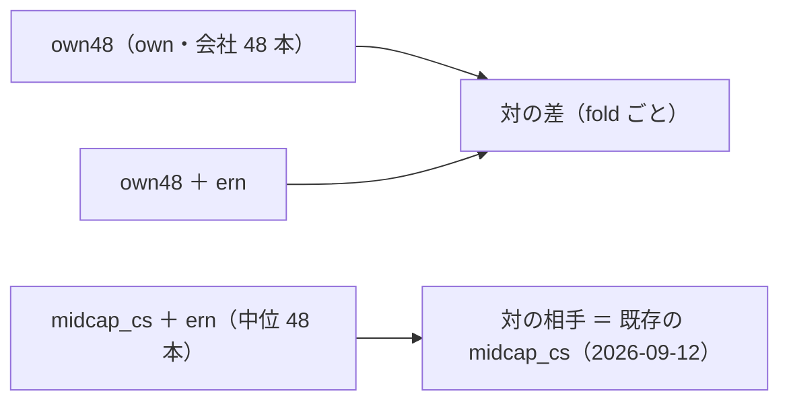

# 決算の層 `ern_`（SEC EDGAR）を既にある表に足す — 段 1（机上）

2026-10-19（月）titan。利用者の指示「推す案で進めて」（[プラン earnings-smallcap.md](../../plans/earnings-smallcap.md) §5 の E1・E3〜E6 ＝ 推す案。⚠ E2〔EDGAR の User-Agent の連絡先〕は利用者が決める ＝ 環境変数 `AIL_EDGAR_CONTACT`）。規約は [rules.md 26 章](feature-discovery/rules.md)。
⚠ **これは投資助言ではなく調査資料である。** ⚠ 数字は【実測】（自前の机上の検証）。⚠ **この結果で実売買の人を替えない**。

## 0. 回す前に決めたこと（⚠ この節は結果を見る前に書いた）

> この図の主張: 変わるのは「表に `ern_` の 3 列が足される」ことだけで、モデル・θ・fold・判定は今までどおり。対の相手は同じ会社 48 本の `own` だけの行。



| 項目 | 中身 |
| --- | --- |
| 取得 | `cli.fetch --exog earnings_daily`（取得元 `edgar`。us63 ＋ midcap48 の会社 48 ＋ 48 本）。提出日つきの 3 系列 ／ 銘柄（rules.md 26-2） |
| 層 | `ern_days_since_ann` ／ `ern_eps_yoy` ／ `ern_rev_yoy`。as-of ＝ 足の日 − 1 日（提出日の翌日から）・400 日より古い値は欠損（26-4） |
| config | `ern_own48`・`ern_own48_ern`・`ern_midcap_ern`（θ 50 ／ 55 ／ 60・Ridge・全部使う ／ 乱択・`walk_forward_dates` 5 fold・パージ）。queue `earnings1`（本番 3 ＋ leak 3） |
| 数 | **＋9（921 → 930）** |
| 比べ方 | `ern_own48_ern` − `ern_own48` の fold 対（同じ表・同じ切れ目）／ `ern_midcap_ern` − `midcap_cs`（既存の実行。切れ目が同じことを確かめる）。判定は対 B&H のまま |
| 机上の違い | EDGAR の提出日は暦日 ＝ 休日の提出は次の営業日の足から効く。発表の「時刻」（引け後 ／ 寄り前）は使わない（翌日からに揃える ＝ 保守的） |

先に書く見立て【推測】（rules.md 26-7）: ① 3 本とも採る 0 ② ern の有無の対の差は |t| < 2 ③ 系列の無い会社が数社出る（tag が違う・XBRL が無い）＝ 記録に残す ④ leak は own の `LEAK` 列で跳ねる（ern は変わらない）。

```bash
cd experiments/feature-discovery
AIL_EDGAR_CONTACT="<名前> <メール>" .venv/bin/python -m cli.fetch --exog earnings_daily     # 取得（会社 96 本・約 300 回の要求 ＝ 2〜3 分【推測】）
.venv/bin/python -m cli.queue --config earnings1                                            # 本番 3 ＋ leak 3
.venv/bin/python -m cli.report --catalog > ../../docs/specs/experiments/feature-discovery/ledger.md
```
