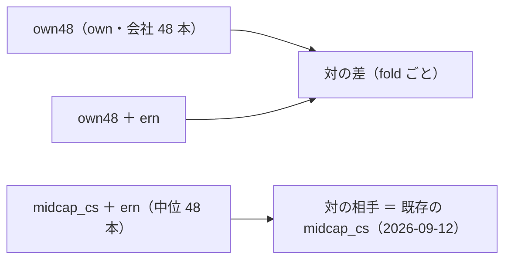
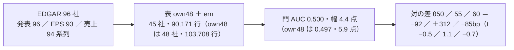

# 決算の層 `ern_`（SEC EDGAR）を既にある表に足す — 段 1（机上）

2026-10-19（月）titan。利用者の指示「推す案で進めて」（[プラン earnings-smallcap.md](../../plans/archive/earnings-smallcap.md) §5 の E1・E3〜E6 ＝ 推す案。⚠ E2〔EDGAR の User-Agent の連絡先〕は利用者が決める ＝ 環境変数 `AIL_EDGAR_CONTACT`）。規約は [rules.md 26 章](feature-discovery/rules.md)。
⚠ **これは投資助言ではなく調査資料である。** ⚠ 数字は【実測】（自前の机上の検証）。⚠ **この結果で実売買の人を替えない**。

## 0. 回す前に決めたこと（⚠ この節は結果を見る前に書いた）

> この図の主張: 変わるのは「表に `ern_` の 3 列が足される」ことだけで、モデル・θ・fold・判定は今までどおり。対の相手は同じ会社 48 本の `own` だけの行。



| 項目 | 中身 |
| --- | --- |
| 取得 | `cli.fetch --exog earnings_daily`（取得元 `edgar`。us63 ＋ midcap48 の会社 48 ＋ 48 本）。提出日つきの 3 系列 ／ 銘柄（rules.md 26-2） |
| 層 | `ern_days_since_ann` ／ `ern_eps_yoy` ／ `ern_rev_yoy`。as-of ＝ 足の日 − 1 日（提出日の翌日から）・400 日より古い値は欠損（26-4） |
| config | `ern_own48`・`ern_own48_ern`・`ern_midcap_ern`（θ 50 ／ 55 ／ 60・Ridge・全部使う ／ 乱択・`walk_forward_dates` 5 fold・パージ）。queue `earnings1`（本番 3 ＋ leak 3） |
| 数 | **＋9（921 → 930）** |
| 比べ方 | `ern_own48_ern` − `ern_own48` の fold 対（同じ表・同じ切れ目）／ `ern_midcap_ern` − `midcap_cs`（既存の実行。切れ目が同じことを確かめる）。判定は対 B&H のまま |
| 机上の違い | EDGAR の提出日は暦日 ＝ 休日の提出は次の営業日の足から効く。発表の「時刻」（引け後 ／ 寄り前）は使わない（翌日からに揃える ＝ 保守的） |

先に書く見立て【推測】（rules.md 26-7）: ① 3 本とも採る 0 ② ern の有無の対の差は |t| < 2 ③ 系列の無い会社が数社出る（tag が違う・XBRL が無い）＝ 記録に残す ④ leak は own の `LEAK` 列で跳ねる（ern は変わらない）。

⚠ **回す前の改め（2026-10-19 22:10 PDT・取得の直後・成績を見る前）**: 1 回目の取得で、売上の tag を「順で最初にあるもの」にすると `Revenues` が 2018 年より前の行しか持たない会社の売上が落ちた（0 行 13 社・15 行以下 23 社 ＝ 96 社の 1/3）。規約 26-3 を「同じ tag のうち start 以降に提出された行が最も多いもの」に改めて取り直した（tag の集合・列・ずらし幅・対象は変えていない。1 回目の取得で作った表・実行は無い ＝ queue は表が無くて 1 本も回る前に止まっていた）。

```bash
cd experiments/feature-discovery
AIL_EDGAR_CONTACT="<名前> <メール>" .venv/bin/python -m cli.fetch --exog earnings_daily     # 取得（会社 96 本・約 300 回の要求 ＝ 2〜3 分【推測】）
.venv/bin/python -m cli.queue --config earnings1                                            # 本番 3 ＋ leak 3
.venv/bin/python -m cli.report --catalog > ../../docs/specs/experiments/feature-discovery/ledger.md
```

## 1. 一言で（2026-10-19（月）22:14〜22:15 PDT・titan。取得 22:01〜22:05 と 22:08〜22:13【実測】）

**採る 0 ／ 保留 1 ／ 落とす 8（n_trials 921 → 930）。決算の 3 列を足しても Ridge の買い% はほとんど動かず、ern の有無の対の差は 6 対とも |t| ≤ 1.1。** 3 本とも門前（holdout AUC 0.497 ／ 0.500 ／ 0.523・買い% 幅 4.4〜5.9 点 ＝ 回したうえで数える。rules.md 14-5）。leak 対照は 3 本とも跳ねた（AUC 1.000・上乗せ ＋23,941〜＋24,356bp・t 19〜21）。見立て ①②④ はそのとおり・③（系列の無い会社）は 5 社 ＋ 登録者の替わった 2 社。

> この図の主張: 決算の列は表に入ったが（取得 → 層 → 表は配線どおり）、買い% を決めているのは相場の局面のままで、fold 3（2022-05〜2023-10）は ern の有無にかかわらず 1 日も持たない。



## 2. 結果【実測】

### 2-1. 取得（`cli.fetch --exog earnings_daily`）

| 項目 | 値 |
| --- | --- |
| 会社 | 96（us63 の 48 ＋ midcap48 の 48）。CIK が引けない銘柄 0 |
| 系列 | 283 本 ＝ 発表 `ANN_` 96 ／ EPS `EPSYOY_` 93 ／ 売上 `REVYOY_` 94。中央値は 発表 35〜36 件・EPS 35 行・売上 33 行（2018 年からの四半期 ≈ 35） |
| 系列の無い会社 | EPS: **BRK/B・V・ARES**（us-gaap に `EarningsPerShare*` の `USD/shares` が無い。V は `Antidilutive…` だけ）／ 売上: **GS・APA**（4 つの tag のどれも無い）＝ 26-4 の規約どおり表から落ちる（own48 48 → **45 社**・midcap 48 → **46 社**） |
| 登録者が替わった会社 | **XOM**（2026-07-01 に持株会社化 ＝ CIK 2115436。発表 1 件・EPS 1 行・売上 1 行 ＝ 2026-08 以降しか無く、表では fold 5 の尻だけ）／ **BG**（2023 年に本籍を移した ＝ 発表 11・EPS 10・売上 10）。`company_tickers.json` は 1 ティッカー 1 CIK ＝ 前の登録者の提出は引かない |
| 行が少ない会社 | JPM 売上 9（銀行の売上の tag は 4 つの外）・APO EPS 18・DIS 発表 30・APA 発表 27 |
| tag | EPS は `EarningsPerShareDiluted` 90 社 ／ `…Basic` 3 社。売上は `Revenues` 48 ／ `RevenueFromContractWithCustomerExcludingAssessedTax` 40 ／ `…IncludingAssessedTax` 6（AEE・AKAM・ARE・AWK・BALL・BBY）。⚠ 1 回目の取得（「順で最初にあるもの」）では売上 0 行 13 社・15 行以下 23 社 → §0 の改め（回す前）で 0 行 3 社・15 行以下 3 社 |
| 時間 | 1 社 約 3 秒（要求 3〜5 回 × 0.25 秒 ＋ companyfacts の JSON が数 MB）＝ 96 社で **4〜5 分**（2 回とも）。表 6 枚 ＝ 並列で 70 秒・queue 6 本 ＝ 78 秒（1 本 11〜15 秒） |

### 2-2. 3 本の行（全部使う × Ridge。判定は対 B&H ＝ rules.md 13-7）

| config（表） | θ | 純利 bp/fold | 上乗せ（対 B&H） | t | fold 符号 | 保有日率 | 対 乱択ゲート | 判定 |
| --- | ---: | ---: | ---: | ---: | --- | ---: | ---: | --- |
| `ern_own48`（own・48 社・103,708 行） | 50 | ＋1,503 | −216 | −0.88 | −＋−−＋ | 0.72 | ＋63 | 落とす |
| | 55 | ＋1,040 | −679 | −1.78 | −−−−− | 0.55 | −11 | 落とす |
| | 60 | ＋712 | −1,008 | −2.44 | ＋−−−− | 0.29 | −52 | 落とす |
| `ern_own48_ern`（own ＋ ern・45 社・90,171 行） | 50 | ＋1,412 | −301 | −1.38 | −＋−−− | 0.71 | ＋8 | 落とす |
| | 55 | ＋1,352 | −360 | −1.90 | −＋−−− | 0.60 | ＋45 | 落とす |
| | 60 | ＋627 | −1,086 | −2.43 | ＋−−−− | 0.28 | −67 | 落とす |
| `ern_midcap_ern`（own ＋ cs ＋ ll ＋ ern・46 社・85,308 行） | 50 | ＋1,388 | **＋280** | 0.94 | ＋＋−0− | 0.60 | ＋657（t 1.85） | **保留**（平均だけ正・符号が割れる） |
| | 55 | ＋807 | −301 | −0.61 | ＋＋−−− | 0.24 | ＋278 | 落とす |
| | 60 | ＋661 | −448 | −1.26 | −＋−−− | 0.22 | ＋206 | 落とす |
| （対の相手）`midcap_cs`（2026-09-13・48 社・96,912 行） | 50 | ＋1,338 | ＋149 | 0.58 | ＋＋−＋− | 0.64 | ＋419（t 1.17） | 保留（既存） |
| | 55 | ＋870 | −319 | −1.31 | ＋＋−−− | 0.50 | ＋99 | 落とす（既存） |
| | 60 | ＋144 | −1,045 | −2.82 | −−−−− | 0.25 | −196 | 落とす（既存） |

fold の期間（評価期間。own48 と own48 ＋ ern は同じ切れ目 ＝ 検証日数 360 ／ 361 ／ 359 ／ 360 ／ 361 が一致・midcap の 2 本も 342 ／ 343 ／ 341 ／ 342 ／ 343 で一致）:

| fold | own48 の 2 本 | midcap の 2 本 |
| ---: | --- | --- |
| 1 | 2019-07-09 〜 2020-12-08 | 2019-11-05 〜 2021-03-16 |
| 2 | 2020-12-09 〜 2022-05-16 | 2021-03-17 〜 2022-07-26 |
| 3 | 2022-05-17 〜 2023-10-19 | 2022-07-27 〜 2023-12-13 |
| 4 | 2023-10-20 〜 2025-03-28 | 2023-12-14 〜 2025-04-28 |
| 5 | 2025-03-31 〜 2026-09-04 | 2025-04-29 〜 2026-09-09 |

### 2-3. ern の有無の対の差（後 − 前・fold 対・全部使う × Ridge）

| 対 | θ | 差 mean bp/fold | t | 正の fold | fold ごと | 共通の銘柄だけ（読み方の補助） |
| --- | ---: | ---: | ---: | ---: | --- | --- |
| `ern_own48_ern` − `ern_own48` | 50 | −92 | −0.49 | 1/5 | ＋534 −601 −15 −274 −103 | 45 社: −100（t −0.6） |
| | 55 | ＋312 | 1.10 | 2/5 | ＋629 −84 0 −259 ＋1,274 | ＋326（t 1.3） |
| | 60 | −85 | −0.66 | 1/5 | ＋308 −324 0 −409 0 | −119（t −1.0） |
| `ern_midcap_ern` − `midcap_cs` | 50 | ＋51 | 0.58 | 4/5 | ＋222 ＋215 −261 ＋32 ＋45 | 46 社: ＋3（t 0.0） |
| | 55 | −62 | −0.18 | 3/5 | ＋930 ＋71 ＋120 −235 −1,198 | −113（t −0.4） |
| | 60 | ＋517 | 1.09 | 3/5 | ＋56 **＋2,407** ＋120 0 0 | ＋509（t 1.0） |

- 「共通の銘柄だけ」は `per_symbol.csv` の銘柄平均で、落ちた 3 社（BRK/B・GS・V）／ 2 社（APA・ARES）を前の実行からも外して対にしたもの（新しい検証ではない。⚠ 銘柄平均は日ごとの平均と少しずれる ＝ `midcap_cs` の fold 3 で 342bp）。向きも大きさも全銘柄の対と同じ ＝ 差は銘柄の違いではない
- fold ごとの保有日率（θ50）: own48 0.99 ／ 0.93 ／ **0.00** ／ 0.69 ／ 1.00・own48 ＋ ern 1.00 ／ 1.00 ／ **0.00** ／ 0.56 ／ 0.99 ＝ **fold 3 は両方とも 1 日も持たない**（θ55 ／ 60 の fold 3 の差 0 はこれ）。買い% の幅が 4〜6 点しか無く、fold ごとにほぼ定数 ＝ own × Ridge の行と同じ形（[horizon-roles-trader.md §3-1](horizon-roles-trader.md)）
- midcap θ60 の ＋517 は fold 2（2021-03〜2022-07）の ＋2,407 が 1 つで作る（ern の行は保有日率 0.10・`midcap_cs` は 0.00）＝ 1 fold の差。θ50 の 4/5 は 1 fold あたり ＋32〜＋222bp ＝ 日次 σ 50bp 級の中（検出限界の下）
- 乱択（16 列）の対は読まない: 列の数が変わると乱数の引きが変わる（[transform-into-detectors.md](transform-into-detectors.md) と同じ）＝ ＋114 ／ −5 ／ −69（own48）・＋1,215 ／ ＋529 ／ ＋655（midcap）は ern の情報ではない

## 3. 見立てと次【推測】

- **決算の 3 列は、この形（Ridge・翌日 1 日・θ 50〜60）では買い% を動かさない。** 前年同期比は四半期に 1 回しか変わらず（1 年で 4 値）、`ern_days_since_ann` は 0〜90 の鋸の形 ＝ 線形モデルが翌日の方向に結びつけられる形ではない。決算を活かすなら、発表の直後だけを切り出す形（発表後 n 日の印 ＝ E3 の 3 つ目・**未実装**）や非線形の学習器（LightGBM × ern）が候補だが、⚠ **どちらも新しい処置 ＝ 先に登録してから回す**（結果を見てからの追加はしない）
- **保留 1 本（midcap ＋ ern θ50）は既存の `midcap_cs` θ50 と同じ形**（平均だけ正・fold の符号が割れる）で、ern を足した効果ではない（対の差 ＋51・t 0.58）。⚠ この行で段 2 の形を選ばない
- **取得の口は段 2（中小型株）でそのまま使える**（会社の group と CIK があれば動く）。⚠ 小型株は us-gaap の tag が揃わない会社・登録者の替わる会社が大型株より多い【推測】＝ 段 2 では「3 系列そろう会社の割合」を先に測って記録する
- 直すなら新しい処置として登録するもの（⚠ 今回は回していない）: ① 前の登録者の CIK をたどる（XOM・BG）② 銀行の売上の tag（JPM・GS）③ EPS の無い会社（BRK/B・V・ARES）の別の tag ④ 発表後 n 日の印 ⑤ LightGBM × ern
- ⚠ **この結果で実売買の人を替えない・候補の人を作らない**（E6 ＝ 段 3 まで机上と sim。本番は 11/4 の判定の後・利用者）
