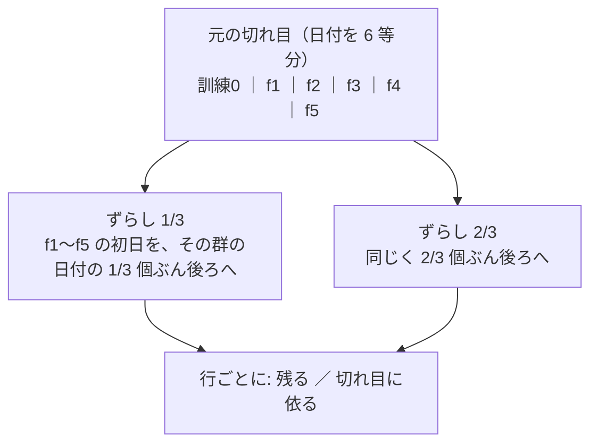
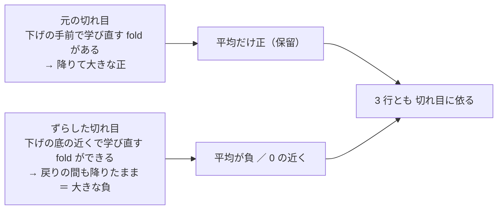

# 評価期間の切れ目をずらして保留の行を測り直す（机上）

2026-11-11。開発ループの段 1（2026-11-11 01:03 PST・参考なし）が出した案（登録簿 [`20261111-fold-cut-shift`](../../../experiments/feature-discovery/config/ideas/20261111-fold-cut-shift.toml)）を、利用者「気になる」→「推す案で進めて」で回した。規約は [rules.md 33 章](feature-discovery/rules.md)、プランは [fold-cut-shift.md](../../plans/archive/fold-cut-shift.md)。
⚠ **これは投資助言ではなく調査資料である。** ⚠ 数字は【実測】（自前の机上の検証・titan）。⚠ **この結果で元の行の判定・閉じる注記を変えない・候補の人を作らない・本番の人を替えない**（33-4 の 5）。

## 0. 回す前に決めたこと（⚠ rules.md 33 章 ＝ 結果を見る前に書いた。ここは写し）

問い: 保留の行の「平均だけ正」は、5 つの評価期間の切れ目がたまたまどこに置かれたかで決まっているのか。

> この図の主張: 切れ目 1〜5 を後ろへ同じ割合だけずらす。最初の訓練が延び、最後の評価期間が縮む。合図・学習・較正・θ・費用・判定は同じ。

| 項目 | 中身 |
| --- | --- |
| 口 | `[validation] cut_offset = "1/3"` ／ `"2/3"`（`splits.date_edges`）。無い config は切れ目が 1 ビットも変わらない |
| 当てる行 | 2026-11-11 の選ぶ段の上位 3（入れ替えない）: ① F1-7 IC の安定性 ② F2-2 RFE（どちらも `sel_small4_1995` ＝ 1995 年からの表・63 本・Ridge）③ M1 3 本の平均（`trader_mix_t4` ＝ ハルの机上の形・48 本・2018 年からの表）。θ 50 だけ |
| config ／ queue | `cut13_sel_small4_1995`・`cut23_sel_small4_1995`・`cut13_mix_t4`・`cut23_mix_t4` ／ queue `fold_cut_shift`（本番 4 ＋ leak 4） |
| 数 | 当てる 3 行 × 2 ＝ ＋6、＋ 合成のメンバーとして回る持ち主の「全部使う」（`T2` のモデル）× 2 ＝ ＋2（33-2 の着手時の追記・回す前）＝ **＋8** |
| 読み方（33-4） | 残る ＝ ずらした 2 行とも 上乗せの平均が正 かつ 判定が保留以上。1 行でも外れれば「切れ目に依る」。⚠ 残っても採る根拠にしない（同じ日付を切り直しただけ） |
| 対の相手（元の切れ目） | 既存の実行（回し直さない）: `2026-09-12T20-39-38_sel_small4_1995`・`2026-10-02T00-07-32_trader_mix_t4` |

予想【推測】（登録簿の `prediction`・保留以上の確率 0.5）: 6 行のうち保留以上は 1〜3 行 ／ 元の版で正だった fold の多くは、ずらすと隣の fold と混ざって符号が割れる ／ 対の差（元の版 − ずらした版）は 0 の周りで、向きは行ごとにばらばら ／ leak 対照はどの切れ目でも跳ねる。

## 1. 結果【実測 2026-11-11 08:43〜08:46 PST・titan】

**答え: 当てた 3 行は 3 行とも「切れ目に依る」。** ずらした 6 行のうち保留以上は 2 行（① の 1/3・③ の 2/3）で、2 行とも残った行は無い。判定は **採る 0 ／ 保留 2 ／ 落とす 6**（メンバーの 2 行を含む 8 行）・n_trials 1,166 → 1,174。

> この図の主張: 元の行の平均を作っていたのは「下げの時期に降りていた fold」で、切れ目がその時期の前に来るか後に来るかで、同じモデルの成績の符号が入れ替わる。

材料: ずらした版 ＝ `2026-11-11T08-43-17_cut13_mix_t4`・`08-44-13_cut23_mix_t4`・`08-45-13_cut13_sel_small4_1995`・`08-46-01_cut23_sel_small4_1995`（leak は各 `_leak`）。queue 8 本で 3 分 34 秒【実測】。値は対 B&H（同じ切れ目）の上乗せ bp/fold、括弧は保有日率。t は 5 つの fold の平均 ÷ 標準誤差。

### 1-1. fold の日付と日数

| 表 | 版 | f1 の初日 | f2 | f3 | f4 | f5 | 日数（f1〜f5） |
| --- | --- | --- | --- | --- | --- | --- | --- |
| 1995 年から（①②） | 元 | 2000-05-10 | 2005-08-17 | 2010-11-18 | 2016-02-25 | 2021-05-28 | 1,324 ／ 1,324 ／ 1,323 ／ 1,324 ／ 1,324 |
| 〃 | 1/3 | 2002-02-14 | 2007-05-21 | 2012-08-20 | 2017-11-22 | 2023-03-01 | 1,324 ／ 1,324 ／ 1,323 ／ 1,324 ／ **883** |
| 〃 | 2/3 | 2003-11-13 | 2009-02-19 | 2014-05-23 | 2019-08-27 | 2024-11-29 | 1,324 ／ 1,324 ／ 1,323 ／ 1,324 ／ **442** |
| 2018 年から・48 本（③） | 元 | 2019-07-09 | 2020-12-09 | 2022-05-17 | 2023-10-20 | 2025-03-31 | 360 ／ 361 ／ 359 ／ 360 ／ 361 |
| 〃 | 1/3 | 2019-12-27 | 2021-06-03 | 2022-11-04 | 2024-04-15 | 2025-09-22 | 360 ／ 360 ／ 360 ／ 360 ／ **241** |
| 〃 | 2/3 | 2020-06-19 | 2021-11-22 | 2023-05-01 | 2024-10-04 | 2026-03-16 | 360 ／ 360 ／ 360 ／ 360 ／ **121** |

⚠ 最後の評価期間は短い（33-1 の 2）。2/3 ずらしの f5 は 442 日 ／ 121 日で、3 行ともほぼ持ち続けただけ（上乗せ 0.0〜＋0.3）＝ その fold の符号は情報にならない。

### 1-2. 行ごとの上乗せ（対 B&H・bp/fold）

| 行 | 版 | f1 | f2 | f3 | f4 | f5 | 平均 | 符号 | t | 判定 |
| --- | --- | ---: | ---: | ---: | ---: | ---: | ---: | --- | ---: | --- |
| ① F1-7 | 元 | ＋3,589（27%） | ＋4,727（72%） | −758（79%） | −3,987（86%） | ＋71（100%） | **＋728.5** | 3/5 ＋＋−−＋ | 0.47 | 保留 |
| 〃 | 1/3 | −800（41%） | ＋3,783（86%） | −595（93%） | ＋61（100%） | −652（94%） | ＋359.3 | 2/5 −＋−＋− | 0.41 | 保留 |
| 〃 | 2/3 | ＋577（99%） | **−7,065（14%）** | ＋3（100%） | ＋17（100%） | ＋0（100%） | **−1,293.4** | 3/5 ＋−＋＋0 | −0.89 | 落とす |
| ② F2-2 | 元 | ＋2,641（20%） | ＋2,590（67%） | −841（80%） | −1,555（98%） | ＋55（99%） | **＋578.1** | 3/5 ＋＋−−＋ | 0.66 | 保留 |
| 〃 | 1/3 | −196（39%） | ＋1,918（80%） | −177（97%） | ＋60（100%） | −2,056（81%） | −90.1 | 2/5 −＋−＋− | −0.14 | 落とす |
| 〃 | 2/3 | ＋508（98%） | **−7,421（8%）** | ＋55（100%） | ＋17（100%） | ＋0（100%） | **−1,368.3** | 4/5 ＋−＋＋＋ | −0.90 | 落とす |
| ③ M1 3 本の平均 | 元 | −43（100%） | ＋443（98%） | −338（0%） | ＋204（84%） | ＋348（100%） | **＋122.8** | 3/5 −＋−＋＋ | 0.87 | 保留 |
| 〃 | 1/3 | −21（100%） | −1,404（90%） | **−2,518（0%）** | −304（100%） | −184（99%） | **−886.3** | 0/5 −−−−− | −1.87 | 落とす |
| 〃 | 2/3 | ＋3（100%） | ＋148（93%） | −10（100%） | −7（100%） | 0（100%） | ＋26.9 | 2/5 ＋＋−−0 | 0.89 | 保留 |

| 行 | 残る ／ 切れ目に依る（33-4 の 2） | 外れた版 |
| --- | --- | --- |
| ① F1-7 | **切れ目に依る** | 2/3（平均 −1,293・落とす） |
| ② F2-2 | **切れ目に依る** | 1/3（−90・落とす）と 2/3（−1,368・落とす） |
| ③ M1 3 本の平均 | **切れ目に依る** | 1/3（−886・0/5・落とす） |

⚠ ① と ② は同じ表・同じ実験で、fold ごとの動きもほぼ同じ（33-2）＝ 独立の 2 票ではない。実質は「1995 年からの表の選別 × Ridge」と「ハルの形」の 2 つ。

合成のメンバーとして回った 2 行（問いの対象ではない・33-2 の追記）: 持ち主の「全部使う」（`T2` のモデル）は 元 −65.0（2/5・落とす）→ 1/3 **−921.4**（1/5・落とす）／ 2/3 −94.7（1/5・落とす）。③ と同じ fold（1/3 の f2 −1,495・f3 −2,909）で崩れている ＝ ③ の 1/3 の崩れはこのメンバーが運んだ。

### 1-3. 元の行の平均を作っていた時期が、ずらすとどう割れたか（33-4 の 3）

- **① ②（1995 年からの表）**: 元の平均は f1（2000-05〜2005-08）と f2（2005-08〜2010-11）の 2 つが作っていた（① ＋3,589 ／ ＋4,727）。どちらも下げ（2000〜2002 年・2008 年）を含み、モデルは保有日率 20〜72% で降りていた。
  - 1/3 ずらし: 2000〜2002 年の下げの大半が訓練の側に移り、f1（2002-02〜2007-05）は戻りの時期になった。モデルは保有 4 割で、持ち続ける（＋4,666）に負けた（−800 ／ −196）。2008 年の下げは f2（2007-05〜2012-08）に入ったままで、正が残った（＋3,783 ／ ＋1,918）。
  - 2/3 ずらし: f2 の初日が 2009-02-19 ＝ 下げの底の近くになった。そこまでを学んだモデルは 5 年あまりの fold の間ほとんど降りたまま（保有 14% ／ 8%）で、戻り（持ち続ける ＋10,219）を取り逃がした（**−7,065 ／ −7,421**）。この 1 つの fold で平均が負になった。
  - 2/3 ずらしでは f3〜f5（2014-05 より後）がほぼ持ち続けるだけ（保有 100%・上乗せ 0〜＋55）で、差が付いたのは f2 だけである。元の版と 1/3 ずらしでは 2010 年より後にも負の fold がある（元の f4 ＝ 2016-02〜2021-05 が −3,987 ／ −1,555・1/3 の f5 ＝ 2023-03〜 が −652 ／ −2,056）。
- **③（ハルの形）**: 元の版は f3（2022-05〜2023-10）で 1 日も持たず（−338。持ち続ける ＋338 の横ばいの時期）、f2・f4・f5 の小さな正で平均が正だった。
  - 1/3 ずらし: f3 の初日が 2022-11-04 ＝ 2022 年の下げの底の近くになった。モデルは 2024-04 までほぼ降りたまま（保有 0.05%）で、戻り（持ち続ける ＋2,533）を取り逃がした（**−2,518**）。f2（2021-06〜2022-11）は下げの間に 1,463 回売買して −1,404。
  - 2/3 ずらし: 5 つの fold とも保有 93〜100% ＝ ほぼ持ち続けるだけで、上乗せは ±150 以内。保留（＋26.9）は「持ち続けるとほぼ同じ」の意味で、f2 の ＋148 の 1 つが作っている。

### 1-4. 診断: 同じ日の対の差（33-4 の 4・採否に使わない）

元の版とずらした版の両方で評価期間に入る日（ずらした f1 の初日より後の全部）の、日次の純利の差（元 − ずらし）。

| 行 | ずらし | 日数 | 差の平均（bp/日） | t | 差の合計（bp） | 値が違う日 |
| --- | --- | ---: | ---: | ---: | ---: | ---: |
| ① F1-7 | 1/3 | 6,178 | −0.277 | −0.75 | −1,711 | 93% |
| 〃 | 2/3 | 5,737 | ＋0.997 | ＋1.55 | ＋5,722 | 83% |
| ② F2-2 | 1/3 | 6,178 | ＋0.050 | ＋0.15 | ＋309 | 89% |
| 〃 | 2/3 | 5,737 | ＋0.993 | ＋1.56 | ＋5,694 | 78% |
| ③ M1 3 本の平均 | 1/3 | 1,681 | **＋3.002** | **＋2.74** | ＋5,046 | 49% |
| 〃 | 2/3 | 1,561 | ＋0.335 | ＋0.24 | ＋523 | 61% |

- 同じ日の B&H の差は合計 ＋2.5bp ／ ＋0.5bp（fold の境目で払う費用の日が違うだけ）＝ 基準線は切れ目に依らない。差は全部モデルの側から来ている。
- ⚠ この差は「同じ日を、違う時点まで学んだモデルが売買した差」である。机上のモデルは fold の初日に 1 度だけ学び、その fold の間（1995 年からの表で約 5 年・48 本の表で約 1 年半）学び直さない。本番は毎日学び直すので、この差の大きさは本番の人には当てはまらない。
- ⚠ t は日次の系列の単純な t（日の間の相関を割り引いていない）＝ 大きめに出る。

## 2. 予想との突き合わせ

| 予想（回す前） | 結果 |
| --- | --- |
| 6 行のうち保留以上は 1〜3 行 | ✅ 2 行（① の 1/3・③ の 2/3）。登録簿の当たり方 ＝ 確率 0.50 → 保留以上あり |
| 元の版で正だった fold の多くは、ずらすと符号が割れる | ✅ ① ② の f1 ・ f2（正）は、1/3 で f1 が負・2/3 で f2 が大きく負。③ は 1/3 で 5 つとも負 |
| 対の差は 0 の周りで、向きは行ごとにばらばら | ❌ 6 対のうち 5 対が正（元の版が上）・③ の 1/3 は t ＋2.74。⚠ 当てる行を「元の切れ目で上位だった 3 行」から取ったので、切り直すと下がる向きに偏るのは選んだ後の戻りと読める【推測】（① ② は同じ表なので実質 3〜4 対） |
| leak 対照はどの切れ目でも跳ねる | ✅ 4 実行の 8 行とも 5/5 ＋・上乗せ ＋19,845〜＋72,242bp/fold |

## 3. 読み方と、この結果でやらないこと

1. **3 行の「平均だけ正」は、切れ目の置き方が作っていた。** 平均を作っていたのは下げの時期に降りていた 1〜2 個の fold で、切れ目がその時期の底の近くに来ると、同じモデルが戻りの間も降りたままになり、符号が入れ替わる。保留の閉じる注記（「上乗せは下げ相場で降りるから来て、上げ相場では持ち続けるに負ける」）と同じ中身を、別の角度から確かめた形である。
2. ⚠ **「切れ目に依る」は「モデルが悪い」の証明ではない。** 机上は fold の初日に 1 度だけ学ぶ形で、切れ目に依るのは半分はその形の性質である（§1-4）。分かったのは「いまの 5 fold の平均と符号は、この 3 行については切れ目 1 通りぶんの運を含む」こと。
3. ⚠ ずらした行は新しい期間の証拠ではない（元の fold と 2/3 ／ 1/3 重なる）。① の 1/3・③ の 2/3 の保留も採る根拠にしない。
4. ⚠ **やらないこと**（33-4 の 5）: 元の行の判定・閉じる注記を変えない ／ 候補の人を作らない・本番の人（ハルを含む）を替えない ／ 結果を見てからほかの行・ほかの量（1/2・前向きなど）に広げない ／ 選ぶ段の物差し（howto §3-1）は変えていない。
5. ✅ **選ぶ段への併記（2026-11-11 利用者「推す案で進めて」・rules.md 33-6）**: 登録簿の `learn_if_null` どおり「選ぶ段の物差しに足すか」を利用者に出し、推す案で決まった。
   - 物差し（門）にはしない。物差し（howto §3-1 の 6 つ）・順位・上位 3・判定は変えない。
   - 併記の列「切れ目ずらし」に「残る ／ 切れ目に依る ／ —」を出す（`cli.select_candidates`・開発ループの日誌）。いまの上位 3 は 3 行とも「切れ目に依る」と出る。
   - 回すのは新しく上位に入った行だけ。段 4 が `dev_cut13_*` ／ `dev_cut23_*` を書き、次の晩の queue に 20 章の机上と一緒に足す。
   - 代償: 新顔 1 行につき n_trials ＋2（合成の行はこの実行の中のメンバーのぶんも増える）。止めるには `config/devloop.toml` の `[select] cut_new = false`。
   - 理由: 3 行とも切れ目に依ったので保留の行を読む材料としては効くが、確かめたのは実質 2 つの表だけで、門にするほどの根拠は無い。

## 4. 実装の場所

| もの | 場所 |
| --- | --- |
| 口 | `experiments/feature-discovery/ail/validation/splits.py`（`CUT_OFFSETS`・`cut_offset(v)`・`date_edges(ts, n_folds, offset)`） |
| 呼び手 | `cli/run.py`（本体・`_mix_prepare` ＝ メンバーは持ち主のずらしで切る）・`ail/validation/gate.py`・`cli/calibdiag.py`・`cli/null_shuffle.py`・`cli/planted_power.py` |
| 識別項目 | `ail/catalog.py`（`threshold_style` ＝ `閾値売買（切れ目ずらし1/3）`）・`ail/names.py` ＋ `config/names.toml` の `[cut]`（`~cut1of3` ／ `~cut2of3`） |
| 選ぶ段の併記（33-6） | `cli/select_candidates.py`（`cut_check`）・`cli/cut_shift.py`（config を機械で書く）・`cli/devloop.py`（`select_stage`・`plan_queue`）・`tests/test_cut_shift.py` |
| テスト | `tests/test_cut_offset.py`（27 本: 無ければ同じ切れ目 ／ ずらす量 ／ 拒む値 ／ 門と本体が同じ切れ目 ／ 合わせる口 ／ 変種と名前 ／ config 4 本が元の写し） |
| 確かめ | 回す前に検証結果一覧を吐き直して差は生成日の 1 行だけ ／ 回した後の差は頭の合計 5 行の書き換えと新しい行だけ（既存の行は 1 行も変わらない）／ 研究側 pytest 850 本 ✅（既定経路の指紋 `test_trading_run.py`・`test_predict.py` を含む） |

⚠ 新しい保留 2 行（① の 1/3・③ の 2/3）は閉じる注記なし ＝ 次の月 1 回の棚卸しに出る。
