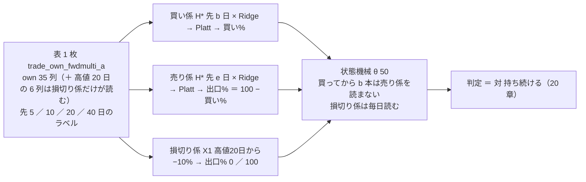

# 先の期間が違う「買い係 ／ 売り係 ／ 損切り係」を 1 人に持たせる（机上の検証）

作成日: 2026-10-18（§0 は**回す前**に書いた。§1 以降は回した後）。派生元: TODO「新しいトレーダーを作成する」・[プラン trader-model-roles.md](../../plans/trader-model-roles.md)。
利用者の決定（2026-10-18）: **「モデルは特定の期間を保有した場合に買いと判断するモデルと、それとは別の期間で売りと判断するモデルと、損切りモデル。期間を別々にすることが大切です」**「複数パターンを作ってシミュレートする。何日にするかは任せる」・最短保有 ＝ 買い係の期間 ／ 入力は T1 と同じ own 35 列 × Ridge ／ 机上で 3 係の形を先に回す（「A」）・「推す案でいく」。
規約: [rules.md 25 章](feature-discovery/rules.md)（2026-10-18 に足した）・13・14・20 章。関連: [forward10-target.md](forward10-target.md)（先 10 日の単体）／ [stoploss-as-model.md](stoploss-as-model.md)（損切り係 X1）／ [trader-shaped-validation.md](trader-shaped-validation.md)（トレーダーの形の机上）。

> ⚠ **これは投資助言ではなく調査資料である。** 特定の銘柄・売買を推奨しない。
> ⚠ **資金は動かしていない**（2026-08-27 の方針）。取得済みの日足（研究用の `data/`）だけを使った。
> ⚠ **数字はすべて【実測】**（自前の検証で出したもの）。良い数字は根拠「中」が上限（rules.md 11 章 規約 3）。

## 0. 事前固定（⚠ 回す前に書いた。2026-10-18）

### 0-1. 問いと、いまあるもの

| 問い | 回す前の答え |
| --- | --- |
| 買う判断と売る判断で見る先の期間を分けた人は、持ち続けるより良いか | ⚠ **測っていない。** いまの 3 人も机上の config も、1 本のモデルの買い% を買いにも売りにも使う（出口% ＝ 100 − 買い%）。先の期間を変えた単体は 10 日だけ（forward10-target.md ＝ 採る 0 ／ 保留 2）。買う線と売る線を分けた行（§7）は 18 行とも落とす |
| 買ってから一定の期間は売らない（最短保有）形は | ⚠ **無い。** 机上にあるのは逆向きの「d 日たったら降りる」（基準線 `max_hold_days`）だけ |
| 損切り係は | X1（高値 20 日から −10%）が本番の器（`trade_own_stopexit_a`）にある。机上では主モデルとの対 L1 で 33 検証とも落とす |

### 0-2. 試す形（構造だけ。数値は期間の組と損切りの水準だけを事前固定 ＝ rules.md 14-9）

> この図の主張: 変えるのは「どの係がどの期間を学ぶか」と「売り係をいつから読むか」だけ。表・学習器・較正・θ・シミュレータ・判定は 3 人と同じ物差し。



| 決めごと | 中身 | 根拠 |
| --- | --- | --- |
| 動かす軸 | 係ごとの**先の期間**（と最短保有 ＝ 買い係の期間）。表は own 35 列・学習器 Ridge・較正 Platt・θ 50 ＝ T1 と同じ | 軸を 2 つ同時に動かさない |
| 期間の組 (b, e) | **(10, 5)・(20, 5)・(40, 10)・(5, 20)〔対照〕**。最短保有 d ＝ b | プラン §2（利用者「何日にするかは任せる」。5 ／ 10 ／ 20 ／ 40 ＝ 1 週 ／ 2 週 ／ 1 か月 ／ 2 か月） |
| 損切り係 | X1 −10%（水準は 1 つ。stoploss-as-model.md の L1 のまん中・本番の `T5` と同じ） | 水準を動かさない（14-9） |
| 損益の対象 | 1 日の `y` のまま（13-4） | 15-3 |
| 判定 | 20-3（対「持ち続ける」。2a 5 本・$600 ／ 2b 全銘柄を買える予算） | 25-2 の 7 |

### 0-3. 数と名前（⚠ 回すと決めたのは結果を見る前 ＝ 14-10 規約 3）

| Phase | 実験 config | 行 | 数 |
| --- | --- | --- | ---: |
| 1 | `trade_own_fwdmulti_a`（表の持ち主） | `H1〜H4 先W日ゲート（全列・学習）` × θ 50 ／ 55 ／ 60 ＝ 12（⚠ H1 は own ＋ trend の層 ＝ 既存の own 表の行とは別の識別項目）・`X1 出口だけ 高値20日から−10%で降りる` × θ 3 ＝ 3 | **＋15** |
| 2 | `trader_roles_t7`〜`t10`（`features_from` で同じ表） | `R1〜R4 …` θ 50 の素の行 4 ＋ `〔トレーダー・5本・$600〕`・`〔トレーダー・全銘柄・全部を買える予算〕` × 4 ＝ 8 | **＋12** |
| 合計 | | | **＋27（n_trials 840 → 867）** |
| 2b（✅ 2026-10-18 に登録。⚠ 結果を見てから足した処置 ＝ §5） | `trader_roles_t7b`〜`t10b`（同じ表・同じ組・`stop_blocks_buy = true`） | `R1b〜R4b …（買いも止める）` θ 50 の素の行 4 ＋ 条件 2 × 4 ＝ 8 | **＋12（867 → 879）** |
| 2c（✅ 2026-10-18 に登録 ＝ §6。別のモデル） | `trade_own_fwdpick_a`（H5 単体・θ 3）＋ `trader_roles_t11`（H5 ＋ X1 の合成 R5・θ 50） | `H5 …` × θ 3 ＝ 3 ＋ `R5 …` の素の行 1 ＋ 条件 2 ＝ 3 | **＋6（879 → 885）** |

予測モデル名: `own-trend.h2-gate5.ridge.shared@50` など（層は own ＋ trend ＝ `own-trend`【推測。吐き直して確かめる】）／ 合成 `own-trend.roles-b20-e5.ridge.shared@50`・トレーダーの形は `-tr5` ／ `-trall`。

### 0-4. 回すもの（コマンド。⚠ Phase 1 → 2 の順。手間の小さい順 ＝ 14-10 規約 4）

```bash
cd experiments/feature-discovery
.venv/bin/python -m cli.build --experiment trade_own_fwdmulti_a          # 表（34 秒【実測 2026-10-18】）
.venv/bin/python -m cli.build --experiment trade_own_fwdmulti_a --leak   # leak 対照の表（35 秒【実測】）
.venv/bin/python -m cli.queue --config horizon_roles1                    # Phase 1: 本番 1 ＋ leak 1
.venv/bin/python -m cli.queue --config horizon_roles2                    # Phase 2: 本番 4 ＋ leak 4（25-2 のコードを足してから）
.venv/bin/python -m cli.report --catalog > ../../docs/specs/experiments/feature-discovery/ledger.md
```

### 0-5. 先に書く見立て（⚠ 結果を見る前）

| # | 見立て【推測】 | 理由 |
| ---: | --- | --- |
| 1 | 単体 H1〜H4 は 12 行とも採る 0。門前（AUC < 0.52）が多い | 先 10 日の 6 本が AUC 0.487〜0.510（forward10-target.md §2-4）。期間を変えても見る数字は同じ |
| 2 | X1 単体（持ち続ける ＋ 損切り）は 3 行とも「持ち続ける」を下回る（落とす） | stoploss-as-model.md: 損切りは下げを避けたぶんより、戻りを取り損ねたぶんが大きかった |
| 3 | 役割つき 4 組は採る 0。2a の上乗せは正が多いが 1 つの fold（下げの時期）から来る | trader-shaped-validation.md §5 と同じ形 |
| 4 | 取引の回数は b が長いほど減る（R3 ＜ R2 ＜ R1）。保有の中央値は d より少し上に張り付く | 作りから決まる（最短保有の中は損切り係しか売らない） |
| 5 | 対照 R4（5 ／ 20）は R1〜R3 より取引が多く上乗せは下回る | 短い先で買い、長い先が弱いときしか降りない ＝ 下げの中で持ち続けやすい |
| 6 | leak 対照は全部跳ねる | `LEAK_fwd_W` が買い係・売り係の説明変数に直接入る（25-1 の 2） |

### 0-6. 机上で再現しないもの（記録に残す違い）

毎日の学び直し（机上は fold ごと）・15:50 ET の途中の足で予測すること・気配と約定の差・実売買の日足（`data-live/`）・損切り係で売った翌日に買い係が買いと言えば翌日買う動き（本番も同じ ＝ 再現する）・⚠ 本番の執行器は営業日を NYSE の暦で数える（机上は表の行 ＝ 営業日なので同じ）。

## 1. 一言で（2026-10-18 に回した。⚠ ここから下は結果を見て書いた）

⚠ **作れた。効かなかった。そして「損切り係が売った翌日に買い係が買い戻す」往復が売買の 6 割を占めた。** 27 検証は **採る 0 ／ 保留 5 ／ 落とす 22**（`n_trials` 840 → **867**【実測】）。
✅ **2026-10-18 Phase 2b（§5）: 「損切り係が出口を言っている日は買い係が買わない」を登録して同じ 4 組を回した ＝ 往復は消えた（保有 1 日 6 割 → 11〜16%）が成績は下がった（R1〜R4 との対の差は 12 対のうち 11 対が負）。12 検証とも落とす（867 → 879）。**

| 問い | 答え |
| --- | --- |
| 買い係・売り係で先の期間を分けた人は、持ち続けるより良いか | ⚠ **言えない。** 4 組の素の行（63 銘柄）と 2b（全銘柄）は 8 行とも落とす（fold 0〜1/5）。2a（5 本・$600）は R1（10 ／ 5）＋69bp・R3（40 ／ 10）＋117bp が保留（fold 3/5・t 0.26 ／ 0.42）、R2・R4 は落とす |
| 期間を分けたことは効いたか | ⚠ **ほとんど見えない。** 4 組とも fold 2・4・5 の数字が**完全に同じ**（2a・素の行とも）＝ その 3 fold では買い係 4 本がどれも毎日「買い」（買い% の幅 4〜7 点・門前）で、売買を決めていたのは損切り係だけ。組の違いが出たのは fold 1・3（下げを含む時期）だけ |
| 売買は減ったか | ⚠ **減っていない。** 保有の中央値は 4 組とも 1〜2 日（最短保有 d ＝ 10 ／ 20 ／ 40 ／ 5 なのに）。取引 6,238 ／ 5,180 ／ 4,442 ／ 7,566 回のうち **保有 1 日が 3,713 ／ 3,220 ／ 2,826 ／ 3,763 回（約 6 割）** ＝ 損切り係（高値 20 日から −10%）が出口を言う日に買い係が買い、翌日 損切り係で売り、翌日また買う往復。§0-6 に「再現する」と書いた動きが主役になった |
| 単体の先 5 ／ 20 ／ 40 日は | 12 行とも採る 0（保留 3 ＝ H2 θ55 ＋119・H4 θ55 ＋93・H4 θ50 ＋77bp/fold。fold 3/5）。門は 4 本とも門前（AUC 0.502〜0.510・幅 7.8〜13.7 点）。fold 2・4・5 は 4 本とも取引 63（＝ 1 銘柄 1 回）・保有日率 1.00 ＝ 「持ち続ける − 費用」 |
| leak 対照は | 単体 4 本・合成 4 組とも跳ねた（＋3,334〜＋12,869bp/fold）。⚠ X1 単体の leak は本番と同じ値（規則なので説明変数を読まない ＝ 跳ねないのが正しい） |

## 2. 結果【実測 2026-10-18 20:55〜21:03 PDT・titan】

### 2-1. 単体（Phase 1。実行 `2026-10-18T20-55-19_trade_own_fwdmulti_a` ／ leak `20-55-34`）

列: 上乗せ ＝ 対 B&H（fold 平均 bp・符号）。純利は fold 別（bp）。保有日率は fold 別。中央値 ＝ 1 取引の保有日数の中央値（営業日）。

| 検知器 | θ | 上乗せ | 符号 | 判定 | 純利 fold 1〜5 | 取引 fold 1〜5 | 保有日率 fold 1〜5 | 中央値 |
| --- | ---: | ---: | --- | --- | --- | --- | --- | ---: |
| H1 先10日 | 50 | −58 | ＋0−00 | 落とす | 2,337 ／ 2,103 ／ −263 ／ 2,334 ／ 1,283 | 80 ／ 63 ／ 1,756 ／ 63 ／ 63 | 1.00 ／ 1.00 ／ 0.52 ／ 1.00 ／ 1.00 | 3 |
| H1 | 55 | −6 | ＋0−00 | 落とす | 2,292 ／ 2,103 ／ 40 ／ 2,334 ／ 1,283 | 68 ／ 63 ／ 249 ／ 63 ／ 63 | 1.00 ／ 1.00 ／ 0.53 ／ 1.00 ／ 1.00 | 321 |
| H1 | 60 | −29 | ＋−＋−− | 落とす | 2,305 ／ 1,844 ／ 553 ／ 2,076 ／ 1,161 | 64 ／ 63 ／ 72 ／ 59 ／ 13 | 1.00 ／ 0.97 ／ 0.43 ／ 0.74 ／ 0.18 | 333 |
| H2 先5日 | 50 | −202 | −−−00 | 落とす | 2,155 ／ 2,033 ／ −731 ／ 2,334 ／ 1,283 | 103 ／ 99 ／ 2,299 ／ 63 ／ 63 | 1.00 ／ 1.00 ／ 0.52 ／ 1.00 ／ 1.00 | 2 |
| H2 | 55 | **＋119** | ＋−＋0＋ | **保留** | 2,277 ／ 1,993 ／ 462 ／ 2,334 ／ 1,611 | 78 ／ 64 ／ 148 ／ 63 ／ 63 | 1.00 ／ 1.00 ／ 0.47 ／ 1.00 ／ 0.96 | 346 |
| H2 | 60 | −1,056 | ＋−＋−− | 落とす | 2,310 ／ 33 ／ 450 ／ 12 ／ 0 | 69 ／ 29 ／ 20 ／ 1 ／ 0 | 1.00 ／ 0.25 ／ 0.11 ／ 0.01 ／ 0.00 | 351 |
| H3 先20日 | 50 | −99 | −−＋00 | 落とす | 1,753 ／ 2,065 ／ 152 ／ 2,334 ／ 1,283 | 677 ／ 83 ／ 1,414 ／ 63 ／ 63 | 0.88 ／ 1.00 ／ 0.29 ／ 1.00 ／ 1.00 | 2 |
| H3 | 55 | −178 | −−−00 | 落とす | 1,398 ／ 2,087 ／ 91 ／ 2,334 ／ 1,283 | 217 ／ 68 ／ 164 ／ 63 ／ 63 | 0.90 ／ 1.00 ／ 0.28 ／ 1.00 ／ 1.00 | 98 |
| H3 | 60 | −206 | −−−0− | 落とす | 1,438 ／ 2,055 ／ 60 ／ 2,334 ／ 1,167 | 139 ／ 66 ／ 48 ／ 63 ／ 63 | 0.92 ／ 0.99 ／ 0.15 ／ 1.00 ／ 0.92 | 294 |
| H4 先40日 | 50 | **＋77** | ＋−＋0− | **保留** | 2,822 ／ 2,072 ／ 149 ／ 2,334 ／ 1,092 | 1,343 ／ 102 ／ 728 ／ 63 ／ 101 | 0.58 ／ 0.99 ／ 0.16 ／ 1.00 ／ 0.99 | 2 |
| H4 | 55 | **＋93** | ＋＋＋0− | **保留** | 2,721 ／ 2,130 ／ 115 ／ 2,334 ／ 1,245 | 325 ／ 69 ／ 65 ／ 63 ／ 66 | 0.56 ／ 0.99 ／ 0.13 ／ 1.00 ／ 0.99 | 49 |
| H4 | 60 | −9 | −−−＋− | 落とす | 2,232 ／ 2,098 ／ 39 ／ 2,391 ／ 1,281 | 143 ／ 64 ／ 10 ／ 63 ／ 63 | 0.48 ／ 0.99 ／ 0.02 ／ 0.99 ／ 0.99 | 349 |
| X1 損切り係 単体 | 50 ／ 55 ／ 60 | −316 | −−−−− | 落とす | 2,130 ／ 1,768 ／ −182 ／ 1,916 ／ 871 | 1,474 ／ 968 ／ 1,865 ／ 839 ／ 1,550 | 0.94 ／ 0.96 ／ 0.92 ／ 0.96 ／ 0.93 | 1 |
| 持ち続ける（B&H） | — | 0 | — | 基準 | 1,617（fold 平均） | — | — | — |

- ⚠ **fold 2・4・5 は H1〜H4 の θ 50 ／ 55 で取引 63・保有日率 1.00** ＝ 63 銘柄を最初の日に買って最後まで持つ ＝ 買い% がその fold で 1 度も θ を割らない（買い% の幅 fold 2 ＝ 4.2〜7.8 点・fold 4 ＝ 4.3〜10.5 点）。純利の差は X1 の有無とパージの差だけ
- ⚠ **H1 の値は forward10-target.md の own 表の H1（θ 50 −398 ／ 55 −254 ／ 60 −1,274bp）と違う**。見る列は同じ 35 本（`fwd_columns = "own"`）だが、表の尻が 40 本短く・パージが 60 日（15 日から）・fold の切れ目が動いた ＝ 層 own ＋ trend の別の識別項目として数えた（25-1 の 4）
- 門（14-5）: 4 本とも門前（H1 AUC 0.502 ／ 幅 7.8 点・H2 0.510 ／ 9.6・H3 0.504 ／ 10.5・H4 0.504 ／ 13.7）。回すと事前に決めて回し、数えた
- X1 単体 ＝ 「持ち続ける ＋ 損切り」: 5 fold とも B&H を下回る（−316bp/fold）。取引 839〜1,865 回 ／ fold・保有の中央値 1 日 ＝ 高値から 10% 下にいる間は毎日 買う → 売る を繰り返す

### 2-2. 役割つき（Phase 2。実行 `2026-10-18T21-01-xx〜21-03-08_trader_roles_t7〜t10`）

列: 上乗せ ＝ 素の行・2b は対 B&H ／ 2a は対「持ち続ける〔同じ条件〕」（`checks.json` の `trader.vs_hold`）。取引 ＝ 5 fold の合計（素の行）。保有 1 日 ＝ そのうち保有日数が 1 日の取引（損切り係の翌日売り）。

| 組 | 買い係 b | 売り係 e | 最短保有 d | 素の行（63 銘柄）上乗せ ／ 符号 ／ 判定 | 2a 5 本・$600 上乗せ ／ 符号 ／ t ／ 判定 | 2b 全銘柄 上乗せ ／ 符号 ／ 判定 | 取引 ／ 保有 1 日 ／ 中央値 ／ 保有 > d |
| --- | ---: | ---: | ---: | --- | --- | --- | --- |
| R1 | 10 | 5 | 10 | −285 ／ −−−−− ／ 落とす | **＋69 ／ ＋−＋−＋ ／ 0.26 ／ 保留** | −250 ／ −−−−− ／ 落とす | 6,238 ／ 3,713 ／ 1 ／ 1,392 |
| R2 | 20 | 5 | 20 | −482 ／ −−−−− ／ 落とす | −39 ／ ＋−＋−＋ ／ −0.20 ／ 落とす | −437 ／ −−−−− ／ 落とす | 5,180 ／ 3,220 ／ 1 ／ 948 |
| R3 | 40 | 10 | 40 | −248 ／ ＋−−−− ／ 落とす | **＋117 ／ ＋−＋−＋ ／ 0.42 ／ 保留** | −232 ／ ＋−−−− ／ 落とす | 4,442 ／ 2,826 ／ 1 ／ 587 |
| R4（対照） | 5 | 20 | 5 | −449 ／ −−−−− ／ 落とす | −0.2 ／ ＋−＋−＋ ／ −0.00 ／ 落とす | −384 ／ −−−−− ／ 落とす | 7,566 ／ 3,763 ／ 2 ／ 1,765 |

2a の fold 別（純利 bp ／ 持ち続けるの純利 bp。⚠ **fold 2・4・5 は 4 組とも同じ**）:

| 組 | fold 1 | fold 2 | fold 3 | fold 4 | fold 5 |
| --- | --- | --- | --- | --- | --- |
| R1 | 380 ／ 132 | 722 ／ 1,308 | −2,117 ／ −2,998 | 697 ／ 1,121 | −306 ／ −531 |
| R2 | 340 ／ 132 | 722 ／ 1,308 | −2,616 ／ −2,998 | 697 ／ 1,121 | −306 ／ −531 |
| R3 | 1,078 ／ 132 | 722 ／ 1,308 | −2,573 ／ −2,998 | 697 ／ 1,121 | −306 ／ −531 |
| R4 | 287 ／ 132 | 722 ／ 1,308 | −2,369 ／ −2,998 | 697 ／ 1,121 | −306 ／ −531 |

- ⚠ **2a の正の fold（1・3・5）は 4 組とも同じ向き**で、fold 3（5 本が 3 割下がった時期）と fold 5 は「持ち続ける」が大きく負けたぶんを損切り係が削った差。買い係・売り係の期間の違いは fold 1（R3 ＋946 対 R1 ＋247）と fold 3 の大きさにだけ出る
- fold 2 は 5 本・$600 で 408 回の合図のうち 350 回が「株価で見送り」（NKE の値段が枠 $120 を超える時期）＝ 実質 4 本 → 持ち続けるに負ける（4 組とも同じ）
- 乱択（20-3 の 3。採否に使わない）: 2a 対 乱択 ＝ R1 ＋124 ／ R2 −62 ／ R3 −149 ／ R4 ＋80bp/fold ＝ 日付の対応を壊しても同じくらい

### 2-3. 配線の検算

- 単体の行（H1〜H4・X1）は 4 組の実行で持ち主の実行と同じ識別項目にまとまった（検証結果一覧に「5 実行」の印・幅 0）
- 合成の行の欠けた行 0（3 係とも同じ表）。`fitted_doc` に `combine: roles`・役割・`min_hold_days`
- leak: 単体 H1 ＋8,707 ／ H2 ＋11,136 ／ H3 ＋6,208 ／ H4 ＋4,712bp・合成 R1 ＋7,627 ／ R2 ＋5,311 ／ R3 ＋3,701 ／ R4 ＋8,576bp（θ 50・素の行）。X1 単体は本番と同じ（規則）
- `n_trials` 840 → 855（Phase 1）→ 867（Phase 2）＝ 事前固定（§0-3）どおり

## 3. 見立ての答え合わせ（§0-5 の 6 つ）

| # | 見立て | 答え |
| ---: | --- | --- |
| 1 | 単体 12 行とも採る 0・門前が多い | ✅ 採る 0（保留 3）・4 本とも門前 |
| 2 | X1 単体は持ち続けるを下回る | ✅ 5 fold とも（−316bp/fold） |
| 3 | 役割つき 4 組は採る 0。2a は正が多いが 1 つの fold から | ✅ 採る 0。⚠ 2a の正は fold 1・3・5 の 3 つ（fold 3 が最大）で、4 組とも同じ向き |
| 4 | 取引は b が長いほど減る。保有の中央値は d より少し上 | △ 回数の順は R3 ＜ R2 ＜ R1 で ✅。⚠ **保有の中央値は 1〜2 日で d に届かない** ＝ 損切り係の翌日売りが 6 割（§4） |
| 5 | 対照 R4 は取引が多く上乗せは下回る | △ 取引は最多 ✅。2a の上乗せは R2 のほうが低く、R4 は 2 番目に低い |
| 6 | leak は全部跳ねる | ✅ |

## 4. ⚠ 限界と注意（読む前に）

| # | 中身 |
| ---: | --- |
| 1 | **損切り係の翌日買い戻し**: 損切り係 X1 は「いまの値段が高値 20 日から 10% 下」で出口 100 を出す。買い係はそれを知らずに買う → 翌日 X1 が 100 → 売る → 翌日また買う。保有 1 日の取引が 4 組とも約 6 割。⚠ **執行器の `T5`（ミオ）と、この形の人を本番に入れたときも同じ動きになる**（`unanimous` の出口は max・買い係は X1 を見ない）。机上では 1 往復 5bp の費用、本番では整数株 $0.001 × 2 ＋ 気配の差。⚠ 直すなら「損切り係が出口を言っている日は買わない」（買いの側に損切り係を入れる）か、損切り係を建値基準にする（予測の経路は位置を知らない）＝ **新しい処置として先に登録してから回す**（14-10。結果を見て動かさない） |
| 2 | 買い% の幅が潰れている fold（2・4・5）では、買い係の期間の違いは 1 ビットも効かない（買い% が毎日 θ の上）。期間の違いを測れたのは fold 1・3 だけ ＝ 「期間を分けると良いか」の答えは**この表では出ない**（検出限界 [validation-power.md](feature-discovery/validation-power.md)） |
| 3 | 2a の 5 本・$600 は fold 2 で NKE が枠を超えて買えず実質 4 本。3 人の本番と同じ条件なので事前固定のまま |
| 4 | 多重検定: n_trials 867。保留 5 行の上乗せ（＋69〜＋119bp/fold・t ≤ 0.42）は符号 5/5 に要る大きさの 1 割未満 |
| 5 | 机上で再現しないもの（§0-6）はそのまま。⚠ 本番の執行器にはまだ `role`・`min_hold_days` が無い（プラン Phase 3） |

⚠ **この結果で実売買の 3 人を止めない・替えない・組を選び直さない・順位で人を採らない**（rules.md 20-5 の 5・25-3）。候補の人（Phase 4）は配線の確認のために作る。成績で採らない。

## 5. Phase 2b: 損切り係が出口を言っている日は買い係が買わない（K8 (b)。rules.md 25-4）

### 5-0. 事前固定（⚠ 回す前に書いた。2026-10-18）

利用者決定（2026-10-18 K8）: **(b)「損切り係が出口を言っている日は買い係が買わない」**。§4 の 1 を見てから足した処置なので、新しく登録し（rules.md 25-4）、4 組全部を回して数える（14-10）。

| 決めごと | 中身 |
| --- | --- |
| 変えるもの | 合わせる口に `stop_blocks_buy = true`（未保有の日に 損切り係の出口% > 売る線 なら買い% > θ でも建てない）。**それだけ** |
| 変えないもの | 表・係・期間の組 (b, e)・最短保有 d ＝ b・損切り係 X1 −10%・θ 50・条件 2a 5 本・$600 ／ 2b 全銘柄・判定（対「持ち続ける」） |
| 名前 | `R1b〜R4b …（買いも止める）`（綴り `roles-b10-e5-block` など）。config `trader_roles_t7b`〜`t10b`・queue `horizon_roles2b` |
| 数 | 組 4 × （素の行 1 ＋ 条件 2）＝ **＋12（n_trials 867 → 879）** |
| 比べる相手 | 判定は対「持ち続ける」のまま。添えるのは同じ組の R1〜R4 との fold ごとの純利の差（平均と t）・取引の回数・保有 1 日の取引の割合・保有の中央値 |

先に書く見立て【推測】（rules.md 25-4 の写し）: ① 保有 1 日の取引が 6 割 → 1 割台に減り、保有の中央値は d に近づく ② 2a の上乗せは R1〜R4 より上がる（往復の費用が消える）が、素の行・2b は「高値から 10% 下にいる間は買わない ＝ 戻りを取り損ねる」側に寄って R1〜R4 より下がる ③ 採る 0 ④ leak は跳ねる。

```bash
cd experiments/feature-discovery
.venv/bin/python -m cli.queue --config horizon_roles2b     # 本番 4 ＋ leak 4
.venv/bin/python -m cli.report --catalog > ../../docs/specs/experiments/feature-discovery/ledger.md
```

### 5-1. 一言で（✅ 2026-10-18 21:56〜21:57 PDT に回した・titan。⚠ ここから下は結果を見て書いた）

⚠ **往復は消えた。成績は下がった。** 12 検証は **採る 0 ／ 保留 0 ／ 落とす 12**（`n_trials` 867 → **879**【実測】）。§2-2 で保留だった 2a の R1・R3 も、止める形（R1b・R3b）では「持ち続ける」を下回って落とす。

| 問い | 答え |
| --- | --- |
| 損切り係の翌日買い戻しは消えたか | ✅ **消えた。** 保有 1 日の取引は 4 組とも約 6 割 → **11〜16%**（R1b 406 ／ 2,785・R2b 337 ／ 2,171・R3b 268 ／ 1,777・R4b 455 ／ 4,093）。取引の回数は 45〜58% 減。保有の中央値は 1〜2 日 → **10 ／ 19 ／ 19 ／ 5 日**（最短保有 d ＝ 10 ／ 20 ／ 40 ／ 5 に近づいた。R3b は d ＝ 40 に届かず 19 日 ＝ 売り係ではなく損切り係が 40 日の前に降ろしている） |
| 費用が減ったぶん良くなったか | ⚠ **逆。** 同じ組の R1〜R4 との対の差（fold ごとの純利の差）は、素の行 −245 ／ −130 ／ −227 ／ −206bp/fold（t −2.51 ／ −1.61 ／ −2.08 ／ −2.26）・2b −217 ／ −112 ／ −208 ／ −194（t −2.5 ／ −1.5 ／ −2.1 ／ −2.3）・2a −110 ／ −229 ／ −300 ／ −203（t −0.59 ／ −1.70 ／ −1.46 ／ −1.62）。**4 組 × 3 条件の 12 対のうち 11 対が負** |
| なぜ下がったか | 「高値 20 日から 10% 下」にいる日は買わない ＝ **下げた後の戻りの初日を取り損ねる**。fold 1・2・5（上げ相場）で差が大きく負（素の行で −300〜−568bp）、fold 3（下げ相場）はほぼ 0〜わずかに正、fold 4 は損切り係がほとんど言わなかったので ＋5 だけ。§2-2 で「往復」と呼んだ動きは、費用を払ってでも戻りを拾っていた |
| 判定 | 4 組とも 素の行・2b は 5 fold 全部で B&H ／ 持ち続けるを下回る（−−−−−）。2a は −−＋−＋（fold 3・5 だけ正）＝ R1〜R4 の ＋−＋−＋ から fold 1 の正が消えた |
| leak 対照 | 4 組とも跳ねた（素の行 ＋5,210 ／ ＋3,291 ／ ＋1,753 ／ ＋6,007bp/fold。止めるぶん R1〜R4 の leak より小さい） |

### 5-2. 結果【実測 2026-10-18 21:56〜21:57 PDT・titan。実行 `2026-10-18T21-56-00〜21-57-07_trader_roles_t7b〜t10b`】

列: 上乗せ ＝ 素の行・2b は対 B&H ／ 2a は対「持ち続ける〔同じ条件〕」（`checks.json` の `trader.vs_hold`）。対 R ＝ 同じ組の R1〜R4 との fold ごとの純利の差の平均（bp/fold）と t。取引 ＝ 5 fold の合計（素の行）。

| 組 | b ／ e ／ d | 素の行 上乗せ ／ 符号 ／ 判定 | 2a 上乗せ ／ 符号 ／ t ／ 判定 | 2b 上乗せ ／ 符号 ／ 判定 | 対 R: 素 ／ 2a ／ 2b | 取引 ／ 保有 1 日 ／ 中央値 ／ ≥ d |
| --- | --- | --- | --- | --- | --- | --- |
| R1b | 10 ／ 5 ／ 10 | −531 ／ −−−−− ／ 落とす | −41 ／ −−＋−＋ ／ −0.11 ／ 落とす | −467 ／ −−−−− ／ 落とす | −245 (t −2.51) ／ −110 (−0.59) ／ −217 (−2.49) | 2,785 ／ 406 ／ 10 ／ 1,732 |
| R2b | 20 ／ 5 ／ 20 | −612 ／ −−−−− ／ 落とす | −268 ／ −−＋−＋ ／ −1.28 ／ 落とす | −549 ／ −−−−− ／ 落とす | −130 (−1.61) ／ −229 (−1.70) ／ −112 (−1.50) | 2,171 ／ 337 ／ 19 ／ 1,075 |
| R3b | 40 ／ 10 ／ 40 | −475 ／ −−−−− ／ 落とす | −183 ／ −−＋−＋ ／ −0.88 ／ 落とす | −440 ／ −−−−− ／ 落とす | −227 (−2.08) ／ −300 (−1.46) ／ −208 (−2.08) | 1,777 ／ 268 ／ 19 ／ 626 |
| R4b（対照） | 5 ／ 20 ／ 5 | −655 ／ −−−−− ／ 落とす | −204 ／ −−＋−＋ ／ −0.80 ／ 落とす | −577 ／ −−−−− ／ 落とす | −206 (−2.26) ／ −203 (−1.62) ／ −194 (−2.32) | 4,093 ／ 455 ／ 5 ／ 3,184 |

素の行の fold 別（純利 bp。括弧は R1〜R4 との差。B&H ＝ 2,255 ／ 2,103 ／ 108 ／ 2,334 ／ 1,283）:

| 組 | fold 1 | fold 2 | fold 3 | fold 4 | fold 5 |
| --- | --- | --- | --- | --- | --- |
| R1b | 1,635 (−515) | 1,401 (−367) | −97 (−50) | 1,921 (＋5) | 571 (−300) |
| R2b | 1,260 (−33) | 1,407 (−352) | −137 (＋28) | 1,921 (＋5) | 571 (−300) |
| R3b | 1,842 (−568) | 1,434 (−337) | −16 (＋9) | 1,921 (＋5) | 528 (−244) |
| R4b | 1,689 (−425) | 1,415 (−326) | −787 (＋18) | 1,921 (＋5) | 571 (−300) |

2a の fold 別（純利 bp ／ 持ち続けるの純利 bp。括弧は R1〜R4 との差。⚠ fold 2・4・5 は 4 組とも同じ ＝ §2-2 と同じ理由）:

| 組 | fold 1 | fold 2 | fold 3 | fold 4 | fold 5 |
| --- | --- | --- | --- | --- | --- |
| R1b | −298 ／ 132 (−678) | 447 ／ 1,308 (−274) | −1,653 ／ −2,998 (＋464) | 758 ／ 1,121 (＋61) | −429 ／ −531 (−124) |
| R2b | −385 ／ 132 (−725) | 447 ／ 1,308 (−274) | −2,700 ／ −2,998 (−85) | 758 ／ 1,121 (＋61) | −429 ／ −531 (−124) |
| R3b | −17 ／ 132 (−1,094) | 447 ／ 1,308 (−274) | −2,642 ／ −2,998 (−69) | 758 ／ 1,121 (＋61) | −429 ／ −531 (−124) |
| R4b | −365 ／ 132 (−652) | 447 ／ 1,308 (−274) | −2,397 ／ −2,998 (−27) | 758 ／ 1,121 (＋61) | −429 ／ −531 (−124) |

- 保有の中央値の fold 別（R1b）: 12 ／ 19 ／ 10 ／ 19 ／ 9 日。fold 2・4 は 19 日（買い% が毎日 θ の上なので売り係は売らず、損切り係が降ろすまで持つ）・fold 3 は 10 日 ＝ d で売り係が降ろす。**≥ d の取引の数は R1〜R4 とほぼ同じ**（1,732 対 1,741・1,075 対 1,080・626 対 629・3,184 対 3,216）＝ 消えたのは保有 1 日の往復だけ
- 2a の買いの合図（5 fold 合計）: R1 921 → R1b 598・R2 829 → 545・R3 714 → 464・R4 1,005 → 674。fold 2 の「株価で見送り」（NKE が枠 $120 を超える）は 350 → 314 で、実質 4 本のまま
- 乱択（20-3 の 3。採否に使わない）: 2a 対 乱択 ＝ R1b ＋60 ／ R2b −230 ／ R3b −409 ／ R4b −84bp/fold
- 配線の検算: 単体の行（H1〜H4・X1）は 4 組の実行で持ち主の実行と同じ識別項目にまとまった（検証結果一覧の「実行」の数が 5 → 9 に増え、幅 0 のまま）・合成の行の欠けた行 0・`fitted_doc` に `stop_blocks_buy: true`・`n_trials` 867 → 879 ＝ 事前固定（§5-0）どおり

### 5-3. 見立ての答え合わせと、読む前の注意

| # | 見立て（§5-0） | 答え |
| ---: | --- | --- |
| 1 | 保有 1 日の取引が 6 割 → 1 割台・中央値は d に近づく | ✅ 11〜16%・中央値 10 ／ 19 ／ 19 ／ 5 日 |
| 2 | 2a は R1〜R4 より上がる・素の行と 2b は下がる | △ 素の行・2b は下がった ✅。⚠ **2a も下がった**（4 組とも。fold 1 の正が消えた）＝ 往復の費用（1 往復 5bp）より、戻りの初日を取り損ねるほうが大きかった |
| 3 | 採る 0 | ✅ 12 行とも落とす |
| 4 | leak は跳ねる | ✅ |

| # | 注意 |
| ---: | --- |
| 1 | **この結果は「損切り係 X1（高値 20 日から −10%）を買いの側にも流すと悪くなる」であって、「損切り係を外すとよい」ではない。** X1 単体（§2-1）も「持ち続ける」を下回る。X1 は売りでも買いでも「持ち続ける」より悪い向きに働いた ＝ 高値から 10% 下は、この表（2018 年から・63 銘柄・上げ相場が 4 fold）では買う側の合図だった |
| 2 | 往復（建て → 翌日 損切り係で売り → 翌日また建てる）が「費用を払ってでも戻りを拾う」動きだったことは、§2-2 の数字からは読めなかった。⚠ **取引の回数・保有の中央値を「良い ／ 悪い」の物差しにしない**（14 章の物差しは純利 bp と対 B&H の符号だけ） |
| 3 | 差が大きいのは fold 1・2・5（上げ相場）。fold 3（下げ相場）はほぼ 0。⚠ 「下げ相場では効く」とも言えない（fold 3 の 2a は R1b だけ ＋464 で、R2b〜R4b は負） |
| 4 | 多重検定: n_trials 879。対の差の t は −0.59〜−2.51 で、R1〜R4 との「違い」の向きは 12 対のうち 11 対が負だが、採否は対「持ち続ける」のまま |
| 5 | ⚠ **この結果で 実売買の 3 人を止めない・替えない・`T5`（ミオ）の `unanimous` を変えない・組を選び直さない・X1 の水準を動かさない**（rules.md 20-5 の 5・25-4）。損切り係の水準や「建値基準」の損切りを試すなら、新しい処置として先に登録してから |
| 6 | 机上で再現しないもの（§0-6）はそのまま。⚠ 本番の執行器にはまだ `role`・`min_hold_days`・`stop_blocks_buy` が無い（プラン Phase 3） |

## 6. Phase 2c: 1 本で「買い」と「何日持つか」を出すモデル（H5。rules.md 25-5）

### 6-0. 事前固定（⚠ 回す前に書いた。2026-10-18）

利用者の問い（2026-10-18）: **「１つの予測モデルで買いと何日後に売るという２つの数値を出せるか？」** →「別のモデルとしてプランに入れて」→「2cを進めて」。3 係の形（§0〜§5）とは別のモデルとして登録し、同じ表で並べる。しくみ・規約は [rules.md 25-5](feature-discovery/rules.md)。

| 決めごと | 中身 |
| --- | --- |
| モデル | `H5 先5〜40日から期間を選ぶゲート（全列・学習）`: 先 5 ／ 10 ／ 20 ／ 40 日のゲート（H2 ／ H1 ／ H3 ／ H4 と同じ学び方・較正・own 35 列）を 1 つの検知器が 4 本持ち、**買い% ＝ 4 本の最大・保有日数 d\* ＝ その期間（同点は短いほう）・出口% ＝ 0** |
| 状態機械 | 建てたら d\* 本持ち、たったら売る（行ごとの `hold_days`）。損切り係 X1 は毎日読む。K9 (a) により損切り係が言っている日も買い係が買えば建てる |
| 回すもの | ① H5 単体（損切り係なし・θ 50 ／ 55 ／ 60）＝ 3 行 ② 合成 `R5 買い係が期間を選ぶ・損切り`（H5 ＋ X1・θ 50）の素の行 ＋ 2a 5 本・$600 ＋ 2b 全銘柄 ＝ 3 行 |
| 数 | **＋6（n_trials 879 → 885）**。⚠ プラン §3-3 の「＋5」は合成の素の行を数え落としていた（回す前に直した） |
| 比べる相手 | 判定は 20-3 のまま（単体は対 B&H・トレーダーの形は対「持ち続ける」）。添えるのは 選んだ期間の分布（fold 別）・保有の中央値・同じ表の R1〜R4（§2-2）と X1 単体（§2-1） |
| 動かさないもの | 期間の候補（5 ／ 10 ／ 20 ／ 40）・θ・損切り係の水準・案 B（日数を直接当てる）は回さない |

先に書く見立て【推測】（rules.md 25-5 の写し）: ① 採る 0 ② 買い% ＝ 4 本の最大は上に偏る（4 本が 50 前後なら最大は 52〜55）ので θ 50 では単体より買う日が増え「持ち続ける − 費用」に近づく ③ 幅が潰れる fold（2・4・5）では期間の選択が雑音で決まり、分布は 4 期間に散る ④ 売買は R1〜R4 より減る（保有中は損切り係しか売らない） ⑤ 「決まった日数で売る」は降りない形より悪かったので上乗せは負に寄る ⑥ leak は跳ねる。

```bash
cd experiments/feature-discovery
.venv/bin/python -m cli.queue --config horizon_roles3     # 本番 2 ＋ leak 2
.venv/bin/python -m cli.report --catalog > ../../docs/specs/experiments/feature-discovery/ledger.md
```

### 6-1. 一言で（✅ 2026-10-18 22:39 PDT に回した・titan。⚠ ここから下は結果を見て書いた）

⚠ **出せた。効かなかった。そして「4 本の最大」は期間を選んでいなかった。** 6 検証は **採る 0 ／ 保留 0 ／ 落とす 6**（`n_trials` 879 → **885**【実測】）。

| 問い | 答え |
| --- | --- |
| 1 本で買いと保有日数を出せたか | ✅ 配線は通った（4 つ返す検知器 → 行ごとの保有日数 → 状態機械。保有日数の分布は 5 ／ 10 ／ 20 ／ 40 日 ＋ 強制清算の端数だけ） |
| 持ち続けるより良いか | ⚠ **言えない。** H5 単体は θ 50 −216 ／ θ 55 −10 ／ θ 60 −226bp/fold（fold 2〜3/5）・R5（＋損切り係）は素の行 −410（−−−−−）・2b −330（−−−−−）・2a −20（＋−＋−−）。6 行とも落とす |
| 期間は選べていたか | ⚠ **選んでいない。fold ごとに 1 つの期間に偏った**: fold 1 ＝ 先 5 日 49%・fold 2 ＝ 先 40 日 88%・fold 3 ＝ 5 ／ 10 日 92%・fold 4 ＝ 20 ／ 40 日 100%・fold 5 ＝ 先 40 日 89%。**先 W 日の「上がる確率」は W が長いほど無条件に高い**（上げ相場では 40 日先がプラスの割合が 5 日先より大きい）ので、較正した確率の最大は「いちばん信号が強い期間」ではなく「その時期に土台の確率が高い期間」を選ぶ |
| 売買は減ったか | H5 単体は保有の中央値 10 日・取引 641〜2,395 回 ／ fold（H1 単体の 63〜1,756 より多い ＝ 出口が「日数」なので上げ相場でも売って買い直す）。R5 は保有 1 日が 38%（3,870 ／ 10,284）＝ 損切り係の翌日買い戻し（§4 の 1）がここでも出る（K9 (a) なので止めていない） |
| 門（14-5） | 門前（AUC 0.504・幅 8.3 点）。回すと事前に決めて回し、数えた |
| leak 対照 | 跳ねた（H5 ＋3,877・R5 ＋2,877bp/fold） |

### 6-2. 結果【実測 2026-10-18 22:39 PDT・titan。実行 `2026-10-18T22-39-18_trade_own_fwdpick_a`・`22-39-42_trader_roles_t11`（leak `22-39-29`・`22-39-52`）】

単体（対 B&H。B&H ＝ 2,255 ／ 2,103 ／ 108 ／ 2,334 ／ 1,283bp）:

| 行 | θ | 上乗せ | 符号 | 判定 | 純利 fold 1〜5 | 取引 fold 1〜5 | 保有日率 fold 1〜5 | 保有の中央値 fold 1〜5 |
| --- | ---: | ---: | --- | --- | --- | --- | --- | --- |
| H5 | 50 | −216 | −＋−−＋ | 落とす | 2,052 ／ 2,355 ／ −778 ／ 2,074 ／ 1,300 | 2,395 ／ 647 ／ 1,747 ／ 763 ／ 641 | 0.89 ／ 0.97 ／ 0.71 ／ 0.97 ／ 0.97 | 5 ／ 40 ／ 10 ／ 20 ／ 40 |
| H5 | 55 | −10 | −＋＋−＋ | 落とす | 2,015 ／ 2,341 ／ 302 ／ 2,074 ／ 1,300 | 2,389 ／ 647 ／ 787 ／ 763 ／ 641 | 0.89 ／ 0.97 ／ 0.37 ／ 0.97 ／ 0.97 | 5 ／ 40 ／ 10 ／ 20 ／ 40 |
| H5 | 60 | −226 | −＋＋−− | 落とす | 1,829 ／ 2,220 ／ 182 ／ 2,074 ／ 646 | 2,373 ／ 626 ／ 202 ／ 763 ／ 561 | 0.89 ／ 0.97 ／ 0.10 ／ 0.97 ／ 0.92 | 5 ／ 40 ／ 10 ／ 20 ／ 40 |

選んだ期間の分布（fold 別・検証の行数。`fitted_doc` の「選んだ期間の分布」）:

| fold | 先 5 日 | 先 10 日 | 先 20 日 | 先 40 日 | 相場（B&H bp） |
| ---: | ---: | ---: | ---: | ---: | ---: |
| 1 | **10,835** | 7,449 | 3,631 | 324 | 2,255 |
| 2 | 1 | 327 | 2,551 | **19,419** | 2,103 |
| 3 | **10,216** | **10,212** | 1,335 | 455 | 108 |
| 4 | 5 | 18 | 10,318 | **11,961** | 2,334 |
| 5 | 0 | 1,209 | 1,386 | **19,707** | 1,283 |

トレーダーの形（R5 ＝ H5 買い係 ＋ X1 損切り係・θ 50。上乗せ ＝ 素の行・2b は対 B&H ／ 2a は対「持ち続ける」）:

| 行 | 上乗せ ／ 符号 ／ t ／ 判定 | 純利 fold 1〜5 ／ 持ち続ける | 取引 ／ 保有 1 日 ／ 中央値 |
| --- | --- | --- | --- |
| R5 素の行（63 銘柄） | −410 ／ −−−−− ／ 落とす | 2,132 ／ 1,863 ／ −608 ／ 1,781 ／ 863 | 10,284 ／ 3,870 ／ 5 |
| R5 2a 5 本・$600 | −20 ／ ＋−＋−− ／ −0.09 ／ 落とす | 289 ／ 871 ／ −2,318 ／ 629 ／ −540 対 132 ／ 1,308 ／ −2,998 ／ 1,121 ／ −531 | 買えた 794 ／ 合図 1,215（fold 2 の株価で見送り 350） |
| R5 2b 全銘柄 | −330 ／ −−−−− ／ 落とす | 1,976 ／ 1,729 ／ −521 ／ 1,657 ／ 820 対 2,022 ／ 1,900 ／ 75 ／ 2,134 ／ 1,181 | — |

- 乱択（20-3 の 3。採否に使わない）: 2a 対 乱択 ＋87・2b −47bp/fold
- 配線の検算: H5 θ 50 の行は 2 実行で一致（`trader_roles_t11` と `trade_own_fwdpick_a`）・X1 の行は持ち主の実行にまとまった・R5 の `fitted_doc` に `hold_from_buy: true` と選んだ期間の分布・欠けた行 0・`n_trials` 879 → 885 ＝ 事前固定（§6-0）どおり

### 6-3. 見立ての答え合わせと、読む前の注意

| # | 見立て（§6-0） | 答え |
| ---: | --- | --- |
| 1 | 採る 0 | ✅ 6 行とも落とす |
| 2 | 最大は上に偏り、θ 50 では買う日が増える | ✅ 保有日率 0.89〜0.97（fold 3 以外）。H1 単体 θ 50 の fold 3（0.52）より H5 は 0.71 |
| 3 | 幅が潰れる fold では期間の選択が雑音で決まり 4 期間に散る | ❌ **散らず、fold ごとに 1 つの期間に偏った**（§6-1）。雑音ではなく、期間ごとの土台の確率の差で決まっていた |
| 4 | 売買は R1〜R4 より減る | ❌ H5 単体 6,193 回（R1 6,238 と同じくらい）・R5 10,284 回（R1〜R4 より多い）＝ 日数で売って買い直す形は、売り係で降りる形より売買が多い |
| 5 | 上乗せは負に寄る | ✅ 6 行とも負（θ 55 の −10 が最小） |
| 6 | leak は跳ねる | ✅ |

| # | 注意 |
| ---: | --- |
| 1 | **「4 本の較正した確率の最大」は期間を比べる物差しになっていない。** 先 W 日の上がる確率の土台（無条件の割合）は W が長いほど高く（上げ相場で顕著）、較正はそれをそのまま写す。期間を選ばせるなら「土台との差」（確率 − その期間の訓練での上がる割合）や順位で比べる形が要るが、⚠ **それは新しい処置として先に登録してから**（14-10。この記録を見て H5 の中身を直さない） |
| 2 | 保有日数で降りる形は、上げ相場でも日数がたてば売って翌日買い直す ＝ 1 往復の費用（机上 5bp）を定期的に払う。「持ち続ける」に対して構造的に不利（stoploss-as-model.md の `〔N日で降りる〕` と同じ向き） |
| 3 | R5 では損切り係の翌日買い戻しが 38%（K9 (a) ＝ 止めない）。§5 のとおり止めても良くならない |
| 4 | 多重検定: n_trials 885。θ 55 の −10bp/fold（3/5）は「効いていない」としか読めない |
| 5 | ⚠ **この結果で実売買の 3 人を止めない・替えない・順位で人を採らない・期間の候補や θ を動かさない**。候補の人 `T11` を作るかは利用者の判断（配線の確認のためなら成績に関わらず作れる。⚠ 執行器に行ごとの保有日数の経路はまだ無い ＝ プラン Phase 3） |
