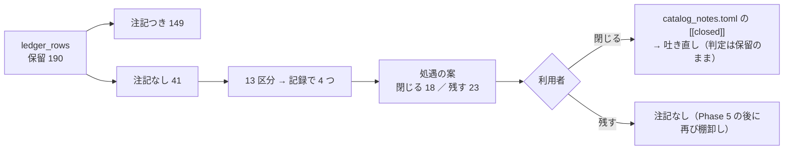

# 検証結果一覧の「保留」の棚卸し（2026-11）

2026-11-07（土）titan。開発ループの Phase 4-4「月 1 回の棚卸し」の 1 回目（[プラン daily-dev-loop.md](../../plans/daily-dev-loop.md) 4-4）。利用者「3 を進めて」。
前の棚卸し: [ledger-hold-inventory.md](ledger-hold-inventory.md)（2026-10-22・閉じる 72 ／ 残す 12）。規則は同じ（区分で処遇・判定と `n_trials` は変えない・「閉じる」は「効かないと確かめた」ではない）。
⚠ **この文書は判断の材料である。判定の列・数字・`n_trials` は 1 つも変えていない。閉じる ／ 残すを決めるのは利用者。**

> ⚠ これは投資助言ではなく調査資料である。数字はすべて【実測】（自前の検証の `result.csv` から機械で引いた）。

## 0. 一言で

⚠ **保留 190 行のうち、閉じる注記の無い 41 行は 13 区分（記録で束ねると 4 つ）に分かれる。** 処遇の案は **閉じる 18 行 ／ 残す 23 行**。残すのは 10/22 と同じ理由の「役割つきの組」（候補の人 `T7`〜`T19` の机上の形 ＝ Phase 5 が利用者待ちで軸が開いている）と、その 1 日遅れの引けの版。閉じるのは、記録が既に答えを持っている 3 つの族（銘柄の選抜・1 日遅れの引けの人の形・開発ループの登録簿 4 本）。

| 問い | 答え |
| --- | --- |
| 保留は何行で、どこから来たか | 190 行 ＝ 注記つき 149（2026-09-11 ／ 09-16 ／ 10-22 に閉じた）＋ **注記なし 41**（10/22 に残した 12 ＋ その後に増えた 29） |
| 41 行の形 | 41 行とも閾値売買。上乗せの t は 41 行とも 2.6 以下（\|t\| ≥ 2 は 1 行 ＝ 中位 48 の選抜 `net` θ50 の t 2.59）。fold の符号は 4/5 が 2・3/5 が 11・2/5 が 16・1/5 が 12。**最大の fold を外すと平均が 0 以下になる行が 31 ／ 41** |
| 「採るの一歩手前」はあるか | ⚠ **無い。** 4/5 の 2 行は選抜の行で、同じ規則は追試で 3 表とも再現しなかった（区分 B） |
| 時間で決着するか | ⚠ **しない**（[前回 §4](ledger-hold-inventory.md) と同じ。fold は固定の 5 つ・研究用の日足は 2026-09-09 で止めている） |

## 1. どう分けたか（⚠ 数字を見て分けていない）

区分は `python3 -m cli.select_candidates --inventory` の機械の区分（開発ループの行 ＝ アイデア id・それ以外 ＝ 実験の族）。処遇は前回と同じく **記録 1 本 ＝ 族** の単位で決め、根拠は「同じ問いに答えた別の実測があるか」「軸を閉じたか」「中身を確かめたか」「検出限界の下か」だけ。§3 の行ごとの数字は付随情報で、**処遇の根拠にしない**（数字の小さい行だけ閉じると選別になる）。

この図の主張: 読んだのは DB の `ledger_rows` と各実行の `result.csv` だけ。`[[closed]]` を足すのは利用者が決めてから。

## 2. 区分ごとの表と処遇の案【実測】

列の意味: 行 ＝ 注記なしの保留の行数 ／ t ＝ fold ごとの上乗せの t（5 fold）の中央値と最大 ／ 1 fold ＝ 最大の fold を外すと平均が 0 以下になる行数 ／ 最大の fold ＝ 上乗せが最大だった fold の内訳。

| # | 区分（記録） | 行 | t 中央値 ／ 最大 | 1 fold | 最大の fold | 記録が既に持っている答え | 処遇の案 |
| ---: | --- | ---: | ---: | ---: | --- | --- | --- |
| A | **役割つきの組**（`trader_roles` 12 ＝ 10/22 に残した C2 ／ `lag1_trader_roles` 11 ＝ 同じ組を 1 日遅れの引けで。[horizon-roles-trader.md](horizon-roles-trader.md) §1・§7・§8・rules.md 32 章） | 23 | 0.73 ／ 1.37 | 18 | fold 3: 21・fold 1: 2 | §1: fold 2・4・5 は組どうしで同じ数字（売買を決めたのは損切り係だけ）／ §7: 損切り係を外すと「持ち続ける − 費用」／ 1 日遅れでも先 5〜40 日の係の人は差が小さい（[nightly-predict.md §7](../../plans/nightly-predict.md)）／ ⚠ **候補の人 `T7`〜`T19` の処遇（trader-loop Phase 5・利用者）がまだ ＝ 軸が開いている**（`T18`・`T19` は 2026-11-03 から本番） | **残す**（前回と同じ。Phase 5 の後に再び棚卸し） |
| B | **銘柄の選抜**（`sel600_small_cs` 4・`sel_small_cs` 3・`sel600_midcap_cs` 2・`sel_midcap_cs` 1・`sel600_midcap_b_cs` 1。[symbol-selection-by-training.md](symbol-selection-by-training.md) §6・[symbol-selection-widen.md](symbol-selection-widen.md)） | 11 | 0.96 ／ 2.59 | 7 | fold 1: 3・fold 4: 3・fold 5: 3・fold 2: 2 | 29 章の規則のただ 1 つの「採る」（中位 48・`ret` θ50）も、追試（30 章）で隣の 44 本・45 本・2000 年からの長い表の **3 表とも再現せず**・選抜の価値は 4 表とも 0 の周り ／ 2026-10-23「候補の人は作らない」・C（S&P 400）／ D（前向き）は進める材料なし | **閉じる（軸を閉じた）** |
| C | **1 日遅れの引けの人の形**（`lag1_trader_mix` 1 ＝ ハルの形・`lag1_trader_trade_own_stop_ridge_a` 1 ＝ ミオの損切りの形。rules.md 32 章・[nightly-predict.md §7](../../plans/nightly-predict.md)） | 2 | 0.16 ／ 0.27 | 2 | fold 3: 2 | 32 章の机上は「日程を 1 日遅らせて壊れないか」を見る行で、答えは記録にある（事前の線に当たる形 0・ハルは縮む・先 5〜40 日の人は差が小さい）。日程は 2026-11-02 に切り替えた・成績で人を選ばない | **閉じる（中身を確かめた）** |
| D1 | **登録簿 `20261101-c3-as-stop-role`**（[dev-loop.md §9](dev-loop.md)） | 2 | 0.80 ／ 0.90 | 1 | fold 3: 2 | 損切り係を SMA200 割れ（X7）にした組は、損切りなしの組より素 ／ 全銘柄の 8 対とも負・往復は X1 の約 2.6 倍。$600 の形の保留は fold 3 が作る | **閉じる（中身を確かめた）** |
| D2 | **登録簿 `20261025-h5-pick-centered`**（[dev-loop.md §2](dev-loop.md)） | 1 | 0.51 | 1 | fold 3: 1 | R14 の $600 の形の保留は fold 3 の 1 つが作る・候補の人は作らない | **閉じる（中身を確かめた）** |
| D3 | **登録簿 `20261025-roles-entry-stop`**（[dev-loop.md §4](dev-loop.md)） | 1 | 0.36 | 1 | fold 3: 1 | 建値から −10% の損切りは、損切りを持たない形より 12 対とも下 | **閉じる（中身を確かめた）** |
| D4 | **登録簿 `20261101-crash-label-exit`**（[dev-loop.md §7・§8](dev-loop.md)） | 1 | 0.04 | 1 | fold 5: 1 | X5 θ60 は ＋0.5bp/fold・保有日率 0.999（出口がほとんど鳴らない）・土台差の X6 も落とす | **閉じる（検出限界の下）** |
| | 合計 | **41** | | **31** | | | 閉じる **18** ／ 残す **23** |

⚠ **「閉じる」は「効かないと確かめた」ではない**。注記には 軸を閉じた ／ 中身を確かめた ／ 検出限界の下 のどれかを書き、判定の列は保留のまま・行は分母に残る（`n_trials` は減らない）。

## 3. 41 行の一覧【実測】（成果物。⚠ 処遇の根拠ではない）

上乗せ ＝ fold ごとの（手法の純利 − 比べる相手の純利）の平均 bp/fold。比べる相手は `catalog._edge_vs_bh` と同じ（〔トレーダー…〕の行は同じ条件の「持ち続ける」・それ以外は「常に上（ドリフト）」）。⚠ 41 行とも `ledger_rows` の `上乗せbp` と一致することを確かめた。t ＝ 平均 ／ 標準偏差 × √5（標本 5 の t ＝ 並べて眺めるためのもの）。

| 区分 | 実験（族） | 手法 | θ | 上乗せ bp/fold | fold の符号 | fold ごとの上乗せ | t | 最大の fold | 最大を外した平均 | 取引/fold | 保有日率 |
| --- | --- | --- | ---: | ---: | --- | --- | ---: | ---: | ---: | ---: | ---: |
| A | `lag1_trader_roles_t12` | R6 買い先10日・売り先5日（損切りなし）〔トレーダー・5本・$600〕 | 50 | +117 | 1/5 −0＋00 | -332 ／ +0 ／ +915 ／ +0 ／ +0 | 0.56 | 3 | -83 | 20 | 0.73 |
| A | `lag1_trader_roles_t13` | R7 買い先20日・売り先5日（損切りなし）〔トレーダー・5本・$600〕 | 50 | +58 | 1/5 −0＋00 | -81 ／ +0 ／ +370 ／ +0 ／ +0 | 0.73 | 3 | -20 | 13 | 0.71 |
| A | `lag1_trader_roles_t14` | R8 買い先40日・売り先10日（損切りなし） | 50 | +38 | 2/5 ＋−＋00 | +94 ／ -20 ／ +116 ／ +0 ／ +0 | 1.37 | 3 | +18 | 89 | 0.88 |
| A | `lag1_trader_roles_t14` | R8 買い先40日・売り先10日（損切りなし）〔トレーダー・5本・$600〕 | 50 | +237 | 1/5 −0＋00 | -16 ／ +0 ／ +1199 ／ +0 ／ +0 | 0.98 | 3 | -4 | 7 | 0.70 |
| A | `lag1_trader_roles_t14` | R8 買い先40日・売り先10日（損切りなし）〔トレーダー・全銘柄・全部を買える予算〕 | 50 | +31 | 2/5 ＋−＋00 | +116 ／ -38 ／ +78 ／ +0 ／ +0 | 1.10 | 1 | +10 | 89 | 0.79 |
| A | `lag1_trader_roles_t15` | R9 買い先5日・売り先20日（対照・損切りなし）〔トレーダー・5本・$600〕 | 50 | +86 | 1/5 −0＋00 | -157 ／ +0 ／ +587 ／ +0 ／ +0 | 0.67 | 3 | -39 | 40 | 0.72 |
| A | `lag1_trader_roles_t16` | R10 買い先10日・売り先5日（土台差・損切りなし）〔トレーダー・5本・$600〕 | 50 | +442 | 3/5 −−＋＋＋ | -289 ／ -366 ／ +2782 ／ +29 ／ +53 | 0.75 | 3 | -143 | 51 | 0.59 |
| A | `lag1_trader_roles_t17` | R11 買い先20日・売り先5日（土台差・損切りなし）〔トレーダー・5本・$600〕 | 50 | +233 | 2/5 −−＋＋− | -335 ／ -471 ／ +2371 ／ +29 ／ -429 | 0.43 | 3 | -301 | 33 | 0.63 |
| A | `lag1_trader_roles_t18` | R12 買い先40日・売り先10日（土台差・損切りなし）〔トレーダー・5本・$600〕 | 50 | +529 | 2/5 ＋−＋0− | +145 ／ -178 ／ +2903 ／ +0 ／ -226 | 0.89 | 3 | -65 | 12 | 0.55 |
| A | `lag1_trader_roles_t19` | R13 買い先5日・売り先20日（対照・土台差・損切りなし）〔トレーダー・5本・$600〕 | 50 | +448 | 2/5 −−＋0＋ | -143 ／ -592 ／ +2890 ／ +0 ／ +82 | 0.72 | 3 | -163 | 39 | 0.61 |
| A | `lag1_trader_roles_t7` | R1 買い先10日・売り先5日・損切り〔トレーダー・5本・$600〕 | 50 | +58 | 2/5 −−＋−＋ | -542 ／ -266 ／ +1096 ／ -243 ／ +247 | 0.20 | 3 | -201 | 101 | 0.69 |
| A | `trader_roles_t12` | R6 買い先10日・売り先5日（損切りなし）〔トレーダー・5本・$600〕 | 50 | +192 | 1/5 −0＋00 | -236 ／ +0 ／ +1197 ／ +0 ／ +0 | 0.75 | 3 | -59 | 20 | 0.73 |
| A | `trader_roles_t13` | R7 買い先20日・売り先5日（損切りなし）〔トレーダー・5本・$600〕 | 50 | +82 | 1/5 −0＋00 | -194 ／ +0 ／ +606 ／ +0 ／ +0 | 0.60 | 3 | -49 | 13 | 0.71 |
| A | `trader_roles_t14` | R8 買い先40日・売り先10日（損切りなし） | 50 | +35 | 2/5 ＋−＋00 | +43 ／ -7 ／ +140 ／ +0 ／ +0 | 1.27 | 3 | +9 | 89 | 0.88 |
| A | `trader_roles_t14` | R8 買い先40日・売り先10日（損切りなし）〔トレーダー・5本・$600〕 | 50 | +228 | 2/5 ＋0＋00 | +16 ／ +0 ／ +1127 ／ +0 ／ +0 | 1.02 | 3 | +4 | 7 | 0.70 |
| A | `trader_roles_t14` | R8 買い先40日・売り先10日（損切りなし）〔トレーダー・全銘柄・全部を買える予算〕 | 50 | +28 | 2/5 ＋−＋00 | +67 ／ -29 ／ +100 ／ +0 ／ +0 | 1.15 | 3 | +9 | 89 | 0.79 |
| A | `trader_roles_t15` | R9 買い先5日・売り先20日（対照・損切りなし）〔トレーダー・5本・$600〕 | 50 | +59 | 1/5 −0＋00 | -142 ／ +0 ／ +435 ／ +0 ／ +0 | 0.60 | 3 | -35 | 40 | 0.72 |
| A | `trader_roles_t16` | R10 買い先10日・売り先5日（土台差・損切りなし）〔トレーダー・5本・$600〕 | 50 | +405 | 1/5 −−＋−− | -384 ／ -344 ／ +3101 ／ -11 ／ -340 | 0.60 | 3 | -270 | 51 | 0.59 |
| A | `trader_roles_t17` | R11 買い先20日・売り先5日（土台差・損切りなし）〔トレーダー・5本・$600〕 | 50 | +358 | 1/5 −−＋−− | -316 ／ -165 ／ +2402 ／ -11 ／ -120 | 0.70 | 3 | -153 | 33 | 0.63 |
| A | `trader_roles_t18` | R12 買い先40日・売り先10日（土台差・損切りなし）〔トレーダー・5本・$600〕 | 50 | +537 | 2/5 ＋−＋0− | +81 ／ -109 ／ +2998 ／ +0 ／ -283 | 0.87 | 3 | -78 | 12 | 0.55 |
| A | `trader_roles_t19` | R13 買い先5日・売り先20日（対照・土台差・損切りなし）〔トレーダー・5本・$600〕 | 50 | +562 | 2/5 −−＋0＋ | -80 ／ -600 ／ +3077 ／ +0 ／ +415 | 0.87 | 3 | -66 | 39 | 0.61 |
| A | `trader_roles_t7` | R1 買い先10日・売り先5日・損切り〔トレーダー・5本・$600〕 | 50 | +69 | 3/5 ＋−＋−＋ | +247 ／ -586 ／ +881 ／ -424 ／ +226 | 0.26 | 3 | -134 | 101 | 0.69 |
| A | `trader_roles_t9` | R3 買い先40日・売り先10日・損切り〔トレーダー・5本・$600〕 | 50 | +117 | 3/5 ＋−＋−＋ | +945 ／ -586 ／ +424 ／ -424 ／ +226 | 0.42 | 1 | -90 | 73 | 0.65 |
| B | `sel600_midcap_b_cs` | 全部使う（基準）〔トレーダー・選抜5・訓練リターン・1本$600〕 | 60 | +271 | 3/5 ＋＋−−＋ | +2591 ／ +818 ／ -1316 ／ -1063 ／ +323 | 0.38 | 1 | -310 | 1 | 0.14 |
| B | `sel600_midcap_cs` | 全部使う（基準）〔トレーダー・選抜5・モデル純利・1本$600〕 | 50 | +930 | 4/5 ＋＋−＋＋ | +1527 ／ +1816 ／ -150 ／ +415 ／ +1044 | 2.59 | 2 | +709 | 171 | 0.57 |
| B | `sel600_midcap_cs` | 全部使う（基準）〔トレーダー・選抜5・訓練リターン・1本$600〕 | 55 | +215 | 3/5 ＋＋＋−− | +552 ／ +2598 ／ +15 ／ -1186 ／ -901 | 0.32 | 2 | -380 | 9 | 0.46 |
| B | `sel600_small_cs` | 全部使う（基準）〔トレーダー・選抜5・モデル純利・1本$600〕 | 50 | +215 | 3/5 ＋0−＋＋ | +1283 ／ +0 ／ -667 ／ +24 ／ +436 | 0.67 | 1 | -52 | 251 | 0.66 |
| B | `sel600_small_cs` | 全部使う（基準）〔トレーダー・選抜5・モデル純利・1本$600〕 | 60 | +287 | 1/5 0000＋ | +0 ／ +0 ／ +0 ／ +0 ／ +1437 | 1.00 | 5 | +0 | 0 | 0.00 |
| B | `sel600_small_cs` | 全部使う（基準）〔トレーダー・選抜5・訓練リターン・1本$600〕 | 50 | +177 | 3/5 ＋0−＋＋ | +840 ／ +0 ／ -1955 ／ +1502 ／ +500 | 0.30 | 4 | -154 | 256 | 0.67 |
| B | `sel600_small_cs` | 全部使う（基準）〔トレーダー・選抜5・訓練リターン・1本$600〕 | 60 | +762 | 3/5 ＋−＋＋− | +1146 ／ -1242 ／ +1832 ／ +2939 ／ -864 | 0.96 | 4 | +218 | 3 | 0.29 |
| B | `sel_midcap_cs` | 全部使う（基準）〔トレーダー・選抜5・モデル純利・$600〕 | 50 | +587 | 4/5 ＋＋＋＋− | +1689 ／ +462 ／ +1360 ／ +241 ／ -817 | 1.33 | 1 | +311 | 146 | 0.50 |
| B | `sel_small_cs` | 全部使う（基準）〔トレーダー・選抜5・モデル純利・$600〕 | 50 | +443 | 3/5 ＋0−＋＋ | +956 ／ +0 ／ -202 ／ +193 ／ +1269 | 1.56 | 5 | +237 | 240 | 0.57 |
| B | `sel_small_cs` | 全部使う（基準）〔トレーダー・選抜5・モデル純利・$600〕 | 60 | +240 | 1/5 0000＋ | +0 ／ +0 ／ +0 ／ +0 ／ +1198 | 1.00 | 5 | +0 | 0 | 0.00 |
| B | `sel_small_cs` | 全部使う（基準）〔トレーダー・選抜5・訓練リターン・$600〕 | 50 | +35 | 2/5 −0−＋＋ | -352 ／ +0 ／ -1346 ／ +1176 ／ +696 | 0.08 | 4 | -251 | 246 | 0.59 |
| C | `lag1_trader_mix_t4` | M1 3本の平均〔トレーダー・5本・$300〕 | 50 | +159 | 2/5 0＋＋−− | +0 ／ +107 ／ +2288 ／ -1350 ／ -248 | 0.27 | 3 | -373 | 41 | 0.52 |
| C | `lag1_trader_trade_own_stop_ridge_a` | L1 高値20日から−10%で降りる〔トレーダー・5本・$300〕 | 50 | +42 | 2/5 −−＋−＋ | -448 ／ -186 ／ +2452 ／ -2096 ／ +489 | 0.06 | 3 | -560 | 124 | 0.43 |
| D1 | `dev_roles_c3stop_b20e5` | R20 買い先20日・売り先5日（損切りSMA200）〔トレーダー・5本・$600〕 | 50 | +305 | 3/5 ＋−＋−＋ | +144 ／ -728 ／ +1755 ／ -395 ／ +749 | 0.69 | 3 | -57 | 359 | 0.53 |
| D1 | `dev_roles_c3stop_b40e10` | R21 買い先40日・売り先10日（損切りSMA200）〔トレーダー・5本・$600〕 | 50 | +478 | 3/5 ＋−＋−＋ | +469 ／ -728 ／ +2297 ／ -395 ／ +749 | 0.90 | 3 | +24 | 326 | 0.51 |
| D2 | `dev_roles_pick_centered` | R14 買い係が期間を選ぶ（土台差）・損切り〔トレーダー・5本・$600〕 | 50 | +329 | 1/5 −−＋−− | -374 ／ -459 ／ +2880 ／ -328 ／ -74 | 0.51 | 3 | -309 | 139 | 0.60 |
| D3 | `dev_roles_entrystop_b40e10` | R17 買い先40日・売り先10日（建値から−10%）〔トレーダー・5本・$600〕 | 50 | +49 | 2/5 −−＋−＋ | -114 ／ -182 ／ +551 ／ -138 ／ +128 | 0.36 | 3 | -76 | 14 | 0.71 |
| D4 | `dev_crash_exit` | X5 出口だけ 先5日の急落を当てる（own・学習） | 60 | +0 | 2/5 −＋−0＋ | -35 ／ +10 ／ -2 ／ +0 ／ +30 | 0.04 | 5 | -7 | 73 | 1.00 |

## 4. 決まったらやること

1. 閉じる区分を選び、[assets/ledger-hold-inventory-2026-11-closed-draft.toml](assets/ledger-hold-inventory-2026-11-closed-draft.toml)（18 件・区分 B ／ C ／ D1〜D4）の該当の `[[closed]]` を `config/catalog_notes.toml` の末尾に貼る。⚠ 下書きは各行の識別項目を DB から写したもので、**既存の 149 件に足して 1 件がちょうど 1 行の保留に当たり、判定が 1 つも変わらないことを機械で確かめた**（保留 190 のまま・採る 1・落とす 975 のまま・注記つき 149 → 167）。吐き直す前に DB の行が動いていれば当たらないことがある（そのときは `cli.report --catalog` が止まる）
2. `cli.report --catalog` で吐き直し、保留の行数・判定の内訳が前後で同じ・注記つきが 149 ＋ 閉じた行数になることを差分で確かめる。⚠ 注記の文に `|` を書かない（表が壊れる）
3. この文書 §2 に「✅ 閉じた」を書き、`validation-power.md` §6-2 に処遇を 1 段足す

## 5. 限界

- B の「軸を閉じた」は追試の記録（30 章）に拠る。追試は中位 48 の `ret` θ50 の 1 行を主に見たもので、ほかの 10 行（小型 50・`net`）を個別に追試したわけではない（同じ規則の族として扱う ＝ 前回の規則）
- C は 32 章の机上を「日程の確かめ」と読んでいる。ハルの形の 1 日遅れの保留そのものは、本番の 20 営業日の判定（別の物差し）とはつながらない
- §3 の付随情報は 5 fold の数字から引いた。t は標本 5 の t で、検定として使える精度は無い
- A の 23 行は残すので、注記なしの保留は次の棚卸し（Phase 5 の後か 12 月）にもそのまま出る
