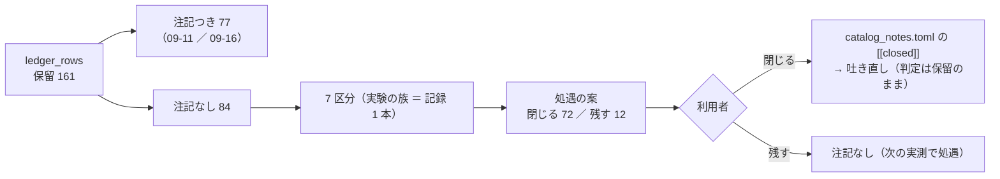

# 検証結果一覧の「保留」の棚卸し（2026-10-22）

2026-10-22（木）titan。利用者「次のおすすめの作業は？」→ 推し 1 →「1 を進めて」（[プラン](../../plans/ledger-hold-inventory.md)）。
前の処遇: 2026-09-11（16 行）・2026-09-16（62 行）＝ [validation-power.md §6-2](feature-discovery/validation-power.md)・[ledger-hold-disposition.md](../../plans/archive/ledger-hold-disposition.md)。
⚠ **この文書は判断の材料である。判定の列・数字・`n_trials` は 1 つも変えていない。閉じる ／ 残すを決めるのは利用者**（前の 2 回と同じ）。

> ⚠ これは投資助言ではなく調査資料である。数字はすべて【実測】（自前の検証の `result.csv` から機械で引いた）。

## 0. 一言で

⚠ **保留 161 行のうち注記なしの 84 行は 7 つの区分に分かれ、どの区分も「同じ問いに答えた別の実測」か「閉じた軸」か「検出限界の下」を記録が既に持っている。** 処遇の案は **閉じる 72 行 ／ 残す 12 行**（残すのは候補の人 `T7`〜`T19` の机上の側 ＝ 軸が開いている）。
⚠ **保留はいまの表では自然に決着しない**: 「採る」には fold 5/5 の符号が要り、fold は固定の 5 つ・研究用の日足は 2026-09-09 で止めている（取り直さない ＝ CLAUDE.md）。時間を置いても保留は保留のままで、動かすには新しい表で新しい検証として回すしかない（その分 `n_trials` が増える）。

| 問い | 答え |
| --- | --- |
| 保留は何行で、どこから来たか | 161 行 ＝ 注記つき 77（2026-09-11 ／ 09-16 に閉じた。日足 × `raw` 27・D 系の検知器 23・検出限界の下 14・代表済み 12・中身を確かめた 1）＋ **注記なし 84**（2026-09-16 以降に増えた） |
| 84 行の形 | 84 行とも閾値売買（検証方式の変種 4 行を含む）。上乗せの t は **84 行とも \|t\| < 2**（最大 1.90）。fold の符号は 4/5 が 21・3/5 が 30・2/5 が 27・1/5 が 6。**最大の fold を外すと平均が 0 以下になる行が 44 ／ 84** |
| 「採るの一歩手前」はあるか | ⚠ **無い。** 符号 4/5 の 21 行も t ≤ 1.9 で、1 つの fold（上位 K は fold 5 か 1・決算 ＋ 中小型株は fold 1・役割つきは fold 3）が平均を作っている |
| 時間で決着するか | ⚠ **しない**（上の段落）。前の 2 回と同じく、処遇は「行ごとの数字」ではなく「区分」で決める |

## 1. どう分けたか（⚠ 数字を見て分けていない）

区分 ＝ **実験の族 ＝ 記録 1 本**（実行名の実験名で機械的に分け、同じ記録に属する行は同じ区分）。行ごとの付随情報（上乗せ・fold の符号・1 fold を外した符号・取引回数）は §3 に載せるが、**処遇の根拠にしない**（数字の小さい行だけ閉じると大きい行が残って選別になる ＝ 前回の規則）。根拠にするのは「同じ問いに答えた別の実測があるか」「軸を閉じたか」「記録が検出限界の下と書いているか」だけ。

この図の主張: 読んだのは DB の `ledger_rows` と各実行の `result.csv` だけ。出るのは区分の表と処遇の案で、`[[closed]]` を足すのは利用者が決めてから。

## 2. 区分ごとの表と処遇の案【実測】

列の意味: 行 ＝ 注記なしの保留の行数 ／ t ＝ fold ごとの上乗せの t（5 fold）の中央値と最大 ／ 1 fold ＝ 最大の fold を外すと平均が 0 以下になる行数 ／ 最大の fold ＝ 上乗せが最大だった fold の内訳。

| # | 区分（記録） | 行 | t 中央値 ／ 最大 | 1 fold | 最大の fold | 記録が既に持っている答え | 処遇の案 |
| ---: | --- | ---: | ---: | ---: | --- | --- | --- |
| A | **上位 K**（[topk-holdings.md](topk-holdings.md) §4 保留 37 ＝ この 37 行） | 37 | 1.09 ／ 1.90 | 9 | fold 5: 18・fold 1: 13・fold 2: 6 | §6: モデルを使わない **ボラ上位 K が T1・T3 の端数 10 対のうち 9 対で上**・順位 − ボラ上位は 10 対とも \|t\| < 2 ＝ 上乗せは荒い銘柄への集中 × 生存バイアスで説明がつく ／ §3: T2 は 96% の日で同点 ＝ 銘柄を選んでいない ／ 17-6 の 4「この結果で K を選ばない」 | **閉じる（中身を確かめた）** |
| B | **トレーダーの形**（[trader-shaped-validation.md](trader-shaped-validation.md) §2・§5） | 16 | 0.46 ／ 1.11 | 13 | fold 2: 7・fold 3: 6・fold 5: 2・fold 1: 1 | §3: 上乗せは「下げ相場で降りる」から来て上げ相場では持ち続けるに負ける・2a は銘柄が実質 4 本で 1〜2 本の運 ／ §5: 6 人の 5 本・$300 の上乗せは 1 つの fold から ／ 利用者決定「順位で人を採らない」・(b) `T6` は候補にして 10/8 に本番へ（この行の用は済んだ） | **閉じる（中身を確かめた）** |
| C1 | **先の期間の単体**（[horizon-roles-trader.md](horizon-roles-trader.md) §2 保留 3 ＝ H2 θ55・H4 θ55・H4 θ50〔H4 θ50 は `trader_roles_t14` の実行に移った〕） | 3 | 0.99 ／ 1.27 | 2 | fold 1: 2・fold 3: 1 | §2: 4 本とも門前（AUC 0.502〜0.510・幅 7.8〜13.7 点）・fold 2・4・5 は取引 63 ＝「持ち続ける − 費用」／ §3 の 4: 上乗せ ＋69〜＋119 は符号 5/5 に要る大きさの 1 割未満 | **閉じる（検出限界の下）** |
| C2 | **役割つきの組**（同 §2 の R1・R3 2a・§7 の R6〜R9・§8 の R10〜R13） | 12 | 0.73 ／ 1.27 | 9 | fold 3: 11・fold 1: 1 | §1: fold 2・4・5 は 4 組とも同じ数字（売買を決めたのは損切り係だけ）／ §7: 損切り係を外すと「持ち続ける − 費用」／ §8: 土台差は $600 の形だけ保留 ／ ⚠ **候補の人 `T7`〜`T19` は Phase 5（11/4 の後・利用者）待ち ＝ 軸が開いている** | **残す**（前回の規則 7 ＝ 無理に閉じない。⚠ 成績で人を選ばないので、この行は Phase 5 の材料にもならない） |
| D | **決算 ＋ 中小型株**（[earnings-layer.md](earnings-layer.md)・[smallcap-stage2.md](smallcap-stage2.md)・[smallcap-stage2b.md](smallcap-stage2b.md)） | 10 | 0.52 ／ 0.94 | 8 | fold 1: 9・fold 4: 1 | 段 2: 保留 5 本はどれも 1 fold が作る ／ 段 2b: 同じ集合にすると決算の差は \|t\| ≤ 1.64・θ50 の損益分岐 5.2bp ／ 気配の差【実測】小型 50 ≈ 15bp ／ ✅ **2026-10-22 利用者「段 3 を閉じて」＝ タスクを閉じた** | **閉じる（軸を閉じた）** |
| E | **訓練の窓 ／ 翌日始値**（[old-data-relevance.md](old-data-relevance.md) §5・[next-open-execution.md](next-open-execution.md)） | 3 | 0.89 ／ 0.90 | 0 | fold 2: 2・fold 1: 1 | 窓: 全窓との対の差は小さく「古い行が役に立つ ／ 邪魔」とは言えない ／ 翌日始値: F2-2 RFE 1995 θ50 ＋574 は終値版 ＋578 の写し（差 −0.01bp/日）で、**終値版は 2026-09-16 に「代表済み」で閉じた行** | **閉じる（代表済み）** |
| F | **先 10 日ゲートの対**（[forward10-target.md](forward10-target.md) §2-2・§7-4。H1 θ50 の素の行 2 本 ＝ `_pairs` の実行に移った） | 2 | 0.75 ／ 0.90 | 2 | fold 2: 2 | §2-4: 出力スコアに先 10 日の情報が無い（AUC 0.49〜0.51）・fold 1・4・5 は 0 ＝ 持ち続ける − 費用 ／ §7-4: 売り線の対 18 行は全部落とす | **閉じる（中身を確かめた）** |
| G | **暦の層（1995 表）**（[weekday-feature.md](weekday-feature.md) §0・§3） | 1 | 0.15 ／ 0.15 | 1 | fold 2: 1 | 対の相手（own だけ）−4.4 → ＋178.4 で「落とす → 保留」に変わっただけ・t 0.15・差は 9 行とも検出限界の下 | **閉じる（検出限界の下）** |
| | 合計 | **84** | | **44** | | | 閉じる **72** ／ 残す **12** |

⚠ **「閉じる」は「効かないと確かめた」ではない**（前回の失敗モード 3）。注記には必ず 代表済み ／ 軸を閉じた ／ 中身を確かめた ／ 検出限界の下 のどれかを書き、判定の列は保留のまま・行は分母に残る（`n_trials` は減らない）。

## 3. 84 行の一覧【実測】（成果物。⚠ 処遇の根拠ではない）

上乗せ ＝ fold ごとの（手法の純利 − 比べる相手の純利）の平均 bp/fold。比べる相手は `catalog._edge_vs_bh` と同じ（〔トレーダー…〕の行は同じ条件の「持ち続ける」・それ以外は「常に上（ドリフト）」）。⚠ 84 行とも `ledger_rows` の `上乗せbp` と一致することを確かめた。t ＝ 平均 ／ 標準偏差 × √5。

| 区分 | 実験（実行名の末尾） | 手法 | θ | 上乗せ bp/fold | fold の符号 | fold ごとの上乗せ | t | 最大の fold | 最大を外した平均 | 取引/fold | 保有日率 |
| --- | --- | --- | ---: | ---: | --- | --- | ---: | ---: | ---: | ---: | ---: |
| 上位 K | `trade_own_ridge_a_topk` | 全部使う（基準）〔上位10・整数株B⚠〕 | 50 | +237 | 4/5 ＋＋＋−＋ | +87 ／ +1637 ／ +41 ／ -1362 ／ +781 | 0.48 | 2 | -113 | 188 | 0.64 |
| 上位 K | `trade_own_ridge_a_topk` | 全部使う（基準）〔上位10・端数〕 | 50 | +334 | 3/5 −＋＋−＋ | -285 ／ +978 ／ +104 ／ -420 ／ +1294 | 0.98 | 5 | +94 | 181 | 0.76 |
| 上位 K | `trade_own_ridge_a_topk` | 全部使う（基準）〔上位1・整数株A〕 | 50 | +1,255 | 4/5 ＋＋＋−＋ | +3480 ／ +4913 ／ +1601 ／ -4000 ／ +283 | 0.82 | 2 | +341 | 27 | 0.66 |
| 上位 K | `trade_own_ridge_a_topk` | 全部使う（基準）〔上位1・整数株B⚠〕 | 50 | +1,853 | 4/5 ＋＋＋−＋ | +3156 ／ +6605 ／ +2146 ／ -3704 ／ +1062 | 1.11 | 2 | +665 | 27 | 0.75 |
| 上位 K | `trade_own_ridge_a_topk` | 全部使う（基準）〔上位1・端数〕 | 50 | +1,899 | 4/5 ＋＋＋−＋ | +3162 ／ +6850 ／ +2183 ／ -3694 ／ +995 | 1.11 | 2 | +661 | 27 | 0.76 |
| 上位 K | `trade_own_ridge_a_topk` | 全部使う（基準）〔上位20・端数〕 | 50 | +231 | 3/5 ＋＋−−＋ | +284 ／ +807 ／ -85 ／ -864 ／ +1015 | 0.69 | 5 | +35 | 350 | 0.76 |
| 上位 K | `trade_own_ridge_a_topk` | 全部使う（基準）〔上位3・整数株A〕 | 50 | +1,261 | 3/5 −＋＋−＋ | -794 ／ +2173 ／ +687 ／ -665 ／ +4906 | 1.19 | 5 | +350 | 59 | 0.62 |
| 上位 K | `trade_own_ridge_a_topk` | 全部使う（基準）〔上位3・整数株B⚠〕 | 50 | +941 | 3/5 −＋＋−＋ | -626 ／ +2769 ／ +546 ／ -1531 ／ +3546 | 0.97 | 5 | +290 | 62 | 0.71 |
| 上位 K | `trade_own_ridge_a_topk` | 全部使う（基準）〔上位3・端数〕 | 50 | +1,060 | 3/5 −＋＋−＋ | -620 ／ +3271 ／ +580 ／ -1549 ／ +3617 | 1.03 | 5 | +420 | 62 | 0.76 |
| 上位 K | `trade_own_ridge_a_topk` | 全部使う（基準）〔上位5・整数株B⚠〕 | 50 | +647 | 3/5 −＋＋−＋ | -1467 ／ +3302 ／ +431 ／ -1964 ／ +2935 | 0.60 | 2 | -16 | 100 | 0.66 |
| 上位 K | `trade_own_ridge_a_topk` | 全部使う（基準）〔上位5・端数〕 | 50 | +995 | 3/5 −＋＋−＋ | -1547 ／ +3820 ／ +474 ／ -1116 ／ +3343 | 0.90 | 2 | +288 | 98 | 0.76 |
| 上位 K | `trade_ownex_lgbm_a_topk` | 全部使う（基準）〔上位10・整数株B⚠〕 | 55 | +904 | 3/5 ＋−−＋＋ | +822 ／ -652 ／ -338 ／ +1273 ／ +3413 | 1.25 | 5 | +276 | 40 | 0.56 |
| 上位 K | `trade_ownex_lgbm_a_topk` | 全部使う（基準）〔上位10・端数〕 | 55 | +925 | 3/5 ＋−−＋＋ | +894 ／ -1249 ／ -338 ／ +409 ／ +4907 | 0.87 | 5 | -71 | 40 | 0.66 |
| 上位 K | `trade_ownex_lgbm_a_topk` | 全部使う（基準）〔上位1・整数株A〕 | 55 | +4,429 | 4/5 ＋＋−＋＋ | +4644 ／ +332 ／ -338 ／ +4463 ／ +13046 | 1.86 | 5 | +2,275 | 4 | 0.55 |
| 上位 K | `trade_ownex_lgbm_a_topk` | 全部使う（基準）〔上位1・整数株B⚠〕 | 55 | +5,238 | 4/5 ＋＋−＋＋ | +5977 ／ +448 ／ -338 ／ +5030 ／ +15074 | 1.90 | 5 | +2,779 | 4 | 0.64 |
| 上位 K | `trade_ownex_lgbm_a_topk` | 全部使う（基準）〔上位1・端数〕 | 55 | +5,400 | 4/5 ＋＋−＋＋ | +6071 ／ +506 ／ -338 ／ +5192 ／ +15572 | 1.90 | 5 | +2,858 | 4 | 0.66 |
| 上位 K | `trade_ownex_lgbm_a_topk` | 全部使う（基準）〔上位20・整数株B⚠〕 | 55 | +81 | 2/5 −−−＋＋ | -784 ／ -522 ／ -338 ／ +458 ／ +1591 | 0.19 | 5 | -297 | 72 | 0.52 |
| 上位 K | `trade_ownex_lgbm_a_topk` | 全部使う（基準）〔上位20・端数〕 | 55 | +431 | 2/5 −−−＋＋ | -219 ／ -1093 ／ -338 ／ +1146 ／ +2659 | 0.65 | 5 | -126 | 80 | 0.66 |
| 上位 K | `trade_ownex_lgbm_a_topk` | 全部使う（基準）〔上位3・整数株A〕 | 55 | +2,808 | 4/5 ＋＋−＋＋ | +347 ／ +352 ／ -338 ／ +2540 ／ +11138 | 1.31 | 5 | +725 | 12 | 0.54 |
| 上位 K | `trade_ownex_lgbm_a_topk` | 全部使う（基準）〔上位3・整数株B⚠〕 | 55 | +2,165 | 4/5 ＋＋−＋＋ | +2144 ／ +642 ／ -338 ／ +884 ／ +7493 | 1.56 | 5 | +833 | 12 | 0.62 |
| 上位 K | `trade_ownex_lgbm_a_topk` | 全部使う（基準）〔上位3・端数〕 | 55 | +2,382 | 4/5 ＋＋−＋＋ | +2324 ／ +781 ／ -338 ／ +876 ／ +8268 | 1.56 | 5 | +911 | 12 | 0.66 |
| 上位 K | `trade_ownex_lgbm_a_topk` | 全部使う（基準）〔上位5・整数株A〕 | 55 | +417 | 3/5 ＋−−＋＋ | +99 ／ -618 ／ -338 ／ +330 ／ +2612 | 0.73 | 5 | -132 | 20 | 0.55 |
| 上位 K | `trade_ownex_lgbm_a_topk` | 全部使う（基準）〔上位5・整数株B⚠〕 | 55 | +1,534 | 2/5 ＋−−−＋ | +1066 ／ -485 ／ -338 ／ -572 ／ +7998 | 0.93 | 5 | -82 | 20 | 0.58 |
| 上位 K | `trade_ownex_lgbm_a_topk` | 全部使う（基準）〔上位5・端数〕 | 55 | +1,969 | 2/5 ＋−−−＋ | +1728 ／ -441 ／ -338 ／ -93 ／ +8991 | 1.09 | 5 | +214 | 20 | 0.66 |
| 上位 K | `trade_ownseq_ridge_a_topk` | T3 QUANT（60日窓）〔上位10・整数株B⚠〕 | 50 | +1,234 | 3/5 ＋＋−−＋ | +4014 ／ +2273 ／ -274 ／ -635 ／ +790 | 1.44 | 1 | +538 | 56 | 0.66 |
| 上位 K | `trade_ownseq_ridge_a_topk` | T3 QUANT（60日窓）〔上位10・端数〕 | 50 | +938 | 3/5 ＋＋−−＋ | +4468 ／ +949 ／ -274 ／ -636 ／ +185 | 1.02 | 1 | +56 | 60 | 0.79 |
| 上位 K | `trade_ownseq_ridge_a_topk` | T3 QUANT（60日窓）〔上位1・整数株A〕 | 50 | +5,295 | 2/5 ＋−−＋− | +22557 ／ -760 ／ -274 ／ +5500 ／ -551 | 1.18 | 1 | +979 | 7 | 0.71 |
| 上位 K | `trade_ownseq_ridge_a_topk` | T3 QUANT（60日窓）〔上位1・整数株B⚠〕 | 50 | +2,967 | 2/5 ＋−−＋− | +23216 ／ -3292 ／ -274 ／ +970 ／ -5784 | 0.57 | 1 | -2,095 | 8 | 0.75 |
| 上位 K | `trade_ownseq_ridge_a_topk` | T3 QUANT（60日窓）〔上位1・端数〕 | 50 | +2,869 | 2/5 ＋−−＋− | +23295 ／ -3532 ／ -274 ／ +1058 ／ -6204 | 0.55 | 1 | -2,238 | 8 | 0.78 |
| 上位 K | `trade_ownseq_ridge_a_topk` | T3 QUANT（60日窓）〔上位20・整数株B⚠〕 | 50 | +354 | 3/5 ＋＋−−＋ | +1497 ／ +875 ／ -274 ／ -351 ／ +23 | 0.99 | 1 | +68 | 101 | 0.64 |
| 上位 K | `trade_ownseq_ridge_a_topk` | T3 QUANT（60日窓）〔上位20・端数〕 | 50 | +586 | 2/5 ＋＋−−− | +2854 ／ +1010 ／ -274 ／ -247 ／ -414 | 0.94 | 1 | +19 | 113 | 0.79 |
| 上位 K | `trade_ownseq_ridge_a_topk` | T3 QUANT（60日窓）〔上位3・整数株A〕 | 50 | +3,595 | 4/5 ＋＋−＋＋ | +10562 ／ +3016 ／ -274 ／ +688 ／ +3981 | 1.89 | 1 | +1,853 | 15 | 0.65 |
| 上位 K | `trade_ownseq_ridge_a_topk` | T3 QUANT（60日窓）〔上位3・整数株B⚠〕 | 50 | +3,623 | 4/5 ＋＋−＋＋ | +11765 ／ +3385 ／ -274 ／ +777 ／ +2460 | 1.70 | 1 | +1,587 | 21 | 0.72 |
| 上位 K | `trade_ownseq_ridge_a_topk` | T3 QUANT（60日窓）〔上位3・端数〕 | 50 | +3,715 | 4/5 ＋＋−＋＋ | +11821 ／ +3502 ／ -274 ／ +1352 ／ +2175 | 1.76 | 1 | +1,689 | 21 | 0.78 |
| 上位 K | `trade_ownseq_ridge_a_topk` | T3 QUANT（60日窓）〔上位5・整数株A〕 | 50 | +1,543 | 4/5 ＋＋−＋＋ | +4504 ／ +2143 ／ -274 ／ +130 ／ +1214 | 1.81 | 1 | +803 | 24 | 0.61 |
| 上位 K | `trade_ownseq_ridge_a_topk` | T3 QUANT（60日窓）〔上位5・整数株B⚠〕 | 50 | +2,273 | 3/5 ＋＋−−＋ | +7201 ／ +4219 ／ -274 ／ -114 ／ +334 | 1.53 | 1 | +1,041 | 33 | 0.67 |
| 上位 K | `trade_ownseq_ridge_a_topk` | T3 QUANT（60日窓）〔上位5・端数〕 | 50 | +2,386 | 4/5 ＋＋−＋＋ | +7916 ／ +3548 ／ -274 ／ +13 ／ +726 | 1.55 | 1 | +1,003 | 32 | 0.78 |
| トレーダーの形 | `trader_mix_t4` | M1 3本の平均 | 50 | +123 | 3/5 −＋−＋＋ | -43 ／ +443 ／ -338 ／ +204 ／ +348 | 0.87 | 2 | +43 | 529 | 0.76 |
| トレーダーの形 | `trader_mix_t4` | M1 3本の平均〔トレーダー・5本・$300〕 | 50 | +425 | 2/5 0−＋−＋ | +0 ／ -119 ／ +2286 ／ -110 ／ +69 | 0.91 | 3 | -40 | 41 | 0.52 |
| トレーダーの形 | `trader_mix_t4` | M1 3本の平均〔トレーダー・全銘柄・全部を買える予算〕 | 50 | +89 | 3/5 −＋−＋＋ | -35 ／ +432 ／ -588 ／ +299 ／ +338 | 0.48 | 2 | +3 | 529 | 0.68 |
| トレーダーの形 | `trader_sel_small4_1995` | F1-7 IC の安定性〔トレーダー・5本・$300〕 | 50 | +500 | 3/5 −＋＋−＋ | -402 ／ +4637 ／ +722 ／ -2800 ／ +345 | 0.42 | 2 | -534 | 721 | 0.53 |
| トレーダーの形 | `trader_sel_small4_1995` | F1-7 IC の安定性〔トレーダー・全銘柄・全部を買える予算〕 | 50 | +423 | 3/5 ＋＋−−＋ | +2626 ／ +4176 ／ -775 ／ -3950 ／ +36 | 0.30 | 2 | -516 | 9,202 | 0.65 |
| トレーダーの形 | `trader_sel_small4_1995` | F2-2 RFE〔トレーダー・5本・$300〕 | 50 | +718 | 3/5 −＋＋−＋ | -107 ／ +4457 ／ +791 ／ -1832 ／ +283 | 0.70 | 2 | -216 | 550 | 0.53 |
| トレーダーの形 | `trader_sel_small4_1995` | F2-2 RFE〔トレーダー・全銘柄・全部を買える予算〕 | 50 | +339 | 3/5 ＋＋−−＋ | +1874 ／ +2332 ／ -873 ／ -1676 ／ +38 | 0.44 | 2 | -159 | 6,749 | 0.65 |
| トレーダーの形 | `trader_sel_small4_2018` | F2-2 RFE〔トレーダー・5本・$300〕 | 50 | +343 | 2/5 −−＋−＋ | -1137 ／ -182 ／ +2595 ／ -165 ／ +605 | 0.55 | 3 | -220 | 60 | 0.50 |
| トレーダーの形 | `trader_trade_own_ridge_a` | 全部使う（基準）〔トレーダー・5本・$300〕 | 50 | +279 | 3/5 −＋＋−＋ | -632 ／ +116 ／ +2524 ／ -1143 ／ +528 | 0.44 | 3 | -283 | 77 | 0.47 |
| トレーダーの形 | `trader_trade_own_stop_ridge_a` | L1 高値20日から−10%で降りる〔トレーダー・5本・$300〕 | 50 | +164 | 3/5 ＋−＋−＋ | +64 ／ -150 ／ +2306 ／ -1480 ／ +78 | 0.27 | 3 | -372 | 124 | 0.43 |
| トレーダーの形 | `trader_trade_ownex_lgbm_a` | 全部使う（基準） | 55 | +49 | 2/5 0−−＋＋ | +0 ／ -942 ／ -338 ／ +552 ／ +972 | 0.15 | 5 | -182 | 185 | 0.66 |
| トレーダーの形 | `trader_trade_ownex_lgbm_a` | 全部使う（基準）〔トレーダー・5本・$300〕 | 55 | +440 | 2/5 0−＋−＋ | +0 ／ -132 ／ +2286 ／ -393 ／ +438 | 0.91 | 3 | -22 | 16 | 0.45 |
| トレーダーの形 | `trader_trade_ownex_lgbm_a` | 全部使う（基準）〔トレーダー・全銘柄・全部を買える予算〕 | 55 | +9 | 2/5 0−−＋＋ | +0 ／ -793 ／ -588 ／ +530 ／ +894 | 0.03 | 5 | -213 | 185 | 0.58 |
| トレーダーの形 | `trader_trade_ownseq_ridge_a` | T3 QUANT（60日窓）〔トレーダー・5本・$300〕 | 50 | +517 | 2/5 0＋＋00 | +0 ／ +206 ／ +2378 ／ +0 ／ +0 | 1.11 | 3 | +52 | 18 | 0.53 |
| トレーダーの形 | `trader_trade_ownseq_ridge_a` | T3 QUANT（60日窓）〔トレーダー・全銘柄・全部を買える予算〕 | 50 | +72 | 2/5 ＋＋−−0 | +11 ／ +598 ／ -243 ／ -8 ／ +0 | 0.51 | 2 | -60 | 373 | 0.70 |
| トレーダーの形 | `trader_trend_scales_1995_us74` | D2 中期ゲート（60日・学習）〔トレーダー・全銘柄・全部を買える予算〕 | 55 | +35 | 2/5 ＋−0＋− | +300 ／ -169 ／ +0 ／ +82 ／ -39 | 0.45 | 1 | -31 | 105 | 0.86 |
| 役割つき・先の期間 C1 単体 | `trade_own_fwdmulti_a` | H2 先5日ゲート（全列・学習） | 55 | +119 | 3/5 ＋−＋0＋ | +22 ／ -110 ／ +354 ／ +0 ／ +328 | 1.27 | 3 | +60 | 83 | 0.89 |
| 役割つき・先の期間 C1 単体 | `trade_own_fwdmulti_a` | H4 先40日ゲート（全列・学習） | 55 | +92 | 3/5 ＋＋＋0− | +466 ／ +27 ／ +7 ／ +0 ／ -38 | 0.99 | 1 | -1 | 118 | 0.73 |
| 役割つき・先の期間 C1 単体 | `trader_roles_t14` | H4 先40日ゲート（全列・学習） | 50 | +77 | 2/5 ＋−＋0− | +567 ／ -31 ／ +41 ／ +0 ／ -190 | 0.60 | 1 | -45 | 467 | 0.74 |
| 役割つき・先の期間 C2 組 | `trader_roles_t12` | R6 買い先10日・売り先5日（損切りなし）〔トレーダー・5本・$600〕 | 50 | +192 | 1/5 −0＋00 | -236 ／ +0 ／ +1197 ／ +0 ／ +0 | 0.75 | 3 | -59 | 20 | 0.73 |
| 役割つき・先の期間 C2 組 | `trader_roles_t13` | R7 買い先20日・売り先5日（損切りなし）〔トレーダー・5本・$600〕 | 50 | +82 | 1/5 −0＋00 | -194 ／ +0 ／ +606 ／ +0 ／ +0 | 0.60 | 3 | -49 | 13 | 0.71 |
| 役割つき・先の期間 C2 組 | `trader_roles_t14` | R8 買い先40日・売り先10日（損切りなし） | 50 | +35 | 2/5 ＋−＋00 | +43 ／ -7 ／ +140 ／ +0 ／ +0 | 1.27 | 3 | +9 | 89 | 0.88 |
| 役割つき・先の期間 C2 組 | `trader_roles_t14` | R8 買い先40日・売り先10日（損切りなし）〔トレーダー・5本・$600〕 | 50 | +228 | 2/5 ＋0＋00 | +16 ／ +0 ／ +1127 ／ +0 ／ +0 | 1.02 | 3 | +4 | 7 | 0.70 |
| 役割つき・先の期間 C2 組 | `trader_roles_t14` | R8 買い先40日・売り先10日（損切りなし）〔トレーダー・全銘柄・全部を買える予算〕 | 50 | +28 | 2/5 ＋−＋00 | +67 ／ -29 ／ +100 ／ +0 ／ +0 | 1.15 | 3 | +10 | 89 | 0.79 |
| 役割つき・先の期間 C2 組 | `trader_roles_t15` | R9 買い先5日・売り先20日（対照・損切りなし）〔トレーダー・5本・$600〕 | 50 | +59 | 1/5 −0＋00 | -142 ／ +0 ／ +435 ／ +0 ／ +0 | 0.60 | 3 | -36 | 40 | 0.72 |
| 役割つき・先の期間 C2 組 | `trader_roles_t16` | R10 買い先10日・売り先5日（土台差・損切りなし）〔トレーダー・5本・$600〕 | 50 | +405 | 1/5 −−＋−− | -384 ／ -344 ／ +3101 ／ -11 ／ -340 | 0.60 | 3 | -270 | 51 | 0.59 |
| 役割つき・先の期間 C2 組 | `trader_roles_t17` | R11 買い先20日・売り先5日（土台差・損切りなし）〔トレーダー・5本・$600〕 | 50 | +358 | 1/5 −−＋−− | -316 ／ -165 ／ +2402 ／ -11 ／ -120 | 0.70 | 3 | -153 | 33 | 0.63 |
| 役割つき・先の期間 C2 組 | `trader_roles_t18` | R12 買い先40日・売り先10日（土台差・損切りなし）〔トレーダー・5本・$600〕 | 50 | +537 | 2/5 ＋−＋0− | +81 ／ -109 ／ +2998 ／ +0 ／ -283 | 0.87 | 3 | -78 | 12 | 0.55 |
| 役割つき・先の期間 C2 組 | `trader_roles_t19` | R13 買い先5日・売り先20日（対照・土台差・損切りなし）〔トレーダー・5本・$600〕 | 50 | +562 | 2/5 −−＋0＋ | -80 ／ -600 ／ +3077 ／ +0 ／ +415 | 0.87 | 3 | -66 | 39 | 0.61 |
| 役割つき・先の期間 C2 組 | `trader_roles_t7` | R1 買い先10日・売り先5日・損切り〔トレーダー・5本・$600〕 | 50 | +69 | 3/5 ＋−＋−＋ | +247 ／ -586 ／ +881 ／ -424 ／ +226 | 0.26 | 3 | -134 | 101 | 0.69 |
| 役割つき・先の期間 C2 組 | `trader_roles_t9` | R3 買い先40日・売り先10日・損切り〔トレーダー・5本・$600〕 | 50 | +117 | 3/5 ＋−＋−＋ | +945 ／ -586 ／ +424 ／ -424 ／ +226 | 0.42 | 1 | -90 | 73 | 0.65 |
| 決算 ＋ 中小型株 | `ern_midcap_ern` | 全部使う（基準） | 50 | +280 | 2/5 ＋＋−0− | +1223 ／ +724 ／ -221 ／ +0 ／ -328 | 0.94 | 1 | +44 | 1,650 | 0.60 |
| 決算 ＋ 中小型株 | `ern_midcap_ernf` | 全部使う（基準） | 50 | +134 | 3/5 ＋＋−＋− | +1010 ／ +146 ／ -19 ／ +116 ／ -585 | 0.52 | 1 | -86 | 1,637 | 0.64 |
| 決算 ＋ 中小型株 | `small_cs` | 全部使う（基準） | 50 | +10 | 2/5 ＋0＋−− | +1680 ／ +0 ／ +769 ／ -505 ／ -1892 | 0.02 | 1 | -407 | 2,597 | 0.70 |
| 決算 ＋ 中小型株 | `small_cs` | 全部使う（基準） | 60 | +416 | 4/5 ＋＋＋＋− | +2138 ／ +763 ／ +858 ／ +874 ／ -2553 | 0.53 | 1 | -14 | 36 | 0.29 |
| 決算 ＋ 中小型株 | `small_cs_cost20` | 全部使う（基準） | 60 | +420 | 4/5 ＋＋＋＋− | +2114 ／ +778 ／ +859 ／ +889 ／ -2538 | 0.54 | 1 | -3 | 36 | 0.29 |
| 決算 ＋ 中小型株 | `small_cs_ern` | 全部使う（基準） | 50 | +247 | 3/5 ＋0＋＋− | +342 ／ +0 ／ +253 ／ +2068 ／ -1428 | 0.44 | 4 | -208 | 2,106 | 0.68 |
| 決算 ＋ 中小型株 | `small_cs_ern` | 全部使う（基準） | 55 | +714 | 4/5 ＋＋＋＋− | +3529 ／ +605 ／ +657 ／ +858 ／ -2076 | 0.81 | 1 | +11 | 28 | 0.30 |
| 決算 ＋ 中小型株 | `small_cs_ernf` | 全部使う（基準） | 50 | +30 | 2/5 ＋0＋−− | +1655 ／ +0 ／ +938 ／ -652 ／ -1792 | 0.05 | 1 | -376 | 2,547 | 0.70 |
| 決算 ＋ 中小型株 | `small_cs_ernf` | 全部使う（基準） | 60 | +400 | 4/5 ＋＋＋＋− | +2139 ／ +763 ／ +776 ／ +874 ／ -2553 | 0.51 | 1 | -35 | 36 | 0.30 |
| 決算 ＋ 中小型株 | `small_own` | 全部使う（基準） | 60 | +310 | 4/5 ＋＋＋＋− | +1996 ／ +844 ／ +735 ／ +545 ／ -2572 | 0.41 | 1 | -112 | 24 | 0.15 |
| 訓練の窓 ／ 翌日始値 | `nextopen_sel_small4_1995` | F2-2 RFE | 50 | +574 | 3/5 ＋＋−−＋ | +1646 ／ +2448 ／ -1079 ／ -170 ／ +24 | 0.89 | 2 | +105 | 6,749 | 0.73 |
| 訓練の窓 ／ 翌日始値 | `window1260_sel_small4_1995` | F2-2 RFE | 50 | +462 | 2/5 ＋＋−−− | +2157 ／ +1665 ／ -1177 ／ -302 ／ -34 | 0.74 | 1 | +38 | 7,763 | 0.66 |
| 訓練の窓 ／ 翌日始値 | `window1260_trade_own_1995_ridge_a` | 全部使う（基準） | 50 | +559 | 4/5 ＋＋−＋＋ | +1610 ／ +2244 ／ -1244 ／ +11 ／ +174 | 0.90 | 2 | +138 | 5,652 | 0.67 |
| 先 10 日ゲートの対 | `trade_ownex_fwd10_lgbm_a_pairs` | H1 先10日ゲート（全列・学習） | 50 | +70 | 1/5 0＋−00 | +0 ／ +513 ／ -165 ／ +0 ／ +0 | 0.60 | 2 | -41 | 534 | 0.77 |
| 先 10 日ゲートの対 | `trade_ownex_fwd10_ridge_a_pairs` | H1 先10日ゲート（全列・学習） | 50 | +100 | 2/5 0＋＋0− | +0 ／ +506 ／ +148 ／ +0 ／ -152 | 0.90 | 2 | -1 | 474 | 0.79 |
| 暦の層（1995 表） | `trade_owncal_1995_ridge_a` | 全部使う（基準） | 50 | +178 | 3/5 ＋＋−−＋ | +1474 ／ +3569 ／ -618 ／ -3549 ／ +16 | 0.15 | 2 | -669 | 7,191 | 0.69 |

## 4. 時間で決着するか【結論】

- ⚠ **しない。** 判定は fold 5 つの符号で決まり（13-7）、fold は表の日付の切れ目で固定。研究用の日足は 2026-09-09 で止めていて取り直さない（配信側が過去の足を変える ＝ CLAUDE.md）ので、評価期間は延びない。
- 延ばすなら「新しい表で新しい検証として回す」になり、その行は別の識別項目（期間）の新しい検証 ＝ `n_trials` が増える。⚠ 保留の行そのものが「採る」に変わる道は無い。
- 実売買の 20 営業日の判定（`live-trading.md` §2-2）は別の物差し（執行の差・無人運転）で、机上の保留とはつながらない。

## 5. 決まったらやること（⚠ 利用者の決定の後・別の回）

1. 閉じる区分ごとに `config/catalog_notes.toml` へ `[[closed]]` を足す（照合キーは `_CLOSED_FIELDS` ＝ key ／ model ／ layers ／ style ／ threshold ／ layer ／ form ／ calibration ／ period ／ symbols。⚠ 1 件がちょうど 1 行に当たるまで鍵を足す・当たる行を選ぶために数字を見ない）。注記の文は §2 の「記録が既に持っている答え」を写し、`（2026-10-22・<種別>）` を頭に置く。
   - ✅ **下書きは作ってある**: [assets/ledger-hold-inventory-closed-draft.toml](assets/ledger-hold-inventory-closed-draft.toml)（72 件。各行の識別項目を DB から写し、⚠ **1 件がちょうど 1 行の保留に当たることを機械で確かめた**〔72/72・leak の行には当たらない〕）。区分を選んで末尾に貼る（残す区分の行は入っていない）。⚠ 下書きは生成物で、吐き直す前に DB の行が動いていれば当たらなくなる（そのときは `cli.report --catalog` が止まる ＝ 書き間違いではなく行が動いた印）
2. `cli.report --catalog` で吐き直し、⚠ **保留の行数が 161 のまま・判定が 1 つも変わらない・注記つきが 77 ＋ 閉じた行数**になることを差分で確かめる（前回の検算と同じ）。
3. この文書 §2 に「✅ 閉じた」を書き、`validation-power.md` §6-2 に 2026-10-22 の処遇を 1 段足す。

## 6. 限界

- 区分 A・B・F の「中身を確かめた」は記録の診断（採否に使わない列 ＝ 14-3）に拠っている。診断は事後の読みで、多重検定を通した結論ではない。
- 「代表済み」（E）は同じ手法・別の執行 ／ 別の窓の結果で代表させている【推測を含む】。
- §3 の付随情報は 5 fold の数字から引いた。t は標本 5 の t で、検定として使える精度は無い（並べて眺めるためのもの）。
