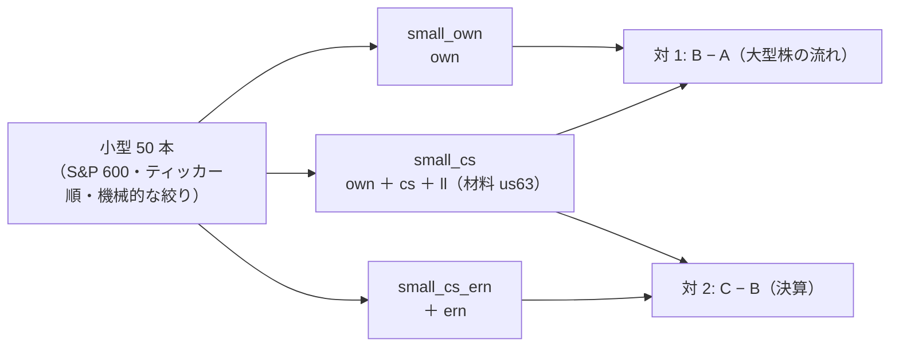
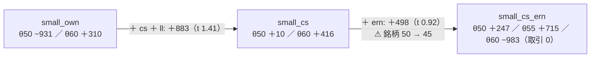

# 段 2: 中小型株（S&P 600）の表 — own ／ 大型株の流れ ／ 決算

2026-10-19（月）titan。利用者の指示「段 2 を進めて」（[プラン earnings-smallcap.md](../../plans/earnings-smallcap.md) §4 の段 2・§5 の E4 ＝ 推す案）。規約は [rules.md 27 章](feature-discovery/rules.md)。前の段は [earnings-layer.md](earnings-layer.md)（決算の層・段 1）・形の手本は [midcap-targets.md](midcap-targets.md)（中位 48 本）。
⚠ **これは投資助言ではなく調査資料である。** ⚠ 数字は【実測】（自前の机上の検証）。⚠ **この結果で実売買の人を替えない・候補の人を作らない**（E6）。

## 0. 回す前に決めたこと（⚠ この節は取得の前に書いた）

> この図の主張: 動かす軸は層だけ（own → ＋ 大型株の流れ → ＋ 決算）。銘柄と期間は 3 本で同じ。



| 項目 | 中身 |
| --- | --- |
| 銘柄（27-1） | Wikipedia「List of S&P 600 companies」（2026-10-19 取得・603 本）をティッカー順に先頭 70 本 → 機械的に ① 2018-06-27 以前から日足 ② 最後の終値 ≥ $5 ③ `us63` に無い → 先頭 50 本。⚠ 落ちた銘柄は §1 に残す・入れ替えない |
| 日足（27-2） | `cli.fetch --dataset small50_daily --symbols <70 本>`（新しい銘柄だけ）→ `cli.adjust --period d`（既存 136 本の adjusted が 1 バイトも変わらないことを sha256 で確かめる） |
| 期間（27-3） | 3 本とも 2018-06-27 〜 2026-09-09（`start_date` ＋ 新しい口 `end_date`。材料 63 本が 2026-09-09 で止まっているため） |
| 決算（27-4） | `earnings_daily` に `small50` を足して取り直す（26 章の規則のまま） |
| config（27-5） | `small_own` ／ `small_cs` ／ `small_cs_ern`（θ 50 ／ 55 ／ 60・Ridge・全部使う ／ 乱択・5 fold・パージ）。queue `smallcap1`（本番 3 ＋ leak 3） |
| 数（27-6） | **＋9（930 → 939）** |
| 比べ方 | `small_cs` − `small_own`・`small_cs_ern` − `small_cs` の fold 対（同じ切れ目 ＝ 検証日数で確かめる）。判定は対 B&H のまま |

先に書く見立て【推測】（27-7）: ① 採る 0 ② own だけは負・cs ＋ ll を足すと上がるが t < 1 ③ ern の対の差は |t| < 2 ④ 70 本のうち 2018-06 より前から日足が無いものが 10〜20 本 ⑤ 3 系列そろわない会社は 50 本中 5 社以上 ⑥ leak は own の `LEAK` 列で跳ねる。

```bash
cd experiments/feature-discovery
.venv/bin/python -m cli.fetch --dataset small50_daily --symbols <ティッカー順 70 本>     # 日足（新しい銘柄だけ）
.venv/bin/python -m cli.adjust --period d                                                 # 調整（既存は変わらない）
AIL_EDGAR_CONTACT="<名前> <メール>" .venv/bin/python -m cli.fetch --exog earnings_daily    # 決算（146 社）
for x in small_own small_cs small_cs_ern; do .venv/bin/python -m cli.build --experiment $x; .venv/bin/python -m cli.build --experiment $x --leak; done
.venv/bin/python -m cli.queue --config smallcap1                                          # 本番 3 ＋ leak 3
.venv/bin/python -m cli.report --catalog > ../../docs/specs/experiments/feature-discovery/ledger.md
```

## 1. 銘柄【実測 2026-10-19 22:30 PDT】（⚠ 規則は §0 ＝ 取得の前に固定。成績では選んでいない）

S&P 600 の構成銘柄 603 本（Wikipedia 2026-10-19 取得）のティッカー順の先頭 70 本を取り（`cli.fetch` 55 秒【実測】・206 銘柄の `raw/` を検査して manifest を書き直した ＝ 既存 136 本の中身は触っていない）、`cli.adjust --period d`（10 秒）のあと既存 136 本の adjusted が **1 バイトも変わらない**ことを sha256 で確かめた。絞りを当てて **通った 59 本 → 先頭 50 本を採用**・落ちた 11 本。

| 採用 50 本（ティッカー順） | 業種の内訳 |
| --- | --- |
| AAMI AAP AAT ABCB ABG ABM ACAD ACHC ACIW ACLS ACMR ACT ADAM ADEA ADMA ADNT ADT ADUS AEO AGO AGX AGYS AHCO AIN AIR AKR ALG ALGT ALKS ALRM AMN AMPH AMRX AMSF ANDE ANIP AORT AOSL APAM APLE APOG ARCB AROC ARR ASTE ASTH ATEN AUB AVA AWI | Health Care 12・Industrials 10・Financials 8・Information Technology 7・Real Estate 5・Consumer Discretionary 5・Consumer Staples 1・Energy 1・Utilities 1 |

| 落ちた 11 本 | 理由 |
| ---: | --- |
| ABR（Arbor Realty Trust） | 終値 $2.67 < $5 |
| ACA（Arcosa, Inc.） | 日足が 2018-11-01 から（2018-06-27 より後） |
| ADIG（ADI Global Distribution） | 日足が 2026-07-30 から（2018-06-27 より後） |
| AESI（Atlas Energy Solutions, Inc.） | 日足が 2023-03-09 から（2018-06-27 より後） |
| AGNT（eXp World Holdings, Inc.） | 終値 $3.73 < $5 |
| ALHC（Alignment Healthcare, Inc.） | 日足が 2021-03-26 から（2018-06-27 より後） |
| AMR（Alpha Metallurgical Resources, Inc.） | 日足が 2018-11-09 から（2018-06-27 より後） |
| AMTM（Amentum） | 日足が 2024-09-24 から（2018-06-27 より後） |
| ARLO（Arlo Technologies） | 日足が 2018-08-03 から（2018-06-27 より後） |
| ASO（Academy Sports + Outdoors） | 日足が 2020-10-02 から（2018-06-27 より後） |
| ATMU（Atmus Filtration Technologies Inc.） | 日足が 2023-05-26 から（2018-06-27 より後） |

通ったが 50 に入らなかった 9 本（先頭 50 の外）: AWR AX AZTA AZZ BANC BANF BANR BBT BCC。

- ⚠ **アルファベット順の限界**: 50 本は A と B の頭だけで、業種は Health Care 12・Industrials 10 に寄る。⚠ 偏っていても入れ替えない（入れ替えたら選別になる）
- ⚠ **ティッカーの履歴は前の会社のものを含みうる**（取得元はティッカー単位 ＝ 例: ACMR は 2011 年から・ACT〔Enact・上場 2021〕は 2013 年から・AAMI〔旧 BrightSphere〕は 2014 年から）。規則 ① は「そのティッカーで 2018-06-27 以前から足がある」の意味で、会社の連続性は見ていない ＝ 限界として残す
- ⚠ 生存バイアスは midcap48 より深い（いまの構成銘柄を過去に当てはめる ＝ 当時 600 に入っていて消えた会社は 1 本も無い）

## 2. 一言で（2026-10-19（月）22:33〜22:38 PDT・titan）

**採る 0 ／ 保留 5 ／ 落とす 4（n_trials 930 → 939）。小型 50 本も「自分の履歴だけ」では負で、大型株の流れ（cs ＋ ll）を足すと θ50 で ＋883bp/fold 上がる（t 1.41・4/5）＝ 中位 48 本（＋673bp・t 0.46）と同じ向き・同じ届かなさ。決算（ern）を足した差は ＋498 ／ ＋1,401 ／ −1,138bp（t 0.92 ／ 1.34 ／ −1.24）で、正の 2 つは fold 1 が 1 つで作り、銘柄の集合が fold ごとに変わる表なので読めない。** 3 本とも門前（holdout AUC 0.493 ／ 0.526 ／ 0.506・買い% 幅 5.6 ／ 6.7 ／ **1.6** 点）。leak 対照は 3 本とも跳ねた（AUC 1.000・t 13〜15）。見立て ①②③④⑥ はそのとおり（② の t は 1.41 で「t < 1」より大きい）・⑤ は 4 社（5 社以上と見た）。

> この図の主張: 層を足すたびに平均は上がるが、どれも fold の符号が割れて検出限界の下。決算を足した表は銘柄が減り（50 → 45・fold 1 は 39）、対の相手と同じ集合ではない。



## 3. 結果【実測】

### 3-1. 取得と表

| 項目 | 値 |
| --- | --- |
| 日足 | 70 本 `cli.fetch` 55 秒・`cli.adjust --period d` 10 秒（206 銘柄）・既存 136 本の adjusted は sha256 で一致（1 バイトも変わらない） |
| 決算 | `earnings_daily`（146 社）5 分【実測】。小型 50 本: 発表 50 ／ EPS 50 ／ 売上 **46**（ABCB・ADAM・ARR・AUB ＝ 銀行・REIT に売上の tag が無い）。行が少ない: ADT EPS 2・ACAD ／ ALKS ／ APLE EPS 17・AKR EPS 19 |
| 表 | `small_own` 102,408 行 × 35 列 ／ `small_cs` 101,284 行 × 313 列（ll の助走ぶん 1.1% 少ない）／ `small_cs_ern` **80,330 行** × 316 列・**45 社**（売上の無い 4 社 ＋ ADT〔EPS 2 行 ＝ 400 日より古くて欠損〕が落ち、EPS の行が少ない会社は欠損の期間が抜ける ＝ fold 1 は 39 社・fold 2 は 43 社） |
| 期間 | 3 本とも 2018-06-27 〜 2026-09-09（`end_date` で揃えた）。評価期間 ＝ own 1,717 日 ／ cs・ern 1,714 日（ll の助走で 3 日短い ＝ 切れ目が 1〜3 日ずれる。cs と ern は同じ切れ目） |

| fold | `small_own` | `small_cs`・`small_cs_ern` |
| ---: | --- | --- |
| 1 | 2019-11-07 〜 2021-03-19 | 2019-11-06 〜 2021-03-18 |
| 2 | 2021-03-22 〜 2022-08-01 | 2021-03-19 〜 2022-07-28 |
| 3 | 2022-08-02 〜 2023-12-11 | 2022-07-29 〜 2023-12-12 |
| 4 | 2023-12-12 〜 2025-04-25 | 2023-12-13 〜 2025-04-28 |
| 5 | 2025-04-28 〜 2026-09-09 | 2025-04-29 〜 2026-09-09 |

### 3-2. 9 行（全部使う × Ridge。判定は対 B&H ＝ rules.md 13-7）

| 表 | θ | 純利 bp/fold | 上乗せ（対 B&H） | t | fold 符号 | 保有日率 | 対 乱択ゲート | 判定 |
| --- | ---: | ---: | ---: | ---: | --- | ---: | ---: | --- |
| `small_own`（own・50 社） | 50 | −150 | −931 | −1.68 | −−−＋− | 0.69 | −43 | 落とす |
| | 55 | ＋334 | −447 | −0.79 | −−＋＋− | 0.37 | ＋143 | 落とす |
| | 60 | ＋1,091 | **＋310** | 0.41 | ＋＋＋＋− | 0.15 | ＋636（t 1.69） | **保留** |
| `small_cs`（own ＋ cs ＋ ll・50 社） | 50 | ＋733 | **＋10** | 0.02 | ＋0＋−− | 0.70 | ＋544（t 1.23） | **保留** |
| | 55 | ＋297 | −425 | −0.75 | −＋−＋− | 0.33 | −220 | 落とす |
| | 60 | ＋1,138 | **＋416** | 0.53 | ＋＋＋＋− | 0.29 | ＋569（t 1.44） | **保留** |
| `small_cs_ern`（＋ ern・45 社） | 50 | ＋1,231 | **＋247** | 0.44 | ＋0＋＋− | 0.68 | ＋704（t 2.08） | **保留** |
| | 55 | ＋1,698 | **＋715** | 0.81 | ＋＋＋＋− | 0.30 | ＋1,249（t 1.31） | **保留** |
| | 60 | 0 | −983 | −1.15 | −＋−＋− | **0.00** | 0 | 落とす（買い% が 60 に 1 日も届かない ＝ 取引 0） |

B&H（対象の等加重）は fold ごとに own 2,455 ／ −609 ／ 34 ／ −545 ／ 2,572・cs 2,578 ／ −763 ／ 146 ／ −874 ／ 2,525・ern 3,480 ／ −605 ／ 431 ／ −858 ／ 2,469bp ＝ ⚠ 表ごとに違う（ern は銘柄が違う・own と cs は切れ目が 1〜3 日違う）。

### 3-3. 対の差（後 − 前・fold の番号で対・全部使う × Ridge）

| 対 | θ | 差 mean bp/fold | t | 正の fold | fold ごと | 共通の銘柄だけ |
| --- | ---: | ---: | ---: | ---: | --- | --- |
| `small_cs` − `small_own`（大型株の流れ） | 50 | **＋883** | 1.41 | 4/5 | ＋2,938 ＋158 ＋1,097 −846 ＋1,067 | （銘柄は同じ） |
| | 55 | −37 | −0.13 | 2/5 | −250 ＋692 −1,025 0 ＋398 | |
| | 60 | ＋47 | 0.51 | 2/5 | ＋265 −236 ＋234 0 −28 | |
| `small_cs_ern` − `small_cs`（決算） | 50 | ＋498 | 0.92 | 3/5 | −436 ＋159 −230 **＋2,589** ＋407 | 45 社: ＋579（t 1.1） |
| | 55 | ＋1,401 | 1.34 | 2/5 | **＋5,361** −28 ＋1,674 0 −4 | ＋1,145（t 1.2） |
| | 60 | −1,138 | −1.24 | 1/5 | −4,716 0 −1,004 0 ＋28 | −1,187（t −1.3） |

- 大型株の流れ: θ50 の ＋883 は 4/5 の fold で正だが t 1.41・DSR 0.005 ＝ 中位 48 本（＋673・t 0.46）と同じ「良くなるが届かない」。θ55 ／ 60 では差が無い（どちらもほぼ現金）
- 決算: θ55 の ＋1,401 は fold 1（2019-11〜2021-03）の ＋5,361 が 1 つで作る。⚠ ern の表は fold 1 が 39 社・fold 2 が 43 社と**銘柄の集合が fold ごとに違う**（EPS の行が少ない会社が欠損で抜ける）ので、fold の対も「共通の銘柄だけ」（per_symbol の銘柄平均）も同じ集合の比較にならない（B&H が fold 1 で 2,578 → 3,480bp と 900bp 違う）。θ60 は買い% が 60 に届かず取引 0（幅 1.6 点 ＝ 列が増えて較正の幅がさらに潰れた）
- 乱択（16 列）の対は読まない（列の数が変わると乱数の引きが変わる）

## 4. 見立てと次【推測】

- **小型株でも形は同じ**: own だけは負・大型株の流れで上がるが検出限界の下・決算は読める差を作らない。「流れは大型株から」の向きは 2 度（中位 48・小型 50）とも合ったが、大きさは t 1.4 止まり
- **決算の層を小型株で読むには、表の銘柄が時間で変わらない形が要る**（欠損を落とさず「無い」を列にする・EPS の tag を広げる・stale を伸ばす ＝ どれも新しい処置として先に登録）。いまの 26-4 の「3 列とも揃った行だけ」は、小型株では会社ごとの抜けが多くて集合が揺れる
- **保留 5 本はどれも平均だけ正・符号が割れる・1 fold が作る**（own θ60 の fold 1 ＋1,996・cs θ60 の fold 1 ＋2,138・ern θ55 の fold 1 ＋3,529）。⚠ この行で候補の人を作らない・段 3 に進む根拠にしない
- **段 3（候補の人・sim）に進む材料は無い**。進めるなら本番の壁（スプレッド・1 株の枠・予測の時間 ＝ プラン §3）を先に測る方が先。⚠ 本番に入れるかは 11/4 の判定の後・利用者（E6）
- 直すなら新しい処置として登録するもの（⚠ 今回は回していない）: ① 欠損を「無い」の列にして銘柄を落とさない ern ② 非線形の学習器（LightGBM）× cs ＋ ll ③ 費用を上げた行（小型株のスプレッド）④ 最短保有（売買の回数を減らす）
