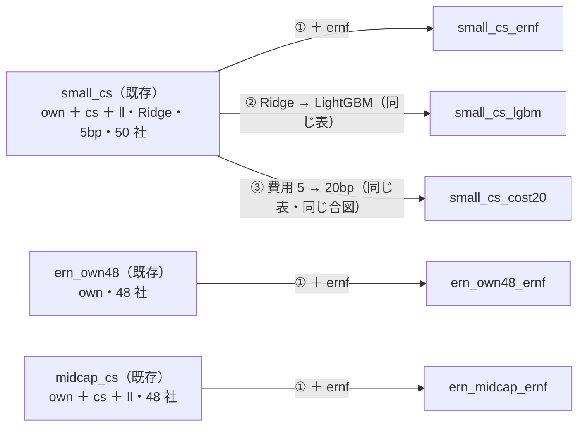
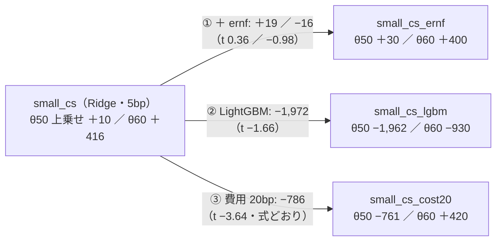

# 段 2b: 決算と小型株の 3 処置 — 欠損を印にする決算の層 `ernf` ／ 小型 50 × LightGBM ／ 費用 20bp

2026-10-22（木）titan。利用者の指示「3 本まとめて進めて」（[プラン earnings-smallcap.md](../../plans/earnings-smallcap.md) §6 ＝ 段 2 の見立て [smallcap-stage2.md §4](smallcap-stage2.md) の ①②③）。規約は [rules.md 28 章](feature-discovery/rules.md)。前の段は [earnings-layer.md](earnings-layer.md)（段 1）・[smallcap-stage2.md](smallcap-stage2.md)（段 2）。
⚠ **これは投資助言ではなく調査資料である。** ⚠ 数字は【実測】（自前の机上の検証）。⚠ **この結果で実売買の人を替えない・候補の人を作らない**（E6）。

## 0. 回す前に決めたこと（⚠ この節は結果を見る前に書いた）

> この図の主張: 3 つの処置はどれも既存の行から軸を 1 本だけ動かす。対の相手は既存の実行で、回し直さない。



| 項目 | 中身 |
| --- | --- |
| ① 層 `ernf`（28-1） | 26-4 の 3 列の欠損を印の列 3 本（`ern_na_ann` ／ `ern_na_eps` ／ `ern_na_rev`。1 ＝ 無い）に写し、値の列は埋める（日数 ＝ `ern_max_stale_days` 400・前年同期比 ＝ 0）。系列の無い銘柄・欠損の期間も表に残る ＝ **対の相手と銘柄・行・fold の切れ目が同じ**。`ern`（欠損のまま落とす）は 1 ビットも変わらない |
| ② LightGBM（28-2） | `small_cs_lgbm` ＝ `small_cs` の表を借りて（`features_from`）model だけ LightGBM（既定のハイパーパラメータ） |
| ③ 費用（28-3） | `small_cs_cost20` ＝ `small_cs` の表を借りて `cost_bp = 20`（往復。1 水準だけ【推測】＝ 小型株の気配の差は大型株の数倍〜十倍）。識別項目は検証方式の変種 `閾値売買（費用20bp）`・名前は `~cost20`。⚠ 既定の 5bp は書かない ＝ 既存の行は割れない（✅ 回す前に検証結果一覧を吐き直して生成日以外は差 0 行〔09:37 PDT〕） |
| config（28-4） | `ern_own48_ernf`（対 `ern_own48`）／ `ern_midcap_ernf`（対 `midcap_cs`）／ `small_cs_ernf`（対 `small_cs`）／ `small_cs_lgbm`（対 `small_cs`）／ `small_cs_cost20`（対 `small_cs`）。queue `earnings2`（本番 5 ＋ leak 5。5 本全部か回さないか） |
| 数（28-5） | **＋15（939 → 954）**。EDGAR は 2026-10-19 の 146 社のまま（取り直さない ＝ 連絡先は要らない） |
| 比べ方（28-6） | fold 対（同じ切れ目を 検証日数 で確かめる）。① は 3 表の「決算の有無の差」を 26 章・27 章の `ern` の対と横に置く ／ ② はモデルの差 ／ ③ は粗利が同じで純利の差 ＝ 費用の差だけ（式 純利(c) ＝ 粗利 − (粗利 − 純利₅) × c ／ 5 と一致すること） |

先に書く見立て【推測】（28-7）: ① 採る 0・対の差は 3 表とも |t| < 2・小型 50 の θ60 は取引 0 のまま ② 採る 0・LightGBM は門を通るが上乗せの向きは Ridge と同じで t < 2 ③ 採る 0・θ50 の対 B&H 上乗せは ＋10 → −761bp/fold（式で先に引いた。損益分岐の費用 5.2bp）・θ55 −425 → −456・θ60 ＋416 → ＋420 ④ leak は own の `LEAK` 列で 5 本とも跳ねる。

```bash
cd experiments/feature-discovery
for x in ern_own48_ernf ern_midcap_ernf small_cs_ernf; do .venv/bin/python -m cli.build --experiment $x; .venv/bin/python -m cli.build --experiment $x --leak; done
.venv/bin/python -m cli.queue --config earnings2                                          # 本番 5 ＋ leak 5
.venv/bin/python -m cli.report --catalog > ../../docs/specs/experiments/feature-discovery/ledger.md
```

## 1. 一言で（2026-10-22（木）09:37〜09:46 PDT・titan）

**採る 0 ／ 保留 4 ／ 落とす 11（n_trials 939 → 954）。① 欠損を印にして銘柄を落とさない決算の層 `ernf` にすると、決算の有無の対の差は 3 表とも数十 bp・\|t\| ≤ 1.64 に縮んだ（own48 ＋37 ／ −30 ／ ＋18・中位 48 −15 ／ ＋34 ／ 0・小型 50 ＋19 ／ −11 ／ −16bp/fold）＝ 段 1・段 2 で `ern` の対に出ていた ＋498 ／ ＋1,401 ／ −1,138 などは決算の情報ではなく「銘柄の集合が変わった」差だった。② 小型 50 × LightGBM は Ridge より 3 水準とも下（−1,972 ／ −427 ／ −1,347bp/fold・t −1.66 ／ −0.44 ／ −1.12）で 3 行とも落とす。③ 費用 20bp は式のとおり（全手法 × θ × fold で純利が 1 ビットも違わない）: θ50 の対 B&H 上乗せは ＋10 → −761bp/fold・損益分岐の費用 5.2bp ＝ 小型 50 の「大型株の流れ」θ50 の行は費用 5bp の仮定の上にしか立っていない。θ60（取引 36 回/fold）は ＋416 → ＋420 で変わらず保留のまま。** 5 本とも門前（holdout AUC 0.498 ／ 0.523 ／ 0.526 ／ 0.512 ／ 0.526・買い% 幅 5〜7 点）・leak 5 本は跳ねた（AUC 0.999〜1.000・θ50 の t 13〜19）。見立て ①（\|t\| < 2）・③・④ はそのとおり。外れ: ① の「小型 50 の θ60 は取引 0 のまま」（取引 0 は銘柄が減った表の較正の幅のせいで、`ernf` の表では `small_cs` と同じ 36 回）・② の「門を通る・向きは Ridge と同じ」（門前のまま・向きは負）。

> この図の主張: 3 本とも既存の行から軸を 1 本だけ動かした。決算を足しても動かず、非線形にすると下がり、費用を 4 倍にすると θ50 は沈む。



## 2. 結果【実測】

### 2-1. 表と所要時間

| 項目 | 値 |
| --- | --- |
| 表（`ernf`） | `ern_own48_ernf` 103,708 行 × 47 列・48 社（`ern_own48` と行・銘柄・切れ目が同じ）／ `ern_midcap_ernf` 96,912 行 × 325 列・48 社（＝ `midcap_cs`）／ `small_cs_ernf` 101,284 行 × 325 列・50 社（＝ `small_cs`。26-4 の `small_cs_ern` は 80,330 行・45 社だった）。3 表とも B&H が対の相手と fold ごとに一致（式の上で同じ行 ＝ 同じ B&H） |
| 印の割合 | `ern_na_ann` ／ `ern_na_eps` ／ `ern_na_rev`（1 ＝ 無い）の行の平均: own48 2.7 ／ 7.3 ／ 9.4%・中位 48 3.1 ／ 5.5 ／ 9.7%・小型 50 1.4 ／ 9.1 ／ **14.4%**（売上の tag が無い銀行・REIT 4 社 ＋ EPS の行が少ない会社の欠損の期間） |
| 切れ目 | own48: f1 2019-07-09〜2020-12-08 ／ f2 〜2022-05-16 ／ f3 〜2023-10-19 ／ f4 〜2025-03-30 ／ f5 〜2026-09-04（検証日数 360 ／ 361 ／ 359 ／ 360 ／ 361）。中位 48: f1 2019-11-05〜2021-03-16 ／ f2 〜2022-07-26 ／ f3 〜2023-12-13 ／ f4 〜2025-04-28 ／ f5 〜2026-09-09（342 ／ 343 ／ 341 ／ 342 ／ 343）。小型 50: [smallcap-stage2.md §3-1](smallcap-stage2.md) の `small_cs` と同じ（343 ／ 343 ／ 342 ／ 343 ／ 343）。**5 本とも対の相手と検証日数が fold ごとに一致** |
| 時間 | 表 6 枚 約 5 分（09:37〜09:42）・queue 10 本 **3 分 20 秒**（Ridge 8〜17 秒・LightGBM 23 秒・その leak 74 秒）【実測】。見積り 15〜25 分【推測】は大きすぎた（LightGBM 313 列 × 101k 行でも 23 秒） |

### 2-2. 15 行（全部使う。判定は対 B&H ＝ rules.md 13-7）

| 表 | θ | 純利 bp/fold | 上乗せ（対 B&H） | t | fold 符号 | 保有日率 | 取引/fold | 対 乱択ゲート | 判定 |
| --- | ---: | ---: | ---: | ---: | --- | ---: | ---: | ---: | --- |
| `ern_own48_ernf`（own ＋ ernf・Ridge・48 社） | 50 | ＋1,540 | −179 | −0.83 | −＋−−＋ | 0.72 | 936 | ＋117 | 落とす |
| | 55 | ＋1,011 | −709 | −1.91 | −−−−− | 0.55 | 69 | −22 | 落とす |
| | 60 | ＋730 | −989 | −2.36 | ＋−−−− | 0.29 | 25 | −36 | 落とす |
| `ern_midcap_ernf`（own ＋ cs ＋ ll ＋ ernf・Ridge・48 社） | 50 | ＋1,322 | **＋134** | 0.52 | ＋＋−＋− | 0.64 | 1,637 | ＋406（t 1.15） | **保留** |
| | 55 | ＋903 | −286 | −1.07 | ＋＋−−− | 0.49 | 89 | ＋148 | 落とす |
| | 60 | ＋144 | −1,045 | −2.82 | −−−−− | 0.25 | 19 | −196 | 落とす |
| `small_cs_ernf`（own ＋ cs ＋ ll ＋ ernf・Ridge・50 社） | 50 | ＋752 | **＋30** | 0.05 | ＋0＋−− | 0.70 | 2,547 | ＋586（t 1.16） | **保留** |
| | 55 | ＋286 | −436 | −0.77 | −＋−＋− | 0.33 | 152 | −170 | 落とす |
| | 60 | ＋1,122 | **＋400** | 0.51 | ＋＋＋＋− | 0.30 | 36 | ＋577（t 1.44） | **保留** |
| `small_cs_lgbm`（own ＋ cs ＋ ll・LightGBM・50 社） | 50 | −1,240 | −1,962 | −2.38 | −−−＋− | 0.54 | 2,830 | −1,501（t −2.27） | 落とす |
| | 55 | −129 | −852 | −0.96 | −＋＋−− | 0.46 | 942 | −475 | 落とす |
| | 60 | −208 | −930 | −0.86 | −＋−＋− | 0.19 | 724 | −667 | 落とす |
| `small_cs_cost20`（own ＋ cs ＋ ll・Ridge・**費用 20bp**・50 社） | 50 | −54 | −761 | −1.12 | ＋0−−− | 0.70 | 2,597 | ＋544（t 1.22） | 落とす |
| | 55 | ＋251 | −456 | −0.79 | −＋−＋− | 0.33 | 154 | −216 | 落とす |
| | 60 | ＋1,128 | **＋420** | 0.54 | ＋＋＋＋− | 0.29 | 36 | ＋574（t 1.44） | **保留** |

- 門（訓練内 holdout）: AUC 0.498 ／ 0.523 ／ 0.526 ／ 0.512 ／ 0.526・買い% の幅 6.1 ／ 5.0 ／ 6.8 ／ 6.7 ／ 6.7 点 ＝ 5 本とも門前（診断で回した。対の相手も門前）。LightGBM だけ fold 1 の幅が 30.9 点（ほかの fold は 2〜11 点）
- leak 対照: AUC 1.000 ／ 1.000 ／ 1.000 ／ 0.999 ／ 1.000・θ50 の上乗せ t 19.4 ／ 17.0 ／ 13.3 ／ 13.3 ／ 12.8 ＝ 5 本とも跳ねた（配線は通っている）
- B&H（対象の等加重・fold）: own48 2,764 ／ 834 ／ 442 ／ 2,388 ／ 2,168 ＝ `ern_own48` と同じ ／ 中位 48 2,341 ／ 640 ／ 1,043 ／ 302 ／ 1,617 ＝ `midcap_cs` と同じ ／ 小型 50 2,578 ／ −763 ／ 146 ／ −874 ／ 2,525 ＝ `small_cs` と同じ（費用 20bp では往復 1 回ぶん 15bp 下がる） |

### 2-3. 対の差（後 − 前・fold の番号で対・全部使う）

| 対 | θ | 差 mean bp/fold | t | 正の fold | fold ごと | （参考）26-4 の `ern` の対（集合が違う） |
| --- | ---: | ---: | ---: | ---: | --- | --- |
| `ern_own48_ernf` − `ern_own48`（決算・48 社） | 50 | ＋37 | 0.99 | 3/5 | ＋42 −40 −16 ＋174 ＋24 | −92（t −0.49） |
| | 55 | −30 | −1.49 | 1/5 | −56 −96 0 ＋4 0 | ＋312（t 1.10） |
| | 60 | ＋18 | 1.64 | 3/5 | ＋60 ＋22 0 ＋10 0 | −85（t −0.66） |
| `ern_midcap_ernf` − `midcap_cs`（決算・中位 48） | 50 | −15 | −0.67 | 1/5 | −59 0 ＋56 −3 −71 | ＋51（t 0.58） |
| | 55 | ＋34 | 0.61 | 1/5 | ＋252 −30 0 −38 −17 | −62（t −0.18） |
| | 60 | **0** | — | 0/5 | 0 0 0 0 0 | ＋517（t 1.09） |
| `small_cs_ernf` − `small_cs`（決算・小型 50） | 50 | ＋19 | 0.36 | 2/5 | −25 0 ＋169 −147 ＋101 | ＋498（t 0.92） |
| | 55 | −11 | −1.39 | 0/5 | −8 0 −43 0 −5 | ＋1,401（t 1.34） |
| | 60 | −16 | −0.98 | 1/5 | ＋1 0 −82 0 0 | −1,138（t −1.24） |
| `small_cs_lgbm` − `small_cs`（学習器） | 50 | **−1,972** | −1.66 | 1/5 | −6,379 −1,451 −1,908 ＋686 −811 | — |
| | 55 | −427 | −0.44 | 2/5 | −3,374 −350 ＋1,185 −1,608 ＋2,014 | |
| | 60 | −1,347 | −1.12 | 2/5 | −6,031 ＋413 −1,004 ＋436 −546 | |
| `small_cs_cost20` − `small_cs`（費用） | 50 | **−786** | −3.64 | 0/5 | −723 −15 −1,200 −806 −1,187 | 式どおり |
| | 55 | −46 | −1.52 | 0/5 | −165 0 −44 0 −24 | |
| | 60 | −11 | −1.41 | 0/5 | −39 0 −14 0 0 | |

- **① 決算**: 同じ集合にすると差は 3 表 9 対とも数十 bp（最大 ＋37）・\|t\| ≤ 1.64。中位 48 の θ60 は 1 ビットも変わらない（買い% が 60 に届く日の集合が同じ）。段 1・段 2 の `ern` の対（右端の列）は 45〜46 社に減った表と 48〜50 社の表の比較で、差の大半は「落ちた会社のぶん」だった。⚠ 印の列（無い ＝ 1）は買い% の幅を広げない（5.9 → 6.1・5.1 → 5.0・6.7 → 6.8 点）
- **② 学習器**: LightGBM は買い% の幅が fold 1 だけ 30.9 点に広がった（ほかは 2〜11 点）が、その fold で −6,379bp ＝ 広がったぶんだけ外した。取引 2,830 回/fold（Ridge 2,597）・保有日率 0.70 → 0.54。中位 48 の `trade_cs_lgbm_a`（2026-09-13）と同じ「非線形にしても届かない」
- **③ 費用**: 粗利・取引回数は 1 ビットも違わず、純利は 式 純利(c) ＝ 粗利 − (粗利 − 純利₅) × c ／ 5 と全手法 × θ × fold で一致（最大のずれ 0.0000bp）＝ 変種の配線は正しい。θ50 は費用 1bp につき上乗せ −51bp/fold（取引 2,597 回 ＝ 保有日率 0.70 で毎日のように出入り）→ **損益分岐 5.2bp** ＝ ⚠ **小型 50 の「大型株の流れ」θ50 の行は、5bp の仮定を 0.2bp 超えただけで B&H を割る**。θ55（取引 154）は −2.1bp/bp・θ60（取引 36）は ＋0.3bp/bp（B&H の往復 1 回のほうが費用が多い）＝ 取引の少ない行は費用に鈍い
- 乱択（16 列）の対は読まない（① は列の数が変わる・② は学習器が違う）

## 3. 見立てと次【推測】

- **決算の層は 3 表（大型 48・中位 48・小型 50）で同じ集合の対を取っても読める差を作らない** ＝ この 3 列（発表からの日数・EPS ／ 売上の前年同期比・1 日ずらし）には翌日の方向の情報は無い。残る形（発表後 n 日の印 ＝ E3 の 3 つ目・発表前の空白・予想との差 ＝ サプライズ）のうちサプライズは予想のデータが要り EDGAR には無い ＝ 新しい取得元 ＋ 新しい処置として先に登録。⚠ 26-4 の `ern` の対（段 1・段 2）の数字は「決算の効き」として読まない（記録はそのまま残す）
- **小型 50 の「大型株の流れ」は費用に 1 番弱い行（θ50・毎日出入り）で立っている**。実売買で気配の差が 5bp を超えれば消える（大型株 5 本でも差 1 の中央値は 0.00bp だが、小型株は【推測】で数倍）＝ 段 3（候補の人）に進む材料はさらに無い。費用に鈍い θ60（取引 36 回/fold・保留）は 1 fold（2019-11〜2021-03 ＋4,677）が作る ＝ 候補の人を作らない
- 非線形は小型株でも効かない（中位 48 と同じ）。内側選抜（14-12）で水準を選んでも中位 48 では届かなかった ＝ 回さない
- ⚠ 結果を見て 埋め値・印の列・費用の水準・θ・ハイパーパラメータ・銘柄・期間を動かさない（14-9）。④ 最短保有は 25 章の形で別の回（回すかは利用者）。⚠ 本番に入れるかは 11/4 の判定の後・利用者（E6）

## 4. 見立ての答え合わせ

| # | 先に書いた見立て【推測】 | 結果 |
| ---: | --- | --- |
| ① | 採る 0・対の差は 3 表とも \|t\| < 2・印の列は幅を動かさない・小型 50 の θ60 は取引 0 のまま | ✅ 採る 0・\|t\| ≤ 1.64・幅 ±0.2 点 ／ ❌ 小型 50 の θ60 は取引 36 回（取引 0 は 45 社の表の較正の幅のせいだった） |
| ② | 採る 0・LightGBM は門を通る・上乗せの向きは Ridge と同じで t < 2 | ✅ 採る 0・\|t\| < 2 ／ ❌ 門前のまま（AUC 0.512・幅 6.7 点）・向きは負（3 水準とも Ridge より下） |
| ③ | 採る 0・θ50 ＋10 → −761・θ55 −425 → −456・θ60 ＋416 → ＋420（式で先に引いた） | ✅ 3 つとも 1 ビットも違わず一致・採る 0（θ60 は保留のまま） |
| ④ | leak は own の `LEAK` 列で 5 本とも跳ねる | ✅ AUC 0.999〜1.000・t 13〜19 |
