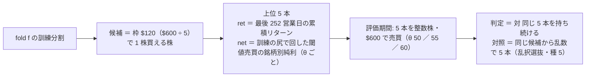

# 小型・中位株から「成績の良い銘柄」を選ぶ処理 — 訓練分割の成績で選ぶ walk-forward の選抜

2026-10-22（木）titan。利用者の指示「小型中型から成績を良い銘柄を選ぶ処理を行う」→ 物差しは「両方」・予算は「一人 600 ドル使えるものとする」（[プラン symbol-selection-by-training.md](../../plans/archive/symbol-selection-by-training.md)）。規約は [rules.md 29 章](feature-discovery/rules.md)（⚠ 回す前に書いた）。
⚠ **これは投資助言ではなく調査資料である。** ⚠ 数字は【実測】（自前の机上の検証）。⚠ **この結果で実売買の人を替えない・候補の人を本番に入れない**（11/4 の判定の後・利用者）。

## 0. 回す前に決めたこと（⚠ この節は結果を見る前に書いた）

> この図の主張: 選ぶのは fold ごとに訓練分割の中だけ。評価期間は選んだ 5 本を 20 章の器で測るだけで、何も選ばない。



| 項目 | 中身 |
| --- | --- |
| 集合・表 | 小型 50（`sel_small_cs` ＝ `small_cs` の表を借りる）／ 中位 48（`sel_midcap_cs` ＝ `midcap_cs` の表）。own ＋ cs ＋ ll × Ridge・5 fold・費用 5bp |
| 候補（29-2） | 訓練分割の最後の終値が枠 $120 以下の銘柄（買える株だけ） |
| 物差し（29-3） | `ret` ＝ 最後の 252 営業日の累積対数リターン（126 行未満は外す）／ `net` ＝ `tail_holdout` の尻で回した 13 章の閾値売買の銘柄別純利 bp（θ ごと・20 行未満は外す）。同点は銘柄名の昇順 |
| 器と対照（29-4） | `simulate_topk`（K 5・整数株・$600）。判定の相手 ＝ `基準 持ち続ける〔トレーダー・選抜…〕`（同じ 5 本）／ 対照 ＝ `基準 乱択選抜〔…〕`（同じ候補から乱数で 5 本・種 5 の平均。数えない）／ 診断 ＝ 乱択持ち続ける・選んだ銘柄・候補数 |
| 数（29-6） | 2 config × 条件 2 × θ 3 ＝ **＋12（954 → 966）**。leak 2 本は数えない。素の行は既存と同じ識別項目（再現の検算） |
| 読み方（29-7） | 判定 ＝ 選んだ 5 本の上でモデルが効いたか（対 持ち続ける）。**選抜の価値** ＝ 持ち続ける〔選抜〕 − 乱択持ち続ける（fold 対の差・t）と、手法の行 − 乱択選抜 |

先に書く見立て【推測】（29-7）: 採る 0。選抜の行の判定は fold で割れる（5 本は 1〜2 本の運）。選抜の価値は `ret` で平均が正でも |t| < 2・`net` は 0 の周り。中位 48 は枠 $120 で候補が半分ほどに減る。2 集合で向きは揃わない。

```bash
cd experiments/feature-discovery
.venv/bin/python -m cli.queue --config symbol_select                                      # 本番 2 ＋ leak 2
.venv/bin/python -m cli.report --catalog > ../../docs/specs/experiments/feature-discovery/ledger.md
.venv/bin/python -m cli.select_symbols --experiment sel_small_cs                          # いまの選抜（全期間を訓練に。読むだけ）
```

## 1-0. 1 回目で見つけた退化（2026-10-22 17:04 PDT。⚠ 判定を読む前に直した）

1 回目の実行（`2026-10-22T17-03-39_sel_small_cs`・`…T17-04-11_sel_midcap_cs` と leak 2 本・各 16 秒）の診断と `cli.select_symbols` で、`net` の θ55 ／ 60 は訓練の尻で 1 回も取引しない銘柄が全部「純利 0」で同点になり、銘柄名の順（AAMI・AAP・AAT・ABCB・ABM）が選ばれていた【実測】。規約 29-3 に「尻で 1 回も取引しなかった銘柄は成績なし ＝ 候補から外す（候補 0 本なら何も選ばない）」を足し、回し直した。⚠ 1 回目の 4 本は DB に残る（閉じた実行は消せない）＝ 検証結果一覧の `net` θ55 ／ 60 の行は 2 実行・不一致と出る。θ50 と `ret` は 1 ビットも変わらない。

## 1. 一言で（2026-10-22（木）17:11〜17:12 PDT・titan。queue `symbol_select` 本番 2 ＋ leak 2・各 16 秒【実測】）

**採る 0 ／ 保留 4 ／ 落とす 8（n_trials 954 → 966）。** 訓練分割だけで 5 本を選んで $600・整数株で売買すると、**選んだ 5 本の上でモデルが効いたか（判定 ＝ 対 持ち続ける）は θ50 の「モデルの成績」で小型 +443（3/5）・中位 +587（4/5）の保留止まり**（t 1.56 ／ 1.33）。
**選抜そのものの価値（選んだ 5 本を持ち続ける − 乱数の 5 本を持ち続ける）は「株自身の成績（12 か月モメンタム）」で 2 集合とも正**（小型 +552・4/5・t 0.69 ／ 中位 +1,466・5/5・t 1.62）**だが t は 2 に届かず、「モデルの成績」では 0 の周り**（−179 ／ +789）。θ55 ／ 60 は選んだ 5 本をほとんど売買しない（fold の過半が全期間 現金）ので持ち続けるに負けて落とす。leak 対照は 4 本とも跳ねた（差 +16,715〜+41,267bp）。素の行（θ 3 つ）は既存の `small_cs` ／ `midcap_cs` と 3 実行・一致（配線の検算）。
⚠ **この結果で候補の人を作らない・本番に入れない**。いまの選抜（全期間を訓練に）は §3 に**案**として写す。

## 2. 結果【実測】

fold の評価期間（2 表とも同じ切れ目・±2 日）: 1 ＝ 2019-11〜2021-03 ／ 2 ＝ 2021-03〜2022-07 ／ 3 ＝ 2022-07〜2023-12 ／ 4 ＝ 2023-12〜2025-04 ／ 5 ＝ 2025-04〜2026-09。候補（枠 $120 で買える株）は fold ごとに 小型 46〜48 本 ／ 中位 22〜32 本（48 本中）。

### 2-1. 12 行（判定は対 同じ 5 本を持ち続ける ＝ rules.md 20-3。bp/fold）

| 集合 | 物差し | θ | 上乗せ（対 持ち続ける） | fold | 判定 | 純利 | 持ち続ける | 乱択選抜（基準線） |
| --- | --- | ---: | ---: | --- | --- | ---: | ---: | ---: |
| 小型 50 | ret 株自身 | 50 | +34.6 | 2/5 −0−＋＋ | 保留 | 1,585 | 1,551 | 1,192 |
| 小型 50 | ret 株自身 | 55 | −855.4 | 0/5 | 落とす | 695 | 1,551 | 248 |
| 小型 50 | ret 株自身 | 60 | −84.4 | 1/5 | 落とす | 1,466 | 1,551 | 818 |
| 小型 50 | net モデル | 50 | +443.3 | 3/5 ＋0−＋＋ | 保留 | 1,263 | 820 | 1,192 |
| 小型 50 | net モデル | 55 | −1,224.4 | 0/5 −0−0− | 落とす | 369 | 1,593 | 248 |
| 小型 50 | net モデル | 60 | +239.5 | 1/5 0000＋ | 保留 ⚠ | 0 | −240 | 818 |
| 中位 48 | ret 株自身 | 50 | −220.2 | 2/5 ＋−−＋− | 落とす | 2,450 | 2,670 | 1,292 |
| 中位 48 | ret 株自身 | 55 | −1,147.6 | 1/5 | 落とす | 1,522 | 2,670 | 554 |
| 中位 48 | ret 株自身 | 60 | −2,270.4 | 0/5 | 落とす | 400 | 2,670 | 244 |
| 中位 48 | net モデル | 50 | +587.0 | 4/5 ＋＋＋＋− | 保留 | 2,580 | 1,993 | 1,292 |
| 中位 48 | net モデル | 55 | −581.1 | 1/5 −＋0−− | 落とす | 1,477 | 2,058 | 554 |
| 中位 48 | net モデル | 60 | −145.5 | 0/5 −0000 | 落とす | 536 | 682 | 244 |

- ⚠ 小型 50 の net θ60 の「保留」は退化: fold 5 で選べたのが 1 本（AMSF）だけ・その 1 本も評価期間で 1 度も買わず（純利 0）、持ち続けるが −1,198 ＝ **「何もしなかった」が勝っただけ**（ほかの 4 fold は候補 0 本で 0 対 0）。θ55 ／ 60 は 2 集合とも、fold の過半で選んだ 5 本を 1 度も買わない（訓練の尻でも取引が無い ＝ 29-3 で候補から外れる）
- `ret` の選抜は θ に依らず同じ 5 本（fold 1〜5: 小型 ＝ ACAD ABG ANIP AGYS ADEA ／ ADNT AAMI ACMR AOSL ACHC ／ ACLS AMPH ACMR ADMA ARCB ／ AMPH ACMR AMRX AIR AROC ／ ADMA ACIW AMRX ADT AROC。中位 ＝ ARES AMAT APO ACGL BALL ／ APA AMAT AES BG AIG ／ APA ADM BG ATO AIG ／ APP AIG ARES ACGL AOS ／ AEE APH AFL AEP ANET）。`net` θ50 は fold ごとに別（診断 `trader.csv` の `選んだ銘柄`）

### 2-2. 対の差（fold 5 の対・平均 bp/fold・t ＝ 5 つの差の t）

| 集合 | 物差し | θ | 手法 − 持ち続ける（判定の量） | **持ち続ける〔選抜〕 − 乱択持ち続ける（選抜の価値）** | 手法 − 乱択選抜 |
| --- | --- | ---: | ---: | ---: | ---: |
| 小型 50 | ret | 50 | +35（t 0.08・2/5） | **+552（t 0.69・4/5）** | +393（t 0.41） |
| 小型 50 | net | 50 | +443（t 1.56・3/5） | **−179（t −0.16・3/5）** | +71（t 0.10） |
| 中位 48 | ret | 50 | −220（t −0.45・2/5） | **+1,466（t 1.62・5/5）** | +1,158（t 1.16） |
| 中位 48 | net | 50 | +587（t 1.33・4/5） | **+789（t 0.73・2/5）** | +1,288（t 1.27） |

- 選抜の価値（太字）は **「株自身の成績」で 2 集合とも平均が正・fold の符号も 4/5 ／ 5/5 だが、t は 0.69 ／ 1.62**（5 対では 2 に届かない）。「モデルの成績」は 0 の周り（尻 ≈ 10 か月の銘柄別純利に順位の情報はほぼ無い）＝ 29-7 の見立てどおり
- θ55 ／ 60 の対の差は省く（手法の行が「売買しない」なので持ち続けるとの差 ＝ −持ち続けるの純利）

### 2-3. leak 対照（配線の検査。rules.md 13-10）

小型 50 ＝ ret +31,683 ／ net +41,267bp・中位 48 ＝ ret +16,715 ／ net +22,724bp（手法 − 持ち続ける・θ 3 つとも同じ）＝ 未来を知る列を混ぜると跳ねる ✅。

## 3. いまの選抜（全期間 2018-06-27〜2026-09-09 を訓練に・`cli.select_symbols`・読むだけ）【実測】

⚠ **候補の人の銘柄の「案」。これで人を作っても成績で採らない**（rules.md 29-8）。θ55 ／ 60 の「モデルの成績」は訓練の尻で 1 本も取引が無いので「—」。

| 集合（候補） | 物差し | θ | 5 本 | 物差しの値（上から） |
| --- | --- | ---: | --- | --- |
| 小型 50（44 本） | ret 株自身 | 50 ／ 55 ／ 60 | ACMR AAMI ANDE ADEA AMRX | 252 営業日の累積対数リターン +0.95 ／ +0.68 ／ +0.59 ／ +0.54 ／ +0.53 |
| 小型 50（44 本） | net モデル | 50 | ACMR AAMI ADEA AMN ACHC | 尻 202 行の閾値売買の純利 +8,550 ／ +7,743 ／ +7,556 ／ +7,312 ／ +6,417bp |
| 中位 48（16 本） | ret 株自身 | 50 ／ 55 ／ 60 | APA ADM APH AKAM BEN | — |
| 中位 48（16 本） | net モデル | 50 | APA BEN ADM BAX BALL | — |

- 中位 48 は枠 $120 で 16 本しか候補にならない（1 株 $120 超が 30 本 ＝ [smallcap-stage2b.md §5](smallcap-stage2b.md)）。小型 50 は 44 本
- 2 つの物差しで 3 本（小型 ACMR・AAMI・ADEA ／ 中位 APA・ADM・BEN）が重なる

## 4. 見立ての答え合わせ

| # | 先に書いた見立て【推測】（29-7） | 結果 |
| ---: | --- | --- |
| 1 | 採る 0・選抜の行の判定は fold で割れる | ✅ 採る 0・最良でも 4/5（中位 net θ50） |
| 2 | 選抜の価値は `ret` で正でも \|t\| < 2・`net` は 0 の周り | ✅ ret +552（t 0.69）／ +1,466（t 1.62）・net −179 ／ +789 |
| 3 | 中位 48 は枠 $120 で候補が半分ほどに減る | ✅ 22〜32 本（全期間では 16 本） |
| 4 | 2 集合で向きは揃わない | △ `ret` θ50 は揃わない（+35 ／ −220）が `net` θ50 は 2 集合とも正（+443 ／ +587） |
| — | ⚠ 見立てに無かったこと | θ55 ／ 60 は選んだ 5 本を売買しない fold が過半 ＝ 判定の行として空に近い ／ 小型 net θ60 の「保留」は 1 本・取引 0 の退化 ／ 1 回目の `net` θ55 ／ 60 の同点の退化（§1-0） |

## 5. 読みと限界

- **選抜の価値は 12 か月モメンタムの向きに合い、5 fold では決着しない**（t 0.69 ／ 1.62）。選ぶ規則を増やして fold を増やせないのは 20 章と同じ（表の日付は 2026-09-09 で止まっている）。⚠ この数字で 5 本を本番に入れない
- **選んだ 5 本の上でモデルが効いたか**は θ50 の `net` だけ保留（3/5 ／ 4/5）。`net` は「訓練の尻でモデルが稼いだ銘柄」を選ぶので、評価期間でもモデルが売買する銘柄に寄る ＝ 持ち続けるとの差が出やすい作り（選抜の価値は 0 の周り ＝ 銘柄を当てたのではなく「モデルが動く銘柄」を選んだ）
- 選抜は fold の頭で 1 度（評価期間 ≈ 1.4 年固定）。実売買で「毎日 ／ 毎月選び直す」形は別の処置（登録してから）。K・窓・枠・θ も 1 水準ずつで動かしていない（14-9）
- 小型 50 の θ50 は取引 228〜394 回/fold ＝ 費用に敏感（28-3 の式・気配の差の中央値 ≈ 15bp【実測 §5】）。中位 48 は枠 $120 で候補が 1/3〜2/3 ＝ 「買える株から選ぶ」が集合をさらに偏らせる。生存バイアスは 27 章のまま（小型で深い）
- `net` の退化 2 つ（§1-0 の同点・§2-1 の 1 本）は「取引しない ＝ 成績 0」の扱いから来る。θ55 ／ 60 では「モデルの成績で選ぶ」こと自体が成り立たない（選ぶ材料が無い）

## 6. 値段の設定の訂正 — $600 ＝ 1 銘柄の枠（2026-10-22 利用者「600/5=120 ドルが最低じゃなくて、600 ドルを 1 銘柄の最低購入額にする。プランの変更」）

### 6-0. 回す前に決めたこと（⚠ 結果を見る前に書いた ＝ rules.md 29-9）

§0〜§5 の「予算 $600」は Claude の読み違い（1 人 $600 ÷ 5 本 ＝ 枠 $120）。訂正 ＝ **枠 $600 ／ 銘柄・予算 $3,000・候補 ＝ 1 株 $600 以下**。物差し・K・θ・器・対照・判定は同じ。新しい条件 `〔トレーダー・選抜5・訓練リターン・1本$600〕` ／ `〔…モデル純利・1本$600〕`（config `sel600_small_cs` ／ `sel600_midcap_cs`・queue `symbol_select600`）＝ **＋12（966 → 978）**。⚠ 枠 $120 の 12 行は回した以上そのまま数える。
見立て【推測】: 候補はほぼ全部（小型 50・中位 44〜48）・`skipped_price` ≈ 0・選抜の価値の向きは §2-2 と同じで t は届かない・採る 0・中位の `ret` の 5 本は高い株に替わる。

```bash
cd experiments/feature-discovery
.venv/bin/python -m cli.queue --config symbol_select600 && .venv/bin/python -m cli.report --catalog > ../../docs/specs/experiments/feature-discovery/ledger.md
.venv/bin/python -m cli.select_symbols --experiment sel600_small_cs ; .venv/bin/python -m cli.select_symbols --experiment sel600_midcap_cs
```

### 6-1. 一言で（2026-10-22（木）17:31 PDT・titan。queue `symbol_select600` 本番 2 ＋ leak 2・各 16 秒【実測】）

**採る 1 ／ 保留 5 ／ 落とす 6（n_trials 966 → 978）。検証結果一覧で初めて「採る」が 1 行出た** ＝ 中位 48・株自身の成績（12 か月モメンタム）で選んだ 5 本・θ50: 対 持ち続ける **+1,003bp/fold・5 fold とも正**（+1,556 ／ +2,487 ／ +325 ／ +145 ／ +502・fold の t 2.26）。
⚠ **ただし根拠は「中」止まりで、扱いは保留と同じ**（rules.md 13-7「DSR を通すまでは根拠『中』が上限」・11 章 規約 3）: ① 日次の対の差の t は **1.15**（1,695 日・2.96bp/日）② この実行の θ50 のポートフォリオの **DSR は 0.18**（n_trials 978・SR 0.057 対 SR0 0.079 ＝ 多重検定の線に届かない）③ **選抜そのものの価値は +336（t 0.23）**・乱数の 5 本で同じモデルを回した対照（乱択選抜）との差は +1,106（t 0.88）＝ 乱数で選んだ 5 本と区別がつかない ④ 同じ規則が枠 $120 では −220（2/5・落とす）＝ 枠を変えただけで判定が裏返る脆さ。⚠ **この 1 行で候補の人を作らない・本番に入れない**（利用者）。
候補はほぼ全部（小型 50・中位 46〜47）・`skipped_price` はほぼ 0（見立て ✅）。leak 4 本は跳ねた（+26,561〜+45,109bp）。

### 6-2. 12 行（判定は対 同じ 5 本を持ち続ける。bp/fold）

| 集合 | 物差し | θ | 上乗せ | fold | 判定 | 純利 | 持ち続ける | 乱択選抜（基準線） |
| --- | --- | ---: | ---: | --- | --- | ---: | ---: | ---: |
| 小型 50 | ret 株自身 | 50 | +177.3 | 3/5 ＋0−＋＋ | 保留 | 1,093 | 916 | 829 |
| 小型 50 | ret 株自身 | 55 | −349.1 | 1/5 | 落とす | 567 | 916 | 462 |
| 小型 50 | ret 株自身 | 60 | +762.4 | 3/5 ＋−＋＋− | 保留 | 1,678 | 916 | 1,011 |
| 小型 50 | net モデル | 50 | +215.2 | 3/5 ＋0−＋＋ | 保留 | 1,378 | 1,162 | 829 |
| 小型 50 | net モデル | 55 | −1,252.4 | 0/5 −0−0− | 落とす | 376 | 1,628 | 462 |
| 小型 50 | net モデル | 60 | +287.4 | 1/5 0000＋ | 保留 ⚠ | 0 | −287 | 1,011 |
| 中位 48 | ret 株自身 | 50 | **+1,003.0** | **5/5 ＋＋＋＋＋** | **採る ⚠** | 2,317 | 1,314 | 1,211 |
| 中位 48 | ret 株自身 | 55 | +215.4 | 3/5 ＋＋＋−− | 保留 | 1,529 | 1,314 | 689 |
| 中位 48 | ret 株自身 | 60 | −1,020.3 | 3/5 −＋＋−＋ | 落とす | 294 | 1,314 | 229 |
| 中位 48 | net モデル | 50 | +930.5 | 4/5 ＋＋−＋＋ | 保留 | 2,346 | 1,415 | 1,211 |
| 中位 48 | net モデル | 55 | −435.5 | 2/5 ＋＋0−− | 落とす | 1,175 | 1,611 | 689 |
| 中位 48 | net モデル | 60 | −70.7 | 0/5 −0000 | 落とす | 645 | 716 | 229 |

- 小型 50 の net θ60 の「保留」は §2-1 と同じ退化（fold 5 に 1 本・取引 0・持ち続けるが −1,437）
- `ret` の 5 本（fold 1〜5。中位）: ARES AMAT APO ACGL AVY ／ APA ALGN AMAT APTV AXON ／ APA ADM BG ALB ATO ／ APP AIG BKNG ARES AMAT ／ APP BKNG AJG ATO AEE。枠 $600 で BKNG・APP などの高い株が入った（$120 の版では候補の外）

### 6-3. 対の差（fold 5 の対・平均 bp/fold・t）

| 集合 | 物差し | θ | 手法 − 持ち続ける（判定の量） | **持ち続ける〔選抜〕 − 乱択持ち続ける（選抜の価値）** | 手法 − 乱択選抜 |
| --- | --- | ---: | ---: | ---: | ---: |
| 小型 50 | ret | 50 | +177（t 0.30・3/5） | **+42（t 0.04・2/5）** | +265（t 0.32） |
| 小型 50 | net | 50 | +215（t 0.67・3/5） | **+289（t 0.30・3/5）** | +549（t 0.86） |
| 中位 48 | ret | 50 | +1,003（t 2.26・5/5。日次 t 1.15） | **+336（t 0.23・2/5）** | +1,106（t 0.88） |
| 中位 48 | net | 50 | +931（t 2.59・4/5） | **+437（t 0.37・3/5）** | +1,135（t 1.11） |

- 枠を $120 → $600 にすると、**選抜の価値（太字）は `ret` で小さくなった**（小型 +552 → +42・中位 +1,466 → +336）＝ $120 の版の「価値」の一部は「安い株だけから選ぶ」偏りだった。**手法 − 持ち続けるは中位で大きくなった**（+587 → +931・−220 → +1,003）＝ 高い株（BKNG・APP・AMAT）でモデルの売買が持ち続けるを上回った fold が増えた
- 中位 48 の 2 行（ret θ50・net θ50）は fold の t が 2 を超えるが、日次の t は 1.15 ／ —・DSR 0.18・乱択選抜との差は t ≤ 1.11

### 6-4. いまの選抜（枠 $600・全期間 2018-06-27〜2026-09-09・`cli.select_symbols`）【実測】

⚠ **案。人は作っていない**。1 人 $3,000（5 本 × $600）。

| 集合（候補） | 物差し | θ | 5 本 | 物差しの値（上から） |
| --- | --- | ---: | --- | --- |
| 小型 50（50 本） | ret 株自身 | 50 ／ 55 ／ 60 | ACMR AAMI ARCB AGX ANDE | 252 営業日の累積対数リターン +0.95 ／ +0.68 ／ +0.64 ／ +0.60 ／ +0.59 |
| 小型 50（50 本） | net モデル | 50 | ACMR AAMI ARCB ADEA AMN | 尻 202 行の純利 +8,550 ／ +7,743 ／ +7,689 ／ +7,556 ／ +7,312bp |
| 中位 48（47 本） | ret 株自身 | 50 ／ 55 ／ 60 | AMAT APA ALB BIIB BG | +1.02 ／ +0.72 ／ +0.52 ／ +0.41 ／ +0.39 |
| 中位 48（47 本） | net モデル | 50 | AMAT APA BEN ADI ANET | +7,010 ／ +5,800 ／ +4,506 ／ +4,415 ／ +4,254bp |

θ55 ／ 60 の「モデルの成績」は訓練の尻で 1 本も取引が無く「—」。

### 6-5. 見立ての答え合わせと限界

| # | 見立て【推測】（29-9 の 3） | 結果 |
| ---: | --- | --- |
| 1 | 候補はほぼ全部・`skipped_price` ≈ 0 | ✅ 小型 50 本・中位 46〜47 本・見送り 0〜45 回/fold（5 本 × 1.4 年） |
| 2 | 選抜の価値の向きは同じ・t は届かない | △ 向きは正のまま・大きさは縮んだ（t 0.04〜0.37） |
| 3 | 採る 0 | ❌ **採る 1**（中位 ret θ50・fold 5/5）。ただし日次 t 1.15・DSR 0.18・乱択選抜と区別がつかない ＝ 根拠「中」 |
| 4 | 中位の `ret` の 5 本は高い株に替わる | ✅ BKNG・APP・AMAT・ARES が入った |

- 「採る」は 13-7 の規則（5 fold とも正・平均が正）を満たしただけで、11 章 規約 3 の DSR は通っていない。検証数 978 の中の 1 行 ＝ 偶然で 1 行は出る水準（5 fold とも正になる確率は符号だけなら 1/32）
- 同じ規則が枠 $120 で落とす・$600 で採る ＝ 判定は枠に敏感。枠・K・窓を振って良い行を探すのは 14-9 の禁じ手なので、ここで止める
- 実売買の壁は §5 と同じ（中位 48 の気配の差 ≈ 6bp・1 人 $3,000 の入金・小型は ≈ 15bp）。候補の人を作るなら利用者の決定（予算 $3,000・本番は 11/4 の後）
