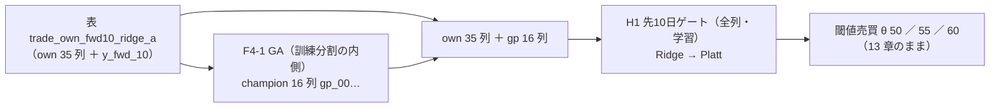
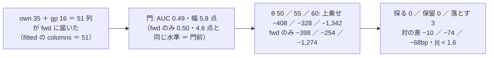
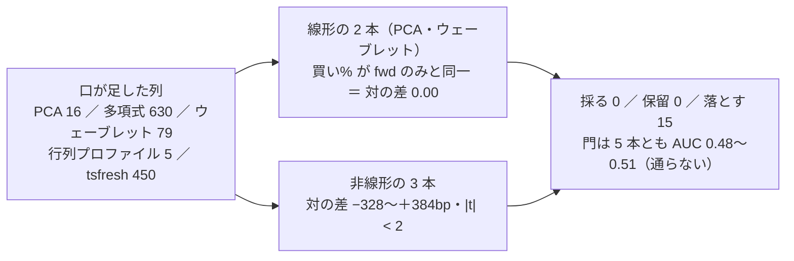
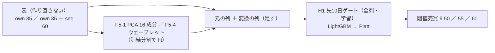

# 変換を検知器に通す口 — 6 変換 × 先 10 日の門（机上。§1 GA・§2 残り 5 変換・§3 線形の変換 × LightGBM）

2026-10-09。利用者の問い（2026-09-16）「遺伝的アルゴリズムは既存のモデル全てに当てはめることはできる？」の残り ＝ ⚠ **検知器 23 本には届かなかった**（[evolutionary-search.md §8](evolutionary-search.md)）を、汎用の口で埋める。利用者決定 2026-10-09 ＝ **A（汎用の口）**「検証の幅が広がる汎用的な方」。規約は [rules.md 24 章](feature-discovery/rules.md)、プランは [transform-into-detectors.md](../../plans/archive/transform-into-detectors.md)。
⚠ **これは投資助言ではなく調査資料である。** ⚠ 数字は【実測】（自前の机上の検証）。⚠ **この結果で実売買の人を替えない**。

## 0. 回す前に決めたこと（⚠ この節は結果を見る前に書いた）

> この図の主張: 変わるのは「検知器の説明変数に GA の列 16 本が足される」ことだけで、検知器・学習器・較正・θ・fold・表は `fwd` × Ridge と同じ。

| 項目 | 中身 |
| --- | --- |
| 口 | `prep.augment`（rules.md 24-1）。訓練分割で標準化 → GA（y ＝ 1 日の `y`・日付は訓練）→ 返った `gp_00`〜`gp_15` を `tr`・`te` に**足す** → `fwd` が `feats` の全列（35 ＋ 16）を説明変数にする |
| config | `trade_own_fwd10_gp_ridge_a`（`trade_own_fwd10_ridge_a` と `name` ／ `transform` 以外は 1 文字も違わない）。queue `transform_detector` |
| 表 | `features_from = "trade_own_fwd10_ridge_a"`（作り直さない。13-8） |
| GA の水準 | `trade_own_gp_a` と同じ（`evolve.DEFAULTS`。個体 100 ／ 世代 20 ／ k 16 ／ 適合度 pooled ／ 種 0） |
| θ | 50 ／ 55 ／ 60 |
| 数 | ⚠ **＋3（n_trials 798 → 801）**・leak 対照 1 本（数えない） |
| 手法名 ／ 鍵 ／ 予測モデル名 | `F4-1 記号回帰（遺伝的プログラミング） ＋ H1 先10日ゲート（全列・学習）` ／ `F4-1 ＋ H1 先10日ゲート（全列・学習）` ／ `own.f4-1-h1-gate10.ridge.shared`（rules.md 24-2） |
| 対の相手（変換なし） | 既存の実行 `2026-09-27T14-21-10_trade_own_fwd10_ridge_a`（[forward10-target.md §2-1](forward10-target.md)。回し直さない）。GA × Ridge の全部使う `2026-09-16` の行（[evolutionary-search.md §8-2](evolutionary-search.md)）も並べる |
| ⚠ Phase 3 | 残り 5 変換（tsfresh・多項式・PCA・行列プロファイル・ウェーブレット）× `fwd` は **この結果を見てから水準を選ばない**（6 本全部か回さないか。利用者の了承が要る） |

物差し（回す前に書いた）: ① 判定は 13-7 のまま（対 B&H 上乗せの符号・fold の符号）／ ② 対の差（GA あり − `fwd` のみ。bp/fold）と t ／ ③ 保有日率と取引回数の変化（列が 35 → 51 に増えた影響）。

予想【推測】（rules.md 24-3）: 3 行とも「採る」にならない（`fwd` × Ridge は −254〜−1,274bp/fold で 3 行とも落とす・GA × Ridge も 3 行とも落とす）。対の差は §8-3 と同じく向きが揃わない・誤差の中。列が増えるぶん Ridge の過学習が増え、θ 60 の保有日率はさらに落ちうる。leak は跳ねる（`LEAK_fwd_10` は `fwd` に直接届く ＝ 変換の有無によらず）。

## 1. 結果【実測 2026-10-09・titan】（⚠ ここから下は結果を見て書いた）

**答え: GA の列を先 10 日の門に足しても、3 行とも落とす。** 上乗せは −408 ／ −328 ／ −1,342bp/fold（`fwd` のみ −398 ／ −254 ／ −1,274 とほぼ同じ）。対の差（GA あり − `fwd` のみ）は 3 θ とも負で \|t\| < 1.6 ＝ 誤差の中。⚠ **列を 35 → 51 に増やしても検知器の出力はほとんど動かない**（的中率 0.5185 対 0.5182・IC −0.0033 対 −0.0026）。n_trials 798 → **801**。

> この図の主張: 変換の列は届いたが（説明変数 51 本・式は訓練の内側で選ばれた）、門も検証も `fwd` のみと同じ答えを出した。

### 1-0. ⚠ 1 回目の実行は口の穴で leak と同じ値になった（回し直した）

| 実行 | 何が起きたか | 処置 |
| --- | --- | --- |
| `2026-10-09T11-27-40_trade_own_fwd10_gp_ridge_a`（＋ `11-27-53_…_leak`） | 上乗せ **＋7,196bp・t 12.6・5/5 fold・DSR 1.0**（leak 対照と同じ値）。原因: 本物の表の `feats` は `META_COLUMNS` だけを外すので **学習の対象 `y_fwd_10` が残っている**（検知器 `fwd` が自分で接頭辞を外す前提）。口はそれをそのまま GA に渡し、8 本の式のうち 6 本に `y_fwd_10` が入った。⚠ テストの表は `contracts.feature_columns` で meta を外していたので見えなかった。⚠ `k = 16` の書き忘れもあった（champion が 8 本） | `prep.augment` の入力を `contracts.is_meta` で外す（rules.md 24-1 の 2）・config に `k = 16`・テスト `test_the_label_never_reaches_the_transform`（`cli/run.py` と同じ作り方の `feats` で式に `y_fwd_` が出ないこと。meta を外さないと落ちることを確かめた）→ `cli.queue --restart` |
| `2026-10-09T11-31-10_trade_own_fwd10_gp_ridge_a`（＋ `11-31-24_…_leak`） | **この節の結果** | — |

⚠ **1 回目の実行は DB に残る**（閉じた実行は消せない・1 実行 1 記録）。検証結果一覧では同じ識別項目の 2 実行としてまとまり、代表は新しい方で、「再現」の列に **⚠ 2 実行・幅 7,536〜8,560bp** の印が付く ＝ **この幅は再現の失敗ではなく、1 回目が配線の穴だったことの跡**。n_trials は識別項目の数なので 1 回目を入れても ＋3 のまま。

### 1-1. 判定（13-7。B&H ＋1,666.42bp/fold ＝ `fwd` の 3 表と同じ値で一致）

| θ | 純利bp/fold | 上乗せ | t | fold の符号 | 取引/fold | 保有日率 | 対 乱択 | DSR | 判定 |
| ---: | ---: | ---: | ---: | :-: | ---: | ---: | ---: | ---: | --- |
| 50 | ＋1,258.21 | **−408.21** | −1.55 | 2/5 −＋−＋− | 502.0 | 0.819 | −266 | 0.057 | 落とす |
| 55 | ＋1,338.50 | **−327.92** | −1.31 | 1/5 −−−−＋ | 88.2 | 0.749 | −108 | 0.084 | 落とす |
| 60 | ＋324.00 | **−1,342.42** | −4.95 | 0/5 −−−−− | 50.4 | 0.383 | −317 | 0.004 | 落とす |

門（診断・門前でも回す）: AUC 0.4896（fold 0.450 ／ 0.506 ／ 0.504 ／ 0.484 ／ 0.490）・買い% の幅 5.8 点 ＝ 通らない（`fwd` のみも通らなかった）。⚠ DSR は SR > 0 の検定で、採否に使わない。

### 1-2. 対の差（GA あり − `fwd` のみ。同じ表・同じ fold・同じ θ ＝ 違いは説明変数に gp 16 列が足されたことだけ）

| θ | `fwd` のみ | GA ＋ `fwd` | 差 | t | fold ごとの差 | 本数 |
| ---: | ---: | ---: | ---: | ---: | --- | --- |
| 50 | ＋1,268.65 | ＋1,258.21 | **−10.45** | −0.92 | −53 ／ ＋8 ／ −2 ／ −13 ／ ＋8 | 35 → 51 |
| 55 | ＋1,412.92 | ＋1,338.50 | **−74.42** | −1.52 | ＋16 ／ 0 ／ −148 ／ −9 ／ −231 | 〃 |
| 60 | ＋392.46 | ＋324.00 | **−68.46** | −1.12 | −51 ／ ＋17 ／ ＋18 ／ −20 ／ −307 | 〃 |

⚠ **3 θ とも負だが誤差の中**（fold の符号は 2〜3/5）。§8-3（GA × LightGBM ／ MLP。±30〜390bp・向きが揃わない）と同じ読み。⚠ **予想「θ 60 の保有日率はさらに落ちる」は外れ**（0.386 → 0.383 で変わらない）＝ Ridge は足された 16 列にほとんど重みを置かなかった【推測。係数は見ていない】。参考: GA × Ridge の全部使う（`own_2018`・1 日の y を学ぶ形）は −219 ／ −384 ／ −699bp（[evolutionary-search.md §8-2](evolutionary-search.md)）。

### 1-3. GA の探索（訓練分割の内側・適合度は 1 日の `y`）

| fold | 世代 | 止めた理由 | 秒 | 最良の適合度 | champion | `own_dow` を含む式 |
| ---: | ---: | --- | ---: | ---: | ---: | ---: |
| 1 | 18 | 改善が止まった | 0.2 | 0.2835 | 16 | 15/16 |
| 2 | 8 | 改善が止まった | 0.2 | 0.1303 | 16 | 4/16 |
| 3 | 20 | 世代の上限 | 0.8 | 0.1849 | 16 | 16/16 |
| 4 | 20 | 世代の上限 | 1.0 | 0.1494 | 15 | 13/15 |
| 5 | 7 | 改善が止まった | 0.5 | 0.0625 | 16 | 0/16 |

⚠ **式と適合度の SHA-256 は `2f11303c…` で、GA × Ridge（`own_2018`）の `b090ba7d…` と違う** ＝ 表の尻が 10 本短く（`y_fwd_10` のぶん）fold の切れ目と訓練の行が違うので、探索の答えも違う（⚠ 同じ表なら同じ答えになる ＝ §8-1）。⚠ **曜日（`own_dow`）は今回も 4 fold で champion の大半に入った**（[§9](evolutionary-search.md) と同じ癖。pooled の適合度のまま）。

### 1-4. 検算

| # | 見たもの | 結果 |
| ---: | --- | --- |
| 1 | ⚠ **leak 対照** | ✅ **跳ねた**（＋7,195〜7,205bp・t 12.6・5/5・的中率 0.6012）。⚠ `fwd` のみの leak 対照（2026-09-27）と**同じ値** ＝ `LEAK_fwd_10` は検知器に直接届くので変換の有無で変わらない。口の側の leak 検査は「式の材料に `LEAK_` が出る」こと（`tests/test_transform_detector.py`）。⚠ 検証結果一覧の「先読みの列を拾わなかった」の印は 的中率 < 0.9 の機械的な判定で、10 日のラベルを 1 日の的中率で見るとそうなる（fwd の 3 表とも 0.60。2026-09-27 と同じ） |
| 2 | 指紋 | ✅ `tests/test_trading_run.py::test_default_path_fingerprint_is_unchanged`・`tests/test_predict.py`（10 件）・`fwd` の指紋 `tests/fixtures/fwd_fingerprint.json` ＝ **`transform` の無い config は 1 ビットも変わらない** |
| 3 | `n_trials` | ✅ **798 → 801**（事前登録どおり ＋3）。落とす 662 → 665・保留 136 のまま。leak 対照は数えない |
| 4 | 識別項目 | ✅ 鍵 `F4-1 ＋ H1 先10日ゲート（全列・学習）`（既存の GA × Ridge の行 `F4-1` と割れている）・予測モデル名 `own.f4-1-h1-gate10.ridge.shared`・系統 F4 生成型 |
| 5 | 既存の行 | ✅ 数字が変わった手法の行 0・消えた行 0（`git diff` は頭の数・足した 3 行・基準線の代表の実行〔表の尻が違う ＝ howto 1-6 の注記どおり〕・leak の節だけ） |
| 6 | B&H | ✅ ＋1,666.42bp ＝ `fwd` の own 表と一致 |
| 7 | 口が足した列 | ✅ 検知器の `columns` ＝ 51（fold 4 は 50。champion が 15 本） |

### 1-5. かかった時間【実測】と次にしないこと

- 本番 14.0 秒・leak 12.6 秒（GA は 1 fold 0.2〜1.0 秒）。1 回目の穴を含めても全体で 1 分。
- ⚠ **この結果で θ・水準・検知器を足さない**（14-10 の「緩めないもの」）。⚠ **Phase 3（残り 5 変換 × `fwd`）は利用者の了承の後に、6 本全部か回さないか**（この結果で水準を選ばない）。
- ⚠ 口が届くのは `fwd` だけ（rules.md 24-1 の 4）。窓固定・配列・接頭辞の検知器に広げるのは別の処置。

## 2. Phase 3 — 残り 5 変換 × 先 10 日の門（⚠ §2-0 は回す前に書いた。2026-10-09 利用者「進めて」）

### 2-0. 事前固定

水準・費用・対の相手は [プラン §3](../../plans/archive/transform-into-detectors.md)（5 本全部。変換の水準は元の実行のまま・検知器と θ は §0 と同じ）。数は **5 × θ 3 ＝ ＋15（n_trials 801 → 816）**・leak 対照 5 本。queue `transform_detector3`。

| 変換 | config | 表 | 足す列 |
| --- | --- | --- | ---: |
| F5-1 PCA | `trade_own_fwd10_pca_ridge_a` | own 35 | 16 |
| F4-4 多項式 | `trade_own_fwd10_poly_ridge_a` | own 35 | 630 |
| F5-4 ウェーブレット | `trade_ownseq_fwd10_wave_ridge_a` | own 35 ＋ seq 60 | 係数 |
| F5-3 行列プロファイル | `trade_ownseq_fwd10_mp_ridge_a` | 〃 | 5 |
| F4-3 tsfresh | `trade_ownseq_fwd10_tsf_ridge_a` | 〃 | ≤ 783 |

⚠ 元の実行と違う点（口の規則）: 生の窓 60 列が残る（F4-3 ／ F5-3 ／ F5-4）・F4-3 は選別で絞らない。物差しは §0 と同じ（判定 13-7 ／ 対の差 ／ 保有日率と取引回数）。予想【推測】: 15 行とも採らない・列数の大きい F4-3 ／ F4-4 は対の差が負に寄る・leak は 5 本とも跳ねる。

### 2-1. 結果【実測 2026-10-09・titan】（⚠ ここから下は結果を見て書いた）

**答え: 5 変換 × θ 3 ＝ 15 行とも落とす**（採る 0 ／ 保留 0）。n_trials 801 → **816**。上乗せは全部負（−136〜−1,289bp/fold）で `fwd` のみ（own −398 ／ −254 ／ −1,274・own seq −520 ／ −346 ／ −1,217）と同じ水準。⚠ **線形の変換 2 本（PCA・ウェーブレット）は `fwd` のみと全銘柄・全 fold で買い% が 1 ビットも同じ**（§2-3）。非線形の 3 本（多項式・行列プロファイル・tsfresh）は変わったが、対の差は全部 \|t\| < 2 ＝ 誤差の中。

> この図の主張: 列は届いた（51〜665 本）が、門も判定も `fwd` のみと同じ答えで、線形の 2 本は答えそのものが同じだった。

| 変換（＋ H1 先10日ゲート） | 表 | θ | 純利bp/fold | 上乗せ | t | fold の符号 | 取引/fold | 保有日率 | 対 乱択 | DSR | 判定 |
| --- | --- | ---: | ---: | ---: | ---: | :-: | ---: | ---: | ---: | ---: | --- |
| F5-1 PCA（16 列） | own | 50 | ＋1,268.65 | **−397.77** | −1.56 | 2/5 −＋−＋− | 445.4 | 0.812 | −245 | 0.066 | 落とす |
| 〃 | 〃 | 55 | ＋1,412.92 | **−253.50** | −0.94 | 1/5 −−−−＋ | 91.0 | 0.754 | −53 | 0.108 | 落とす |
| 〃 | 〃 | 60 | ＋392.46 | **−1,273.95** | −5.71 | 0/5 −−−−− | 55.4 | 0.386 | −282 | 0.006 | 落とす |
| F4-4 多項式（630 列） | own | 50 | ＋1,394.92 | **−271.49** | −1.53 | 1/5 −＋−0− | 125.2 | 0.794 | −145 | 0.061 | 落とす |
| 〃 | 〃 | 55 | ＋1,084.62 | **−581.80** | −2.17 | 1/5 −＋−−− | 64.8 | 0.614 | −111 | 0.038 | 落とす |
| 〃 | 〃 | 60 | ＋377.01 | **−1,289.41** | −3.39 | 0/5 −−−−− | 37.6 | 0.352 | −229 | 0.004 | 落とす |
| F5-4 ウェーブレット（79 列） | own seq | 50 | ＋1,146.40 | **−520.02** | −1.66 | 0/5 −−−−− | 552.8 | 0.800 | −340 | 0.043 | 落とす |
| 〃 | 〃 | 55 | ＋1,320.62 | **−345.80** | −1.20 | 2/5 −0−＋＋ | 103.4 | 0.776 | −196 | 0.072 | 落とす |
| 〃 | 〃 | 60 | ＋449.27 | **−1,217.15** | −8.56 | 0/5 −−−−− | 58.8 | 0.382 | −354 | 0.008 | 落とす |
| F5-3 行列プロファイル（5 列） | own seq | 50 | ＋1,161.24 | **−505.18** | −1.67 | 0/5 −−−−− | 544.6 | 0.795 | −321 | 0.046 | 落とす |
| 〃 | 〃 | 55 | ＋1,299.22 | **−367.20** | −1.24 | 1/5 −0−−＋ | 106.2 | 0.777 | −188 | 0.070 | 落とす |
| 〃 | 〃 | 60 | ＋526.42 | **−1,140.00** | −8.49 | 0/5 −−−−− | 62.6 | 0.412 | −324 | 0.010 | 落とす |
| F4-3 tsfresh（450 列） | own seq | 50 | ＋1,530.11 | **−136.30** | −0.90 | 2/5 00−＋＋ | 67.6 | 0.798 | ＋16 | 0.067 | 落とす |
| 〃 | 〃 | 55 | ＋1,439.11 | **−227.31** | −1.46 | 1/5 00−＋− | 48.0 | 0.714 | ＋107 | 0.066 | 落とす |
| 〃 | 〃 | 60 | ＋630.94 | **−1,035.48** | −2.67 | 0/5 0−−−− | 15.0 | 0.221 | ＋3 | 0.012 | 落とす |

B&H は 5 本とも ＋1,666.42bp/fold（`fwd` の 2 表と一致）。門（診断・門前でも回す）: AUC は PCA 0.496 ／ 多項式 0.510 ／ ウェーブレット 0.487 ／ 行列プロファイル 0.485 ／ tsfresh 0.493・買い% の幅 1.3〜7.1 点 ＝ 5 本とも通らない。⚠ DSR は SR > 0 の検定で、採否に使わない。⚠ tsfresh の fold の符号「0」は上乗せが 0 ＝ その fold の損益が B&H と同じ（買い% がずっと θ の上にあって持ち続けた【推測。買い% の分布は見ていない】）。

### 2-2. 対の差（変換あり − `fwd` のみ。同じ表・同じ fold・同じ θ ＝ 違いは口が足した列だけ）

| 変換 | θ | `fwd` のみ | 変換あり | 差 | t | fold ごとの差 | 本数 |
| --- | ---: | ---: | ---: | ---: | ---: | --- | --- |
| F5-1 PCA | 50 ／ 55 ／ 60 | ＋1,268.65 ／ ＋1,412.92 ／ ＋392.46 | 同じ | **0.00** | — | 0 ／ 0 ／ 0 ／ 0 ／ 0（3 θ とも） | 35 → 51 |
| F4-4 多項式 | 50 | ＋1,268.65 | ＋1,394.92 | **＋126.27** | ＋1.53 | ＋431 ／ ＋41 ／ ＋168 ／ −18 ／ ＋9 | 35 → 665 |
| 〃 | 55 | ＋1,412.92 | ＋1,084.62 | **−328.30** | −0.83 | ＋191 ／ ＋46 ／ ＋7 ／ ＋19 ／ **−1,905** | 〃 |
| 〃 | 60 | ＋392.46 | ＋377.01 | **−15.46** | −0.09 | ＋342 ／ ＋345 ／ ＋55 ／ −512 ／ −307 | 〃 |
| F5-4 ウェーブレット | 50 ／ 55 ／ 60 | ＋1,146.40 ／ ＋1,320.62 ／ ＋449.27 | 同じ | **0.00** | — | 0 ／ 0 ／ 0 ／ 0 ／ 0（3 θ とも） | 95 → 174 |
| F5-3 行列プロファイル | 50 | ＋1,146.40 | ＋1,161.24 | **＋14.85** | ＋1.00 | ＋50 ／ ＋13 ／ ＋45 ／ −8 ／ −26 | 95 → 100 |
| 〃 | 55 | ＋1,320.62 | ＋1,299.22 | **−21.40** | −1.05 | −76 ／ 0 ／ ＋33 ／ −62 ／ −2 | 〃 |
| 〃 | 60 | ＋449.27 | ＋526.42 | **＋77.15** | ＋1.94 | −20 ／ ＋133 ／ −19 ／ ＋132 ／ ＋159 | 〃 |
| F4-3 tsfresh | 50 | ＋1,146.40 | ＋1,530.11 | **＋383.72** | ＋1.15 | **＋1,706** ／ ＋46 ／ −133 ／ ＋209 ／ ＋91 | 95 → 545 |
| 〃 | 55 | ＋1,320.62 | ＋1,439.11 | **＋118.50** | ＋0.36 | **＋1,323** ／ 0 ／ −68 ／ ＋39 ／ −701 | 〃 |
| 〃 | 60 | ＋449.27 | ＋630.94 | **＋181.67** | ＋0.44 | **＋1,501** ／ ＋516 ／ −8 ／ −1,015 ／ −85 | 〃 |

読み方（⚠ 採否には使わない）:

- ⚠ **tsfresh の正の差は 3 θ とも最初の fold 1 つから来ている**（＋1,323〜＋1,706。残り 4 fold は ±1,015 で向きが割れる）＝ fold 1 で `fwd` のみが売った時期を tsfresh 付きは持ち続けた、というだけ。θ 60 では取引が 62.6 → 15.0 回・保有日率 0.382 → 0.221 と動きが減った。t は 0.4〜1.2。
- ⚠ **多項式の θ 55 の −328 も fold 5 の −1,905 が 1 つ**で決まっている（残り 4 fold は全部正）。θ ごとに向きが揃わない（＋126 ／ −328 ／ −15）。
- 行列プロファイルは 5 列しか足さず、差は ±77bp 以内。
- ⚠ **予想の答え合わせ**: 「15 行とも採らない」✅ ／ 「列数の大きい F4-3 ／ F4-4 は過学習で対の差が負に寄る」❌（tsfresh は 3 θ とも正・多項式は割れる。ただし全部誤差の中）／ 「leak は 5 本とも跳ねる」✅（§2-4）。

### 2-3. ⚠ 線形の変換（PCA・ウェーブレット）は `fwd` × Ridge の答えを 1 ビットも変えない

PCA の 16 列・ウェーブレットの 79 列を足した実行は、`fwd` のみの実行（2026-09-27）と **全銘柄・全 fold・全 θ で買い% が同一**（`per_symbol` の最大の差 0.0・取引回数・保有日率・的中率・IC まで同じ）。

理由【推測。係数は見ていない】: 2 本とも**入力の列の線形結合**（PCA ＝ 標準化した own 35 列の回転・ウェーブレット ＝ 窓 60 列の直交変換）なので、足しても説明変数が張る空間が変わらない。学習器 Ridge（`alpha = 1.0`。`ail/models/linear.py`）は訓練 10 万行超に対して罰則がほぼ効かず OLS と同じ ＝ 同じ空間なら同じ予測を返す。較正（Platt）と θ の丸めが浮動小数の差を消す。

⚠ **次に効くこと**: 線形の変換 × 線形の学習器の組は、この口では**何も試していないのと同じ**（n_trials には数える ＝ 回したので）。線形の変換を検知器で試すなら、非線形の学習器（LightGBM ／ MLP）か「置き換える」口（元の列を落とす ＝ 別の処置）が要る。⚠ この結果で LightGBM の水準を足さない（結果を見てからの追加 ＝ 14-10）。

### 2-4. 検算

| # | 見たもの | 結果 |
| ---: | --- | --- |
| 1 | ⚠ **leak 対照** | ✅ **5 本とも跳ねた**（＋7,194〜7,206bp・t 12.5・5/5・的中率 0.6012）。`fwd` のみの leak 対照と同じ値（`LEAK_fwd_10` は検知器に直接届く ＝ §1-4 の 1 と同じ読み） |
| 2 | `n_trials` | ✅ **801 → 816**（事前登録どおり ＋15）。落とす 665 → 680・保留 136 のまま。leak 対照は数えない |
| 3 | 識別項目 | ✅ 鍵は 5 本とも `<ID> ＋ H1 先10日ゲート（全列・学習）`（`F5-1`・`F4-4`・`F5-4`・`F5-3`・`F4-3`）で既存の `<ID> × Ridge` の行と割れている。「再現」列は 15 行とも「—」（1 実行ずつ） |
| 4 | 既存の行 | ✅ 数字が変わった手法の行 0・消えた行 0（`git diff` は頭の数・足した 15 行・基準線の代表の実行・leak の節だけ） |
| 5 | B&H | ✅ 5 本とも ＋1,666.42bp ＝ `fwd` の own ／ own seq 表と一致 |
| 6 | 口が足した列 | ✅ `_transform["口"]` ＝ PCA 16（通したまま 0）／ 多項式 630（通したまま 35）／ ウェーブレット 79（35）／ 行列プロファイル 5（35）／ tsfresh 450（35。生成 783 → 全部 NaN 277・定数 56 を落とす）。検知器の `columns` ＝ 51 ／ 665 ／ 174 ／ 100 ／ 545 |
| 7 | 線形 2 本の同一性 | ✅ `per_symbol` を `fwd` のみの実行と突き合わせて最大の差 0.0（§2-3） |
| 8 | tsfresh の NaN | ⚠ 訓練分割で NaN・inf を 6,065,834 個、検証分割で 1,284 個埋めた（元の実行と同じ処理 ＝ `_transform` に記録） |
| 9 | コードの版 | ⚠ 検証結果一覧の「コード」が PCA ＝ `0664095`・多項式 ＝ `60a2c4a`（rebase 前の同じ内容）・残り 3 本 ＝ `275985c`。queue を回しながらコミット・push したため。**作業ツリーは 10 本とも同じ**（口の規則「通したままの列は足さない」は回す前に入れてある） |

### 2-5. かかった時間【実測】と次にしないこと

| 変換 | 本番 | leak | 元の実行（選別 × モデルの経路） |
| --- | ---: | ---: | ---: |
| PCA | 9.7 秒 | 9.8 秒 | 数秒〜数十秒 |
| 多項式 | 26.4 秒 | 31.9 秒 | 数十秒 |
| ウェーブレット | 12.7 秒 | 13.3 秒 | 数十秒 |
| 行列プロファイル | 110.5 秒 | 109.5 秒 | 112 秒 |
| tsfresh | **2,522.4 秒**（42 分） | 2,556.5 秒 | 3,634 秒 |

queue 全体で約 90 分（11:59〜13:30 PDT）。メモリは測っていない（落ちなかった）。

- ⚠ **この結果で θ・水準・検知器・学習器を足さない**（14-10）。線形の変換 × 非線形の学習器は「試すなら新しい処置として先に登録」（§2-3）。
- ⚠ 口が届くのは `fwd` だけのまま（rules.md 24-1 の 4）。
- Phase 4（デプロイ）は利用者の「デプロイ」の言葉で。`cli/run.py` は 13500t の毎日の予測の経路なので、`transform` の無い config が 1 ビットも変わらないことは指紋テスト 3 本で固定してある。
  - ✅ 2026-10-09 14:15 PDT（17:15 ET）: 利用者が `./run-deploy.sh` ＝ 関門 ✅（執行器 202 passed ／ 管理画面 266 passed ／ 指紋 22 passed）→ `prod` cafd762 → **2aea697**・13500t `done 2aea697`（管理画面のコンテナ起こし直し）。⚠ 分類器が Claude の実行を止めたので、関門の `--dry-run` だけ Claude（Sx360）が先に流し、本番は利用者が流した。プランは [archive](../../plans/archive/transform-into-detectors.md) へ

## 3. 線形の変換（PCA・ウェーブレット）× 先 10 日の門 × LightGBM（⚠ §3-0 は回す前に書いた。2026-10-18 利用者「1 で進めて」）

### 3-0. 事前固定

⚠ **この処置は §2-3 の結果を見た後に登録した**（PCA・ウェーブレットは `fwd` × Ridge の買い% を 1 ビットも変えなかった ＝ 線形 × 線形の組は「何も試していないのと同じ」）。§2-3 が残した道「試すなら非線形の学習器か『置き換える』口を新しい処置として先に登録する」のうち、**非線形の学習器のほう**だけを登録する。⚠ 学習器は既存の `fwd` × LightGBM（[forward10-target.md](forward10-target.md) §2-1・§2-3）をそのまま使い、**水準を足さない**（§2-5「学習器を足さない」は、結果を見て LightGBM の水準や候補を足すことを止めたもの。ここで足すのは変換の水準ではなく、学習器だけを替えた新しい組 2 本）。「置き換える」口は登録しない（コードの直しが要る ＝ 別の処置）。

> この図の主張: §2 の 2 本から変わるのは学習器（Ridge → LightGBM）だけで、変換の水準・表・検知器・θ・fold は同じ。対の相手は変換なしの `fwd` × LightGBM（既存の実行）。

| 変換 | config | 表（`features_from`） | 足す列 | 対の相手（変換なし・回し直さない） |
| --- | --- | --- | ---: | --- |
| F5-1 PCA（16 成分） | `trade_own_fwd10_pca_lgbm_a` | `trade_own_fwd10_ridge_a`（own 35） | 16 | `2026-09-27T14-21-25_trade_own_fwd10_lgbm_a` |
| F5-4 ウェーブレット（db4・レベル 3） | `trade_ownseq_fwd10_wave_lgbm_a` | `trade_ownseq_fwd10_ridge_a`（own 35 ＋ seq 60） | 79 | `2026-09-27T14-23-09_trade_ownseq_fwd10_lgbm_a` |

| 項目 | 中身 |
| --- | --- |
| config | 対の相手の config と `name` ／ `transform` ／ `k` 以外は 1 文字も違わない（表・fold・θ・LightGBM の水準〔葉 31・学習率 0.05・最小標本 100・列の抽出 0.8・木 500 ＋ 早期打ち切り 30〕・種 0・コスト 5bp・パージ 15 日）。queue `transform_detector_lgbm` |
| 数 | ⚠ **2 × θ 3 ＝ ＋6（n_trials 834 → 840）**・leak 対照 2 本（数えない）。⚠ **2 本全部か回さないか**（片方の結果を見てもう片方を決めない） |
| 識別項目 | 手法名「変換名 ＋ H1 先10日ゲート（全列・学習）」・鍵「ID ＋ 検知器名」（24-2）。§2 の Ridge の行とは列「モデル」が違う ＝ 別の行 |
| 物差し | ① 判定は 13-7（対 B&H。B&H ＋1,666bp/fold）／ ② 対の差（変換あり − なし。同じ表・同じ fold・同じ θ・日次の純利 bp）と t ／ ③ 保有日率と取引回数 ／ ④ 買い% が変換なしと bit で同じかどうか |
| 費用【推測】 | 合計 1〜2 分（`fwd` × LightGBM 9〜14 秒・leak 15〜28 秒・PCA ／ ウェーブレット × Ridge 8〜11 秒 ＝ 2026-09-27・10-09 の実測）。titan で回す |

対の相手の値【実測。forward10-target.md】: own × LightGBM の上乗せ −223 ／ −110 ／ −877bp/fold（θ 50 ／ 55 ／ 60。3 行とも落とす）・ownseq × LightGBM −218 ／ −126 ／ −287（3 行とも落とす）。

| # | 予想【推測。回す前】 | 読み方 |
| ---: | --- | --- |
| 1 | **採る 0 ／ 6** | 対の相手が 6 行とも落とす（上乗せ −110〜−877bp/fold）。足すのは元の列の線形結合だけ |
| 2 | 買い% は変換なしと**違う**（Ridge と違って 0.00 にならない） | 木は軸に沿って分けるので、回した軸（主成分・ウェーブレット係数）では分け方が変わる。⚠ **加えて、列の抽出 0.8 の乱数が列の数で変わる** ＝ 新しい列に情報が無くても予測は動く |
| 3 | 対の差は θ ごとに向きが揃わず \|t\| < 2 | §2-2 の非線形の 3 本と同じ形（正の差があっても 1 つの fold から来る） |
| 4 | leak は 2 本とも跳ねる | `LEAK_fwd_10` は `fwd` に直接届く（変換の有無によらない） |

⚠ **示せないもの**: 「変換が効いた ／ 効かなかった」。予想 2 のとおり、列が増えると列の抽出の乱数が変わるので、**対の差の中で「変換の列の情報」と「乱数の引き直し」を分けられない**（分けるなら同じ数の雑音の列を足す対照が要る ＝ 別の処置。今回は登録しない）。示せるのは 採否・対の差の大きさが §2-2 の非線形の 3 本や種の揺れと比べてどの程度か・買い% が動いたかどうか。

⚠ **次に何をしないか**（回す前に書いた）: 結果を見て LightGBM の水準を動かさない・MLP を足さない・θ を足さない・雑音の列の対照を足して回し直さない（足すなら新しい処置として先に登録）・この結果で実売買の人を替えない。

### 3-1. 結果【実測 2026-10-18・titan】（⚠ ここから下は結果を見て書いた）

**答え: 学習器を LightGBM にすると、線形の変換の列は検知器の答えを変えた。ただし 6 行とも落とす（予想 1 どおり）。** n_trials 834 → **840**。上乗せは 6 行とも変換なしより悪いか同じ程度で、良くなった 1 行（PCA θ 60）も 1 つの fold から来ている。leak 2 本とも跳ねた。

| 変換 | θ | 純利 | 上乗せ（対 B&H ＋1,666.42） | fold の符号 | 取引 ／ fold | 保有日率 | 判定 |
| --- | ---: | ---: | ---: | --- | ---: | ---: | --- |
| F5-1 PCA | 50 | ＋1,262.28 | −404.14 | 0/5 −0−−− | 282.0 | 0.765 | 落とす |
| 〃 | 55 | ＋1,125.97 | −540.45 | 1/5 −0−−＋ | 98.8 | 0.612 | 落とす |
| 〃 | 60 | ＋1,026.48 | −639.94 | 2/5 ＋−−−＋ | 46.2 | 0.366 | 落とす |
| F5-4 ウェーブレット | 50 | ＋1,357.33 | −309.09 | 0/5 00−−− | 364.0 | 0.733 | 落とす |
| 〃 | 55 | ＋1,388.74 | −277.67 | 1/5 00−−＋ | 94.0 | 0.668 | 落とす |
| 〃 | 60 | ＋1,039.90 | −626.52 | 1/5 0−−−＋ | 36.6 | 0.369 | 落とす |

IC（fold の平均）: PCA −0.0023 → ＋0.0022 ／ ウェーブレット −0.0135 → −0.0056（変換なし → あり）。的中率は 2 本とも下がった（0.5201 → 0.5178 ／ 0.5204 → 0.5168）。

### 3-2. 対の差（変換あり − 変換なしの `fwd` × LightGBM。同じ表・同じ fold・同じ θ）

| 変換 | θ | 変換なし | 変換あり | 差 | t | fold ごとの差 | 取引 ／ fold | 保有日率 |
| --- | ---: | ---: | ---: | ---: | ---: | --- | --- | --- |
| F5-1 PCA | 50 | ＋1,443.88 | ＋1,262.28 | **−181.60** | −1.27 | −412 ／ 0 ／ ＋61 ／ ＋72 ／ −629 | 111.4 → 282.0 | 0.793 → 0.765 |
| 〃 | 55 | ＋1,556.23 | ＋1,125.97 | **−430.26** | −1.38 | −214 ／ 0 ／ ＋131 ／ **−1,613** ／ −456 | 59.8 → 98.8 | 0.733 → 0.612 |
| 〃 | 60 | ＋789.28 | ＋1,026.48 | **＋237.20** | ＋0.76 | ＋9 ／ 0 ／ ＋93 ／ −363 ／ **＋1,446** | 20.4 → 46.2 | 0.281 → 0.366 |
| F5-4 ウェーブレット | 50 | ＋1,448.69 | ＋1,357.33 | **−91.36** | −1.52 | 0 ／ 0 ／ −114 ／ −317 ／ −26 | 184.0 → 364.0 | 0.793 → 0.733 |
| 〃 | 55 | ＋1,540.19 | ＋1,388.74 | **−151.44** | −1.07 | 0 ／ 0 ／ −165 ／ −690 ／ ＋98 | 116.2 → 94.0 | 0.794 → 0.668 |
| 〃 | 60 | ＋1,379.21 | ＋1,039.90 | **−339.31** | −0.80 | ＋1 ／ 0 ／ −723 ／ **−1,753** ／ ＋778 | 55.2 → 36.6 | 0.561 → 0.369 |

t は fold ごとの差 5 つの平均 ÷ 標準誤差（§2-2 と同じ）。

読み方（⚠ 採否には使わない）:

- ⚠ **Ridge と違い、買い% は動いた**（差が 0.00 ではない）。差が 0 の fold は、変換なし・ありとも全部の日で持ち続けた fold（fold の符号の 0 ＝ B&H と同じ）。
- ⚠ **差の多くは 1 つの fold で決まる**（PCA θ 55 の fold 4 −1,613・θ 60 の fold 5 ＋1,446・ウェーブレット θ 60 の fold 4 −1,753）。\|t\| は 6 対とも 1.6 未満。
- ⚠ **ウェーブレットは 3 θ とも負**（−91 ／ −151 ／ −339）。PCA は割れた（−182 ／ −430 ／ ＋237）。
- 取引の回数は PCA で 3 θ とも増えた（θ 50 で 2.5 倍）。ウェーブレットは θ 50 で倍・θ 55 ／ 60 で減った。保有日率は 6 対のうち 5 対で下がった。
- ⚠ **「変換の列に情報があった」とは読まない**（§3-0 の「示せないもの」＝ 列の抽出 0.8 の乱数が列の数で変わる。同じ数の雑音の列の対照は置いていない）。

予想の答え合わせ（§3-0）: 1「採る 0 ／ 6」✅ ／ 2「買い% は変換なしと違う」✅ ／ 3「向きが揃わず \|t\| < 2」△（\|t\| < 2 は ✅・ウェーブレットは 3 θ とも負で向きが揃った）／ 4「leak は跳ねる」✅。

### 3-3. 検算

| 項目 | 値 |
| --- | --- |
| n_trials | 834 → **840**（＋6 ＝ 2 × θ 3。`ledger.md`・DB の `ledger_rows` を吐き直した。titan `6833fd0`） |
| B&H | 2 本とも ＋1,666.42bp/fold（§1-1・§2 と同じ値） |
| 対の相手の値 | 上乗せ −222.54 ／ −110.19 ／ −877.14（own）・−217.73 ／ −126.23 ／ −287.21（ownseq）＝ [forward10-target.md](forward10-target.md) §2-1・§2-3 と同じ（同じ実行を読んだ） |
| leak 対照 | PCA ＋8,857〜＋8,867bp・ウェーブレット ＋8,946〜＋8,954bp（的中率 0.60・IC 0.23）＝ 2 本とも跳ねた |
| 識別項目 | 手法名「`F5-1 PCA ＋ H1 先10日ゲート（全列・学習）`」ほか・列「モデル」＝ LightGBM ＝ §2 の Ridge の行とは別の行（検証結果一覧で 6 行増えた） |
| 実行の版 | 4 本とも `247dd82`（事前の登録のコミット）・入力の指紋 `81ade06ba58c8e42` |

⚠ 検証結果一覧の基準線の行（数えない）の値が一部替わった（own の「常に上」0.5216 ／ ＋1,657.02 → 0.5222 ／ ＋1,671.42 など）。同じ識別項目の基準線を代表する実行が今回の実行に替わったため【推測。`catalog` の選び方は確かめていない】。手法の行と n_trials には効かない。

### 3-4. かかった時間【実測】と次にしないこと

| 変換 | 本番 | leak |
| --- | ---: | ---: |
| PCA | 12.7 秒 | 28.6 秒 |
| ウェーブレット | 22.7 秒 | 45.6 秒 |

queue 全体で 1 分 50 秒（2026-10-18 15:36〜15:38 PDT・titan）。見積り 1〜2 分【推測】のとおり。

- ⚠ **この結果で LightGBM の水準・θ・学習器（MLP など）を足さない**（§3-0 で回す前に書いたとおり。14-10）
- ⚠ 雑音の列の対照（「情報」と「乱数の引き直し」を分ける）・「置き換える」口は、試すなら新しい処置として先に登録する
- ⚠ コードは直していない ＝ デプロイは要らない（13500t の毎日の予測の経路は動いていない）
- ⚠ この結果で実売買の人を替えない
